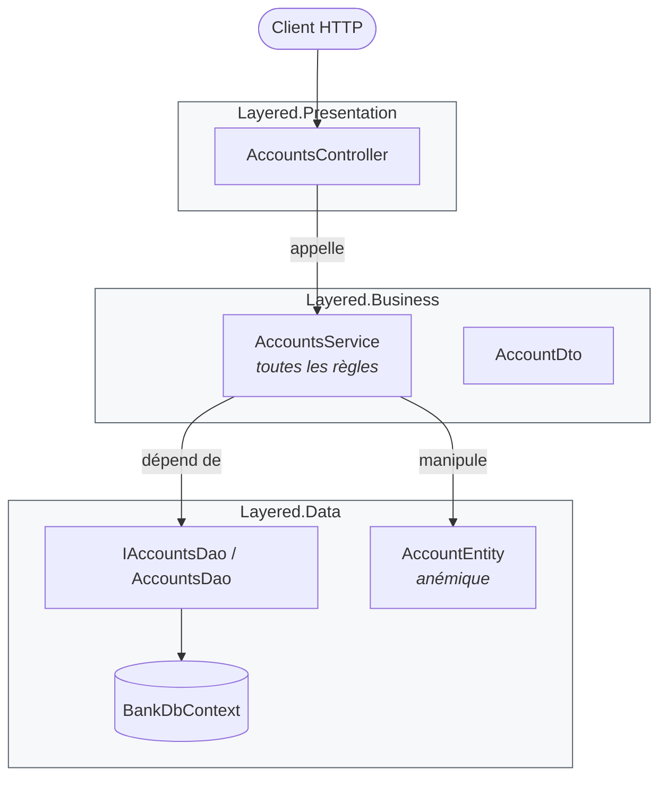
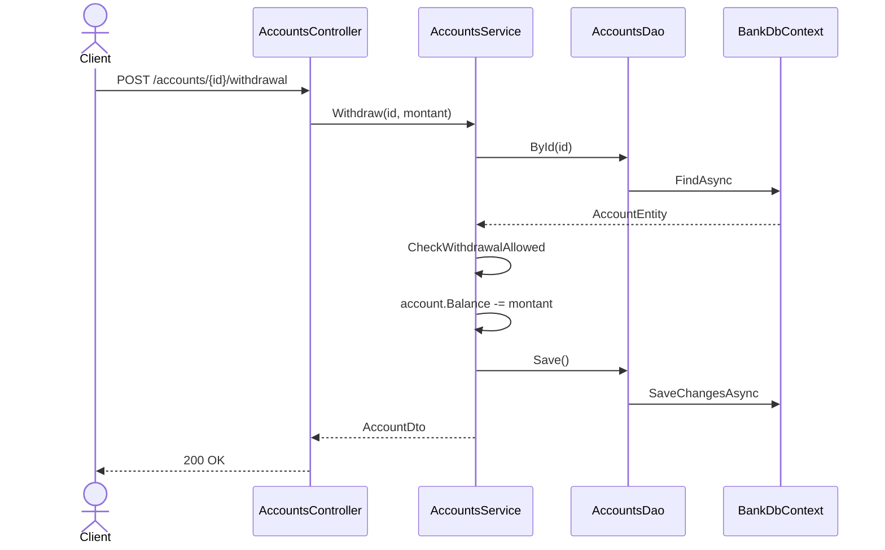
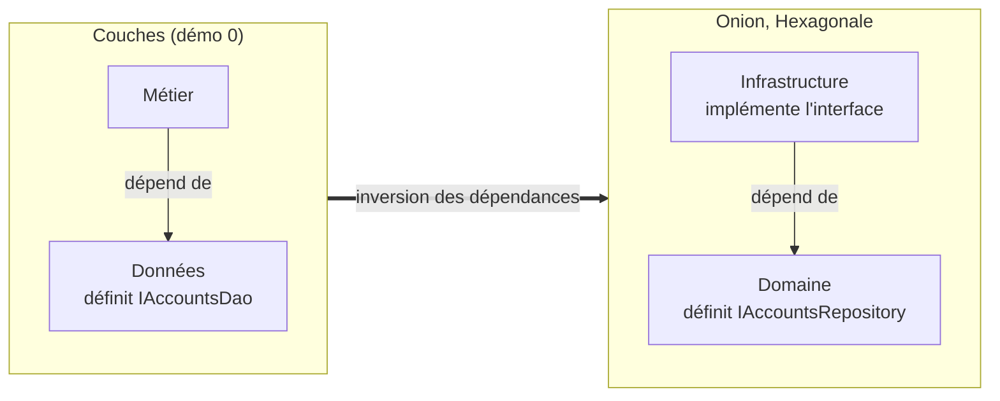

# 0. Architecture en couches (N-tiers)

**Nom anglais** : *Layered Architecture (N-tier)*

> **En une phrase** : on empile des couches techniques — présentation, métier, données — et chaque couche n'appelle
> que celle du dessous.

📁 Code : [`00-Layered`](../00-Layered) · ⬅️ [Sommaire](README.md) · ➡️ [Hexagonale](01-hexagonale.md) · 🌐 [English](en/00-couches.md)

---

## L'idée

C'est l'architecture « par défaut » de la plupart des applications d'entreprise depuis les années 1990, et le point de
comparaison de toutes les autres. Son principe est simple : **séparer les responsabilités techniques**.



**Le point clé : les dépendances descendent jusqu'à la base.** La couche métier *dépend* de la couche données : c'est la
couche données qui définit l'interface `IAccountsDao` et l'entité `AccountEntity`, dans son vocabulaire, et le métier s'y adapte.
C'est exactement ce que les architectures suivantes (Hexagonale, Onion, Clean) vont **inverser**.

---

## Organisation de la solution

| Projet | Rôle | Référence |
|---|---|---|
| `Layered.Data` | Entité, `DbContext`, interface et implémentation du DAO | rien |
| `Layered.Business` | `AccountsService` (règles), DTO, exceptions | `Layered.Data` |
| `Layered.Presentation` | Contrôleurs MVC, `Program.cs` | `Layered.Business` **seulement** |
| `Layered.Tests` | Tests du service et de l'architecture | — |

---

## Le code, pas à pas

### 1. La couche données définit le modèle… et le contrat

L'entité est **anémique** : uniquement des données, avec des setters publics.
([AccountEntity.cs](../00-Layered/Layered.Data/AccountEntity.cs))

```csharp
public class AccountEntity
{
    public Guid Id { get; set; }
    public string Owner { get; set; } = "";
    public decimal Balance { get; set; }
}
```

L'interface d'accès est définie **par la couche données**, dans **son** vocabulaire.
([AccountsDao.cs](../00-Layered/Layered.Data/AccountsDao.cs))

```csharp
// The interface is defined BY the data layer, in ITS vocabulary (AccountEntity).
// Key difference with Onion/Hexagonal: there, the business code defines the interface it needs.
public interface IAccountsDao
{
    Task<AccountEntity?> ById(Guid id);
    Task Add(AccountEntity account);
    Task<bool> IsEmpty();
    Task Save();
}
```

### 2. La couche métier contient toutes les règles (*transaction script*)

Une méthode = un cas d'utilisation, du début à la fin.
([AccountsService.cs](../00-Layered/Layered.Business/AccountsService.cs))

```csharp
public class AccountsService(IAccountsDao dao)
{
    public async Task<AccountDto> Withdraw(Guid id, decimal amount)
    {
        var account = await Load(id);
        CheckWithdrawalAllowed(account, amount);

        account.Balance -= amount;
        await dao.Save();
        return ToDto(account);
    }

    // Since the entity is anemic, nothing stops another class from doing "account.Balance -= x"
    // without going through this check: the rule is protected by discipline alone.
    private static void CheckWithdrawalAllowed(AccountEntity account, decimal amount)
    {
        if (amount <= 0)
            throw new BusinessRuleException("The amount must be strictly positive.");
        if (amount > account.Balance)
            throw new BusinessRuleException("Insufficient balance.");
    }
}
```

### 3. La présentation ne voit que la couche juste en dessous

Un contrôleur MVC classique traduit HTTP ⇄ métier.
([AccountsController.cs](../00-Layered/Layered.Presentation/Controllers/AccountsController.cs))

```csharp
[HttpPost("accounts/{id:guid}/withdrawal")]
public Task<IActionResult> Withdraw(Guid id, WithdrawalRequest request) =>
    Execute(async () => Ok(await accounts.Withdraw(id, request.Amount)));
```

Les **couches strictes** sont imposées par le compilateur : sans ce réglage, la présentation pourrait utiliser
`BankDbContext` grâce à la référence transitive via `Layered.Business`.
([Layered.Presentation.csproj](../00-Layered/Layered.Presentation/Layered.Presentation.csproj))

```xml
<DisableTransitiveProjectReferences>true</DisableTransitiveProjectReferences>
```

Essayer d'injecter `BankDbContext` dans un contrôleur donne alors `CS0234 : le nom 'Data' n'existe pas`.
C'est la couche métier qui branche elle-même la couche du dessous
([BusinessExtensions.cs](../00-Layered/Layered.Business/BusinessExtensions.cs)) :

```csharp
public static IServiceCollection AddBusinessLayer(this IServiceCollection services, string databaseName = "Bank")
{
    services.AddDataLayer(databaseName);
    services.AddScoped<AccountsService>();
    return services;
}
```

### Le trajet d'un retrait



---

## Les tests

Tester le métier oblige à manipuler la couche données : même le faux DAO renvoie des `AccountEntity`.
**Le test du métier est couplé au schéma de persistance.**
([AccountsServiceTests.cs](../00-Layered/Layered.Tests/AccountsServiceTests.cs))

```csharp
private readonly FakeDao _dao = new(
    new AccountEntity { Id = Alice, Owner = "Alice", Balance = 100m },
    new AccountEntity { Id = Bob, Owner = "Bob", Balance = 0m });
```

Les tests d'architecture vérifient le sens des dépendances
([ArchitectureTests.cs](../00-Layered/Layered.Tests/ArchitectureTests.cs)) :

```csharp
[Fact]
public void The_business_layer_depends_on_the_data_layer()
{
    Assert.Equal(["Layered.Data"], InternalDependencies(typeof(AccountsService).Assembly));
}

[Fact]
public void The_presentation_only_sees_the_layer_right_below()
{
    Assert.Equal(["Layered.Business"], InternalDependencies(typeof(AccountsController).Assembly));
}
```

---

## Couches vs Onion : l'inversion en un schéma



---

## Bilan

| 👍 Points forts | 👎 Limites |
|---|---|
| Simple, connu de tous, rapide à démarrer | Le métier dépend de la base : changer de persistance touche le métier |
| Séparation claire des responsabilités techniques | Entités anémiques : les règles ne sont protégées que par la discipline |
| Couches strictes vérifiables par le compilateur | Tests du métier couplés aux entités de persistance |
| Parfait pour un CRUD au métier mince | Une fonctionnalité = des modifications dans toutes les couches |

**Quand l'utiliser** : applications de gestion simples, prototypes, équipes qui débutent. **Signaux pour évoluer** : les
règles métier se multiplient, on veut les tester sans base, ou on prévoit de changer de technologie de stockage
→ [Hexagonale](01-hexagonale.md) ou [Onion](02-onion.md).
