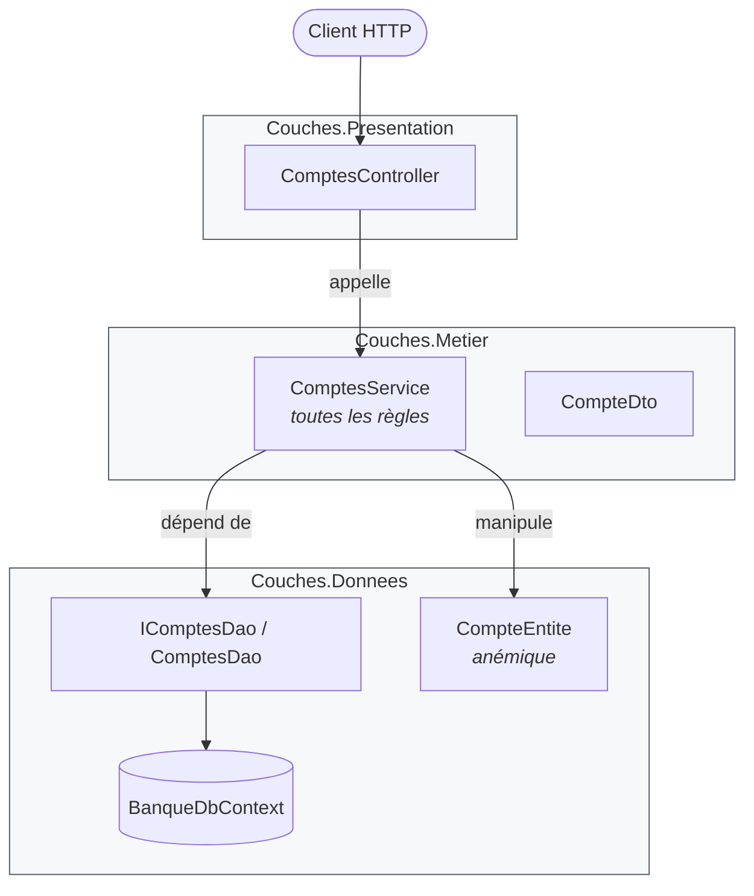
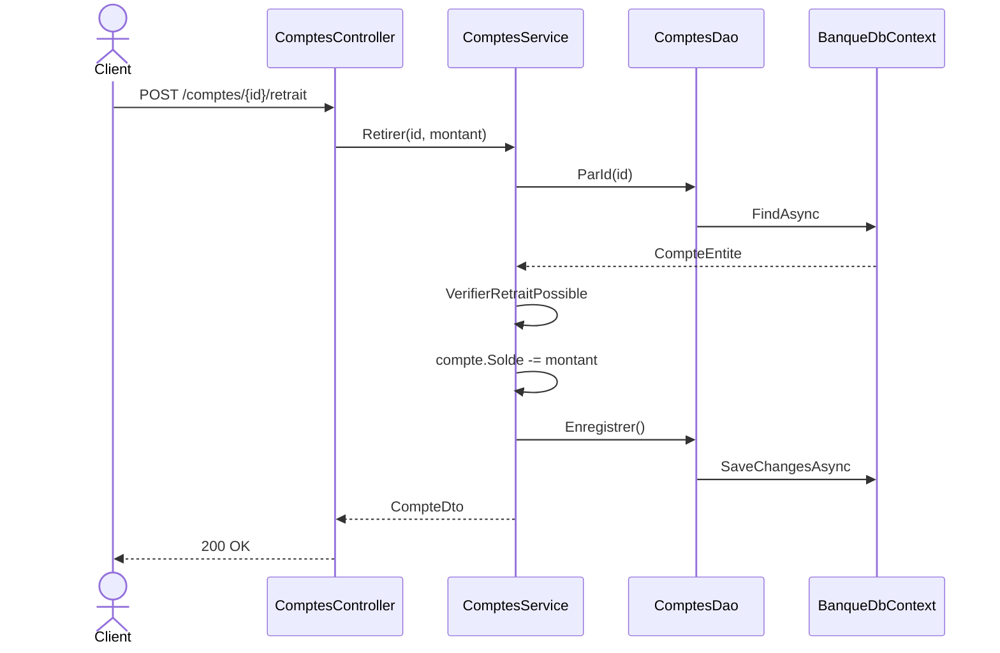

# 0. Architecture en couches (N-tiers)

> **En une phrase** : on empile des couches techniques — présentation, métier, données — et chaque couche n'appelle
> que celle du dessous.

📁 Code : [`00-Couches`](../00-Couches) · ⬅️ [Sommaire](README.md) · ➡️ [Hexagonale](01-hexagonale.md)

---

## L'idée

C'est l'architecture « par défaut » de la plupart des applications d'entreprise depuis les années 1990, et le point de
comparaison de toutes les autres. Son principe est simple : **séparer les responsabilités techniques**.



**Le point clé : les dépendances descendent jusqu'à la base.** La couche métier *dépend* de la couche données : c'est la
couche données qui définit l'interface `IComptesDao` et l'entité `CompteEntite`, dans son vocabulaire, et le métier s'y adapte.
C'est exactement ce que les architectures suivantes (Hexagonale, Onion, Clean) vont **inverser**.

---

## Organisation de la solution

| Projet | Rôle | Référence |
|---|---|---|
| `Couches.Donnees` | Entité, `DbContext`, interface et implémentation du DAO | rien |
| `Couches.Metier` | `ComptesService` (règles), DTO, exceptions | `Couches.Donnees` |
| `Couches.Presentation` | Contrôleurs MVC, `Program.cs` | `Couches.Metier` **seulement** |
| `Couches.Tests` | Tests du service et de l'architecture | — |

---

## Le code, pas à pas

### 1. La couche données définit le modèle… et le contrat

L'entité est **anémique** : uniquement des données, avec des setters publics.
([CompteEntite.cs](../00-Couches/Couches.Donnees/CompteEntite.cs))

```csharp
public class CompteEntite
{
    public Guid Id { get; set; }
    public string Titulaire { get; set; } = "";
    public decimal Solde { get; set; }
}
```

L'interface d'accès est définie **par la couche données**, dans **son** vocabulaire.
([ComptesDao.cs](../00-Couches/Couches.Donnees/ComptesDao.cs))

```csharp
// L'interface est définie PAR la couche données, dans SON vocabulaire (CompteEntite).
// Différence clé avec Onion/Hexagonale : là-bas, c'est le métier qui définit l'interface dont il a besoin.
public interface IComptesDao
{
    Task<CompteEntite?> ParId(Guid id);
    Task Ajouter(CompteEntite compte);
    Task<bool> EstVide();
    Task Enregistrer();
}
```

### 2. La couche métier contient toutes les règles (*transaction script*)

Une méthode = un cas d'utilisation, du début à la fin.
([ComptesService.cs](../00-Couches/Couches.Metier/ComptesService.cs))

```csharp
public class ComptesService(IComptesDao dao)
{
    public async Task<CompteDto> Retirer(Guid id, decimal montant)
    {
        var compte = await Charger(id);
        VerifierRetraitPossible(compte, montant);

        compte.Solde -= montant;
        await dao.Enregistrer();
        return VersDto(compte);
    }

    // L'entité étant anémique, rien n'empêche une autre classe de faire « compte.Solde -= x »
    // sans passer par cette vérification : la règle n'est protégée que par la discipline.
    private static void VerifierRetraitPossible(CompteEntite compte, decimal montant)
    {
        if (montant <= 0)
            throw new RegleMetierException("Le montant doit être strictement positif.");
        if (montant > compte.Solde)
            throw new RegleMetierException("Solde insuffisant.");
    }
}
```

### 3. La présentation ne voit que la couche juste en dessous

Un contrôleur MVC classique traduit HTTP ⇄ métier.
([ComptesController.cs](../00-Couches/Couches.Presentation/Controllers/ComptesController.cs))

```csharp
[HttpPost("comptes/{id:guid}/retrait")]
public Task<IActionResult> Retirer(Guid id, RetraitRequete requete) =>
    Executer(async () => Ok(await comptes.Retirer(id, requete.Montant)));
```

Les **couches strictes** sont imposées par le compilateur : sans ce réglage, la présentation pourrait utiliser
`BanqueDbContext` grâce à la référence transitive via `Couches.Metier`.
([Couches.Presentation.csproj](../00-Couches/Couches.Presentation/Couches.Presentation.csproj))

```xml
<DisableTransitiveProjectReferences>true</DisableTransitiveProjectReferences>
```

Essayer d'injecter `BanqueDbContext` dans un contrôleur donne alors `CS0234 : le nom 'Donnees' n'existe pas`.
C'est la couche métier qui branche elle-même la couche du dessous
([MetierExtensions.cs](../00-Couches/Couches.Metier/MetierExtensions.cs)) :

```csharp
public static IServiceCollection AddCoucheMetier(this IServiceCollection services, string nomBase = "Banque")
{
    services.AddCoucheDonnees(nomBase);
    services.AddScoped<ComptesService>();
    return services;
}
```

### Le trajet d'un retrait



---

## Les tests

Tester le métier oblige à manipuler la couche données : même le faux DAO renvoie des `CompteEntite`.
**Le test du métier est couplé au schéma de persistance.**
([ComptesServiceTests.cs](../00-Couches/Couches.Tests/ComptesServiceTests.cs))

```csharp
private readonly FauxDao _dao = new(
    new CompteEntite { Id = Alice, Titulaire = "Alice", Solde = 100m },
    new CompteEntite { Id = Bob, Titulaire = "Bob", Solde = 0m });
```

Les tests d'architecture vérifient le sens des dépendances
([ArchitectureTests.cs](../00-Couches/Couches.Tests/ArchitectureTests.cs)) :

```csharp
[Fact]
public void Le_metier_depend_de_la_couche_donnees()
{
    Assert.Equal(["Couches.Donnees"], DependancesInternes(typeof(ComptesService).Assembly));
}

[Fact]
public void La_presentation_ne_voit_que_la_couche_juste_en_dessous()
{
    Assert.Equal(["Couches.Metier"], DependancesInternes(typeof(ComptesController).Assembly));
}
```

---

## Couches vs Onion : l'inversion en un schéma


---

## Bilan

| 👍 Points forts | 👎 Limites |
|---|---|
| Simple, connu de tous, rapide à démarrer | Le métier dépend de la base : changer de persistance touche le métier |
| Séparation claire des responsabilités techniques | Entités anémiques : les règles ne sont protégées que par la discipline |
| Couches strictes vérifiables par le compilateur | Tests du métier couplés aux entités de persistance |
| Parfait pour un CRUD au métier mince | Une fonctionnalité = des modifications dans toutes les couches |

**Quand l'utiliser** : applications de gestion simples, prototypes, équipes qui débutent. **Signaux pour évoluer** : les
règles métier se multiplient, on veut les tester sans base, ou on prévoit de changer de technologie de stockage
→ [Hexagonale](01-hexagonale.md) ou [Onion](02-onion.md).
