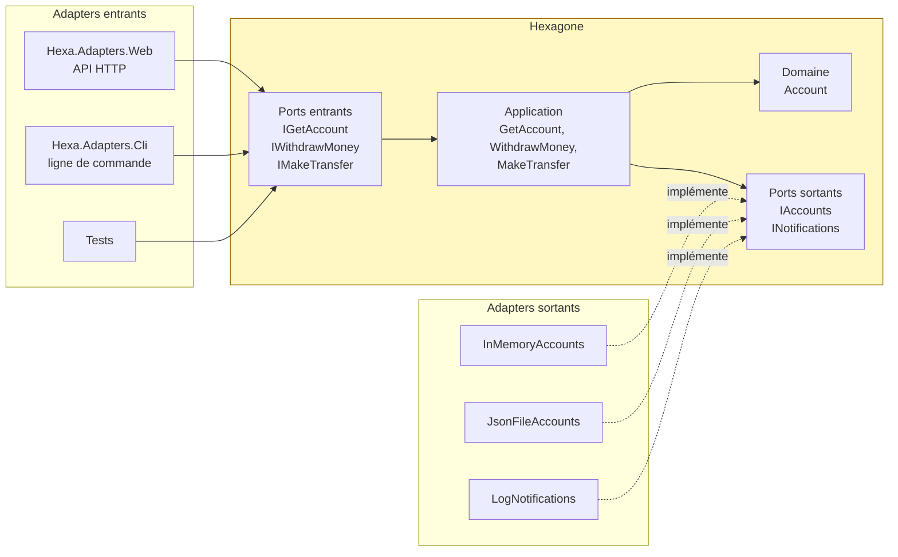
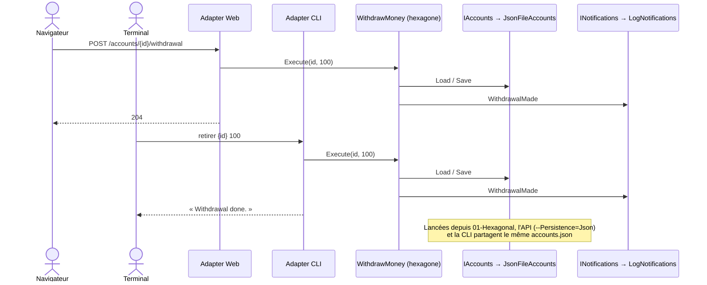
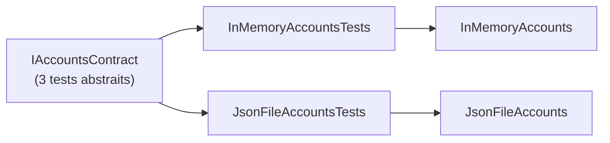

# 1. Architecture hexagonale (Ports & Adapters)

**Nom anglais** : *Hexagonal Architecture (Ports & Adapters)*

> **En une phrase** : le métier est au centre et ne dépend de rien ; le monde extérieur s'y branche par des **ports**
> (interfaces) et des **adapters** (implémentations) interchangeables.

📁 Code : [`01-Hexagonal`](../01-Hexagonal) · ⬅️ [Couches](00-couches.md) · ➡️ [Onion](02-onion.md) · 🌐 [English](en/01-hexagonale.md)

---

## L'idée

Proposée par **Alistair Cockburn** en 2005. Le constat : dans une architecture en couches, le métier finit par dépendre
de la base de données et de l'interface. Cockburn propose de raisonner en **intérieur / extérieur** plutôt qu'en haut / bas.
L'hexagone n'a rien de magique : c'est juste une forme qui laisse de la place pour dessiner plusieurs ports.



Deux sortes de ports :

| | Port **entrant** (*driving*, primaire) | Port **sortant** (*driven*, secondaire) |
|---|---|---|
| Rôle | Ce que l'application **offre** | Ce dont l'application **a besoin** |
| Qui l'appelle ? | Un adapter entrant (API, CLI, test) | L'application elle-même |
| Qui l'implémente ? | L'application (`WithdrawMoney`) | Un adapter sortant (`JsonFileAccounts`) |
| Exemple | `IWithdrawMoney` | `IAccounts`, `INotifications` |

**Toutes les flèches de dépendance pointent vers l'hexagone**, qui ne référence aucun autre projet.

---

## Organisation de la solution

| Projet | Rôle |
|---|---|
| `Hexa.Hexagon` | Domaine + ports + cas d'utilisation. **Aucune référence**, ni projet ni package. |
| `Hexa.Adapters.Persistence` | Deux adapters du **même** port `IAccounts` : en mémoire et fichier JSON |
| `Hexa.Adapters.Notifications` | Adapter du port `INotifications` (journal texte) |
| `Hexa.Adapters.Web` | Adapter entrant HTTP + *composition root* (assemble tout) |
| `Hexa.Adapters.Cli` | Second adapter entrant : la ligne de commande |
| `Hexa.Tests` | Tests de l'hexagone, **tests de contrat** des adapters, test d'architecture |

---

## Le code, pas à pas

### 1. Les ports : des interfaces dans l'hexagone

([InboundPorts.cs](../01-Hexagonal/Hexa.Hexagon/Ports/Inbound/InboundPorts.cs),
[OutboundPorts.cs](../01-Hexagonal/Hexa.Hexagon/Ports/Outbound/OutboundPorts.cs))

```csharp
// Inbound ports ("driving", primary): what the application OFFERS to the outside world.
public interface IWithdrawMoney
{
    Task Execute(Guid accountId, decimal amount);
}

// Outbound ports ("driven", secondary): what the application NEEDS.
public interface IAccounts
{
    Task<Account?> Load(Guid id);
    Task Save(Account account);
}

public interface INotifications
{
    Task WithdrawalMade(Guid accountId, decimal amount);
    Task TransferMade(Guid sourceId, Guid targetId, decimal amount);
}
```

### 2. Un cas d'utilisation : un port entrant implémenté avec des ports sortants

([UseCases.cs](../01-Hexagonal/Hexa.Hexagon/Application/UseCases.cs))

```csharp
public class WithdrawMoney(IAccounts accounts, INotifications notifications) : IWithdrawMoney
{
    public async Task Execute(Guid accountId, decimal amount)
    {
        var account = await accounts.Load(accountId) ?? throw new AccountNotFoundException(accountId);
        account.Withdraw(amount);
        await accounts.Save(account);
        await notifications.WithdrawalMade(accountId, amount);
    }
}
```

L'hexagone ignore s'il est appelé par HTTP ou par la ligne de commande, et si les comptes sont en mémoire ou dans un fichier.

### 3. Deux adapters pour le même port

([JsonFileAccounts.cs](../01-Hexagonal/Hexa.Adapters.Persistence/JsonFileAccounts.cs))

```csharp
public class JsonFileAccounts : IAccounts
{
    // …
    // Storage format specific to the adapter: the domain does not know it is serialized.
    private record Row(Guid Id, string Owner, decimal Balance)
    {
        public static Row From(Account account) => new(account.Id, account.Owner, account.Balance);
        public Account ToAccount() => new(Id, Owner, Balance);
    }
}
```

### 4. La *composition root* choisit les adapters

C'est **le seul endroit** qui connaît à la fois l'hexagone et les adapters.
([Program.cs](../01-Hexagonal/Hexa.Adapters.Web/Program.cs))

```csharp
// Outbound adapters, swappable by configuration: --Persistence=Json or Memory (default).
builder.Services.AddSingleton<IAccounts>(_ => builder.Configuration["Persistence"] switch
{
    "Json" => new JsonFileAccounts(builder.Configuration["AccountsFile"] ?? "accounts.json", DemoData.Accounts()),
    _ => new InMemoryAccounts(DemoData.Accounts())
});
builder.Services.AddSingleton<INotifications>(new LogNotifications(Console.Out));

// Inbound ports → their implementation in the hexagon.
builder.Services.AddScoped<IWithdrawMoney, WithdrawMoney>();
```

La CLI fait la même chose **sans conteneur d'injection** : l'hexagone n'en a pas besoin.
([Hexa.Adapters.Cli/Program.cs](../01-Hexagonal/Hexa.Adapters.Cli/Program.cs))

```csharp
IAccounts accounts = new JsonFileAccounts("accounts.json", DemoData.Accounts());
INotifications notifications = new LogNotifications(Console.Out);
IWithdrawMoney withdraw = new WithdrawMoney(accounts, notifications);
```

### 5. L'adapter HTTP traduit, sans aucune règle

([AccountsEndpoints.cs](../01-Hexagonal/Hexa.Adapters.Web/AccountsEndpoints.cs))

```csharp
// Translating business errors into HTTP codes is the adapter's job, not the hexagon's.
private static async Task<IResult> Translate(Func<Task<IResult>> action)
{
    try { return await action(); }
    catch (AccountNotFoundException e) { return Results.NotFound(new { error = e.Message }); }
    catch (BusinessRuleException e) { return Results.BadRequest(new { error = e.Message }); }
}
```

### Deux portes d'entrée, un même hexagone



---

## Les tests

**Tests de l'hexagone** : on branche des adapters de test sur les ports ; ni serveur web, ni base.
([UseCasesTests.cs](../01-Hexagonal/Hexa.Tests/Hexagon/UseCasesTests.cs))

```csharp
[Fact]
public async Task A_valid_withdrawal_debits_the_account_and_notifies()
{
    await new WithdrawMoney(_accounts, _notifications).Execute(Alice, 30m);

    Assert.Equal(70m, (await _accounts.Load(Alice))!.Balance);
    Assert.Equal([$"withdrawal 30 {Alice}"], _notifications.Sent);
}
```

**Tests de contrat** : les mêmes tests s'exécutent sur **chaque** adapter du port `IAccounts`. C'est ce qui garantit
qu'on peut remplacer l'un par l'autre sans surprise.
([IAccountsContractTests.cs](../01-Hexagonal/Hexa.Tests/Adapters/IAccountsContractTests.cs))

```csharp
public abstract class IAccountsContract
{
    protected abstract IAccounts Create(params Account[] initialAccounts);

    [Fact]
    public async Task An_unsaved_change_is_not_persisted() { /* … */ }
}

public class InMemoryAccountsTests : IAccountsContract
{
    protected override IAccounts Create(params Account[] initialAccounts) => new InMemoryAccounts(initialAccounts);
}

public class JsonFileAccountsTests : IAccountsContract, IDisposable { /* same tests, on a temporary file */ }
```



---

## Bilan

| 👍 Points forts | 👎 Limites |
|---|---|
| Le métier ne dépend de rien : testable sans infrastructure | Une interface par besoin externe : plus de code |
| Adapters interchangeables (mémoire, fichier, SQL…) | Risque de ports « passe-plat » qui n'apportent rien |
| Plusieurs portes d'entrée sur le même métier | Le centre n'est pas structuré : à compléter (Onion, DDD) |
| Tests de contrat des adapters | |

**Quand l'utiliser** : métier riche, infrastructure susceptible de changer, besoin de plusieurs canaux (API, CLI,
messages). **Variantes** : [Onion](02-onion.md) structure le centre en couches ; [Clean](03-clean.md) formalise les
cas d'utilisation. Les trois partagent la même règle : *les dépendances pointent vers le métier*.
