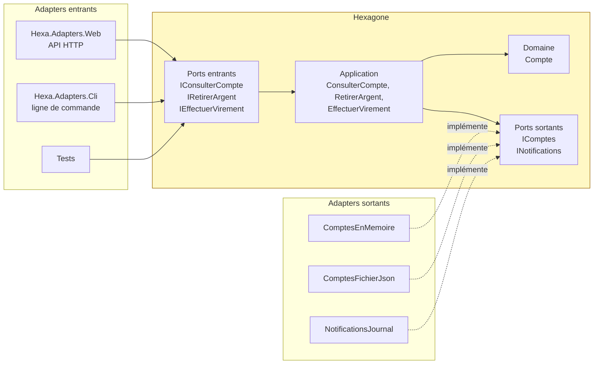
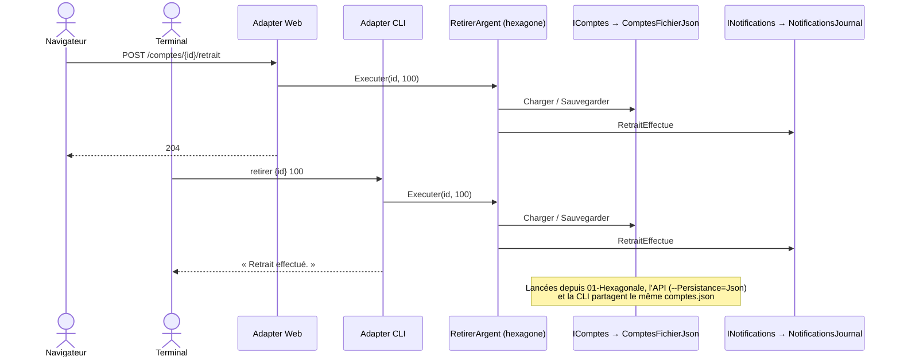
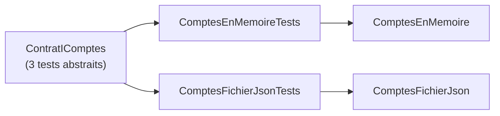

# 1. Architecture hexagonale (Ports & Adapters)

**Nom anglais** : *Hexagonal Architecture (Ports & Adapters)*

> **En une phrase** : le métier est au centre et ne dépend de rien ; le monde extérieur s'y branche par des **ports**
> (interfaces) et des **adapters** (implémentations) interchangeables.

📁 Code : [`01-Hexagonale`](../01-Hexagonale) · ⬅️ [Couches](00-couches.md) · ➡️ [Onion](02-onion.md)

---

## L'idée

Proposée par **Alistair Cockburn** en 2005. Le constat : dans une architecture en couches, le métier finit par dépendre
de la base de données et de l'interface. Cockburn propose de raisonner en **intérieur / extérieur** plutôt qu'en haut / bas.
L'hexagone n'a rien de magique : c'est juste une forme qui laisse de la place pour dessiner plusieurs ports.



Deux sortes de ports :

| | Port **entrant** (*driving*, primaire) | Port **sortant** (*driven*, secondaire) |
|---|---|---|
| Rôle | Ce que l'application **offre** | Ce dont l'application **a besoin** |
| Qui l'appelle ? | Un adapter entrant (API, CLI, test) | L'application elle-même |
| Qui l'implémente ? | L'application (`RetirerArgent`) | Un adapter sortant (`ComptesFichierJson`) |
| Exemple | `IRetirerArgent` | `IComptes`, `INotifications` |

**Toutes les flèches de dépendance pointent vers l'hexagone**, qui ne référence aucun autre projet.

---

## Organisation de la solution

| Projet | Rôle |
|---|---|
| `Hexa.Hexagone` | Domaine + ports + cas d'utilisation. **Aucune référence**, ni projet ni package. |
| `Hexa.Adapters.Persistance` | Deux adapters du **même** port `IComptes` : en mémoire et fichier JSON |
| `Hexa.Adapters.Notifications` | Adapter du port `INotifications` (journal texte) |
| `Hexa.Adapters.Web` | Adapter entrant HTTP + *composition root* (assemble tout) |
| `Hexa.Adapters.Cli` | Second adapter entrant : la ligne de commande |
| `Hexa.Tests` | Tests de l'hexagone, **tests de contrat** des adapters, test d'architecture |

---

## Le code, pas à pas

### 1. Les ports : des interfaces dans l'hexagone

([PortsEntrants.cs](../01-Hexagonale/Hexa.Hexagone/Ports/Entrants/PortsEntrants.cs),
[PortsSortants.cs](../01-Hexagonale/Hexa.Hexagone/Ports/Sortants/PortsSortants.cs))

```csharp
// Ports entrants (« driving », primaires) : ce que l'application OFFRE au monde extérieur.
public interface IRetirerArgent
{
    Task Executer(Guid compteId, decimal montant);
}

// Ports sortants (« driven », secondaires) : ce dont l'application A BESOIN.
public interface IComptes
{
    Task<Compte?> Charger(Guid id);
    Task Sauvegarder(Compte compte);
}

public interface INotifications
{
    Task RetraitEffectue(Guid compteId, decimal montant);
    Task VirementEffectue(Guid sourceId, Guid cibleId, decimal montant);
}
```

### 2. Un cas d'utilisation : un port entrant implémenté avec des ports sortants

([CasUtilisation.cs](../01-Hexagonale/Hexa.Hexagone/Application/CasUtilisation.cs))

```csharp
public class RetirerArgent(IComptes comptes, INotifications notifications) : IRetirerArgent
{
    public async Task Executer(Guid compteId, decimal montant)
    {
        var compte = await comptes.Charger(compteId) ?? throw new CompteIntrouvableException(compteId);
        compte.Retirer(montant);
        await comptes.Sauvegarder(compte);
        await notifications.RetraitEffectue(compteId, montant);
    }
}
```

L'hexagone ignore s'il est appelé par HTTP ou par la ligne de commande, et si les comptes sont en mémoire ou dans un fichier.

### 3. Deux adapters pour le même port

([ComptesFichierJson.cs](../01-Hexagonale/Hexa.Adapters.Persistance/ComptesFichierJson.cs))

```csharp
public class ComptesFichierJson : IComptes
{
    // …
    // Format de stockage propre à l'adapter : le domaine ignore qu'il est sérialisé.
    private record Ligne(Guid Id, string Titulaire, decimal Solde)
    {
        public static Ligne Depuis(Compte compte) => new(compte.Id, compte.Titulaire, compte.Solde);
        public Compte VersCompte() => new(Id, Titulaire, Solde);
    }
}
```

### 4. La *composition root* choisit les adapters

C'est **le seul endroit** qui connaît à la fois l'hexagone et les adapters.
([Program.cs](../01-Hexagonale/Hexa.Adapters.Web/Program.cs))

```csharp
// Adapters sortants, interchangeables par configuration : --Persistance=Json ou Memoire (défaut).
builder.Services.AddSingleton<IComptes>(_ => builder.Configuration["Persistance"] switch
{
    "Json" => new ComptesFichierJson(builder.Configuration["FichierComptes"] ?? "comptes.json", DonneesDeDemo.Comptes()),
    _ => new ComptesEnMemoire(DonneesDeDemo.Comptes())
});
builder.Services.AddSingleton<INotifications>(new NotificationsJournal(Console.Out));

// Ports entrants → leur implémentation dans l'hexagone.
builder.Services.AddScoped<IRetirerArgent, RetirerArgent>();
```

La CLI fait la même chose **sans conteneur d'injection** : l'hexagone n'en a pas besoin.
([Hexa.Adapters.Cli/Program.cs](../01-Hexagonale/Hexa.Adapters.Cli/Program.cs))

```csharp
IComptes comptes = new ComptesFichierJson("comptes.json", DonneesDeDemo.Comptes());
INotifications notifications = new NotificationsJournal(Console.Out);
IRetirerArgent retirer = new RetirerArgent(comptes, notifications);
```

### 5. L'adapter HTTP traduit, sans aucune règle

([ComptesEndpoints.cs](../01-Hexagonale/Hexa.Adapters.Web/ComptesEndpoints.cs))

```csharp
// Traduire les erreurs du métier en codes HTTP est le rôle de l'adapter, pas de l'hexagone.
private static async Task<IResult> Traduire(Func<Task<IResult>> action)
{
    try { return await action(); }
    catch (CompteIntrouvableException e) { return Results.NotFound(new { erreur = e.Message }); }
    catch (RegleMetierException e) { return Results.BadRequest(new { erreur = e.Message }); }
}
```

### Deux portes d'entrée, un même hexagone



---

## Les tests

**Tests de l'hexagone** : on branche des adapters de test sur les ports ; ni serveur web, ni base.
([CasUtilisationTests.cs](../01-Hexagonale/Hexa.Tests/Hexagone/CasUtilisationTests.cs))

```csharp
[Fact]
public async Task Un_retrait_valide_debite_le_compte_et_notifie()
{
    await new RetirerArgent(_comptes, _notifications).Executer(Alice, 30m);

    Assert.Equal(70m, (await _comptes.Charger(Alice))!.Solde);
    Assert.Equal([$"retrait 30 {Alice}"], _notifications.Envoyees);
}
```

**Tests de contrat** : les mêmes tests s'exécutent sur **chaque** adapter du port `IComptes`. C'est ce qui garantit
qu'on peut remplacer l'un par l'autre sans surprise.
([ContratIComptesTests.cs](../01-Hexagonale/Hexa.Tests/Adapters/ContratIComptesTests.cs))

```csharp
public abstract class ContratIComptes
{
    protected abstract IComptes Creer(params Compte[] comptesInitiaux);

    [Fact]
    public async Task Une_modification_non_sauvegardee_n_est_pas_persistee() { /* … */ }
}

public class ComptesEnMemoireTests : ContratIComptes
{
    protected override IComptes Creer(params Compte[] comptesInitiaux) => new ComptesEnMemoire(comptesInitiaux);
}

public class ComptesFichierJsonTests : ContratIComptes, IDisposable { /* même tests, sur un fichier temporaire */ }
```



---

## Bilan

| 👍 Points forts | 👎 Limites |
|---|---|
| Le métier ne dépend de rien : testable sans infrastructure | Une interface par besoin externe : plus de code |
| Adapters interchangeables (mémoire, fichier, SQL…) | Risque de ports « passe-plat » qui n'apportent rien |
| Plusieurs portes d'entrée sur le même métier | Le centre n'est pas structuré : à compléter (Onion, DDD) |
| Tests de contrat des adapters | |

**Quand l'utiliser** : métier riche, infrastructure susceptible de changer, besoin de plusieurs canaux (API, CLI,
messages). **Variantes** : [Onion](02-onion.md) structure le centre en couches ; [Clean](03-clean.md) formalise les
cas d'utilisation. Les trois partagent la même règle : *les dépendances pointent vers le métier*.
