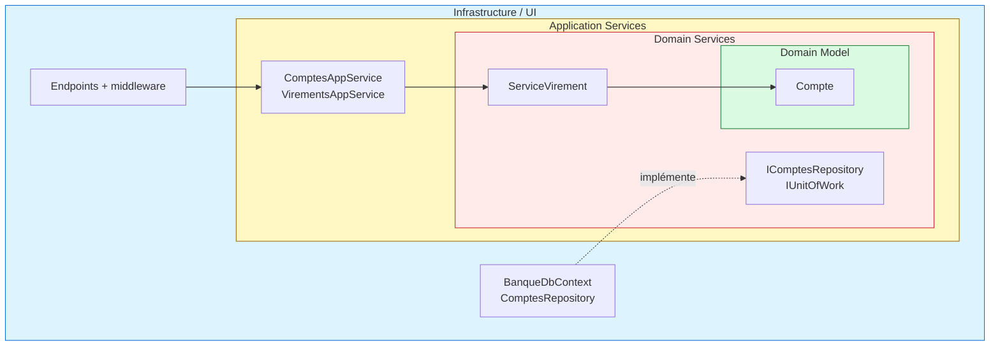
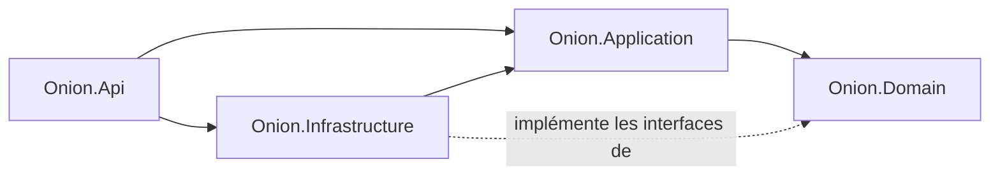
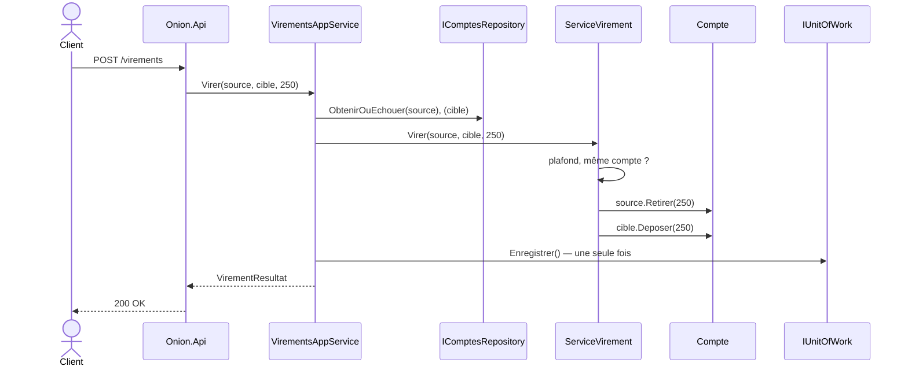

# 2. Onion Architecture

> **En une phrase** : des couches concentriques ; le domaine est au centre, et **toutes les dépendances pointent vers lui**.

📁 Code : [`02-Onion`](../02-Onion) · ⬅️ [Hexagonale](01-hexagonale.md) · ➡️ [Clean](03-clean.md)

---

## L'idée

Proposée par **Jeffrey Palermo** en 2008. Même règle que l'hexagonale (le métier ne dépend de rien), mais avec un
**centre découpé en couches** : le modèle du domaine, puis les services de domaine, puis les services applicatifs.



| Couche | Contenu | Rôle |
|---|---|---|
| **Domain Model** | `Compte`, exceptions | Les entités et leurs invariants |
| **Domain Services** | `ServiceVirement` + interfaces `IComptesRepository`, `IUnitOfWork` | Règles qui concernent plusieurs entités ; ce dont le domaine a besoin |
| **Application Services** | `ComptesAppService`, `VirementsAppService`, DTO | Orchestration : charger, déléguer, enregistrer |
| **Infrastructure / UI** | EF Core, API, middleware | Implémente les interfaces, expose l'application |

### Dépendances entre projets



---

## Le code, pas à pas

### 1. Le service de domaine

Une règle qui porte sur **deux** comptes n'appartient naturellement à aucun des deux.
([ServiceVirement.cs](../02-Onion/Onion.Domain/Services/ServiceVirement.cs))

```csharp
public class ServiceVirement
{
    public const decimal PlafondParVirement = 5_000m;

    public void Virer(Compte source, Compte cible, decimal montant)
    {
        if (source.Id == cible.Id)
            throw new RegleMetierException("Impossible de virer vers le même compte.");
        if (montant > PlafondParVirement)
            throw new RegleMetierException($"Un virement ne peut pas dépasser {PlafondParVirement:0} €.");

        source.Retirer(montant);
        cible.Deposer(montant);
    }
}
```

### 2. Les interfaces sont déclarées au centre

([IComptesRepository.cs](../02-Onion/Onion.Domain/Interfaces/IComptesRepository.cs))

```csharp
// Les interfaces d'accès aux données sont déclarées au centre ;
// l'infrastructure (couche externe) les implémente : les dépendances pointent vers l'intérieur.
public interface IComptesRepository
{
    Task<Compte?> ParId(Guid id);
    Task Ajouter(Compte compte);
    Task<bool> EstVide();
}

/// <summary>Valide en une fois toutes les modifications faites pendant un cas d'utilisation.</summary>
public interface IUnitOfWork
{
    Task Enregistrer();
}
```

### 3. Le service applicatif orchestre, sans décider

([VirementsAppService.cs](../02-Onion/Onion.Application/VirementsAppService.cs))

```csharp
public class VirementsAppService(IComptesRepository comptes, IUnitOfWork unitOfWork, ServiceVirement serviceVirement)
{
    public async Task<VirementResultat> Virer(Guid sourceId, Guid cibleId, decimal montant)
    {
        var source = await comptes.ObtenirOuEchouer(sourceId);
        var cible = await comptes.ObtenirOuEchouer(cibleId);

        // La règle (plafond, même compte, solde…) vit dans le service de domaine.
        serviceVirement.Virer(source, cible, montant);

        // Une seule validation pour les deux comptes : tout ou rien.
        await unitOfWork.Enregistrer();
        return new VirementResultat(CompteDto.Depuis(source), CompteDto.Depuis(cible));
    }
}
```

### 4. L'infrastructure implémente les interfaces du domaine

Le `DbContext` **est** l'unité de travail ; le mapping est décrit ici, jamais par des attributs dans le domaine.
([BanqueDbContext.cs](../02-Onion/Onion.Infrastructure/BanqueDbContext.cs))

```csharp
public class BanqueDbContext(DbContextOptions<BanqueDbContext> options) : DbContext(options), IUnitOfWork
{
    public DbSet<Compte> Comptes => Set<Compte>();

    public Task Enregistrer() => SaveChangesAsync();

    protected override void OnModelCreating(ModelBuilder modelBuilder)
    {
        // Le mapping est décrit ici, pas par des attributs dans le domaine : le domaine ignore EF Core.
        modelBuilder.Entity<Compte>(compte =>
        {
            compte.HasKey(c => c.Id);
            compte.Property(c => c.Titulaire).HasMaxLength(100);
        });
    }
}
```

### 5. Les erreurs du domaine traduites une seule fois

([Program.cs](../02-Onion/Onion.Api/Program.cs))

```csharp
// Les erreurs du domaine sont traduites en HTTP une seule fois, par un middleware.
app.Use(async (contexte, suivant) =>
{
    try { await suivant(contexte); }
    catch (CompteIntrouvableException e) { contexte.Response.StatusCode = 404; /* … */ }
    catch (RegleMetierException e) { contexte.Response.StatusCode = 400; /* … */ }
});
```

### Le trajet d'un virement, de l'extérieur vers le centre



---

## Les tests

Les couches centrales se testent **sans aucun double** ; la couche application avec de faux repository / unit of work.
([VirementsAppServiceTests.cs](../02-Onion/Onion.Tests/Application/VirementsAppServiceTests.cs))

```csharp
[Fact]
public async Task Un_virement_refuse_n_est_pas_enregistre()
{
    await Assert.ThrowsAsync<RegleMetierException>(() => Service.Virer(Alice, Bob, 1_000m));

    Assert.Equal(0, _unitOfWork.NombreEnregistrements);
}
```

Et la règle d'or vérifiée à chaque build ([ArchitectureTests.cs](../02-Onion/Onion.Tests/ArchitectureTests.cs)) :
le domaine ne dépend de rien, l'application ne dépend que du domaine.

---

## Bilan

| 👍 Points forts | 👎 Limites |
|---|---|
| Domaine pur et testable | Beaucoup de projets et d'interfaces pour une petite application |
| Centre structuré : modèle / services de domaine / application | Frontière parfois floue entre service de domaine et service applicatif |
| Unité de travail explicite (tout ou rien) | Risque de modèle anémique si les règles migrent dans les services |

**Hexagonale ou Onion ?** C'est la même règle de dépendance. L'hexagonale insiste sur les **ports et adapters** autour,
l'Onion sur les **couches au centre**. En pratique, beaucoup de projets « Clean » .NET sont en réalité des Onion.
