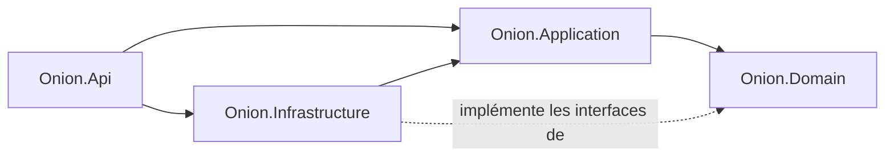
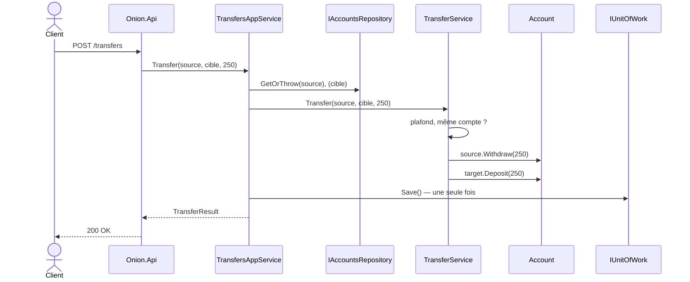

# 2. Onion Architecture

> **En une phrase** : des couches concentriques ; le domaine est au centre, et **toutes les dépendances pointent vers lui**.

📁 Code : [`02-Onion`](../02-Onion) · ⬅️ [Hexagonale](01-hexagonale.md) · ➡️ [Clean](03-clean.md) · 🌐 [English](en/02-onion.md)

---

## L'idée

Proposée par **Jeffrey Palermo** en 2008. Même règle que l'hexagonale (le métier ne dépend de rien), mais avec un
**centre découpé en couches** : le modèle du domaine, puis les services de domaine, puis les services applicatifs.


| Couche | Contenu | Rôle |
|---|---|---|
| **Domain Model** | `Account`, exceptions | Les entités et leurs invariants |
| **Domain Services** | `TransferService` + interfaces `IAccountsRepository`, `IUnitOfWork` | Règles qui concernent plusieurs entités ; ce dont le domaine a besoin |
| **Application Services** | `AccountsAppService`, `TransfersAppService`, DTO | Orchestration : charger, déléguer, enregistrer |
| **Infrastructure / UI** | EF Core, API, middleware | Implémente les interfaces, expose l'application |

### Dépendances entre projets



---

## Le code, pas à pas

### 1. Le service de domaine

Une règle qui porte sur **deux** comptes n'appartient naturellement à aucun des deux.
([TransferService.cs](../02-Onion/Onion.Domain/Services/TransferService.cs))

```csharp
public class TransferService
{
    public const decimal TransferLimit = 5_000m;

    public void Transfer(Account source, Account target, decimal amount)
    {
        if (source.Id == target.Id)
            throw new BusinessRuleException("Cannot transfer to the same account.");
        if (amount > TransferLimit)
            throw new BusinessRuleException($"A transfer cannot exceed {TransferLimit:0} €.");

        source.Withdraw(amount);
        target.Deposit(amount);
    }
}
```

### 2. Les interfaces sont déclarées au centre

([IAccountsRepository.cs](../02-Onion/Onion.Domain/Interfaces/IAccountsRepository.cs))

```csharp
// The data access interfaces are declared at the center;
// the infrastructure (outer layer) implements them: dependencies point inwards.
public interface IAccountsRepository
{
    Task<Account?> ById(Guid id);
    Task Add(Account account);
    Task<bool> IsEmpty();
}

/// <summary>Commits at once all the changes made during a use case.</summary>
public interface IUnitOfWork
{
    Task Save();
}
```

### 3. Le service applicatif orchestre, sans décider

([TransfersAppService.cs](../02-Onion/Onion.Application/TransfersAppService.cs))

```csharp
public class TransfersAppService(IAccountsRepository accounts, IUnitOfWork unitOfWork, TransferService transferService)
{
    public async Task<TransferResult> Transfer(Guid sourceId, Guid targetId, decimal amount)
    {
        var source = await accounts.GetOrThrow(sourceId);
        var target = await accounts.GetOrThrow(targetId);

        // The rule (limit, same account, balance…) lives in the domain service.
        transferService.Transfer(source, target, amount);

        // A single commit for both accounts: all or nothing.
        await unitOfWork.Save();
        return new TransferResult(AccountDto.From(source), AccountDto.From(target));
    }
}
```

### 4. L'infrastructure implémente les interfaces du domaine

Le `DbContext` **est** l'unité de travail ; le mapping est décrit ici, jamais par des attributs dans le domaine.
([BankDbContext.cs](../02-Onion/Onion.Infrastructure/BankDbContext.cs))

```csharp
public class BankDbContext(DbContextOptions<BankDbContext> options) : DbContext(options), IUnitOfWork
{
    public DbSet<Account> Accounts => Set<Account>();

    public Task Save() => SaveChangesAsync();

    protected override void OnModelCreating(ModelBuilder modelBuilder)
    {
        // The mapping is described here, not by attributes in the domain: the domain knows nothing of EF Core.
        modelBuilder.Entity<Account>(account =>
        {
            account.HasKey(c => c.Id);
            account.Property(c => c.Owner).HasMaxLength(100);
        });
    }
}
```

### 5. Les erreurs du domaine traduites une seule fois

([Program.cs](../02-Onion/Onion.Api/Program.cs))

```csharp
// Domain errors are translated into HTTP once, by a middleware.
app.Use(async (context, next) =>
{
    try { await next(context); }
    catch (AccountNotFoundException e) { context.Response.StatusCode = 404; /* … */ }
    catch (BusinessRuleException e) { context.Response.StatusCode = 400; /* … */ }
});
```

### Le trajet d'un virement, de l'extérieur vers le centre



---

## Les tests

Les couches centrales se testent **sans aucun double** ; la couche application avec de faux repository / unit of work.
([TransfersAppServiceTests.cs](../02-Onion/Onion.Tests/Application/TransfersAppServiceTests.cs))

```csharp
[Fact]
public async Task A_refused_transfer_is_not_saved()
{
    await Assert.ThrowsAsync<BusinessRuleException>(() => Service.Transfer(Alice, Bob, 1_000m));

    Assert.Equal(0, _unitOfWork.SaveCount);
}
```

Et la règle d'or vérifiée à chaque build ([ArchitectureTests.cs](../02-Onion/Onion.Tests/ArchitectureTests.cs)) :
le domaine ne dépend de rien, l'application ne dépend que du domaine.

---

## Bilan

| 👍 Points forts | 👎 Limites |
|---|---|
| Domaine pur et testable | Beaucoup de projets et d'interfaces pour une petite application |
| Centre structuré : modèle / services de domaine / application | Frontière parfois floue entre service de domaine et service applicatif |
| Unité de travail explicite (tout ou rien) | Risque de modèle anémique si les règles migrent dans les services |

**Hexagonale ou Onion ?** C'est la même règle de dépendance. L'hexagonale insiste sur les **ports et adapters** autour,
l'Onion sur les **couches au centre**. En pratique, beaucoup de projets « Clean » .NET sont en réalité des Onion.
