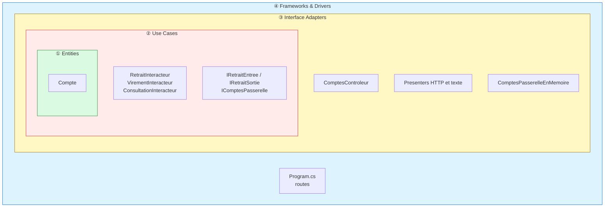
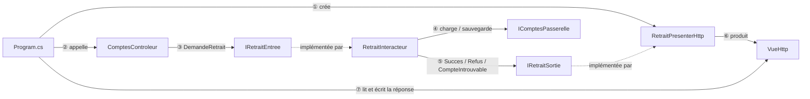
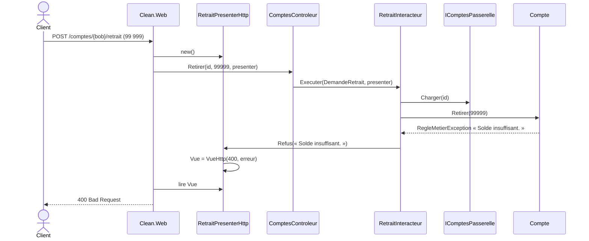

# 3. Clean Architecture

> **En une phrase** : chaque cas d'utilisation est une classe (*interactor*) avec des frontières explicites
> (*boundaries*) ; il ne renvoie rien et pousse son résultat vers un *presenter*.

📁 Code : [`03-Clean`](../03-Clean) · ⬅️ [Onion](02-onion.md) · ➡️ [Cœur fonctionnel](04-coeur-fonctionnel.md) · 🌐 [English](en/03-clean.md)

---

## L'idée

Formalisée par **Robert C. Martin (Uncle Bob)** en 2012, c'est une synthèse de l'hexagonale et de l'Onion avec un
vocabulaire précis. Quatre cercles, et une seule règle : **la règle de dépendance** — le code d'un cercle ne connaît que
les cercles plus intérieurs.



| Cercle | Projet |
|---|---|
| ① Entities | `Clean.Entites` |
| ② Use Cases | `Clean.CasUtilisation` |
| ③ Interface Adapters | `Clean.AdaptateursInterface` |
| ④ Frameworks & Drivers | `Clean.Web` (ASP.NET Core) |

### Le vocabulaire

| Terme | Dans la démo | Rôle |
|---|---|---|
| **Request model** | `DemandeRetrait` | Données d'entrée du cas d'utilisation, sans rien du web |
| **Input boundary** | `IRetraitEntree` | Ce que le contrôleur appelle |
| **Interactor** | `RetraitInteracteur` | Le cas d'utilisation |
| **Output boundary** | `IRetraitSortie` | Ce que l'interacteur appelle pour rendre son résultat |
| **Response model** | `ReponseRetrait` | Données de sortie |
| **Presenter** | `RetraitPresenterHttp` | Implémente l'output boundary, fabrique une vue |
| **Gateway** | `IComptesPasserelle` | Accès aux données (= port sortant) |

### Le flux de contrôle traverse les cercles… mais pas les dépendances



L'interacteur appelle le presenter **à travers une interface qu'il définit lui-même** (`IRetraitSortie`) : c'est
l'inversion des dépendances appliquée à la **sortie**.

---

## Le code, pas à pas

### 1. Un cas d'utilisation complet dans un fichier

([Retrait.cs](../03-Clean/Clean.CasUtilisation/Retrait/Retrait.cs))

```csharp
public record DemandeRetrait(Guid CompteId, decimal Montant);
public record ReponseRetrait(Guid CompteId, decimal AncienSolde, decimal NouveauSolde);

public interface IRetraitEntree
{
    Task Executer(DemandeRetrait demande, IRetraitSortie sortie);
}

public interface IRetraitSortie
{
    void Succes(ReponseRetrait reponse);
    void CompteIntrouvable(Guid compteId);
    void Refus(string raison);
}

/// L'interacteur ne renvoie rien : il pousse son résultat vers l'output boundary.
/// Il ignore donc totalement si la réponse finira en JSON, en HTML ou en texte.
public class RetraitInteracteur(IComptesPasserelle comptes) : IRetraitEntree
{
    public async Task Executer(DemandeRetrait demande, IRetraitSortie sortie)
    {
        var compte = await comptes.Charger(demande.CompteId);
        if (compte is null)
        {
            sortie.CompteIntrouvable(demande.CompteId);
            return;
        }

        var ancienSolde = compte.Solde;
        try
        {
            compte.Retirer(demande.Montant);
        }
        catch (RegleMetierException e)
        {
            sortie.Refus(e.Message);
            return;
        }

        await comptes.Sauvegarder(compte);
        sortie.Succes(new ReponseRetrait(compte.Id, ancienSolde, compte.Solde));
    }
}
```

### 2. Des presenters qui décident de la forme

([PresentersHttp.cs](../03-Clean/Clean.AdaptateursInterface/Presenters/PresentersHttp.cs)) — le presenter produit un
*view model* (`VueHttp`), pas un `IResult` : les adaptateurs ne dépendent pas d'ASP.NET Core.

```csharp
public class RetraitPresenterHttp : IRetraitSortie
{
    public VueHttp Vue { get; private set; } = VueHttp.Refus("Aucun résultat.");

    public void Succes(ReponseRetrait r) =>
        Vue = VueHttp.Ok(new
        {
            solde = r.NouveauSolde,
            message = $"Retrait de {r.AncienSolde - r.NouveauSolde:0.00} € effectué."
        });

    public void CompteIntrouvable(Guid compteId) => Vue = VueHttp.Introuvable(compteId);
    public void Refus(string raison) => Vue = VueHttp.Refus(raison);
}
```

**Deux presenters pour le même interacteur** : JSON, ou relevé texte
([ConsultationPresenterTexte.cs](../03-Clean/Clean.AdaptateursInterface/Presenters/ConsultationPresenterTexte.cs)).
Ajouter un format ne touche pas au cas d'utilisation.

```csharp
public void Succes(ReponseConsultation r) =>
    Texte = $"""
        RELEVÉ DE COMPTE
        Titulaire : {r.Titulaire}
        Solde     : {r.Solde.ToString("N2", Francais)} €
        """;
```

### 3. Le cercle extérieur n'est que de la tuyauterie

([Program.cs](../03-Clean/Clean.Web/Program.cs))

```csharp
// Chaque route : créer le presenter → appeler le contrôleur → écrire la vue produite par le presenter.
app.MapPost("/comptes/{id:guid}/retrait", async (Guid id, RetraitRequete requete, ComptesControleur controleur) =>
{
    var presenter = new RetraitPresenterHttp();
    await controleur.Retirer(id, requete.Montant, presenter);
    return EnHttp(presenter.Vue);
});
```

### Le trajet d'un retrait refusé



---

## Les tests

On teste **ce que dit** l'interacteur, avec un espion sur l'output boundary, sans aucun format.
([RetraitInteracteurTests.cs](../03-Clean/Clean.Tests/CasUtilisation/RetraitInteracteurTests.cs))

```csharp
[Fact]
public async Task Un_retrait_trop_eleve_annonce_un_refus()
{
    await new RetraitInteracteur(_comptes).Executer(new DemandeRetrait(Alice, 500m), _sortie);

    Assert.Equal("Solde insuffisant.", _sortie.Refus);
    Assert.Null(_sortie.Succes);
}
```

Les presenters se testent seuls, et un test vérifie que les adaptateurs ne dépendent pas d'ASP.NET Core
([ArchitectureTests.cs](../03-Clean/Clean.Tests/ArchitectureTests.cs)).

---

## Bilan

| 👍 Points forts | 👎 Limites |
|---|---|
| Cas d'utilisation explicites, un par classe | **Cérémonie** : 6 types pour un retrait |
| Plusieurs présentations pour un même cas | Presenter à état, peu naturel avec ASP.NET Core |
| Règle de dépendance vérifiable | Souvent appliquée de façon dogmatique |

**En pratique**, les modèles « Clean » .NET populaires (Jason Taylor, Ardalis) remplacent le presenter par un simple
retour (`Result<T>`) et des handlers MediatR. On garde les cercles et la règle de dépendance, sans toute la mécanique.
Comparer avec [Vertical Slice](05-vertical-slice.md) : même retrait, un seul fichier.
