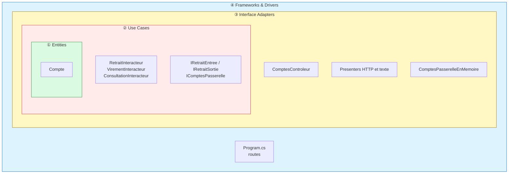
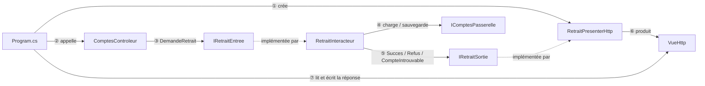
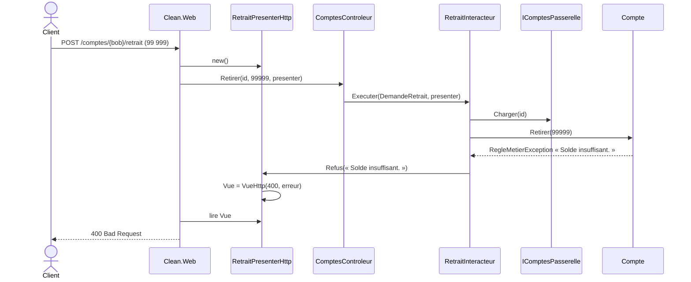

# 3. Clean Architecture

> **En une phrase** : chaque cas d'utilisation est une classe (*interactor*) avec des frontières explicites
> (*boundaries*) ; il ne renvoie rien et pousse son résultat vers un *presenter*.

📁 Code : [`03-Clean`](../03-Clean) · ⬅️ [Onion](02-onion.md) · ➡️ [Cœur fonctionnel](04-coeur-fonctionnel.md) · 🌐 [English](en/03-clean.md)

---

## L'idée

Formalisée par **Robert C. Martin (Uncle Bob)** en 2012, c'est une synthèse de l'hexagonale et de l'Onion avec un
vocabulaire précis. Quatre cercles, et une seule règle : **la règle de dépendance** — le code d'un cercle ne connaît que
les cercles plus intérieurs.



| Cercle | Projet |
|---|---|
| ① Entities | `Clean.Entites` |
| ② Use Cases | `Clean.CasUtilisation` |
| ③ Interface Adapters | `Clean.AdaptateursInterface` |
| ④ Frameworks & Drivers | `Clean.Web` (ASP.NET Core) |

### Le vocabulaire

| Terme | Dans la démo | Rôle |
|---|---|---|
| **Request model** | `DemandeRetrait` | Données d'entrée du cas d'utilisation, sans rien du web |
| **Input boundary** | `IRetraitEntree` | Ce que le contrôleur appelle |
| **Interactor** | `RetraitInteracteur` | Le cas d'utilisation |
| **Output boundary** | `IRetraitSortie` | Ce que l'interacteur appelle pour rendre son résultat |
| **Response model** | `ReponseRetrait` | Données de sortie |
| **Presenter** | `RetraitPresenterHttp` | Implémente l'output boundary, fabrique une vue |
| **Gateway** | `IComptesPasserelle` | Accès aux données (= port sortant) |

### Le flux de contrôle traverse les cercles… mais pas les dépendances



L'interacteur appelle le presenter **à travers une interface qu'il définit lui-même** (`IRetraitSortie`) : c'est
l'inversion des dépendances appliquée à la **sortie**.

---

## Le code, pas à pas

### 1. Un cas d'utilisation complet dans un fichier

([Retrait.cs](../03-Clean/Clean.CasUtilisation/Retrait/Retrait.cs))

```csharp
public record WithdrawalRequest(Guid AccountId, decimal Amount);
public record WithdrawalResponse(Guid AccountId, decimal OldBalance, decimal NewBalance);

public interface IWithdrawalInput
{
    Task Execute(WithdrawalRequest request, IWithdrawalOutput output);
}

public interface IWithdrawalOutput
{
    void Success(WithdrawalResponse response);
    void AccountNotFound(Guid accountId);
    void Refused(string reason);
}

/// The interactor returns nothing: it pushes its result to the output boundary.
/// So it has no idea whether the response will end up as JSON, HTML or text.
public class WithdrawalInteractor(IAccountsGateway accounts) : IWithdrawalInput
{
    public async Task Execute(WithdrawalRequest request, IWithdrawalOutput output)
    {
        var account = await accounts.Load(request.AccountId);
        if (account is null)
        {
            output.AccountNotFound(request.AccountId);
            return;
        }

        var oldBalance = account.Balance;
        try
        {
            account.Withdraw(request.Amount);
        }
        catch (BusinessRuleException e)
        {
            output.Refused(e.Message);
            return;
        }

        await accounts.Save(account);
        output.Success(new WithdrawalResponse(account.Id, oldBalance, account.Balance));
    }
}
```

### 2. Des presenters qui décident de la forme

([PresentersHttp.cs](../03-Clean/Clean.AdaptateursInterface/Presenters/PresentersHttp.cs)) — le presenter produit un
*view model* (`VueHttp`), pas un `IResult` : les adaptateurs ne dépendent pas d'ASP.NET Core.

```csharp
public class WithdrawalHttpPresenter : IWithdrawalOutput
{
    public HttpView View { get; private set; } = HttpView.Refused("No result.");

    public void Success(WithdrawalResponse r) =>
        View = HttpView.Ok(new
        {
            balance = r.NewBalance,
            message = $"Withdrawal of {r.OldBalance - r.NewBalance:0.00} € done."
        });

    public void AccountNotFound(Guid accountId) => View = HttpView.NotFound(accountId);
    public void Refused(string reason) => View = HttpView.Refused(reason);
}
```

**Deux presenters pour le même interacteur** : JSON, ou relevé texte
([ConsultationPresenterTexte.cs](../03-Clean/Clean.AdaptateursInterface/Presenters/ConsultationPresenterTexte.cs)).
Ajouter un format ne touche pas au cas d'utilisation.

```csharp
public void Success(LookupResponse r) =>
    Text = $"""
        ACCOUNT STATEMENT
        Owner   : {r.Owner}
        Balance : {r.Balance.ToString("N2", English)} €
        """;
```

### 3. Le cercle extérieur n'est que de la tuyauterie

([Program.cs](../03-Clean/Clean.Web/Program.cs))

```csharp
// Each route: create the presenter → call the controller → write the view produced by the presenter.
app.MapPost("/accounts/{id:guid}/withdrawal", async (Guid id, WithdrawalBody body, AccountsController controller) =>
{
    var presenter = new WithdrawalHttpPresenter();
    await controller.Withdraw(id, body.Amount, presenter);
    return ToHttp(presenter.View);
});
```

### Le trajet d'un retrait refusé



---

## Les tests

On teste **ce que dit** l'interacteur, avec un espion sur l'output boundary, sans aucun format.
([RetraitInteracteurTests.cs](../03-Clean/Clean.Tests/CasUtilisation/RetraitInteracteurTests.cs))

```csharp
[Fact]
public async Task A_withdrawal_that_is_too_large_reports_a_refusal()
{
    await new WithdrawalInteractor(_accounts).Execute(new WithdrawalRequest(Alice, 500m), _output);

    Assert.Equal("Insufficient balance.", _output.Refused);
    Assert.Null(_output.Success);
}
```

Les presenters se testent seuls, et un test vérifie que les adaptateurs ne dépendent pas d'ASP.NET Core
([ArchitectureTests.cs](../03-Clean/Clean.Tests/ArchitectureTests.cs)).

---

## Bilan

| 👍 Points forts | 👎 Limites |
|---|---|
| Cas d'utilisation explicites, un par classe | **Cérémonie** : 6 types pour un retrait |
| Plusieurs présentations pour un même cas | Presenter à état, peu naturel avec ASP.NET Core |
| Règle de dépendance vérifiable | Souvent appliquée de façon dogmatique |

**En pratique**, les modèles « Clean » .NET populaires (Jason Taylor, Ardalis) remplacent le presenter par un simple
retour (`Result<T>`) et des handlers MediatR. On garde les cercles et la règle de dépendance, sans toute la mécanique.
Comparer avec [Vertical Slice](05-vertical-slice.md) : même retrait, un seul fichier.
