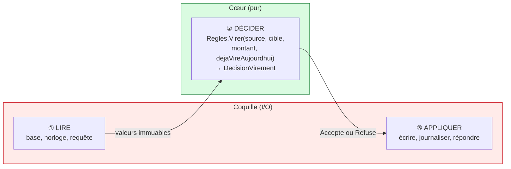
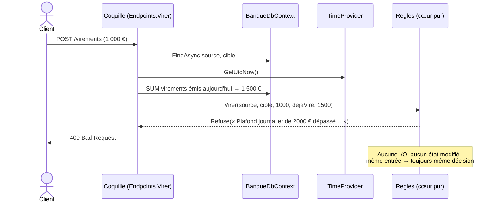

# 4. Functional Core, Imperative Shell

> **En une phrase** : les règles métier sont des **fonctions pures** qui renvoient une décision ; une fine **coquille**
> autour fait toutes les entrées/sorties.

📁 Code : [`04-CoeurFonctionnel`](../04-CoeurFonctionnel) · ⬅️ [Clean](03-clean.md) · ➡️ [Vertical Slice](05-vertical-slice.md)

---

## L'idée

Formulée par **Gary Bernhardt** (« Boundaries », 2012). C'est l'hexagonale poussée à l'extrême : le centre n'a même plus
besoin de ports, car **il ne fait jamais d'entrée/sortie**. Pas d'`async`, pas d'interface, pas de base, pas d'horloge :
des valeurs en entrée, une décision en sortie.



| | Cœur | Coquille |
|---|---|---|
| Contient | règles, décisions | I/O : HTTP, EF Core, horloge, logs |
| Style | fonctions pures, `record` immuables | impératif, `async` |
| Dépendances | aucune | le cœur + l'infrastructure |
| Tests | valeurs → valeur, **sans mock** | quelques tests d'intégration |
| Taille | grosse (toute la logique) | mince (aucune décision) |

---

## Le code, pas à pas

### 1. Des valeurs immuables et des décisions fermées

([Compte.cs](../04-CoeurFonctionnel/Fonctionnel.Coeur/Compte.cs), [Decisions.cs](../04-CoeurFonctionnel/Fonctionnel.Coeur/Decisions.cs))

```csharp
/// Valeur immuable : un compte n'est jamais modifié, on en produit une nouvelle version.
public sealed record Compte(Guid Id, string Titulaire, decimal Solde);

// Les règles ne FONT rien : elles renvoient une décision que la coquille appliquera.
public abstract record DecisionVirement
{
    public sealed record Accepte(Compte Source, Compte Cible, decimal Montant) : DecisionVirement;
    public sealed record Refuse(string Raison) : DecisionVirement;
}
```

### 2. Les règles : des fonctions pures

Le **temps** est une donnée d'entrée : le cumul viré aujourd'hui est calculé par la coquille et passé en paramètre.
([Regles.cs](../04-CoeurFonctionnel/Fonctionnel.Coeur/Regles.cs))

```csharp
public static DecisionRetrait Retirer(Compte compte, decimal montant) => montant switch
{
    <= 0 => new DecisionRetrait.Refuse("Le montant doit être strictement positif."),
    _ when montant > compte.Solde => new DecisionRetrait.Refuse("Solde insuffisant."),
    _ => new DecisionRetrait.Accepte(compte with { Solde = compte.Solde - montant }, montant)
};

public static DecisionVirement Virer(Compte source, Compte cible, decimal montant, decimal dejaVireAujourdhui)
{
    if (source.Id == cible.Id)
        return new DecisionVirement.Refuse("Impossible de virer vers le même compte.");

    if (dejaVireAujourdhui + montant > PlafondVirementJournalier)
        return new DecisionVirement.Refuse(/* « Plafond journalier de 2000 € dépassé… » */);

    // On réutilise la règle de retrait : des fonctions pures se composent naturellement.
    return Retirer(source, montant) switch
    {
        DecisionRetrait.Accepte retrait => new DecisionVirement.Accepte(
            retrait.CompteMisAJour, cible with { Solde = cible.Solde + montant }, montant),
        DecisionRetrait.Refuse refus => new DecisionVirement.Refuse(refus.Raison),
        _ => throw new UnreachableException()
    };
}
```

### 3. La coquille : lire → décider → appliquer

([Endpoints.cs](../04-CoeurFonctionnel/Fonctionnel.Coquille/Endpoints.cs))

```csharp
private static async Task<IResult> Virer(VirementRequete requete, BanqueDbContext db, TimeProvider horloge, ILoggerFactory journaux)
{
    // 1. LIRE (I/O) : les comptes ET tout ce dont la règle a besoin (ici, le cumul du jour).
    var source = await db.Comptes.FindAsync(requete.Source);
    var cible = await db.Comptes.FindAsync(requete.Cible);
    if (source is null || cible is null)
        return Results.NotFound();

    var debutDuJour = horloge.GetUtcNow().UtcDateTime.Date;
    var dejaVire = await db.Operations
        .Where(o => o.CompteId == source.Id && o.Type == "VirementEmis" && o.DateUtc >= debutDuJour)
        .SumAsync(o => o.Montant);

    // 2. DÉCIDER (pur)
    var decision = Regles.Virer(source.VersCoeur(), cible.VersCoeur(), requete.Montant, dejaVire);

    // 3. APPLIQUER (I/O)
    switch (decision)
    {
        case DecisionVirement.Accepte ok:
            source.Solde = ok.Source.Solde;
            cible.Solde = ok.Cible.Solde;
            db.Operations.Add(Operation(source.Id, "VirementEmis", ok.Montant, horloge));
            db.Operations.Add(Operation(cible.Id, "VirementRecu", ok.Montant, horloge));
            await db.SaveChangesAsync();
            return Results.Ok(new { source = ok.Source, cible = ok.Cible });

        case DecisionVirement.Refuse refus:
            return Results.BadRequest(new { erreur = refus.Raison });

        default:
            throw new UnreachableException();
    }
}
```

La coquille a son **propre modèle de persistance** mutable (`CompteLigne`), converti en valeur du cœur par `VersCoeur()`.



---

## Les tests

Tester une fonction pure : des valeurs en entrée, une valeur attendue en sortie. **Rien d'autre.**
([ReglesTests.cs](../04-CoeurFonctionnel/Fonctionnel.Tests/ReglesTests.cs))

```csharp
[Fact]
public void Le_plafond_journalier_tient_compte_de_ce_qui_a_deja_ete_vire()
{
    // Le « temps » est une simple donnée : pas besoin de simuler une horloge.
    var decision = Regles.Virer(Alice with { Solde = 10_000m }, Bob, 600m, dejaVireAujourdhui: 1_500m);

    Assert.IsType<DecisionVirement.Refuse>(decision);
}

[Fact]
public void Une_decision_ne_modifie_jamais_le_compte_d_origine()
{
    Regles.Retirer(Alice, 100m);

    Assert.Equal(1000m, Alice.Solde);
}
```

Le projet de tests ne référence **que** le cœur : ni EF Core, ni ASP.NET Core, ni mock.

---

## Bilan

| 👍 Points forts | 👎 Limites |
|---|---|
| Règles testables en millisecondes, sans aucun double | Il faut tout charger **avant** de décider |
| Raisonnement local : même entrée, même sortie | Difficile si la décision nécessite des lectures en cascade |
| Les décisions sont des données (journalisables, rejouables) | Demande une habitude du style fonctionnel |

**Quand l'utiliser** : règles complexes (tarification, éligibilité, calculs, plafonds), à l'intérieur de n'importe quelle
autre architecture. Le même principe — *décider* séparé d'*appliquer* — est au cœur de l'[Event Sourcing](10-event-sourcing.md).
