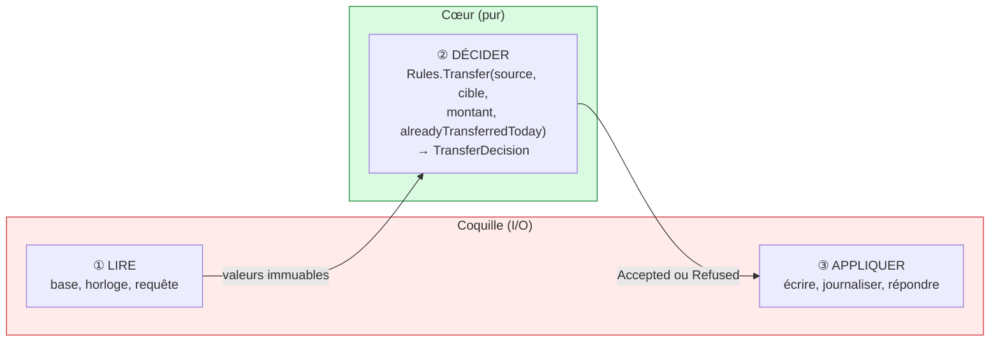
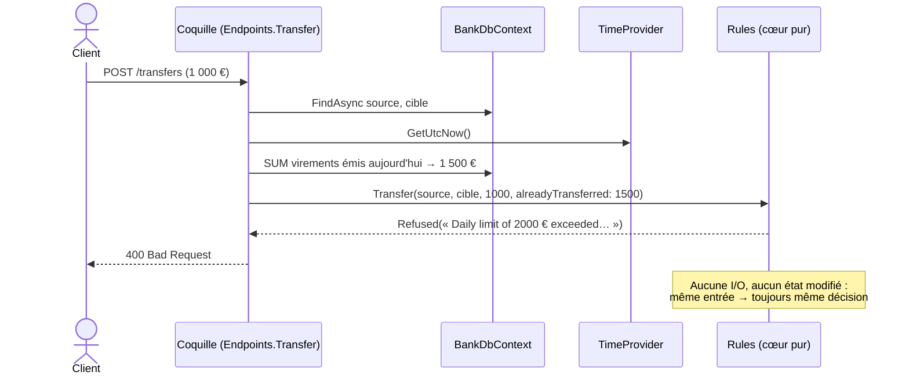

# 4. Functional Core, Imperative Shell

> **En une phrase** : les règles métier sont des **fonctions pures** qui renvoient une décision ; une fine **coquille**
> autour fait toutes les entrées/sorties.

📁 Code : [`04-FunctionalCore`](../04-FunctionalCore) · ⬅️ [Clean](03-clean.md) · ➡️ [Vertical Slice](05-vertical-slice.md) · 🌐 [English](en/04-coeur-fonctionnel.md)

---

## L'idée

Formulée par **Gary Bernhardt** (« Boundaries », 2012). C'est l'hexagonale poussée à l'extrême : le centre n'a même plus
besoin de ports, car **il ne fait jamais d'entrée/sortie**. Pas d'`async`, pas d'interface, pas de base, pas d'horloge :
des valeurs en entrée, une décision en sortie.



| | Cœur | Coquille |
|---|---|---|
| Contient | règles, décisions | I/O : HTTP, EF Core, horloge, logs |
| Style | fonctions pures, `record` immuables | impératif, `async` |
| Dépendances | aucune | le cœur + l'infrastructure |
| Tests | valeurs → valeur, **sans mock** | quelques tests d'intégration |
| Taille | grosse (toute la logique) | mince (aucune décision) |

---

## Le code, pas à pas

### 1. Des valeurs immuables et des décisions fermées

([Account.cs](../04-FunctionalCore/Functional.Core/Account.cs), [Decisions.cs](../04-FunctionalCore/Functional.Core/Decisions.cs))

```csharp
/// Immutable value: an account is never modified, a new version of it is produced.
public sealed record Account(Guid Id, string Owner, decimal Balance);

// The rules DO nothing: they return a decision that the shell will apply.
public abstract record TransferDecision
{
    public sealed record Accepted(Account Source, Account Target, decimal Amount) : TransferDecision;
    public sealed record Refused(string Reason) : TransferDecision;
}
```

### 2. Les règles : des fonctions pures

Le **temps** est une donnée d'entrée : le cumul viré aujourd'hui est calculé par la coquille et passé en paramètre.
([Rules.cs](../04-FunctionalCore/Functional.Core/Rules.cs))

```csharp
public static WithdrawalDecision Withdraw(Account account, decimal amount) => amount switch
{
    <= 0 => new WithdrawalDecision.Refused("The amount must be strictly positive."),
    _ when amount > account.Balance => new WithdrawalDecision.Refused("Insufficient balance."),
    _ => new WithdrawalDecision.Accepted(account with { Balance = account.Balance - amount }, amount)
};

public static TransferDecision Transfer(Account source, Account target, decimal amount, decimal alreadyTransferredToday)
{
    if (source.Id == target.Id)
        return new TransferDecision.Refused("Cannot transfer to the same account.");

    if (alreadyTransferredToday + amount > DailyTransferLimit)
        return new TransferDecision.Refused(/* "Daily limit of 2000 € exceeded…" */);

    // The withdrawal rule is reused: pure functions compose naturally.
    return Withdraw(source, amount) switch
    {
        WithdrawalDecision.Accepted withdrawal => new TransferDecision.Accepted(
            withdrawal.UpdatedAccount, target with { Balance = target.Balance + amount }, amount),
        WithdrawalDecision.Refused refusal => new TransferDecision.Refused(refusal.Reason),
        _ => throw new UnreachableException()
    };
}
```

### 3. La coquille : lire → décider → appliquer

([Endpoints.cs](../04-FunctionalCore/Functional.Shell/Endpoints.cs))

```csharp
private static async Task<IResult> Transfer(TransferRequest request, BankDbContext db, TimeProvider clock, ILoggerFactory loggers)
{
    // 1. READ (I/O): the accounts AND everything the rule needs (here, the day's total).
    var source = await db.Accounts.FindAsync(request.Source);
    var target = await db.Accounts.FindAsync(request.Target);
    if (source is null || target is null)
        return Results.NotFound();

    var startOfDay = clock.GetUtcNow().UtcDateTime.Date;
    var alreadyTransferred = await db.Operations
        .Where(o => o.AccountId == source.Id && o.Type == "TransferSent" && o.DateUtc >= startOfDay)
        .SumAsync(o => o.Amount);

    // 2. DECIDE (pure)
    var decision = Rules.Transfer(source.ToCore(), target.ToCore(), request.Amount, alreadyTransferred);

    // 3. APPLY (I/O)
    switch (decision)
    {
        case TransferDecision.Accepted ok:
            source.Balance = ok.Source.Balance;
            target.Balance = ok.Target.Balance;
            db.Operations.Add(Operation(source.Id, "TransferSent", ok.Amount, clock));
            db.Operations.Add(Operation(target.Id, "TransferReceived", ok.Amount, clock));
            await db.SaveChangesAsync();
            return Results.Ok(new { source = ok.Source, target = ok.Target });

        case TransferDecision.Refused refusal:
            return Results.BadRequest(new { error = refusal.Reason });

        default:
            throw new UnreachableException();
    }
}
```

La coquille a son **propre modèle de persistance** mutable (`AccountRow`), converti en valeur du cœur par `ToCore()`.



---

## Les tests

Tester une fonction pure : des valeurs en entrée, une valeur attendue en sortie. **Rien d'autre.**
([RulesTests.cs](../04-FunctionalCore/Functional.Tests/RulesTests.cs))

```csharp
[Fact]
public void The_daily_limit_takes_into_account_what_was_already_transferred()
{
    // "Time" is a mere piece of data: no need to fake a clock.
    var decision = Rules.Transfer(Alice with { Balance = 10_000m }, Bob, 600m, alreadyTransferredToday: 1_500m);

    Assert.IsType<TransferDecision.Refused>(decision);
}

[Fact]
public void A_decision_never_modifies_the_original_account()
{
    Rules.Withdraw(Alice, 100m);

    Assert.Equal(1000m, Alice.Balance);
}
```

Le projet de tests ne référence **que** le cœur : ni EF Core, ni ASP.NET Core, ni mock.

---

## Bilan

| 👍 Points forts | 👎 Limites |
|---|---|
| Règles testables en millisecondes, sans aucun double | Il faut tout charger **avant** de décider |
| Raisonnement local : même entrée, même sortie | Difficile si la décision nécessite des lectures en cascade |
| Les décisions sont des données (journalisables, rejouables) | Demande une habitude du style fonctionnel |

**Quand l'utiliser** : règles complexes (tarification, éligibilité, calculs, plafonds), à l'intérieur de n'importe quelle
autre architecture. Le même principe — *décider* séparé d'*appliquer* — est au cœur de l'[Event Sourcing](10-event-sourcing.md).
