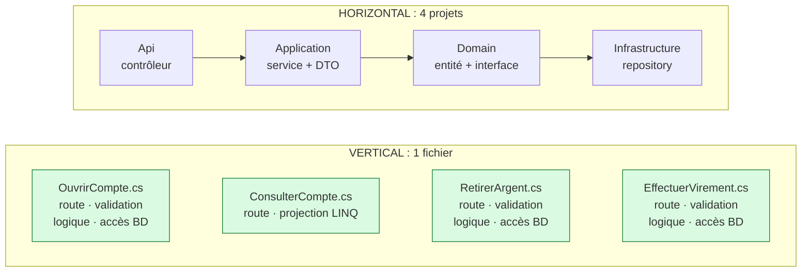
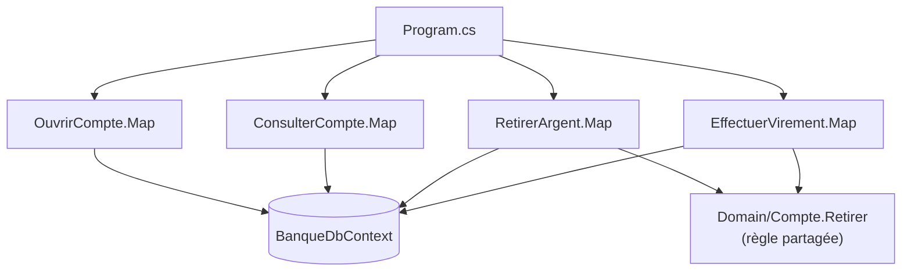

# 5. Vertical Slice Architecture

> **En une phrase** : on range le code **par fonctionnalité** et non par couche technique ; chaque tranche contient
> tout ce qu'il faut, de la route HTTP jusqu'à la base.

📁 Code : [`05-VerticalSlice`](../05-VerticalSlice) · ⬅️ [Cœur fonctionnel](04-coeur-fonctionnel.md) · ➡️ [Composants](06-composants.md) · 🌐 [English](en/05-vertical-slice.md)

---

## L'idée

Popularisée par **Jimmy Bogard** (auteur de MediatR et AutoMapper) vers 2018. Le constat : dans une architecture en
couches, ajouter « retirer de l'argent » oblige à modifier un contrôleur, un service, une interface, un repository, un DTO…
dans quatre projets. Les changements suivent les **fonctionnalités**, pas les couches : rangeons le code ainsi.



**Principes** :
1. Une tranche = une requête ou une commande.
2. **Couplage fort à l'intérieur** d'une tranche, **faible entre** les tranches.
3. Chaque tranche choisit sa technique (projection LINQ, entité, SQL…).
4. Pas d'abstraction « au cas où » : le `DbContext` est déjà un repository + unit of work.

---

## Organisation de la solution

```
Vertical.Api/
├── Features/
│   ├── Comptes/
│   │   ├── OuvrirCompte.cs       ← transaction script : tout est dans le fichier
│   │   ├── ConsulterCompte.cs    ← lecture : projection LINQ directe
│   │   └── RetirerArgent.cs      ← écriture : validation + règle + persistance
│   └── Virements/
│       └── EffectuerVirement.cs
├── Domain/Compte.cs              ← seulement la règle PARTAGÉE
├── Data/BanqueDbContext.cs       ← pas de repository par-dessus
└── Program.cs
```



---

## Le code, pas à pas

### 1. Une tranche d'écriture complète

Pour comprendre ou modifier « retirer de l'argent », on n'ouvre **que ce fichier**.
([RetirerArgent.cs](../05-VerticalSlice/Vertical.Api/Features/Comptes/RetirerArgent.cs))

```csharp
public static class RetirerArgent
{
    public record Requete(decimal Montant);
    public record Reponse(Guid CompteId, decimal NouveauSolde);

    public static void Map(IEndpointRouteBuilder app) => app.MapPost("/comptes/{id:guid}/retrait", Executer);

    private static async Task<IResult> Executer(Guid id, Requete requete, BanqueDbContext db)
    {
        if (requete.Montant <= 0)
            return Results.ValidationProblem(new Dictionary<string, string[]>
            {
                [nameof(Requete.Montant)] = ["Le montant doit être strictement positif."]
            });

        var compte = await db.Comptes.FindAsync(id);
        if (compte is null)
            return Results.NotFound();

        if (compte.Retirer(requete.Montant) is { } refus)
            return Results.BadRequest(new { erreur = refus });

        db.Operations.Add(new Operation { CompteId = id, Libelle = "Retrait", Montant = -requete.Montant });
        await db.SaveChangesAsync();

        return Results.Ok(new Reponse(id, compte.Solde));
    }
}
```

### 2. Une tranche de lecture, avec sa propre technique

Projection directe vers la réponse, en lecture seule, sans passer par le domaine.
([ConsulterCompte.cs](../05-VerticalSlice/Vertical.Api/Features/Comptes/ConsulterCompte.cs))

```csharp
var compte = await db.Comptes
    .AsNoTracking()
    .Where(c => c.Id == id)
    .Select(c => new { c.Id, c.Titulaire, c.Solde })
    .FirstOrDefaultAsync();

var operations = await db.Operations
    .AsNoTracking()
    .Where(o => o.CompteId == id)
    .OrderByDescending(o => o.DateUtc)
    .Take(5)
    .Select(o => new OperationVue(o.Libelle, o.Montant, o.DateUtc))
    .ToListAsync();
```

### 3. Le domaine : seulement ce qui est partagé

La règle « solde suffisant » était d'abord dans `RetirerArgent`. Quand `EffectuerVirement` en a eu besoin, elle a été
**remontée** dans l'entité. On n'extrait vers le domaine que ce qui le mérite.
([Compte.cs](../05-VerticalSlice/Vertical.Api/Domain/Compte.cs))

```csharp
/// <returns>null si le retrait est fait, sinon la raison du refus.</returns>
public string? Retirer(decimal montant)
{
    if (montant > Solde)
        return "Solde insuffisant.";
    Solde -= montant;
    return null;
}
```

### 4. Ajouter une fonctionnalité = un fichier + une ligne

([Program.cs](../05-VerticalSlice/Vertical.Api/Program.cs))

```csharp
// Chaque tranche déclare elle-même sa route. Ajouter une fonctionnalité = un fichier + une ligne ici.
OuvrirCompte.Map(app);
ConsulterCompte.Map(app);
RetirerArgent.Map(app);
EffectuerVirement.Map(app);
```

---

## Les tests

Surtout des **tests d'intégration par tranche**, rangés comme le code (`Features/Comptes/RetirerArgentTests.cs`…),
avec l'API démarrée en mémoire et une base neuve par test.
([RetirerArgentTests.cs](../05-VerticalSlice/Vertical.Tests/Features/Comptes/RetirerArgentTests.cs))

```csharp
[Theory]
[InlineData(0, HttpStatusCode.BadRequest)]       // validation de la tranche
[InlineData(99_999, HttpStatusCode.BadRequest)]  // règle du domaine (solde insuffisant)
public async Task Un_retrait_invalide_est_refuse(int montant, HttpStatusCode attendu)
{
    await using var app = new BanqueApplication();

    var reponse = await app.CreateClient()
        .PostAsJsonAsync($"/comptes/{BanqueDbContext.Alice}/retrait", new RetirerArgent.Requete(montant));

    Assert.Equal(attendu, reponse.StatusCode);
}
```

Les tests réutilisent les types de la tranche (`RetirerArgent.Requete`, `RetirerArgent.Reponse`) : le contrat est au même endroit que le code.

---

## Bilan

| 👍 Points forts | 👎 Limites |
|---|---|
| Une fonctionnalité = un fichier : lisible, facile à modifier | Duplication si on ne remonte pas les règles partagées |
| Chaque tranche choisit la technique adaptée | Handlers obèses si on n'extrait jamais rien |
| Très peu d'abstractions, peu de projets | Changer de base demande plus de travail (le `DbContext` est partout) |
| Les tranches évoluent indépendamment | Exige de la discipline pour reconnaître le code partagé |

**Quand l'utiliser** : API de gestion, équipes qui livrent fonctionnalité par fonctionnalité. **Combinaison fréquente** :
des tranches verticales *dans chaque module* d'un [monolithe modulaire](07-monolithe-modulaire.md), avec des ports
hexagonaux uniquement autour des services externes. Avec MediatR, chaque tranche contient une `Command`/`Query` et son
`Handler` (attention : MediatR est payant pour les entreprises depuis 2025).
