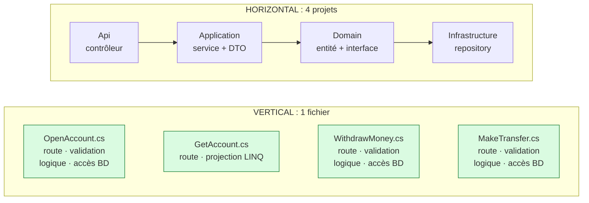
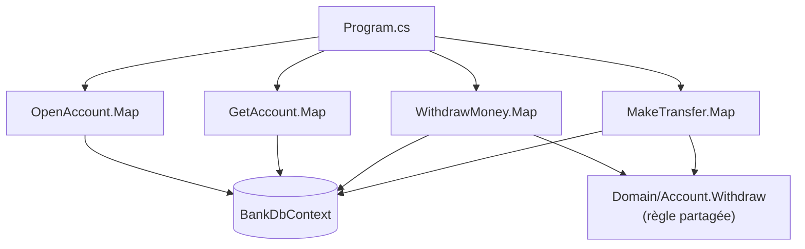

# 5. Vertical Slice Architecture

> **En une phrase** : on range le code **par fonctionnalité** et non par couche technique ; chaque tranche contient
> tout ce qu'il faut, de la route HTTP jusqu'à la base.

📁 Code : [`05-VerticalSlice`](../05-VerticalSlice) · ⬅️ [Cœur fonctionnel](04-coeur-fonctionnel.md) · ➡️ [Composants](06-composants.md) · 🌐 [English](en/05-vertical-slice.md)

---

## L'idée

Popularisée par **Jimmy Bogard** (auteur de MediatR et AutoMapper) vers 2018. Le constat : dans une architecture en
couches, ajouter « retirer de l'argent » oblige à modifier un contrôleur, un service, une interface, un repository, un DTO…
dans quatre projets. Les changements suivent les **fonctionnalités**, pas les couches : rangeons le code ainsi.



**Principes** :
1. Une tranche = une requête ou une commande.
2. **Couplage fort à l'intérieur** d'une tranche, **faible entre** les tranches.
3. Chaque tranche choisit sa technique (projection LINQ, entité, SQL…).
4. Pas d'abstraction « au cas où » : le `DbContext` est déjà un repository + unit of work.

---

## Organisation de la solution

```
Vertical.Api/
├── Features/
│   ├── Accounts/
│   │   ├── OpenAccount.cs     ← transaction script : tout est dans le fichier
│   │   ├── GetAccount.cs      ← lecture : projection LINQ directe
│   │   └── WithdrawMoney.cs   ← écriture : validation + règle + persistance
│   └── Transfers/
│       └── MakeTransfer.cs
├── Domain/Account.cs          ← seulement la règle PARTAGÉE
├── Data/BankDbContext.cs      ← pas de repository par-dessus
└── Program.cs
```



---

## Le code, pas à pas

### 1. Une tranche d'écriture complète

Pour comprendre ou modifier « retirer de l'argent », on n'ouvre **que ce fichier**.
([WithdrawMoney.cs](../05-VerticalSlice/Vertical.Api/Features/Accounts/WithdrawMoney.cs))

```csharp
public static class WithdrawMoney
{
    public record Request(decimal Amount);
    public record Response(Guid AccountId, decimal NewBalance);

    public static void Map(IEndpointRouteBuilder app) => app.MapPost("/accounts/{id:guid}/withdrawal", Execute);

    private static async Task<IResult> Execute(Guid id, Request request, BankDbContext db)
    {
        if (request.Amount <= 0)
            return Results.ValidationProblem(new Dictionary<string, string[]>
            {
                [nameof(Request.Amount)] = ["The amount must be strictly positive."]
            });

        var account = await db.Accounts.FindAsync(id);
        if (account is null)
            return Results.NotFound();

        if (account.Withdraw(request.Amount) is { } refusal)
            return Results.BadRequest(new { error = refusal });

        db.Operations.Add(new Operation { AccountId = id, Label = "Withdrawal", Amount = -request.Amount });
        await db.SaveChangesAsync();

        return Results.Ok(new Response(id, account.Balance));
    }
}
```

### 2. Une tranche de lecture, avec sa propre technique

Projection directe vers la réponse, en lecture seule, sans passer par le domaine.
([GetAccount.cs](../05-VerticalSlice/Vertical.Api/Features/Accounts/GetAccount.cs))

```csharp
var account = await db.Accounts
    .AsNoTracking()
    .Where(c => c.Id == id)
    .Select(c => new { c.Id, c.Owner, c.Balance })
    .FirstOrDefaultAsync();

var operations = await db.Operations
    .AsNoTracking()
    .Where(o => o.AccountId == id)
    .OrderByDescending(o => o.DateUtc)
    .Take(5)
    .Select(o => new OperationView(o.Label, o.Amount, o.DateUtc))
    .ToListAsync();
```

### 3. Le domaine : seulement ce qui est partagé

La règle « solde suffisant » était d'abord dans `WithdrawMoney`. Quand `MakeTransfer` en a eu besoin, elle a été
**remontée** dans l'entité. On n'extrait vers le domaine que ce qui le mérite.
([Account.cs](../05-VerticalSlice/Vertical.Api/Domain/Account.cs))

```csharp
/// <returns>null if the withdrawal is done, otherwise the reason for the refusal.</returns>
public string? Withdraw(decimal amount)
{
    if (amount > Balance)
        return "Insufficient balance.";
    Balance -= amount;
    return null;
}
```

### 4. Ajouter une fonctionnalité = un fichier + une ligne

([Program.cs](../05-VerticalSlice/Vertical.Api/Program.cs))

```csharp
// Each slice declares its own route. Adding a feature = one file + one line here.
OpenAccount.Map(app);
GetAccount.Map(app);
WithdrawMoney.Map(app);
MakeTransfer.Map(app);
```

---

## Les tests

Surtout des **tests d'intégration par tranche**, rangés comme le code (`Features/Accounts/WithdrawMoneyTests.cs`…),
avec l'API démarrée en mémoire et une base neuve par test.
([WithdrawMoneyTests.cs](../05-VerticalSlice/Vertical.Tests/Features/Accounts/WithdrawMoneyTests.cs))

```csharp
[Theory]
[InlineData(0, HttpStatusCode.BadRequest)]       // validation of the slice
[InlineData(99_999, HttpStatusCode.BadRequest)]  // domain rule (insufficient balance)
public async Task An_invalid_withdrawal_is_refused(int amount, HttpStatusCode expected)
{
    await using var app = new BankApplication();

    var response = await app.CreateClient()
        .PostAsJsonAsync($"/accounts/{BankDbContext.Alice}/withdrawal", new WithdrawMoney.Request(amount));

    Assert.Equal(expected, response.StatusCode);
}
```

Les tests réutilisent les types de la tranche (`WithdrawMoney.Request`, `WithdrawMoney.Response`) : le contrat est au même endroit que le code.

---

## Bilan

| 👍 Points forts | 👎 Limites |
|---|---|
| Une fonctionnalité = un fichier : lisible, facile à modifier | Duplication si on ne remonte pas les règles partagées |
| Chaque tranche choisit la technique adaptée | Handlers obèses si on n'extrait jamais rien |
| Très peu d'abstractions, peu de projets | Changer de base demande plus de travail (le `DbContext` est partout) |
| Les tranches évoluent indépendamment | Exige de la discipline pour reconnaître le code partagé |

**Quand l'utiliser** : API de gestion, équipes qui livrent fonctionnalité par fonctionnalité. **Combinaison fréquente** :
des tranches verticales *dans chaque module* d'un [monolithe modulaire](07-monolithe-modulaire.md), avec des ports
hexagonaux uniquement autour des services externes. Avec MediatR, chaque tranche contient une `Command`/`Query` et son
`Handler` (attention : MediatR est payant pour les entreprises depuis 2025).
