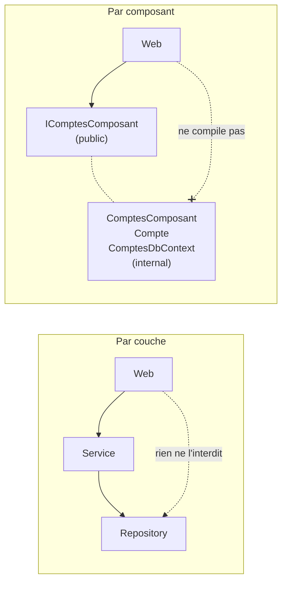
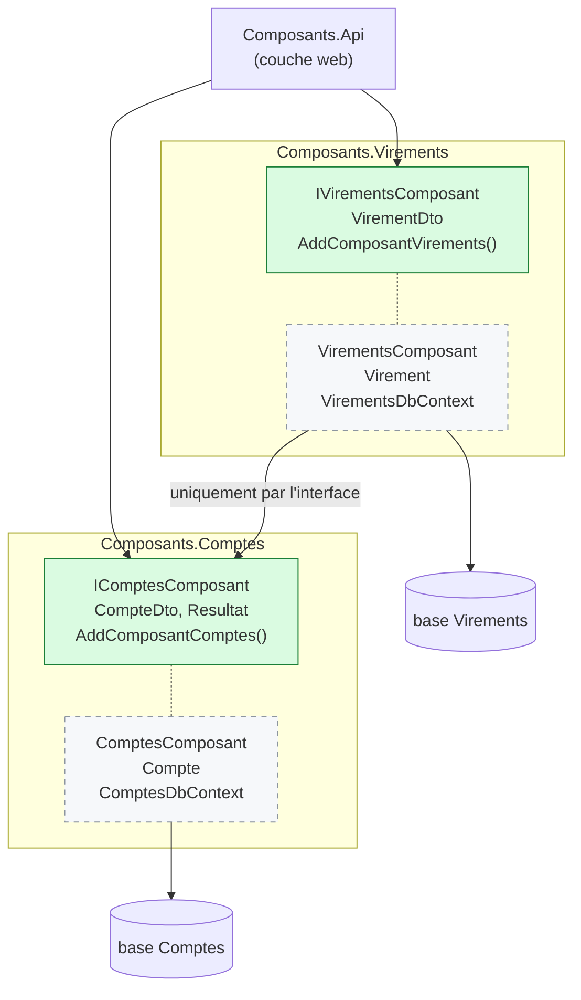
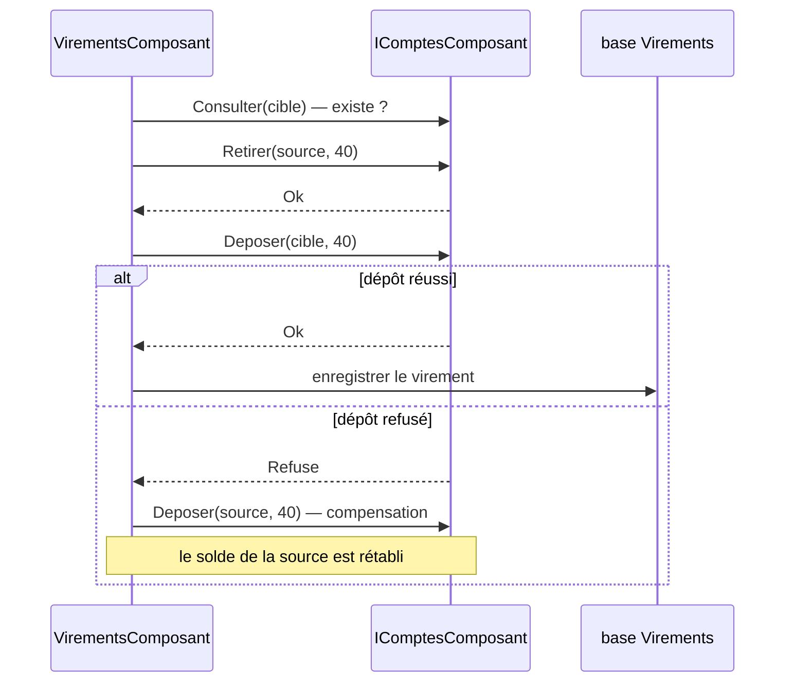

# 6. Package by Component

> **En une phrase** : chaque composant regroupe métier et données derrière **une seule interface publique** ;
> tout le reste est `internal`, et c'est le compilateur qui fait respecter l'architecture.

📁 Code : [`06-Composants`](../06-Composants) · ⬅️ [Vertical Slice](05-vertical-slice.md) · ➡️ [Monolithe modulaire](07-monolithe-modulaire.md)

---

## L'idée

Proposée par **Simon Brown** (auteur du modèle C4) dans *« The Missing Chapter »* du livre *Clean Architecture*.
Son constat : **dans les architectures précédentes, rien n'empêche un développeur pressé de court-circuiter le schéma**.
Si tout est `public`, un contrôleur peut appeler directement le repository. L'architecture n'existe que sur le papier.



---

## Organisation de la solution



En vert : `public`. En pointillés : `internal`, invisible hors du projet. **Chaque composant possède sa base** :
Virements ne lit jamais les tables de Comptes.

---

## Le code, pas à pas

### 1. La surface publique d'un composant

([IComptesComposant.cs](../06-Composants/Composants.Comptes/IComptesComposant.cs))

```csharp
// ─── Surface publique du composant : c'est tout ce que le reste de l'application peut voir. ───
public interface IComptesComposant
{
    Task<CompteDto> Ouvrir(string titulaire, decimal depotInitial, Guid? id = null);
    Task<CompteDto?> Consulter(Guid compteId);
    Task<Resultat> Retirer(Guid compteId, decimal montant);
    Task<Resultat> Deposer(Guid compteId, decimal montant);
}
```

### 2. Tout le reste est `internal`

([Compte.cs](../06-Composants/Composants.Comptes/Interne/Compte.cs), [ComptesComposant.cs](../06-Composants/Composants.Comptes/Interne/ComptesComposant.cs))

```csharp
// internal : invisible hors du composant. Personne ne peut faire « new Compte() » depuis l'API.
internal class Compte { /* … */ }

// L'implémentation est internal : on ne l'obtient que par l'interface, via l'injection de dépendances.
internal class ComptesComposant(ComptesDbContext db) : IComptesComposant { /* … */ }
```

Le seul autre point public : le branchement dans l'injection de dépendances.
([ComptesExtensions.cs](../06-Composants/Composants.Comptes/ComptesExtensions.cs))

```csharp
public static IServiceCollection AddComposantComptes(this IServiceCollection services, string nomBase = "Comptes")
{
    // Le composant possède SA base : aucun autre composant n'y accède.
    services.AddDbContext<ComptesDbContext>(options => options.UseInMemoryDatabase(nomBase));
    services.AddScoped<IComptesComposant, ComptesComposant>();
    return services;
}
```

### 3. Un composant en utilise un autre… par son interface

Sans transaction commune entre deux bases, il faut **compenser** si la deuxième étape échoue.
([VirementsComposant.cs](../06-Composants/Composants.Virements/Interne/VirementsComposant.cs))

```csharp
var retrait = await comptes.Retirer(sourceId, montant);
if (!retrait.Succes)
    return retrait;

var depot = await comptes.Deposer(cibleId, montant);
if (!depot.Succes)
{
    // Pas de transaction commune entre deux composants qui ont chacun leur base :
    // si la 2e étape échoue, on compense la 1re.
    await comptes.Deposer(sourceId, montant);
    return depot;
}
```



### 4. L'API ne peut pas tricher

([Program.cs](../06-Composants/Composants.Api/Program.cs))

```csharp
// Essayez d'écrire « new ComptesDbContext(...) » ou « new Compte(...) » ici : ça ne compile pas.
app.MapPost("/comptes/{id:guid}/retrait", async (Guid id, RetraitRequete requete, IComptesComposant comptes) =>
    EnHttp(await comptes.Retirer(id, requete.Montant)));
```

---

## Les tests

- **Boîte noire** : chaque composant est testé par son interface publique, avec sa vraie base en mémoire.
- **Isolation** : le composant Virements est testé avec un **faux** `IComptesComposant` dont le dépôt échoue, pour vérifier
  la compensation ([VirementsComposantTests.cs](../06-Composants/Composants.Tests/VirementsComposantTests.cs)) :

```csharp
Assert.Equal(["retrait source 40", "dépôt cible 40 (refusé)", "dépôt source 40"], faux.Journal);
```

- **Garde-fou** : la surface publique est verrouillée. Rendre un type interne `public` fait échouer le test
  ([ArchitectureTests.cs](../06-Composants/Composants.Tests/ArchitectureTests.cs)) :

```csharp
var publics = typeof(IComptesComposant).Assembly.GetExportedTypes().Select(t => t.Name).Order();

Assert.Equal(
    ["CompteDto", "ComptesExtensions", "IComptesComposant", "Resultat", "StatutResultat"],
    publics);
```

- `InternalsVisibleTo` (dans le `.csproj`) ouvre l'intérieur au seul projet de tests, pour tester l'entité `Compte` directement.

---

## Bilan

| 👍 Points forts | 👎 Limites |
|---|---|
| Architecture imposée par le compilateur | Bien concevoir les interfaces publiques demande du soin |
| Une base par composant : vraie indépendance des données | Plus de transaction commune : compensation nécessaire |
| Chemin naturel vers le monolithe modulaire puis les microservices | Un projet par composant |

**L'idée clé de Simon Brown** : une architecture qui n'est pas protégée par `internal` (ou par des tests d'architecture
comme NetArchTest / ArchUnitNET) finit toujours par être contournée. Étape suivante : des composants qui possèdent aussi
leur API et leurs événements → [Monolithe modulaire](07-monolithe-modulaire.md).
