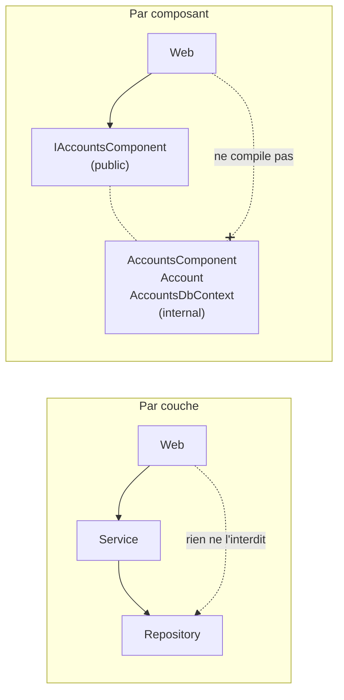
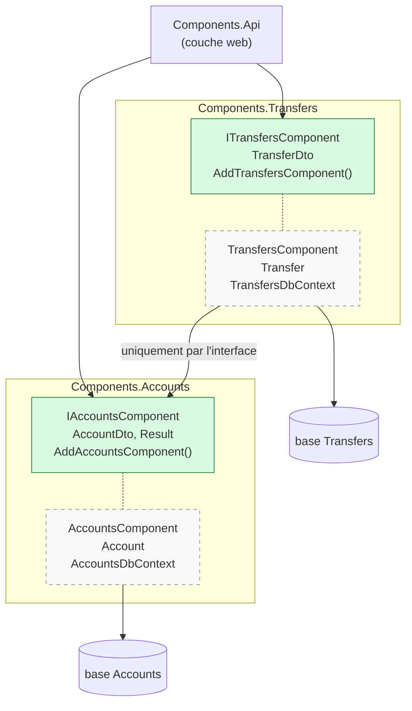
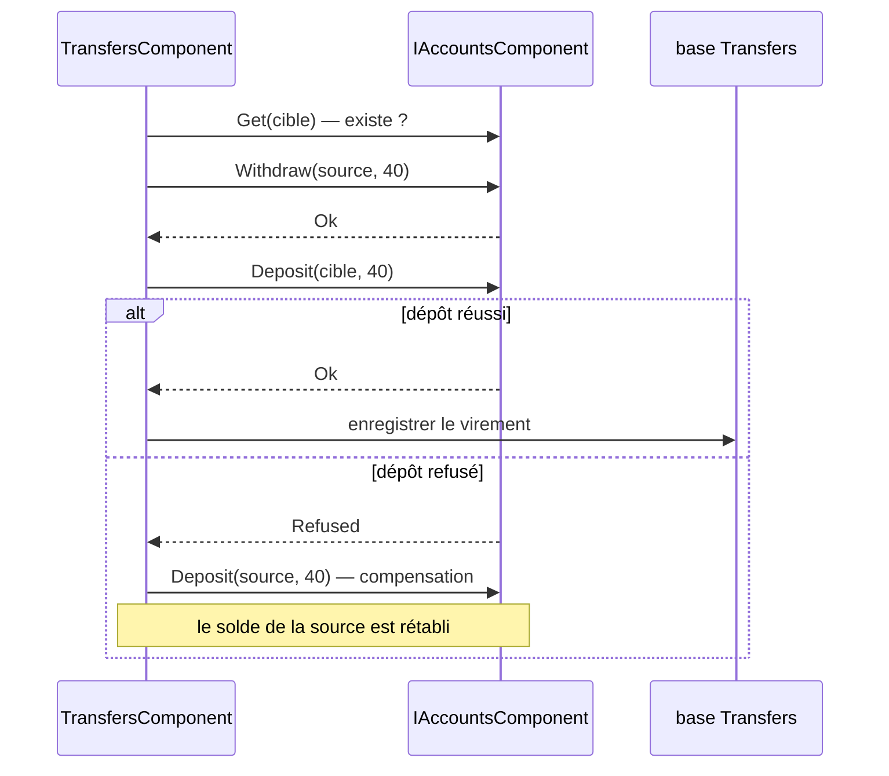

# 6. Package by Component

> **En une phrase** : chaque composant regroupe métier et données derrière **une seule interface publique** ;
> tout le reste est `internal`, et c'est le compilateur qui fait respecter l'architecture.

📁 Code : [`06-Components`](../06-Components) · ⬅️ [Vertical Slice](05-vertical-slice.md) · ➡️ [Monolithe modulaire](07-monolithe-modulaire.md) · 🌐 [English](en/06-composants.md)

---

## L'idée

Proposée par **Simon Brown** (auteur du modèle C4) dans *« The Missing Chapter »* du livre *Clean Architecture*.
Son constat : **dans les architectures précédentes, rien n'empêche un développeur pressé de court-circuiter le schéma**.
Si tout est `public`, un contrôleur peut appeler directement le repository. L'architecture n'existe que sur le papier.



---

## Organisation de la solution



En vert : `public`. En pointillés : `internal`, invisible hors du projet. **Chaque composant possède sa base** :
Virements ne lit jamais les tables de Comptes.

---

## Le code, pas à pas

### 1. La surface publique d'un composant

([IAccountsComponent.cs](../06-Components/Components.Accounts/IAccountsComponent.cs))

```csharp
// ─── Public surface of the component: this is all the rest of the application can see. ───
public interface IAccountsComponent
{
    Task<AccountDto> Open(string owner, decimal initialDeposit, Guid? id = null);
    Task<AccountDto?> Get(Guid accountId);
    Task<Result> Withdraw(Guid accountId, decimal amount);
    Task<Result> Deposit(Guid accountId, decimal amount);
}
```

### 2. Tout le reste est `internal`

([Account.cs](../06-Components/Components.Accounts/Internal/Account.cs), [AccountsComponent.cs](../06-Components/Components.Accounts/Internal/AccountsComponent.cs))

```csharp
// internal: invisible outside the component. Nobody can do "new Account()" from the API.
internal class Account { /* … */ }

// The implementation is internal: it can only be obtained through the interface, via dependency injection.
internal class AccountsComponent(AccountsDbContext db) : IAccountsComponent { /* … */ }
```

Le seul autre point public : le branchement dans l'injection de dépendances.
([AccountsExtensions.cs](../06-Components/Components.Accounts/AccountsExtensions.cs))

```csharp
public static IServiceCollection AddAccountsComponent(this IServiceCollection services, string databaseName = "Accounts")
{
    // The component owns ITS database: no other component accesses it.
    services.AddDbContext<AccountsDbContext>(options => options.UseInMemoryDatabase(databaseName));
    services.AddScoped<IAccountsComponent, AccountsComponent>();
    return services;
}
```

### 3. Un composant en utilise un autre… par son interface

Sans transaction commune entre deux bases, il faut **compenser** si la deuxième étape échoue.
([TransfersComponent.cs](../06-Components/Components.Transfers/Internal/TransfersComponent.cs))

```csharp
var withdrawal = await accounts.Withdraw(sourceId, amount);
if (!withdrawal.Success)
    return withdrawal;

var deposit = await accounts.Deposit(targetId, amount);
if (!deposit.Success)
{
    // No shared transaction between two components that each have their own database:
    // if the 2nd step fails, the 1st one is compensated.
    await accounts.Deposit(sourceId, amount);
    return deposit;
}
```



### 4. L'API ne peut pas tricher

([Program.cs](../06-Components/Components.Api/Program.cs))

```csharp
// Try writing "new AccountsDbContext(...)" or "new Account(...)" here: it does not compile.
app.MapPost("/accounts/{id:guid}/withdrawal", async (Guid id, WithdrawalRequest request, IAccountsComponent accounts) =>
    ToHttp(await accounts.Withdraw(id, request.Amount)));
```

---

## Les tests

- **Boîte noire** : chaque composant est testé par son interface publique, avec sa vraie base en mémoire.
- **Isolation** : le composant Virements est testé avec un **faux** `IAccountsComponent` dont le dépôt échoue, pour vérifier
  la compensation ([TransfersComponentTests.cs](../06-Components/Components.Tests/TransfersComponentTests.cs)) :

```csharp
Assert.Equal(["withdrawal source 40", "deposit target 40 (refused)", "deposit source 40"], fake.Log);
```

- **Garde-fou** : la surface publique est verrouillée. Rendre un type interne `public` fait échouer le test
  ([ArchitectureTests.cs](../06-Components/Components.Tests/ArchitectureTests.cs)) :

```csharp
var publics = typeof(IAccountsComponent).Assembly.GetExportedTypes().Select(t => t.Name).Order();

Assert.Equal(
    ["AccountDto", "AccountsExtensions", "IAccountsComponent", "Result", "ResultStatus"],
    publics);
```

- `InternalsVisibleTo` (dans le `.csproj`) ouvre l'intérieur au seul projet de tests, pour tester l'entité `Account` directement.

---

## Bilan

| 👍 Points forts | 👎 Limites |
|---|---|
| Architecture imposée par le compilateur | Bien concevoir les interfaces publiques demande du soin |
| Une base par composant : vraie indépendance des données | Plus de transaction commune : compensation nécessaire |
| Chemin naturel vers le monolithe modulaire puis les microservices | Un projet par composant |

**L'idée clé de Simon Brown** : une architecture qui n'est pas protégée par `internal` (ou par des tests d'architecture
comme NetArchTest / ArchUnitNET) finit toujours par être contournée. Étape suivante : des composants qui possèdent aussi
leur API et leurs événements → [Monolithe modulaire](07-monolithe-modulaire.md).
