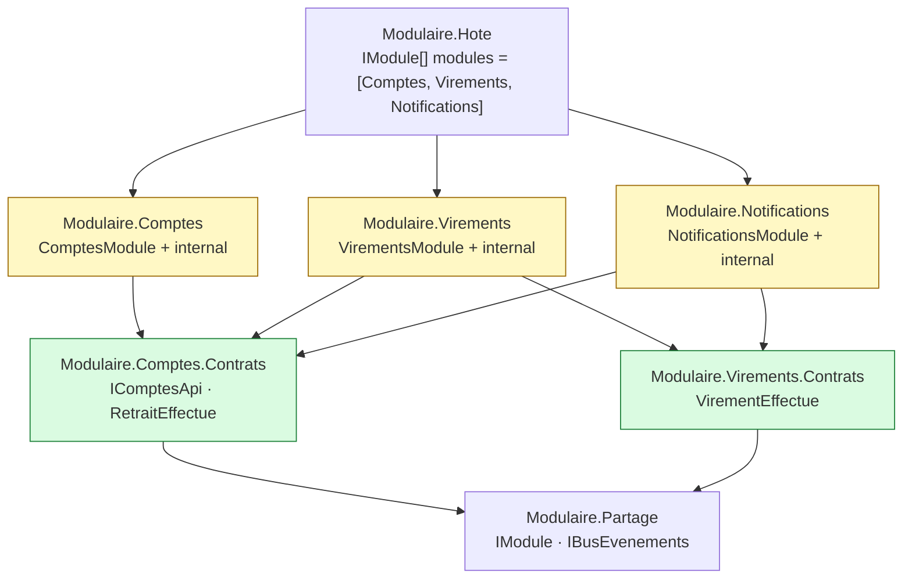
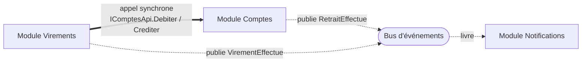
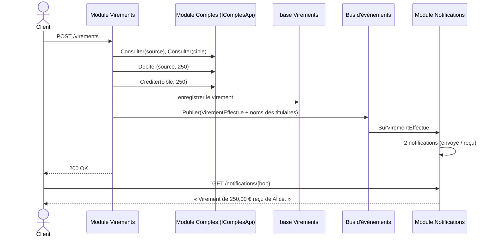

# 7. Monolithe modulaire

**Nom anglais** : *Modular Monolith*

> **En une phrase** : des modules autonomes — chacun avec son API, sa base, ses événements — reliés uniquement par des
> **contrats**, et déployés ensemble dans un seul processus.

📁 Code : [`07-MonolitheModulaire`](../07-MonolitheModulaire) · ⬅️ [Composants](06-composants.md) · ➡️ [Microservices](08-microservices.md)

---

## L'idée

Le monolithe modulaire prend le meilleur de deux mondes : la **simplicité d'exploitation** d'un monolithe (un déploiement,
pas de réseau entre modules, débogage facile) et l'**indépendance** des microservices (frontières nettes, une base par
module, communication par contrats). Shopify, entre autres, l'a popularisé comme alternative aux microservices.

Par rapport aux [composants](06-composants.md), un module n'est plus seulement « du métier derrière une interface » :
c'est une **mini-application** qui possède ses routes HTTP, sa base et ses abonnements, et qu'on branche d'une ligne.

**Qui référence qui** (projets) :



**Qui parle à qui** (à l'exécution) :



**Règles** (vérifiées par des tests d'architecture) :
1. Un module ne référence **jamais** l'implémentation d'un autre module, seulement ses **Contrats**.
2. Un module n'expose publiquement **que** sa classe `IModule`.
3. Les contrats ne dépendent d'aucun module.
4. Une base par module (`Banque-Comptes`, `Banque-Virements`, `Banque-Notifications`).

---

## Deux modes de communication

| | **Synchrone** (appel d'interface) | **Asynchrone** (événement) |
|---|---|---|
| Exemple | Virements → `IComptesApi.Debiter/Crediter` | Comptes publie `RetraitEffectue` |
| Quand | On a besoin de la réponse **tout de suite** | On **annonce** un fait, sans savoir qui écoute |
| Couplage | l'appelant connaît l'interface du module appelé | l'émetteur ne connaît pas les abonnés |
| Panne de l'autre côté | l'appelant échoue | l'émetteur n'est pas affecté |

---

## Le code, pas à pas

### 1. Le contrat d'un module

([IModule.cs](../07-MonolitheModulaire/Modulaire.Partage/IModule.cs))

```csharp
/// Ce que chaque module implémente pour se brancher dans l'hôte.
/// L'hôte ne connaît que cette interface : il ignore tout du contenu des modules.
public interface IModule
{
    string Nom { get; }
    void Enregistrer(IServiceCollection services, IConfiguration configuration);
    void MapEndpoints(IEndpointRouteBuilder app);
    Task Initialiser(IServiceProvider services) => Task.CompletedTask;
}
```

### 2. L'hôte assemble, sans aucun métier

([Program.cs](../07-MonolitheModulaire/Modulaire.Hote/Program.cs))

```csharp
// La liste des modules : retirer une ligne retire une fonctionnalité entière (routes, base, abonnements).
IModule[] modules = [new ComptesModule(), new VirementsModule(), new NotificationsModule()];

builder.Services.AddBusEvenements();
foreach (var module in modules)
    module.Enregistrer(builder.Services, builder.Configuration);

var app = builder.Build();

foreach (var module in modules)
{
    await module.Initialiser(app.Services);
    module.MapEndpoints(app);
}
```

### 3. Les contrats : ce que les autres ont le droit de connaître

([Comptes.Contrats/Contrats.cs](../07-MonolitheModulaire/Modulaire.Comptes.Contrats/Contrats.cs))

```csharp
// ─── Communication synchrone : une API que les autres modules peuvent appeler ───
public interface IComptesApi
{
    Task<CompteInfo?> Consulter(Guid compteId);
    Task<ResultatOperation> Debiter(Guid compteId, decimal montant);
    Task<ResultatOperation> Crediter(Guid compteId, decimal montant);
}

// ─── Communication asynchrone : les événements que le module publie ───
public record RetraitEffectue(Guid CompteId, decimal Montant, decimal NouveauSolde) : IEvenementIntegration;
```

### 4. Un module utilise un autre module… et publie un événement

([VirementsEndpoints.cs](../07-MonolitheModulaire/Modulaire.Virements/Interne/VirementsEndpoints.cs))

```csharp
// Appel synchrone à un autre module, uniquement par son contrat public.
var debit = await comptes.Debiter(source.Id, requete.Montant);
if (!debit.Succes)
    return Results.BadRequest(new { erreur = debit.Erreur });

var credit = await comptes.Crediter(cible.Id, requete.Montant);
if (!credit.Succes)
{
    // Chaque module a sa base : pas de transaction commune, donc on compense le débit.
    await comptes.Crediter(source.Id, requete.Montant);
    return Results.BadRequest(new { erreur = credit.Erreur });
}

db.Virements.Add(new Virement { SourceId = source.Id, CibleId = cible.Id, Montant = requete.Montant });
await db.SaveChangesAsync();

// Communication asynchrone : on annonce le virement à qui veut l'entendre.
await bus.Publier(new VirementEffectue(source.Id, source.Titulaire, cible.Id, cible.Titulaire, requete.Montant));
```

### 5. Un module ajouté sans toucher aux autres

Notifications ne fait qu'**écouter**. Il a été ajouté sans modifier une ligne de Comptes ni de Virements.
([NotificationsModule.cs](../07-MonolitheModulaire/Modulaire.Notifications/NotificationsModule.cs))

```csharp
// Abonnements aux événements des autres modules.
services.AddScoped<IGestionnaireEvenement<RetraitEffectue>, SurRetraitEffectue>();
services.AddScoped<IGestionnaireEvenement<VirementEffectue>, SurVirementEffectue>();
```

### 6. Le bus isole les pannes

([Evenements.cs](../07-MonolitheModulaire/Modulaire.Partage/Evenements.cs)) — chaque gestionnaire tourne dans son propre
scope, et une erreur chez un abonné ne fait pas échouer le module qui publie.

```csharp
foreach (var gestionnaire in scope.ServiceProvider.GetServices<IGestionnaireEvenement<T>>())
{
    try
    {
        await gestionnaire.Traiter(evenement);
    }
    catch (Exception e)
    {
        journal.LogError(e, "Le gestionnaire {Gestionnaire} a échoué sur {Evenement}",
            gestionnaire.GetType().Name, typeof(T).Name);
    }
}
```

### Le trajet d'un virement à travers les trois modules



L'événement transporte les **noms des titulaires** (*event-carried state transfer*) : Notifications n'a pas besoin de
rappeler Comptes.

---

## Les tests

- **Parcours inter-modules** ([ParcoursTests.cs](../07-MonolitheModulaire/Modulaire.Tests/ParcoursTests.cs)) : un virement
  traverse les trois modules.
- **Isolation** ([IsolationTests.cs](../07-MonolitheModulaire/Modulaire.Tests/IsolationTests.cs)) : on remplace un module
  par un faux via son contrat (`services.AddScoped<IComptesApi>(_ => faux)`), et on vérifie qu'une panne chez un abonné
  ne casse pas le module qui publie.
- **Architecture** ([ArchitectureTests.cs](../07-MonolitheModulaire/Modulaire.Tests/ArchitectureTests.cs)) :

```csharp
[Theory]
[MemberData(nameof(Modules))]
public void Un_module_ne_reference_que_des_contrats_et_le_projet_partage(string module)
{
    var interdites = DependancesInternes(Assembly.Load(module))
        .Where(nom => nom != "Modulaire.Partage" && !nom.EndsWith(".Contrats"));

    Assert.Empty(interdites);
}
```

---

## Bilan

| 👍 Points forts | 👎 Limites |
|---|---|
| Un seul déploiement, débogage simple, pas de latence réseau | Pas de mise à l'échelle indépendante des modules |
| Frontières nettes, vérifiées par les tests | Une base par module : pas de transaction ni de jointure entre modules |
| Ajouter / retirer un module d'une ligne | Le bus en mémoire perd les événements en cas de crash (→ outbox) |
| Chaque module choisit son architecture interne | Une mauvaise découpe coûte cher à corriger |

**Le point de départ recommandé** pour un système qui grandit. Le jour où un module doit être déployé à part, ses
contrats deviennent une API réseau et son bus un vrai courtier : c'est la [démo 8](08-microservices.md). En production,
ajouter une *outbox* (voir [concepts transverses](concepts-transverses.md#outbox)).
