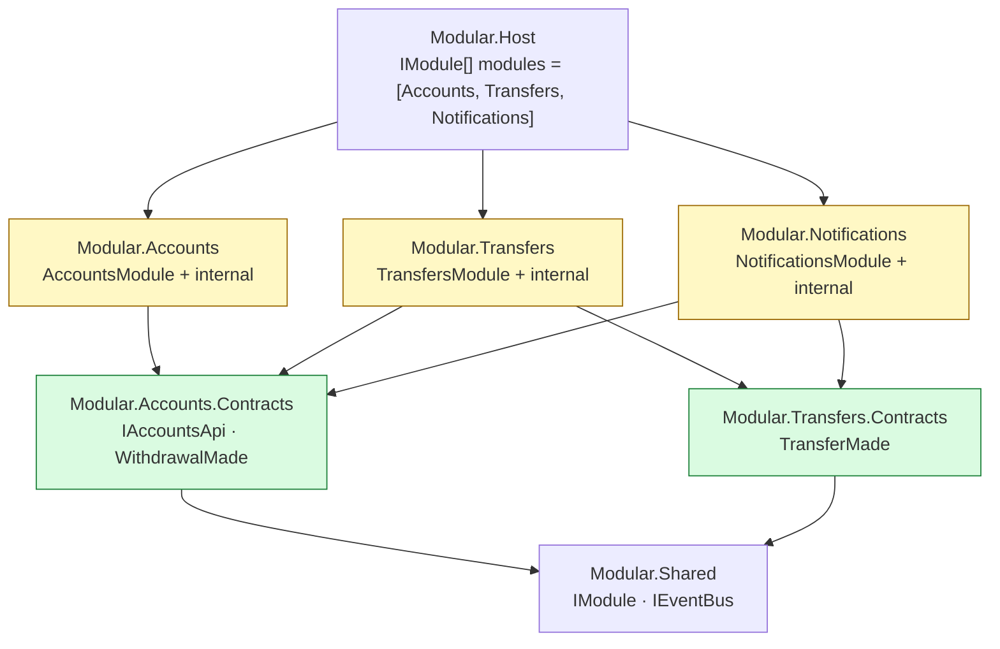
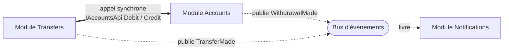
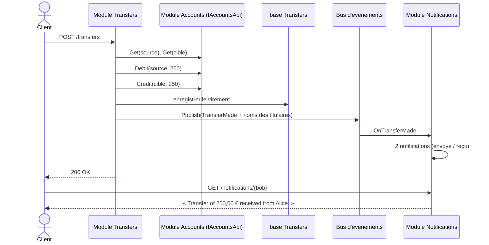

# 7. Monolithe modulaire

**Nom anglais** : *Modular Monolith*

> **En une phrase** : des modules autonomes — chacun avec son API, sa base, ses événements — reliés uniquement par des
> **contrats**, et déployés ensemble dans un seul processus.

📁 Code : [`07-ModularMonolith`](../07-ModularMonolith) · ⬅️ [Composants](06-composants.md) · ➡️ [Microservices](08-microservices.md) · 🌐 [English](en/07-monolithe-modulaire.md)

---

## L'idée

Le monolithe modulaire prend le meilleur de deux mondes : la **simplicité d'exploitation** d'un monolithe (un déploiement,
pas de réseau entre modules, débogage facile) et l'**indépendance** des microservices (frontières nettes, une base par
module, communication par contrats). Shopify, entre autres, l'a popularisé comme alternative aux microservices.

Par rapport aux [composants](06-composants.md), un module n'est plus seulement « du métier derrière une interface » :
c'est une **mini-application** qui possède ses routes HTTP, sa base et ses abonnements, et qu'on branche d'une ligne.

**Qui référence qui** (projets) :



**Qui parle à qui** (à l'exécution) :



**Règles** (vérifiées par des tests d'architecture) :
1. Un module ne référence **jamais** l'implémentation d'un autre module, seulement ses **Contrats**.
2. Un module n'expose publiquement **que** sa classe `IModule`.
3. Les contrats ne dépendent d'aucun module.
4. Une base par module (`Bank-Accounts`, `Bank-Transfers`, `Bank-Notifications`).

---

## Deux modes de communication

| | **Synchrone** (appel d'interface) | **Asynchrone** (événement) |
|---|---|---|
| Exemple | Virements → `IAccountsApi.Debit/Credit` | Comptes publie `WithdrawalMade` |
| Quand | On a besoin de la réponse **tout de suite** | On **annonce** un fait, sans savoir qui écoute |
| Couplage | l'appelant connaît l'interface du module appelé | l'émetteur ne connaît pas les abonnés |
| Panne de l'autre côté | l'appelant échoue | l'émetteur n'est pas affecté |

---

## Le code, pas à pas

### 1. Le contrat d'un module

([IModule.cs](../07-ModularMonolith/Modular.Shared/IModule.cs))

```csharp
/// What each module implements to plug itself into the host.
/// The host only knows this interface: it knows nothing about what the modules contain.
public interface IModule
{
    string Name { get; }
    void Register(IServiceCollection services, IConfiguration configuration);
    void MapEndpoints(IEndpointRouteBuilder app);
    Task Initialize(IServiceProvider services) => Task.CompletedTask;
}
```

### 2. L'hôte assemble, sans aucun métier

([Program.cs](../07-ModularMonolith/Modular.Host/Program.cs))

```csharp
// The list of modules: removing a line removes a whole feature (routes, database, subscriptions).
IModule[] modules = [new AccountsModule(), new TransfersModule(), new NotificationsModule()];

builder.Services.AddEventBus();
foreach (var module in modules)
    module.Register(builder.Services, builder.Configuration);

var app = builder.Build();

foreach (var module in modules)
{
    await module.Initialize(app.Services);
    module.MapEndpoints(app);
}
```

### 3. Les contrats : ce que les autres ont le droit de connaître

([Accounts.Contracts/Contracts.cs](../07-ModularMonolith/Modular.Accounts.Contracts/Contracts.cs))

```csharp
// ─── Synchronous communication: an API the other modules can call ───
public interface IAccountsApi
{
    Task<AccountInfo?> Get(Guid accountId);
    Task<OperationResult> Debit(Guid accountId, decimal amount);
    Task<OperationResult> Credit(Guid accountId, decimal amount);
}

// ─── Asynchronous communication: the events the module publishes ───
public record WithdrawalMade(Guid AccountId, decimal Amount, decimal NewBalance) : IIntegrationEvent;
```

### 4. Un module utilise un autre module… et publie un événement

([TransfersEndpoints.cs](../07-ModularMonolith/Modular.Transfers/Internal/TransfersEndpoints.cs))

```csharp
// Synchronous call to another module, only through its public contract.
var debit = await accounts.Debit(source.Id, request.Amount);
if (!debit.Success)
    return Results.BadRequest(new { error = debit.Error });

var credit = await accounts.Credit(target.Id, request.Amount);
if (!credit.Success)
{
    // Each module has its own database: no shared transaction, so the debit is compensated.
    await accounts.Credit(source.Id, request.Amount);
    return Results.BadRequest(new { error = credit.Error });
}

db.Transfers.Add(new Transfer { SourceId = source.Id, TargetId = target.Id, Amount = request.Amount });
await db.SaveChangesAsync();

// Asynchronous communication: the transfer is announced to whoever wants to hear it.
await bus.Publish(new TransferMade(source.Id, source.Owner, target.Id, target.Owner, request.Amount));
```

### 5. Un module ajouté sans toucher aux autres

Notifications ne fait qu'**écouter**. Il a été ajouté sans modifier une ligne de Comptes ni de Virements.
([NotificationsModule.cs](../07-ModularMonolith/Modular.Notifications/NotificationsModule.cs))

```csharp
// Subscriptions to the other modules' events.
services.AddScoped<IEventHandler<WithdrawalMade>, OnWithdrawalMade>();
services.AddScoped<IEventHandler<TransferMade>, OnTransferMade>();
```

### 6. Le bus isole les pannes

([Events.cs](../07-ModularMonolith/Modular.Shared/Events.cs)) — chaque gestionnaire tourne dans son propre
scope, et une erreur chez un abonné ne fait pas échouer le module qui publie.

```csharp
foreach (var handler in scope.ServiceProvider.GetServices<IEventHandler<T>>())
{
    try
    {
        await handler.Handle(@event);
    }
    catch (Exception e)
    {
        logger.LogError(e, "Handler {Handler} failed on {Event}",
            handler.GetType().Name, typeof(T).Name);
    }
}
```

### Le trajet d'un virement à travers les trois modules



L'événement transporte les **noms des titulaires** (*event-carried state transfer*) : Notifications n'a pas besoin de
rappeler Comptes.

---

## Les tests

- **Parcours inter-modules** ([JourneyTests.cs](../07-ModularMonolith/Modular.Tests/JourneyTests.cs)) : un virement
  traverse les trois modules.
- **Isolation** ([IsolationTests.cs](../07-ModularMonolith/Modular.Tests/IsolationTests.cs)) : on remplace un module
  par un faux via son contrat (`services.AddScoped<IAccountsApi>(_ => fake)`), et on vérifie qu'une panne chez un abonné
  ne casse pas le module qui publie.
- **Architecture** ([ArchitectureTests.cs](../07-ModularMonolith/Modular.Tests/ArchitectureTests.cs)) :

```csharp
[Theory]
[MemberData(nameof(Modules))]
public void A_module_only_references_contracts_and_the_shared_project(string module)
{
    var forbidden = InternalDependencies(Assembly.Load(module))
        .Where(name => name != "Modular.Shared" && !name.EndsWith(".Contracts"));

    Assert.Empty(forbidden);
}
```

---

## Bilan

| 👍 Points forts | 👎 Limites |
|---|---|
| Un seul déploiement, débogage simple, pas de latence réseau | Pas de mise à l'échelle indépendante des modules |
| Frontières nettes, vérifiées par les tests | Une base par module : pas de transaction ni de jointure entre modules |
| Ajouter / retirer un module d'une ligne | Le bus en mémoire perd les événements en cas de crash (→ outbox) |
| Chaque module choisit son architecture interne | Une mauvaise découpe coûte cher à corriger |

**Le point de départ recommandé** pour un système qui grandit. Le jour où un module doit être déployé à part, ses
contrats deviennent une API réseau et son bus un vrai courtier : c'est la [démo 8](08-microservices.md). En production,
ajouter une *outbox* (voir [concepts transverses](concepts-transverses.md#outbox)).
