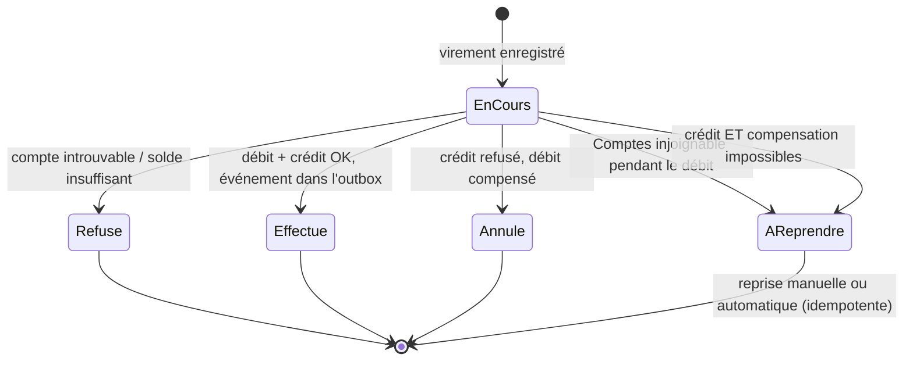
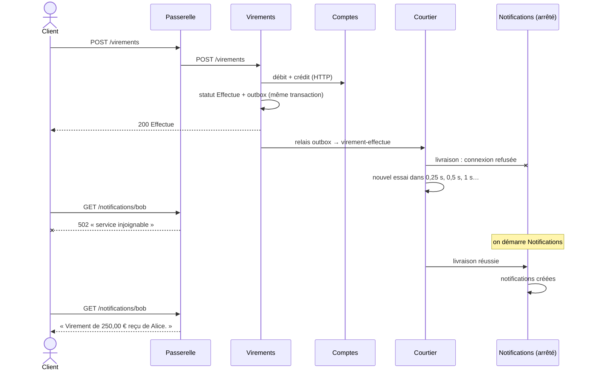

# 8. Microservices

> **En une phrase** : chaque service est un **processus séparé**, avec sa propre base, déployable seul ; les services
> communiquent uniquement par le **réseau** (HTTP et messages) et ne partagent aucun code.

📁 Code : [`08-Microservices`](../08-Microservices) · ⬅️ [Monolithe modulaire](07-monolithe-modulaire.md) · ➡️ [CQRS](09-cqrs.md) · 🌐 [English](en/08-microservices.md)

---

## L'idée

C'est la [démo 7](07-monolithe-modulaire.md) coupée en processus. Tout ce qui était gratuit dans le monolithe — un appel
de méthode, une transaction, un événement en mémoire — passe maintenant par le **réseau, qui peut échouer**.
L'essentiel du code de cette démo sert à gérer ces échecs.


| Service | Rôle | Particularités |
|---|---|---|
| **Passerelle** | Point d'entrée unique des clients | Ne relaie que les routes publiques ; `/interne/…` répond 404 ; `GET /sante` agrégé |
| **Comptes** | Tenue des comptes | API interne **idempotente** (`operationId`) ; **outbox** |
| **Virements** | Orchestre un virement | Client HTTP **résilient** ; **saga** avec statut et **compensation** ; outbox |
| **Notifications** | Envoie les notifications | Ne connaît aucun service ; ignore les **doublons** (`Message-Id`) |
| **Courtier** | Transporte les messages | Livraison « au moins une fois », réessais, lettres mortes |
| *Lanceur* | Outil de démo | Démarre les 5 processus (rôle de docker compose / Kubernetes / Aspire) |

**Aucune référence entre services**, ni projet partagé : le contrat, c'est le JSON échangé. Le relais d'outbox est
volontairement dupliqué dans Comptes et Virements.

---

## Le code, pas à pas

### 1. Appeler un autre service : se préparer à l'échec

([Micro.Virements/Program.cs](../08-Microservices/Micro.Virements/Program.cs))

```csharp
// Appels au service Comptes : le réseau peut échouer, on se protège.
// Retry (y compris sur POST : sans danger, car les appels portent un operationId idempotent),
// timeout par tentative et circuit breaker pour ne pas insister sur un service à terre.
builder.Services.AddHttpClient("comptes", (sp, client) =>
        client.BaseAddress = new Uri(sp.GetRequiredService<IConfiguration>()["Services:Comptes"]!))
    .AddStandardResilienceHandler(options =>
    {
        options.Retry.MaxRetryAttempts = 3;
        options.Retry.Delay = TimeSpan.FromMilliseconds(200);
    });
```

Le client a sa **propre copie** du modèle distant ([ClientComptes.cs](../08-Microservices/Micro.Virements/ClientComptes.cs)) :

```csharp
// Représentation LOCALE d'un compte : pas de bibliothèque partagée avec le service Comptes,
// le contrat entre les deux, c'est le JSON échangé.
internal record CompteDistant(Guid Id, string Titulaire, decimal Solde);
```

### 2. Rendre l'appel rejouable : l'idempotence

Si la réponse se perd, le retry renvoie le même débit. Sans précaution : double débit.
([Micro.Comptes/Endpoints.cs](../08-Microservices/Micro.Comptes/Endpoints.cs))

```csharp
/// API interne, appelée par les autres services (la passerelle ne l'expose pas).
/// Idempotente : un appel rejoué avec le même operationId (retry après une coupure réseau) ne débite pas deux fois.
private static async Task<IResult> Appliquer(Guid id, MouvementRequete requete, ComptesDb db, Func<Compte, decimal, string?> mouvement)
{
    if (await db.OperationsTraitees.FindAsync(requete.OperationId) is { } dejaTraitee)
        return Repondre(dejaTraitee);
    // … appliquer le mouvement, mémoriser l'opération et sa réponse, enregistrer
}
```


### 3. La saga : un virement à statut, avec compensation

Le virement est enregistré **avant** les appels ; son statut dit où il en est si quelque chose échoue.
([Micro.Virements/Endpoints.cs](../08-Microservices/Micro.Virements/Endpoints.cs))

```csharp
// Étape 2 : créditer la cible. En cas d'échec : compensation (on recrédite la source).
if (echecCredit is not null)
{
    try
    {
        await comptes.Crediter(source.Id, requete.Montant, $"{virement.Id}-compensation");
        return await Terminer(db, virement, StatutVirement.Annule, $"{echecCredit} Débit annulé.", 400);
    }
    catch (Exception e) when (EstUnePanneReseau(e))
    {
        return await Terminer(db, virement, StatutVirement.AReprendre,
            "Crédit et compensation impossibles : virement à reprendre.", 503);
    }
}
```



### 4. L'outbox : ne jamais perdre un événement

La donnée et le message sont enregistrés dans **la même transaction** ; un relais envoie ensuite le message au courtier.
([Micro.Comptes/Endpoints.cs](../08-Microservices/Micro.Comptes/Endpoints.cs), [RelaisOutbox.cs](../08-Microservices/Micro.Comptes/RelaisOutbox.cs))

```csharp
// Modification ET événement enregistrés ensemble : soit les deux, soit aucun.
db.Outbox.Add(MessageOutbox.Creer("retrait-effectue",
    new { compteId = id, montant = requete.Montant, nouveauSolde = compte.Solde }));
await db.SaveChangesAsync();
```

```csharp
// Dans RelaisOutbox, en boucle :
var enAttente = await db.Outbox.Where(m => m.EnvoyeLe == null).OrderBy(m => m.CreeLe).Take(20).ToListAsync(arret);
foreach (var message in enAttente)
{
    // … POST /sujets/{sujet} avec l'en-tête Message-Id
    (await courtier.SendAsync(requete, arret)).EnsureSuccessStatusCode();
    message.EnvoyeLe = DateTime.UtcNow;
    await db.SaveChangesAsync(arret);
}
```

### 5. Le courtier : réessayer, puis abandonner proprement

([Courtier.cs](../08-Microservices/Micro.Courtier/Courtier.cs))

```csharp
// Attente exponentielle : 0,25 s, 0,5 s, 1 s, 2 s… plafonnée à 30 s.
var attente = Math.Min(0.25 * Math.Pow(2, livraison.Tentatives - 1), 30);
livraison.ProchainEssai = DateTime.UtcNow.AddSeconds(attente);

if (livraison.Tentatives >= TentativesMax)
{
    _enAttente.Remove(livraison);
    _lettresMortes.Add(livraison);
}
```

### 6. L'abonné ignore les doublons

([Micro.Notifications/Program.cs](../08-Microservices/Micro.Notifications/Program.cs))

```csharp
// Le courtier livre « au moins une fois » : un même message peut arriver deux fois. On l'ignore alors.
static async Task<IResult> Traiter(NotificationsDb db, Guid messageId, params Notification[] notifications)
{
    if (await db.MessagesTraites.FindAsync(messageId) is not null)
        return Results.Ok(new { doublon = true });
    // …
}
```

### Cohérence à terme : Notifications en panne

Scénario vérifié en lançant réellement les 5 processus :



---

## Les tests

Chaque service est testé **seul** : les autres sont remplacés par de **faux serveurs HTTP** (`FauxHttp`).
([VirementsTests.cs](../08-Microservices/Micro.Tests/VirementsTests.cs))

```csharp
[Fact]
public async Task Une_panne_passagere_est_absorbee_par_le_retry_sans_double_debit()
{
    // Le 1er appel de débit échoue (503), le retry automatique réussit.
    var comptes = FauxComptes(debits: numero => new HttpResponseMessage(
        numero == 1 ? HttpStatusCode.ServiceUnavailable : HttpStatusCode.OK));
    await using var service = new ServiceEnTest<Marqueur>(new() { ["comptes"] = comptes });

    var (_, statut) = await Virer(service);

    Assert.Equal("Effectue", statut);
    // Deux appels de débit… avec le MÊME operationId : Comptes ne débitera qu'une fois.
    var debits = comptes.Appels.Where(a => a.Chemin.EndsWith("/debits")).ToList();
    Assert.Equal(2, debits.Count);
    Assert.Single(debits.Select(a => JsonDocument.Parse(a.Corps!).RootElement.GetProperty("operationId").GetString()).Distinct());
}
```

Autres tests : idempotence de l'API interne, outbox quand le courtier est en panne, compensation, `AReprendre` quand
Comptes est injoignable (1 appel + 3 retries), courtier qui relivre, passerelle qui masque `/interne/…`.
Le parcours complet se vérifie en lançant le système (`dotnet run --project Micro.Lanceur`).

---

## Bilan

| 👍 Points forts | 👎 Limites |
|---|---|
| Déploiement et mise à l'échelle **indépendants** par service | **Pannes partielles** : retry, timeout, circuit breaker partout |
| Isolation totale : impossible de tricher (le réseau) | **Idempotence** obligatoire de chaque appel et message |
| Technologies différentes possibles par service | **Cohérence à terme**, sagas et compensations au lieu de transactions |
| Équipes autonomes | Exploitation lourde : supervision, traces distribuées, déploiements |

**Quand l'utiliser** : plusieurs équipes, besoins de mise à l'échelle très différents, cycles de déploiement indépendants
— et une organisation capable d'exploiter un système distribué. Sinon, le [monolithe modulaire](07-monolithe-modulaire.md)
apporte l'essentiel des bénéfices à une fraction du coût. En production : RabbitMQ / Azure Service Bus, YARP,
.NET Aspire ou Kubernetes, OpenTelemetry. Les mécanismes sont détaillés dans les [concepts transverses](concepts-transverses.md).
