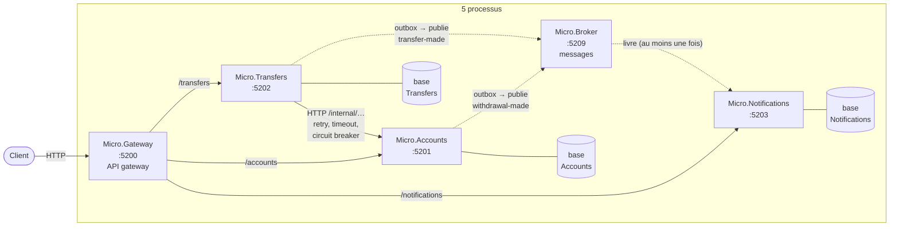
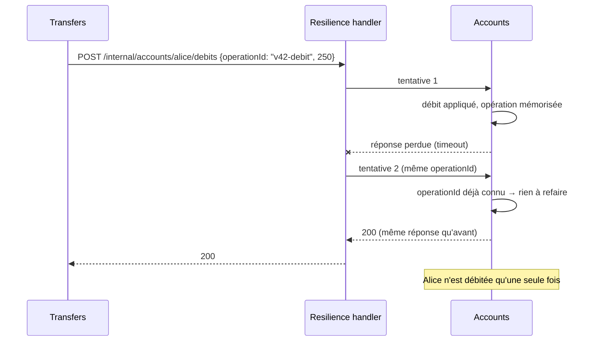
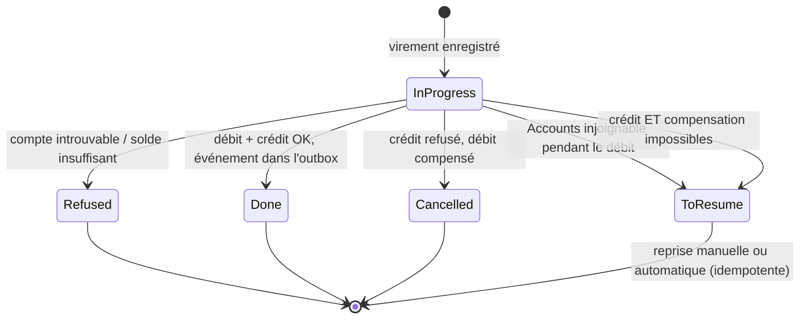
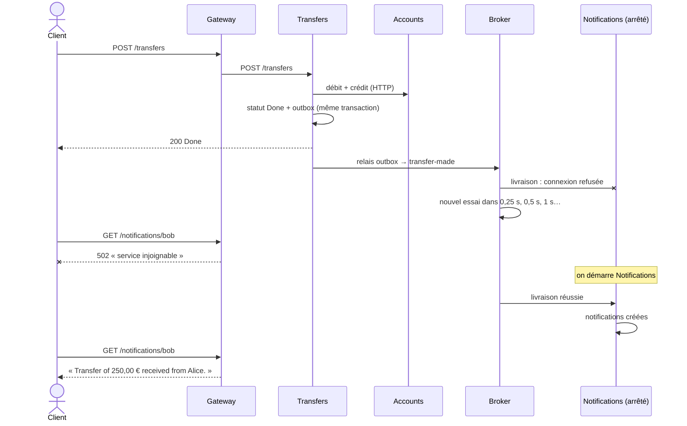

# 8. Microservices

> **En une phrase** : chaque service est un **processus séparé**, avec sa propre base, déployable seul ; les services
> communiquent uniquement par le **réseau** (HTTP et messages) et ne partagent aucun code.

📁 Code : [`08-Microservices`](../08-Microservices) · ⬅️ [Monolithe modulaire](07-monolithe-modulaire.md) · ➡️ [CQRS](09-cqrs.md) · 🌐 [English](en/08-microservices.md)

---

## L'idée

C'est la [démo 7](07-monolithe-modulaire.md) coupée en processus. Tout ce qui était gratuit dans le monolithe — un appel
de méthode, une transaction, un événement en mémoire — passe maintenant par le **réseau, qui peut échouer**.
L'essentiel du code de cette démo sert à gérer ces échecs.



| Service | Rôle | Particularités |
|---|---|---|
| **Passerelle** | Point d'entrée unique des clients | Ne relaie que les routes publiques ; `/internal/…` répond 404 ; `GET /health` agrégé |
| **Comptes** | Tenue des comptes | API interne **idempotente** (`operationId`) ; **outbox** |
| **Virements** | Orchestre un virement | Client HTTP **résilient** ; **saga** avec statut et **compensation** ; outbox |
| **Notifications** | Envoie les notifications | Ne connaît aucun service ; ignore les **doublons** (`Message-Id`) |
| **Courtier** | Transporte les messages | Livraison « au moins une fois », réessais, lettres mortes |
| *Lanceur* | Outil de démo | Démarre les 5 processus (rôle de docker compose / Kubernetes / Aspire) |

**Aucune référence entre services**, ni projet partagé : le contrat, c'est le JSON échangé. Le relais d'outbox est
volontairement dupliqué dans Comptes et Virements.

---

## Le code, pas à pas

### 1. Appeler un autre service : se préparer à l'échec

([Micro.Transfers/Program.cs](../08-Microservices/Micro.Transfers/Program.cs))

```csharp
// Calls to the Accounts service: the network can fail, so we protect ourselves.
// Retry (including on POST: safe, because the calls carry an idempotent operationId),
// timeout per attempt and circuit breaker so as not to insist on a service that is down.
builder.Services.AddHttpClient("accounts", (sp, client) =>
        client.BaseAddress = new Uri(sp.GetRequiredService<IConfiguration>()["Services:Accounts"]!))
    .AddStandardResilienceHandler(options =>
    {
        options.Retry.MaxRetryAttempts = 3;
        options.Retry.Delay = TimeSpan.FromMilliseconds(200);
    });
```

Le client a sa **propre copie** du modèle distant ([AccountsClient.cs](../08-Microservices/Micro.Transfers/AccountsClient.cs)) :

```csharp
// LOCAL representation of an account: no library shared with the Accounts service,
// the contract between the two is the JSON they exchange.
internal record RemoteAccount(Guid Id, string Owner, decimal Balance);
```

### 2. Rendre l'appel rejouable : l'idempotence

Si la réponse se perd, le retry renvoie le même débit. Sans précaution : double débit.
([Micro.Accounts/Endpoints.cs](../08-Microservices/Micro.Accounts/Endpoints.cs))

```csharp
/// Internal API, called by the other services (the gateway does not expose it).
/// Idempotent: a call replayed with the same operationId (retry after a network cut) does not debit twice.
private static async Task<IResult> Apply(Guid id, MovementRequest request, AccountsDb db, Func<Account, decimal, string?> movement)
{
    if (await db.ProcessedOperations.FindAsync(request.OperationId) is { } alreadyProcessed)
        return Respond(alreadyProcessed);
    // … apply the movement, remember the operation and its response, save
}
```



### 3. La saga : un virement à statut, avec compensation

Le virement est enregistré **avant** les appels ; son statut dit où il en est si quelque chose échoue.
([Micro.Transfers/Endpoints.cs](../08-Microservices/Micro.Transfers/Endpoints.cs))

```csharp
// Step 2: credit the target. On failure: compensation (the source is credited back).
if (creditFailure is not null)
{
    try
    {
        await accounts.Credit(source.Id, request.Amount, $"{transfer.Id}-compensation");
        return await Finish(db, transfer, TransferStatus.Cancelled, $"{creditFailure} Debit cancelled.", 400);
    }
    catch (Exception e) when (IsNetworkFailure(e))
    {
        return await Finish(db, transfer, TransferStatus.ToResume,
            "Credit and compensation impossible: transfer to resume.", 503);
    }
}
```



### 4. L'outbox : ne jamais perdre un événement

La donnée et le message sont enregistrés dans **la même transaction** ; un relais envoie ensuite le message au courtier.
([Micro.Accounts/Endpoints.cs](../08-Microservices/Micro.Accounts/Endpoints.cs), [OutboxRelay.cs](../08-Microservices/Micro.Accounts/OutboxRelay.cs))

```csharp
// Change AND event saved together: either both, or neither.
db.Outbox.Add(OutboxMessage.Create("withdrawal-made",
    new { accountId = id, amount = request.Amount, newBalance = account.Balance }));
await db.SaveChangesAsync();
```

```csharp
// In OutboxRelay, in a loop:
var pending = await db.Outbox.Where(m => m.SentAt == null).OrderBy(m => m.CreatedAt).Take(20).ToListAsync(stopping);
foreach (var message in pending)
{
    // … POST /topics/{topic} with the Message-Id header
    (await broker.SendAsync(request, stopping)).EnsureSuccessStatusCode();
    message.SentAt = DateTime.UtcNow;
    await db.SaveChangesAsync(stopping);
}
```

### 5. Le courtier : réessayer, puis abandonner proprement

([Broker.cs](../08-Microservices/Micro.Broker/Broker.cs))

```csharp
// Exponential backoff: 0.25 s, 0.5 s, 1 s, 2 s… capped at 30 s.
var wait = Math.Min(0.25 * Math.Pow(2, delivery.Attempts - 1), 30);
delivery.NextAttempt = DateTime.UtcNow.AddSeconds(wait);

if (delivery.Attempts >= MaxAttempts)
{
    _pending.Remove(delivery);
    _deadLetters.Add(delivery);
}
```

### 6. L'abonné ignore les doublons

([Micro.Notifications/Program.cs](../08-Microservices/Micro.Notifications/Program.cs))

```csharp
// The broker delivers "at least once": the same message can arrive twice. It is then ignored.
static async Task<IResult> Handle(NotificationsDb db, Guid messageId, params Notification[] notifications)
{
    if (await db.ProcessedMessages.FindAsync(messageId) is not null)
        return Results.Ok(new { duplicate = true });
    // …
}
```

### Cohérence à terme : Notifications en panne

Scénario vérifié en lançant réellement les 5 processus :



---

## Les tests

Chaque service est testé **seul** : les autres sont remplacés par de **faux serveurs HTTP** (`FakeHttp`).
([TransfersTests.cs](../08-Microservices/Micro.Tests/TransfersTests.cs))

```csharp
[Fact]
public async Task A_transient_failure_is_absorbed_by_the_retry_without_double_debit()
{
    // The 1st debit call fails (503), the automatic retry succeeds.
    var accounts = FakeAccounts(debits: number => new HttpResponseMessage(
        number == 1 ? HttpStatusCode.ServiceUnavailable : HttpStatusCode.OK));
    await using var service = new ServiceUnderTest<Marker>(new() { ["accounts"] = accounts });

    var (_, status) = await Transfer(service);

    Assert.Equal("Done", status);
    // Two debit calls… with the SAME operationId: Accounts will debit only once.
    var debits = accounts.Calls.Where(a => a.Path.EndsWith("/debits")).ToList();
    Assert.Equal(2, debits.Count);
    Assert.Single(debits.Select(a => JsonDocument.Parse(a.Body!).RootElement.GetProperty("operationId").GetString()).Distinct());
}
```

Autres tests : idempotence de l'API interne, outbox quand le courtier est en panne, compensation, `ToResume` quand
Comptes est injoignable (1 appel + 3 retries), courtier qui relivre, passerelle qui masque `/internal/…`.
Le parcours complet se vérifie en lançant le système (`dotnet run --project Micro.Launcher`).

---

## Bilan

| 👍 Points forts | 👎 Limites |
|---|---|
| Déploiement et mise à l'échelle **indépendants** par service | **Pannes partielles** : retry, timeout, circuit breaker partout |
| Isolation totale : impossible de tricher (le réseau) | **Idempotence** obligatoire de chaque appel et message |
| Technologies différentes possibles par service | **Cohérence à terme**, sagas et compensations au lieu de transactions |
| Équipes autonomes | Exploitation lourde : supervision, traces distribuées, déploiements |

**Quand l'utiliser** : plusieurs équipes, besoins de mise à l'échelle très différents, cycles de déploiement indépendants
— et une organisation capable d'exploiter un système distribué. Sinon, le [monolithe modulaire](07-monolithe-modulaire.md)
apporte l'essentiel des bénéfices à une fraction du coût. En production : RabbitMQ / Azure Service Bus, YARP,
.NET Aspire ou Kubernetes, OpenTelemetry. Les mécanismes sont détaillés dans les [concepts transverses](concepts-transverses.md).
