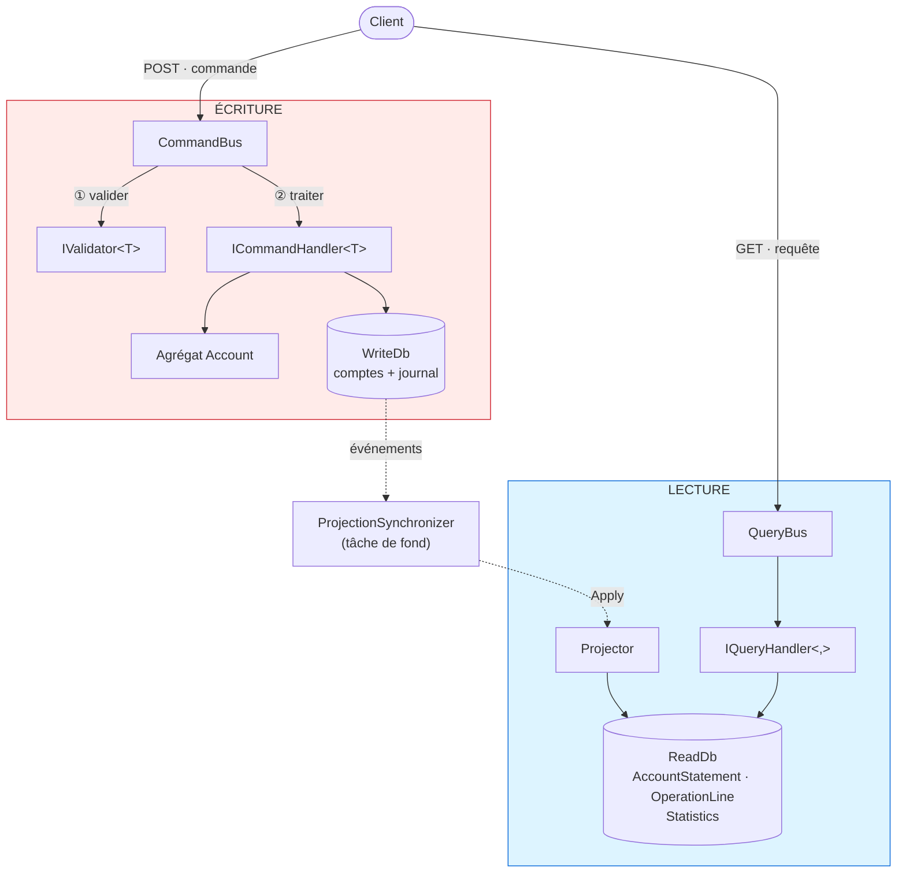
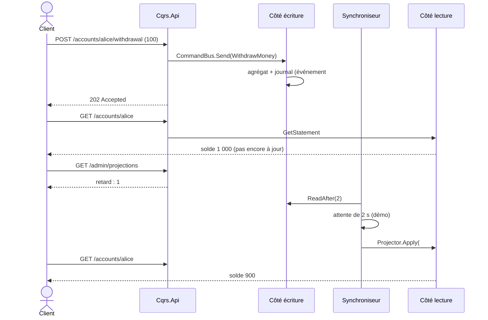

# 9. CQRS — Command Query Responsibility Segregation

> **En une phrase** : un modèle pour **écrire** (fait respecter les règles), un autre pour **lire** (des vues prêtes à
> afficher), reliés par des événements.

📁 Code : [`09-CQRS`](../09-CQRS) · ⬅️ [Microservices](08-microservices.md) · ➡️ [Event Sourcing](10-event-sourcing.md) · 🌐 [English](en/09-cqrs.md)

---

## L'idée

Formalisé par **Greg Young** vers 2010, à partir du principe CQS de Bertrand Meyer (« une méthode modifie l'état *ou*
répond à une question, jamais les deux »). Le constat : **écrire et lire n'ont pas les mêmes besoins**.

| | Écriture (Command) | Lecture (Query) |
|---|---|---|
| Objectif | cohérence, règles, invariants | rapidité, formes variées pour chaque écran |
| Modèle | agrégat riche | tables dénormalisées, données dupliquées |
| Volume | peu de requêtes | souvent 10 à 100 fois plus |
| Renvoie | rien (ou un identifiant) | des données, sans rien modifier |



Les deux côtés **ne se référencent pas** : le seul lien est `Cqrs.Events`.

---

## Le code, pas à pas

### 1. Une commande : intention + validation + gestionnaire, dans un fichier

L'identifiant est fourni par l'appelant : la commande n'a rien à renvoyer.
([OpenAccount.cs](../09-CQRS/Cqrs.Write/Commands/OpenAccount.cs))

```csharp
public record OpenAccount(Guid AccountId, string Owner, decimal InitialDeposit) : ICommand;

public class OpenAccountValidator : IValidator<OpenAccount>
{
    public IEnumerable<string> Validate(OpenAccount command)
    {
        if (string.IsNullOrWhiteSpace(command.Owner))
            yield return "The owner is required.";
        if (command.InitialDeposit < 10)
            yield return "The initial deposit must be at least 10 €.";
    }
}

public class OpenAccountHandler(WriteDb db, TimeProvider clock) : ICommandHandler<OpenAccount>
{
    public async Task Handle(OpenAccount command)
    {
        if (await db.Accounts.FindAsync(command.AccountId) is not null)
            throw new BusinessRuleException("This account already exists.");

        db.Accounts.Add(Account.Open(command.AccountId, command.Owner.Trim(), command.InitialDeposit,
            clock.GetUtcNow().UtcDateTime));
        await db.Save();
    }
}
```

### 2. Un pipeline commun pour toutes les commandes

C'est le rôle qu'on confie souvent à MediatR, écrit ici en quelques lignes.
([CommandBus.cs](../09-CQRS/Cqrs.Write/Commands/CommandBus.cs))

```csharp
public async Task Send<TCommand>(TCommand command) where TCommand : ICommand
{
    var errors = services.GetServices<IValidator<TCommand>>()
        .SelectMany(validator => validator.Validate(command))
        .ToList();
    if (errors.Count > 0)
        throw new InvalidCommandException(errors);

    logger.LogInformation("Command {Command}: {Content}", typeof(TCommand).Name, command);
    await services.GetRequiredService<ICommandHandler<TCommand>>().Handle(command);
}
```

### 3. L'écriture enregistre l'état ET les événements, ensemble

([WriteDb.cs](../09-CQRS/Cqrs.Write/Persistence/WriteDb.cs))

```csharp
/// <summary>Saves the changes and appends to the log the events produced by the aggregates.</summary>
public async Task Save(params IDomainEvent[] extraEvents)
{
    var events = ChangeTracker.Entries<Account>()
        .SelectMany(entry => entry.Entity.ExtractEvents())
        .Concat(extraEvents)
        .ToList();

    foreach (var @event in events)
        Events.Add(new StoredEvent
        {
            Type = @event.GetType().Name,
            Data = EventCatalog.Serialize(@event),
            Date = @event.Date
        });

    await SaveChangesAsync();
}
```

### 4. Le projecteur construit les vues

Seul code qui écrit côté lecture. Le **point de reprise** le rend idempotent.
([Projector.cs](../09-CQRS/Cqrs.Read/Projections/Projector.cs))

```csharp
public async Task Apply(RecordedEvent recorded)
{
    var checkpoint = await GetCheckpoint();
    if (recorded.Sequence <= checkpoint.LastSequence)
        return;  // already projected: replaying an event has no effect

    switch (recorded.Event)
    {
        case TransferMade e:
            var source = await Update(e.SourceId, e.SourceBalance, e.Date);
            var target = await Update(e.TargetId, e.TargetBalance, e.Date);
            // The label is written once and for all, with the other owner's name.
            AddLine(e.SourceId, $"Transfer to {target.Owner}", -e.Amount, e.SourceBalance, e.Date);
            AddLine(e.TargetId, $"Transfer received from {source.Owner}", e.Amount, e.TargetBalance, e.Date);
            stats.TransferCount++;
            stats.TotalTransferredAmount += e.Amount;
            break;
        // … AccountOpened, MoneyWithdrawn
    }

    checkpoint.LastSequence = recorded.Sequence;
    await db.SaveChangesAsync();
}
```

### 5. Les requêtes ne font que lire

([Queries.cs](../09-CQRS/Cqrs.Read/Queries/Queries.cs))

```csharp
public class GetDashboardHandler(ReadDb db) : IQueryHandler<GetDashboard, DashboardView>
{
    public async Task<DashboardView> Handle(GetDashboard query)
    {
        var s = await db.Statistics.AsNoTracking().FirstOrDefaultAsync() ?? new Statistics();
        return new DashboardView(s.AccountCount, s.TotalOutstanding, s.TransferCount, s.TotalTransferredAmount);
    }
}
```

Le tableau de bord n'est **jamais recalculé** : il est maintenu au fil des événements.

### 6. Les commandes répondent 202

([Program.cs](../09-CQRS/Cqrs.Api/Program.cs))

```csharp
app.MapPost("/accounts/{id:guid}/withdrawal", async (Guid id, WithdrawalRequest r, CommandBus bus) =>
{
    await bus.Send(new WithdrawMoney(id, r.Amount));
    return Results.Accepted($"/accounts/{id}");
});
```

### La cohérence à terme, rendue visible

`appsettings.json` ralentit volontairement la projection de 2 s (`Projections:DelayMs`).



---

## Les tests

- **Côté écriture** : les événements produits par l'agrégat, le pipeline de validation
  ([WriteTests.cs](../09-CQRS/Cqrs.Tests/WriteTests.cs)).
- **Côté lecture, sans aucune commande** : on lui donne des événements, on interroge ses vues
  ([ReadTests.cs](../09-CQRS/Cqrs.Tests/ReadTests.cs)) :

```csharp
private static readonly RecordedEvent[] History =
[
    new(1, new AccountOpened(Alice, "Alice", 1000m, T0)),
    new(2, new AccountOpened(Bob, "Bob", 500m, T0.AddMinutes(1))),
    new(3, new MoneyWithdrawn(Alice, 100m, 900m, T0.AddMinutes(2))),
    new(4, new TransferMade(Guid.NewGuid(), Alice, Bob, 250m, 650m, 750m, T0.AddMinutes(3)))
];

[Fact]
public async Task The_statement_is_ready_to_display()
{
    var services = await ProjectHistory();

    var statement = await Ask(services, new GetStatement(Alice));

    Assert.Equal(650m, statement!.Balance);
    Assert.Equal(3, statement.OperationCount);
    Assert.Equal(["Transfer to Bob", "Withdrawal", "Account opening"], statement.LatestOperations.Select(o => o.Label));
}
```

- **Cohérence à terme** ([ApiTests.cs](../09-CQRS/Cqrs.Tests/ApiTests.cs)) : juste après la commande, la vue n'est pas à
  jour et le retard vaut 1 ; elle le devient ensuite.

---

## Bilan

| 👍 Points forts | 👎 Limites |
|---|---|
| Chaque côté optimisé pour son usage | Données dupliquées, projections à maintenir |
| Lectures très rapides (vues pré-calculées) | **Cohérence à terme** à expliquer aux utilisateurs |
| Les côtés évoluent et se testent indépendamment | Plus de code qu'un CRUD |
| Vues reconstructibles à partir des événements | |

**À ne pas confondre** :
- CQRS **n'impose pas deux bases**. On peut séparer seulement les modèles, sur une même base, avec une lecture synchrone :
  c'est la variante la plus simple, souvent suffisante.
- CQRS **n'est pas** l'Event Sourcing : ici, l'état est stocké normalement et les événements servent à alimenter la lecture.
  En [Event Sourcing](10-event-sourcing.md), les événements **sont** la source de vérité.
