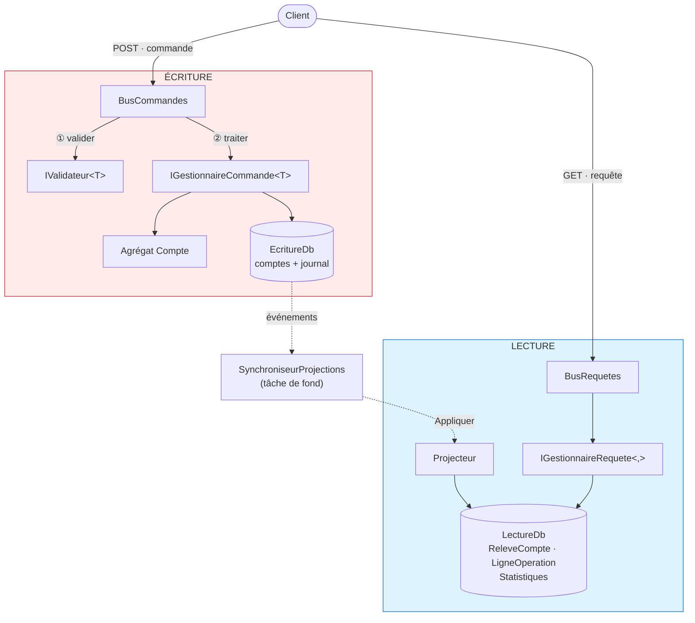
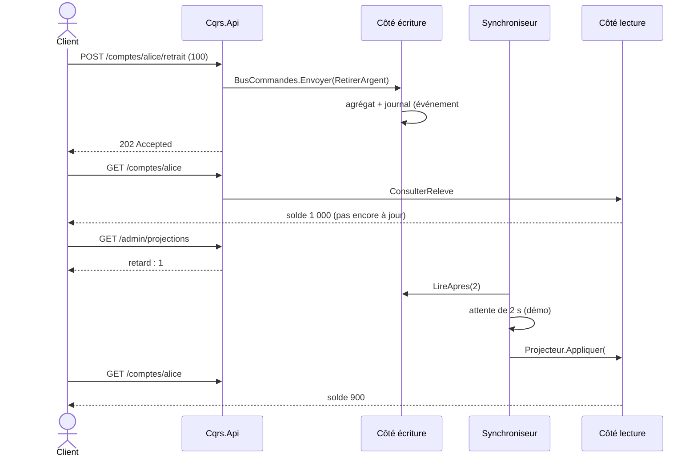

# 9. CQRS — Command Query Responsibility Segregation

> **En une phrase** : un modèle pour **écrire** (fait respecter les règles), un autre pour **lire** (des vues prêtes à
> afficher), reliés par des événements.

📁 Code : [`09-CQRS`](../09-CQRS) · ⬅️ [Microservices](08-microservices.md) · ➡️ [Event Sourcing](10-event-sourcing.md) · 🌐 [English](en/09-cqrs.md)

---

## L'idée

Formalisé par **Greg Young** vers 2010, à partir du principe CQS de Bertrand Meyer (« une méthode modifie l'état *ou*
répond à une question, jamais les deux »). Le constat : **écrire et lire n'ont pas les mêmes besoins**.

| | Écriture (Command) | Lecture (Query) |
|---|---|---|
| Objectif | cohérence, règles, invariants | rapidité, formes variées pour chaque écran |
| Modèle | agrégat riche | tables dénormalisées, données dupliquées |
| Volume | peu de requêtes | souvent 10 à 100 fois plus |
| Renvoie | rien (ou un identifiant) | des données, sans rien modifier |



Les deux côtés **ne se référencent pas** : le seul lien est `Cqrs.Evenements`.

---

## Le code, pas à pas

### 1. Une commande : intention + validation + gestionnaire, dans un fichier

L'identifiant est fourni par l'appelant : la commande n'a rien à renvoyer.
([OuvrirCompte.cs](../09-CQRS/Cqrs.Ecriture/Commandes/OuvrirCompte.cs))

```csharp
public record OuvrirCompte(Guid CompteId, string Titulaire, decimal DepotInitial) : ICommande;

public class OuvrirCompteValidateur : IValidateur<OuvrirCompte>
{
    public IEnumerable<string> Valider(OuvrirCompte commande)
    {
        if (string.IsNullOrWhiteSpace(commande.Titulaire))
            yield return "Le titulaire est obligatoire.";
        if (commande.DepotInitial < 10)
            yield return "Le dépôt initial doit être d'au moins 10 €.";
    }
}

public class OuvrirCompteGestionnaire(EcritureDb db, TimeProvider horloge) : IGestionnaireCommande<OuvrirCompte>
{
    public async Task Traiter(OuvrirCompte commande)
    {
        if (await db.Comptes.FindAsync(commande.CompteId) is not null)
            throw new RegleMetierException("Ce compte existe déjà.");

        db.Comptes.Add(Compte.Ouvrir(commande.CompteId, commande.Titulaire.Trim(), commande.DepotInitial,
            horloge.GetUtcNow().UtcDateTime));
        await db.Enregistrer();
    }
}
```

### 2. Un pipeline commun pour toutes les commandes

C'est le rôle qu'on confie souvent à MediatR, écrit ici en quelques lignes.
([BusCommandes.cs](../09-CQRS/Cqrs.Ecriture/Commandes/BusCommandes.cs))

```csharp
public async Task Envoyer<TCommande>(TCommande commande) where TCommande : ICommande
{
    var erreurs = services.GetServices<IValidateur<TCommande>>()
        .SelectMany(validateur => validateur.Valider(commande))
        .ToList();
    if (erreurs.Count > 0)
        throw new CommandeInvalideException(erreurs);

    journal.LogInformation("Commande {Commande} : {Contenu}", typeof(TCommande).Name, commande);
    await services.GetRequiredService<IGestionnaireCommande<TCommande>>().Traiter(commande);
}
```

### 3. L'écriture enregistre l'état ET les événements, ensemble

([EcritureDb.cs](../09-CQRS/Cqrs.Ecriture/Persistance/EcritureDb.cs))

```csharp
/// Enregistre les modifications et ajoute au journal les événements produits par les agrégats.
public async Task Enregistrer(params IEvenementDomaine[] evenementsSupplementaires)
{
    var evenements = ChangeTracker.Entries<Compte>()
        .SelectMany(entree => entree.Entity.ExtraireEvenements())
        .Concat(evenementsSupplementaires)
        .ToList();

    foreach (var evenement in evenements)
        Evenements.Add(new EvenementStocke
        {
            Type = evenement.GetType().Name,
            Donnees = CatalogueEvenements.Serialiser(evenement),
            Date = evenement.Date
        });

    await SaveChangesAsync();
}
```

### 4. Le projecteur construit les vues

Seul code qui écrit côté lecture. Le **point de reprise** le rend idempotent.
([Projecteur.cs](../09-CQRS/Cqrs.Lecture/Projections/Projecteur.cs))

```csharp
public async Task Appliquer(EvenementEnregistre enregistre)
{
    var point = await ObtenirPointDeReprise();
    if (enregistre.Sequence <= point.DerniereSequence)
        return;  // déjà projeté : rejouer un événement n'a pas d'effet

    switch (enregistre.Evenement)
    {
        case VirementEffectue e:
            var source = await MettreAJour(e.SourceId, e.SoldeSource, e.Date);
            var cible = await MettreAJour(e.CibleId, e.SoldeCible, e.Date);
            // Le libellé est rédigé une fois pour toutes, avec le nom de l'autre titulaire.
            AjouterLigne(e.SourceId, $"Virement vers {cible.Titulaire}", -e.Montant, e.SoldeSource, e.Date);
            AjouterLigne(e.CibleId, $"Virement reçu de {source.Titulaire}", e.Montant, e.SoldeCible, e.Date);
            stats.NombreVirements++;
            stats.MontantTotalVire += e.Montant;
            break;
        // … CompteOuvert, ArgentRetire
    }

    point.DerniereSequence = enregistre.Sequence;
    await db.SaveChangesAsync();
}
```

### 5. Les requêtes ne font que lire

([Requetes.cs](../09-CQRS/Cqrs.Lecture/Requetes/Requetes.cs))

```csharp
public class ConsulterTableauDeBordGestionnaire(LectureDb db) : IGestionnaireRequete<ConsulterTableauDeBord, TableauDeBordVue>
{
    public async Task<TableauDeBordVue> Traiter(ConsulterTableauDeBord requete)
    {
        var s = await db.Statistiques.AsNoTracking().FirstOrDefaultAsync() ?? new Statistiques();
        return new TableauDeBordVue(s.NombreComptes, s.EncoursTotal, s.NombreVirements, s.MontantTotalVire);
    }
}
```

Le tableau de bord n'est **jamais recalculé** : il est maintenu au fil des événements.

### 6. Les commandes répondent 202

([Program.cs](../09-CQRS/Cqrs.Api/Program.cs))

```csharp
app.MapPost("/comptes/{id:guid}/retrait", async (Guid id, RetraitRequete r, BusCommandes bus) =>
{
    await bus.Envoyer(new RetirerArgent(id, r.Montant));
    return Results.Accepted($"/comptes/{id}");
});
```

### La cohérence à terme, rendue visible

`appsettings.json` ralentit volontairement la projection de 2 s (`Projections:DelaiMs`).



---

## Les tests

- **Côté écriture** : les événements produits par l'agrégat, le pipeline de validation
  ([EcritureTests.cs](../09-CQRS/Cqrs.Tests/EcritureTests.cs)).
- **Côté lecture, sans aucune commande** : on lui donne des événements, on interroge ses vues
  ([LectureTests.cs](../09-CQRS/Cqrs.Tests/LectureTests.cs)) :

```csharp
private static readonly EvenementEnregistre[] Historique =
[
    new(1, new CompteOuvert(Alice, "Alice", 1000m, T0)),
    new(2, new CompteOuvert(Bob, "Bob", 500m, T0.AddMinutes(1))),
    new(3, new ArgentRetire(Alice, 100m, 900m, T0.AddMinutes(2))),
    new(4, new VirementEffectue(Guid.NewGuid(), Alice, Bob, 250m, 650m, 750m, T0.AddMinutes(3)))
];

[Fact]
public async Task Le_releve_est_pret_a_afficher()
{
    var services = await ProjeterHistorique();

    var releve = await Demander(services, new ConsulterReleve(Alice));

    Assert.Equal(650m, releve!.Solde);
    Assert.Equal(3, releve.NombreOperations);
    Assert.Equal(["Virement vers Bob", "Retrait", "Ouverture du compte"], releve.DernieresOperations.Select(o => o.Libelle));
}
```

- **Cohérence à terme** ([ApiTests.cs](../09-CQRS/Cqrs.Tests/ApiTests.cs)) : juste après la commande, la vue n'est pas à
  jour et le retard vaut 1 ; elle le devient ensuite.

---

## Bilan

| 👍 Points forts | 👎 Limites |
|---|---|
| Chaque côté optimisé pour son usage | Données dupliquées, projections à maintenir |
| Lectures très rapides (vues pré-calculées) | **Cohérence à terme** à expliquer aux utilisateurs |
| Les côtés évoluent et se testent indépendamment | Plus de code qu'un CRUD |
| Vues reconstructibles à partir des événements | |

**À ne pas confondre** :
- CQRS **n'impose pas deux bases**. On peut séparer seulement les modèles, sur une même base, avec une lecture synchrone :
  c'est la variante la plus simple, souvent suffisante.
- CQRS **n'est pas** l'Event Sourcing : ici, l'état est stocké normalement et les événements servent à alimenter la lecture.
  En [Event Sourcing](10-event-sourcing.md), les événements **sont** la source de vérité.
