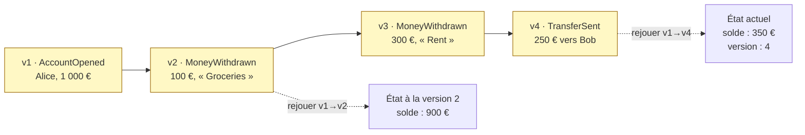
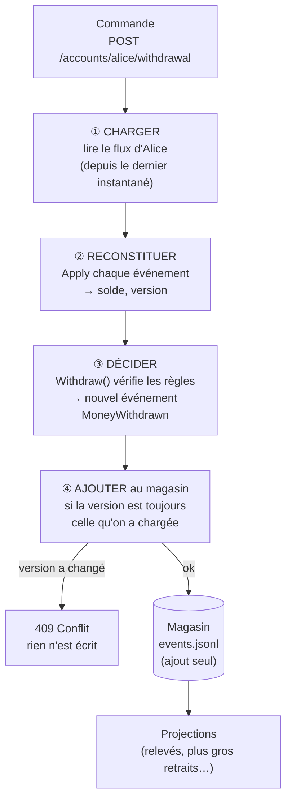
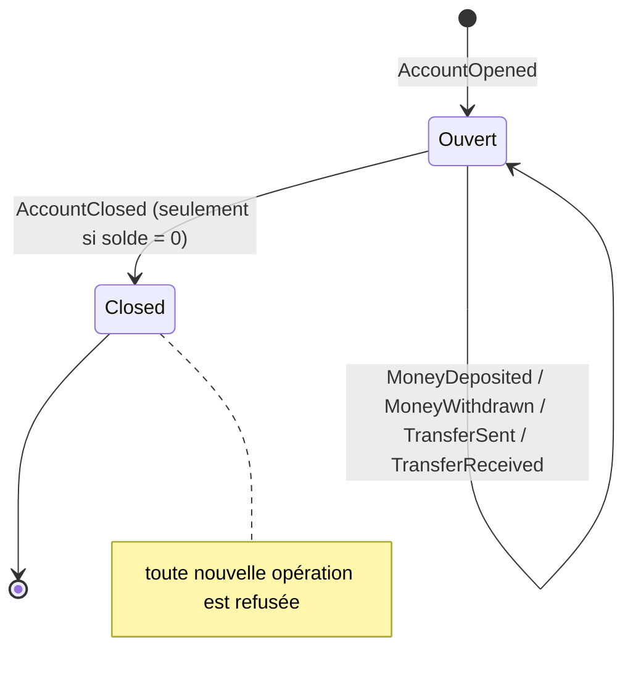
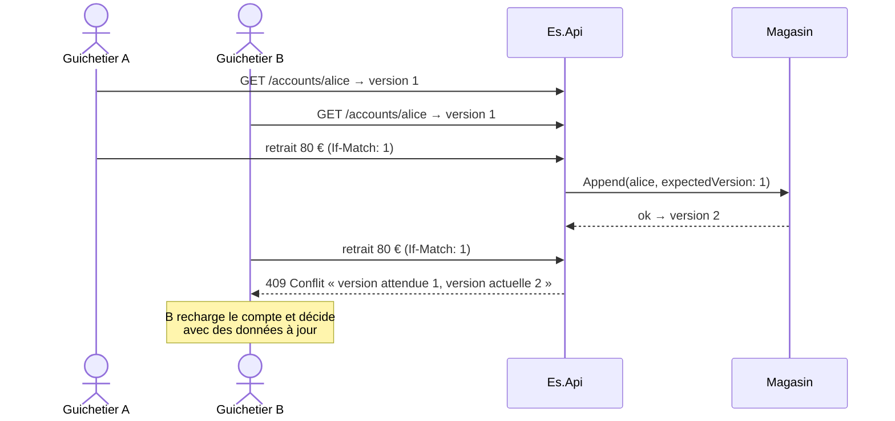

# 10. Event Sourcing

> **En une phrase** : on ne stocke pas l'état, mais **la suite des événements** qui y ont mené ; l'état se recalcule en
> les rejouant, et on n'efface jamais rien.

📁 Code : [`10-EventSourcing`](../10-EventSourcing) · ⬅️ [CQRS](09-cqrs.md) · ➡️ [DDD](11-ddd.md) · 🌐 [English](en/10-event-sourcing.md)

---

## L'idée

Dans toutes les autres démos, on stocke **le solde** et on oublie comment on y est arrivé. Ici, on stocke les **faits** :
le compte a été ouvert avec 1 000 €, 100 € ont été retirés, 250 € ont été virés… Le solde n'est qu'un **calcul**.
C'est exactement ainsi que fonctionne une comptabilité : on n'efface jamais une écriture, on en ajoute une autre.



### Le cycle d'une commande



---

## Organisation de la solution

| Projet | Contenu |
|---|---|
| `Es.Domain` | Événements, agrégat `Account` (décider / appliquer), `AccountSnapshot` |
| `Es.Storage` | `EventStore` (ajout seul, concurrence optimiste, fichier `.jsonl`), `EventSerializer` (+ upcasting), `AccountRepository` (instantanés, voyage dans le temps) |
| `Es.Projections` | `StatementsProjection`, `LargestWithdrawalsProjection`, `ProjectionEngine` (suivi, reconstruction) |
| `Es.Api` | Commandes, audit, voyage dans le temps, administration |

**La base de données est un fichier lisible** : `Es.Api\events.jsonl`, une ligne par événement.

```json
{"position":3,"stream":"1111…","version":2,"type":"MoneyWithdrawn.v2","data":{"accountId":"1111…","amount":100,"reason":"Groceries","date":"…"},"date":"…"}
```

---

## Le code, pas à pas

### 1. Décider / appliquer : deux sortes de méthodes, à ne jamais mélanger

([Account.cs](../10-EventSourcing/Es.Domain/Account.cs))

```csharp
/// <summary>
/// "Event-sourced" aggregate. Two kinds of methods, never to be mixed:
/// - the DECISIONS (Withdraw, Close…) check the rules then record an event;
/// - Apply evolves the state from an event, without any rule (a past fact cannot be refused).
/// Loading an account = replaying Apply over its whole history.
/// </summary>
public class Account
{
    // …
    public void Withdraw(decimal amount, string reason, DateTime date)
    {
        CheckOpen();
        CheckAmount(amount);
        if (amount > Balance)
            throw new BusinessRuleException("Insufficient balance.");
        Record(new MoneyWithdrawn(Id, amount, reason, date));
    }
    // …

    // ─── State evolution ───

    private void Record(IEvent @event)
    {
        Apply(@event);
        _new.Add(@event);
    }

    private void Apply(IEvent @event)
    {
        switch (@event)
        {
            case AccountOpened e:
                (Id, Owner, Balance) = (e.AccountId, e.Owner, e.InitialDeposit);
                break;
            case MoneyDeposited e:
                Balance += e.Amount;
                break;
            case MoneyWithdrawn e:
                Balance -= e.Amount;
                break;
            case TransferSent e:
                Balance -= e.Amount;
                break;
            case TransferReceived e:
                Balance += e.Amount;
                break;
            case AccountClosed:
                Closed = true;
                break;
        }
        Version++;
    }
```

Charger un compte, c'est rejouer `Apply` sur tout son historique :

```csharp
public static Account Rehydrate(IEnumerable<IEvent> history) =>
    FromSnapshot(null, history);
```



### 2. Le magasin : ajout seul et concurrence optimiste

([EventStore.cs](../10-EventSourcing/Es.Storage/EventStore.cs))

```csharp
/// Appends the events of one or more streams, all or nothing.
/// Optimistic concurrency: if a stream moved since it was loaded, nothing is written.
public Task Append(params ToWrite[] writes)
{
    lock (_lock)
    {
        foreach (var write in writes)
        {
            var current = _events.Count(e => e.Stream == write.Stream);
            if (current != write.ExpectedVersion)
                throw new ConcurrencyConflictException(write.Stream, write.ExpectedVersion, current);
        }
        // … then add everything, in memory and in the .jsonl file
    }
    return Task.CompletedTask;
}
```



### 3. Les instantanés : ne pas tout rejouer

Tous les 5 événements, une photo de l'état est mise en **cache**. On peut l'effacer sans rien perdre.
([AccountRepository.cs](../10-EventSourcing/Es.Storage/AccountRepository.cs))

```csharp
public async Task<Account> Load(Guid id)
{
    var snapshot = snapshots.Latest(id);
    var rest = await store.ReadStream(id, afterVersion: snapshot?.Version ?? 0);
    if (snapshot is null && rest.Count == 0)
        throw new AccountNotFoundException(id);
    return Account.FromSnapshot(snapshot, rest.Select(e => e.Event()));
}
```

### 4. Le voyage dans le temps

```csharp
/// <summary>Time travel: the state of the account as it was at a given version.</summary>
public async Task<Account> LoadAtVersion(Guid id, int version)
{
    var history = await store.ReadStream(id);
    if (history.Count == 0)
        throw new AccountNotFoundException(id);
    return Account.Rehydrate(history.Where(e => e.Version <= version).Select(e => e.Event()));
}
```

`GET /accounts/{id}/state?version=2` ou `?date=…` ; `GET /accounts/{id}/events` donne l'audit complet.

### 5. Faire évoluer un événement sans réécrire l'historique (*upcasting*)

`MoneyWithdrawn` a gagné un champ `Reason` en v2. Les anciens événements v1 restent intacts ; ils sont convertis **à la lecture**.
([EventSerializer.cs](../10-EventSourcing/Es.Storage/EventSerializer.cs))

```csharp
private static readonly Dictionary<string, Func<string, (string Type, string Json)>> Upcasters = new()
{
    // v1: { accountId, amount, date }  →  v2: + reason
    ["MoneyWithdrawn"] = json =>
    {
        var node = JsonNode.Parse(json)!.AsObject();
        node["reason"] = "Not specified";
        return ("MoneyWithdrawn.v2", node.ToJsonString());
    }
};
```

### 6. Une projection ajoutée après coup connaît tout le passé

([Projections.cs](../10-EventSourcing/Es.Projections/Projections.cs))

```csharp
// ─── Largest withdrawals: a projection added AFTERWARDS ───
// Since it is built by replaying the whole stream, it knows all the past withdrawals right away,
// including those made before it existed. Impossible with a classic database, which kept only the final state.
public class LargestWithdrawalsProjection : IProjection { /* … */ }
```

`POST /admin/projections/rebuild` efface toutes les vues et rejoue tout le magasin.

---

## Les tests : Given / When / Then

Le style naturel de l'Event Sourcing : *étant donné* des faits, *quand* une commande arrive, *alors* on attend ces nouveaux faits.
([AccountTests.cs](../10-EventSourcing/Es.Tests/AccountTests.cs))

```csharp
private static IReadOnlyList<IEvent> When(IEvent[] given, Action<Account> command)
{
    var account = Account.Rehydrate(given);
    command(account);
    return account.NewEvents;
}

[Fact]
public void A_possible_withdrawal_produces_MoneyWithdrawn()
{
    var then = When(AccountWith100Euros, c => c.Withdraw(30m, "Groceries", T));

    Assert.Equal([new MoneyWithdrawn(Id, 30m, "Groceries", T)], then);
}
```

Autres tests ([StorageTests.cs](../10-EventSourcing/Es.Tests/StorageTests.cs), [ApiTests.cs](../10-EventSourcing/Es.Tests/ApiTests.cs)) :
conflit de concurrence, virement en tout ou rien sur deux flux, redémarrage depuis le fichier, upcasting, instantanés
(même résultat, moins d'événements lus), voyage dans le temps, reconstruction des projections.

---

## Bilan

| 👍 Points forts | 👎 Limites |
|---|---|
| **Audit complet** et immuable, par construction | On ne modifie ni ne supprime : erreurs corrigées par un événement compensatoire |
| **Voyage dans le temps** : l'état à n'importe quelle date | **RGPD** : prévoir l'effacement (chiffrer les données personnelles, puis détruire la clé) |
| Nouvelles vues **rétroactives** sur tout l'historique | Événements à **versionner** pour toujours (upcasters) |
| Concurrence explicite (versions) ; tests Given/When/Then | Projections à maintenir ; courbe d'apprentissage réelle |

**Quand l'utiliser** : quand l'historique est lui-même une donnée métier (banque, comptabilité, logistique, assurance,
audit réglementaire) — et **seulement dans ces modules**. Pour un CRUD, c'est excessif. En production : EventStoreDB,
Marten (PostgreSQL), Axon. Presque toujours combiné avec [CQRS](09-cqrs.md) pour les lectures.
