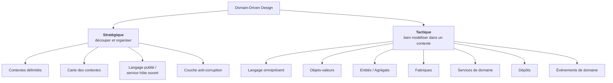
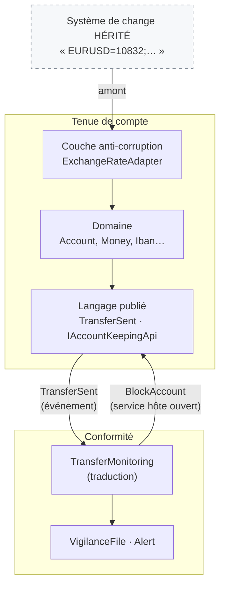
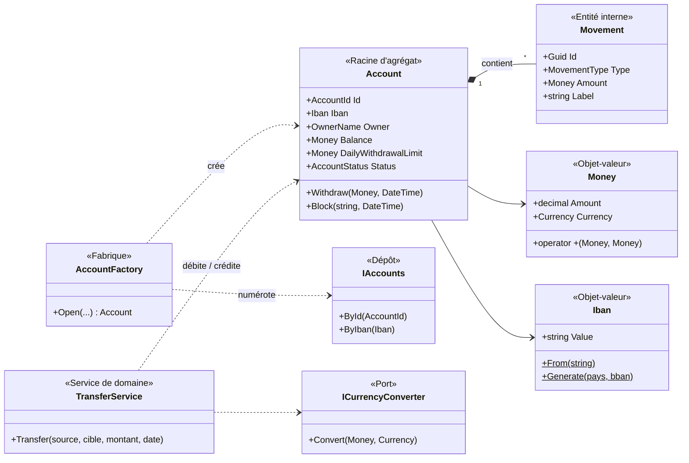
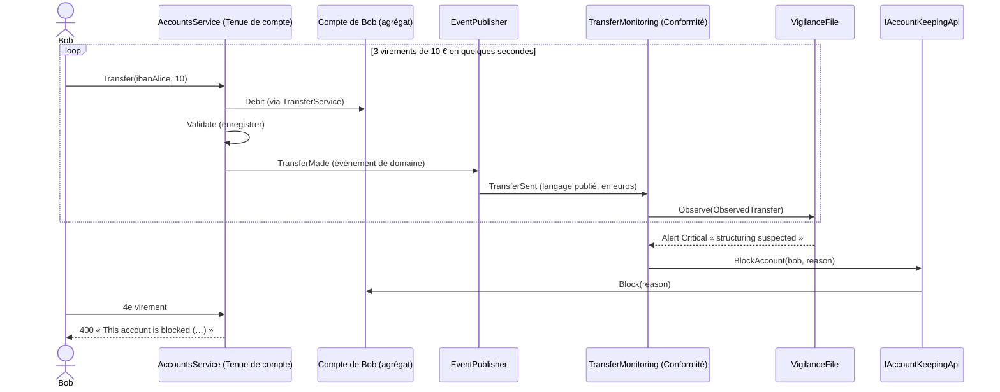

# 11. Domain-Driven Design (DDD)

> **En une phrase** : partir du métier, parler **sa** langue, et laisser le modèle guider le code — à l'intérieur d'un
> contexte (volet **tactique**) comme entre les contextes (volet **stratégique**).

📁 Code : [`11-DDD`](../11-DDD) · ⬅️ [Event Sourcing](10-event-sourcing.md) · ➡️ [Serverless](12-serverless.md) · 🌐 [English](en/11-ddd.md)

---

## L'idée

Formalisé par **Eric Evans** dans *Domain-Driven Design* (2003), le « livre bleu ». Le DDD n'est **pas une organisation de
dossiers** comme les démos précédentes : c'est une **démarche de conception**, applicable avec une architecture hexagonale,
Onion ou Clean (la démo utilise une base Onion). Elle a deux volets :



---

## Le volet stratégique : la carte des contextes

Deux **contextes délimités** modélisent **la même réalité différemment** :

| | Contexte « Tenue de compte » | Contexte « Conformité » |
|---|---|---|
| Un compte, c'est… | un solde, un plafond, des mouvements | un **dossier de vigilance** : des virements observés et des alertes |
| Monnaie | la devise du compte (EUR, USD, CHF) | **toujours en euros** |
| Préoccupation | exécuter correctement les opérations | détecter blanchiment et fractionnement |
| Glossaire | [LANGUAGE.md](../11-DDD/Ddd.AccountKeeping.Domain/LANGUAGE.md) | [LANGUAGE.md](../11-DDD/Ddd.Compliance/LANGUAGE.md) |

Un modèle « Compte » unique pour tout le monde serait **obèse** : chaque équipe y ajouterait ses champs.



| Relation | Dans la démo | Pourquoi |
|---|---|---|
| **Couche anti-corruption** | `ExchangeRateAdapter` devant le système de change hérité | Son format (taux × 10 000, paires depuis l'euro, devises inconnues) ne doit pas polluer notre modèle |
| **Langage publié** | `Ddd.AccountKeeping.Contracts` : `TransferSent` en types simples | Les autres contextes ne voient pas `Money`, `Iban`… : le modèle interne peut évoluer |
| **Service hôte ouvert** | `IAccountKeepingApi.BlockAccount` | La Conformité **demande** un blocage ; c'est la Tenue de compte qui l'exécute |
| **Client / fournisseur** | `AmountInEuros` ajouté à `TransferSent` | Le contexte aval (Conformité) a exprimé un besoin au contexte amont |

---

## Le volet tactique : le modèle de la Tenue de compte



### 1. Le langage omniprésent

Chaque terme du glossaire existe tel quel dans le code : si un expert dit « plafond de retrait journalier », on trouve
`DailyWithdrawalLimit`, pas `MaxDailyLimit`.

### 2. Des objets-valeurs toujours valides

Un `Iban` invalide **ne peut pas exister** : recevoir un `Iban` suffit à savoir qu'il est valide.
([Iban.cs](../11-DDD/Ddd.AccountKeeping.Domain/ValueObjects/Iban.cs))

```csharp
public static Iban From(string input)
{
    var value = new string((input ?? "").Where(c => !char.IsWhiteSpace(c)).ToArray()).ToUpperInvariant();
    // … format check
    if (Modulo97(value[4..] + value[..4]) != 1)
        throw new BusinessRuleException($"Invalid IBAN (wrong check digits): \"{input}\".");
    return new Iban(value);
}
```

`Money` porte sa devise et **refuse de mélanger** euros et dollars — y compris dans une comparaison.
([Money.cs](../11-DDD/Ddd.AccountKeeping.Domain/ValueObjects/Money.cs))

```csharp
// The operations refuse to mix currencies: it is a domain rule, carried by the type itself.
public static Money operator +(Money a, Money b) => new(a.Amount + b.Amount, SameCurrency(a, b));
public static bool operator >(Money a, Money b) => SameCurrency(a, b) is not null && a.Amount > b.Amount;

private static Currency SameCurrency(Money a, Money b) =>
    a.Currency == b.Currency ? a.Currency
        : throw new BusinessRuleException($"Cannot combine {a.Currency} and {b.Currency} without conversion.");
```

Comparez avec les `decimal` et `string` nus des autres démos (*primitive obsession*).

### 3. Un agrégat dont la frontière est dictée par un invariant

Pour vérifier le plafond de retrait **journalier**, le compte doit connaître ses mouvements du jour : c'est cette règle
qui fixe la **frontière** de l'agrégat. On ne charge ni n'enregistre jamais un mouvement seul.
([Account.cs](../11-DDD/Ddd.AccountKeeping.Domain/Accounts/Account.cs))

```csharp
public void Withdraw(Money amount, DateTime date)
{
    CheckDebitPossible(amount);

    var alreadyWithdrawn = WithdrawalsOfTheDay(date);
    if (alreadyWithdrawn + amount > DailyWithdrawalLimit)
        throw new BusinessRuleException(
            $"Daily withdrawal limit of {DailyWithdrawalLimit} exceeded (already withdrawn today: {alreadyWithdrawn}).");

    Balance -= amount;
    _movements.Add(new Movement(date, MovementType.Withdrawal, amount, "Withdrawal"));
    Raise(new WithdrawalMade(Id, amount, date));
}
```

### 4. Fabrique et service de domaine

La **fabrique** calcule le numéro et l'IBAN ([Factory.cs](../11-DDD/Ddd.AccountKeeping.Domain/Accounts/Factory.cs)) ;
le **service de domaine** porte le virement, qui touche deux agrégats et un taux de change
([TransferService.cs](../11-DDD/Ddd.AccountKeeping.Domain/Accounts/TransferService.cs)) :

```csharp
var creditedAmount = target.Currency == amount.Currency ? amount : await converter.Convert(amount, target.Currency);

source.Debit(amount, $"Transfer to {target.Owner}", date);
target.Credit(creditedAmount, $"Transfer from {source.Owner}", date);

source.Report(new TransferMade(Guid.NewGuid(), source.Id, source.Iban, source.Owner,
    target.Iban, amount, creditedAmount, date));
```

### 5. La couche anti-corruption

([AntiCorruptionLayer.cs](../11-DDD/Ddd.AccountKeeping.Infrastructure/AntiCorruptionLayer.cs))

```csharp
public class LegacyQuoteSystem
{
    public virtual string TodaysQuotes() => "EURUSD=10832;EURCHF=9415;EURGBP=8571;EURJPY=1612300";
}

/// ANTI-CORRUPTION LAYER: it translates the model of the legacy system into our language (Money, Currency).
public class ExchangeRateAdapter(LegacyQuoteSystem legacySystem) : ICurrencyConverter
{
    public Task<Money> Convert(Money amount, Currency currency)
    {
        var ratesFromEuro = ReadQuotes(legacySystem.TodaysQuotes());

        // The legacy system only quotes from the euro: any cross rate goes through the euro (USD → CHF…).
        var amountInEuros = amount.Amount / ratesFromEuro[amount.Currency];
        var converted = decimal.Round(amountInEuros * ratesFromEuro[currency], 2, MidpointRounding.ToEven);
        return Task.FromResult(new Money(converted, currency));
    }
}
```

### 6. Traduire les événements de domaine en langage publié

([Integration.cs](../11-DDD/Ddd.AccountKeeping.Application/Integration.cs))

```csharp
var integration = new TransferSent(
    v.TransferId, v.Source.Value, v.SourceIban.Value, v.SourceOwner.Value, v.TargetIban.Value,
    v.DebitedAmount.Amount, v.DebitedAmount.Currency.Code, inEuros.Amount, v.Date);

foreach (var subscriber in subscribers())
    await subscriber.OnTransferSent(integration);
```

### Le scénario de fractionnement : deux contextes coopèrent



---

## Les tests

- **Objets-valeurs** ([ValueObjectsTests.cs](../11-DDD/Ddd.Tests/ValueObjectsTests.cs)) : égalité par valeur, devises non
  mélangeables, montants et IBAN invalides impossibles à créer.
- **Domaine** ([DomainTests.cs](../11-DDD/Ddd.Tests/DomainTests.cs)) : plafond journalier, compte bloqué, conversion via
  la couche anti-corruption (100 € → 108,32 $ ; 108,32 $ → 94,15 CHF par croisement), règles de la Conformité.
- **Frontières des contextes** ([ApiTests.cs](../11-DDD/Ddd.Tests/ApiTests.cs)) :

```csharp
[Fact]
public void Compliance_only_knows_the_published_language_of_account_keeping()
{
    Assert.Equal(["Ddd.AccountKeeping.Contracts"], InternalDependencies(typeof(VigilanceFile).Assembly));
}
```

---

## Bilan

| 👍 Points forts | 👎 Limites |
|---|---|
| Code lisible par les experts métier (même vocabulaire) | Exige des **experts disponibles** pour construire le langage |
| Objets-valeurs : des erreurs impossibles par construction | Beaucoup de cérémonie pour un CRUD |
| Contextes délimités : modèles ciblés, équipes autonomes | Découper les contextes est difficile, et coûteux à corriger |
| Donne **où couper** pour les modules et les services | Souvent réduit, à tort, à sa seule boîte à outils tactique |

**Le DDD n'a pas de colonne dans le comparatif** : ce n'est pas une architecture concurrente, mais la démarche qui dit
**où couper**. Ses contextes délimités donnent les modules ([démo 7](07-monolithe-modulaire.md)) ou les services
([démo 8](08-microservices.md)), et ses agrégats donnent les flux d'événements ([démo 10](10-event-sourcing.md)).
