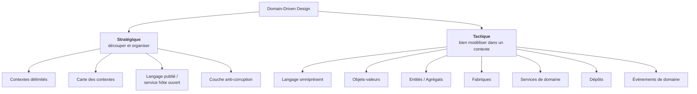
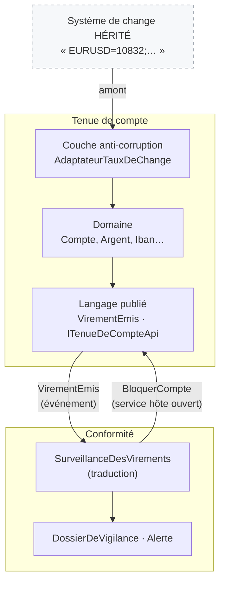
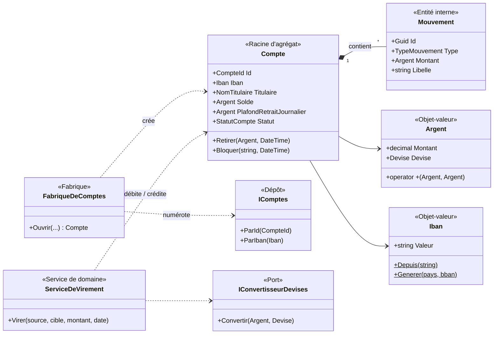
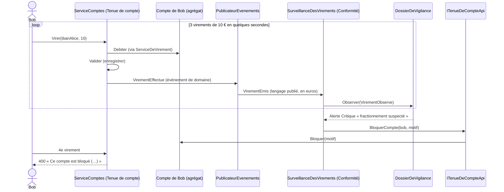

# 11. Domain-Driven Design (DDD)

> **En une phrase** : partir du métier, parler **sa** langue, et laisser le modèle guider le code — à l'intérieur d'un
> contexte (volet **tactique**) comme entre les contextes (volet **stratégique**).

📁 Code : [`11-DDD`](../11-DDD) · ⬅️ [Event Sourcing](10-event-sourcing.md) · ➡️ [Serverless](12-serverless.md)

---

## L'idée

Formalisé par **Eric Evans** dans *Domain-Driven Design* (2003), le « livre bleu ». Le DDD n'est **pas une organisation de
dossiers** comme les démos précédentes : c'est une **démarche de conception**, applicable avec une architecture hexagonale,
Onion ou Clean (la démo utilise une base Onion). Elle a deux volets :



---

## Le volet stratégique : la carte des contextes

Deux **contextes délimités** modélisent **la même réalité différemment** :

| | Contexte « Tenue de compte » | Contexte « Conformité » |
|---|---|---|
| Un compte, c'est… | un solde, un plafond, des mouvements | un **dossier de vigilance** : des virements observés et des alertes |
| Monnaie | la devise du compte (EUR, USD, CHF) | **toujours en euros** |
| Préoccupation | exécuter correctement les opérations | détecter blanchiment et fractionnement |
| Glossaire | [LANGAGE.md](../11-DDD/Ddd.TenueDeCompte.Domaine/LANGAGE.md) | [LANGAGE.md](../11-DDD/Ddd.Conformite/LANGAGE.md) |

Un modèle « Compte » unique pour tout le monde serait **obèse** : chaque équipe y ajouterait ses champs.



| Relation | Dans la démo | Pourquoi |
|---|---|---|
| **Couche anti-corruption** | `AdaptateurTauxDeChange` devant le système de change hérité | Son format (taux × 10 000, paires depuis l'euro, devises inconnues) ne doit pas polluer notre modèle |
| **Langage publié** | `Ddd.TenueDeCompte.Contrats` : `VirementEmis` en types simples | Les autres contextes ne voient pas `Argent`, `Iban`… : le modèle interne peut évoluer |
| **Service hôte ouvert** | `ITenueDeCompteApi.BloquerCompte` | La Conformité **demande** un blocage ; c'est la Tenue de compte qui l'exécute |
| **Client / fournisseur** | `MontantEnEuros` ajouté à `VirementEmis` | Le contexte aval (Conformité) a exprimé un besoin au contexte amont |

---

## Le volet tactique : le modèle de la Tenue de compte



### 1. Le langage omniprésent

Chaque terme du glossaire existe tel quel dans le code : si un expert dit « plafond de retrait journalier », on trouve
`PlafondRetraitJournalier`, pas `MaxDailyLimit`.

### 2. Des objets-valeurs toujours valides

Un `Iban` invalide **ne peut pas exister** : recevoir un `Iban` suffit à savoir qu'il est valide.
([Iban.cs](../11-DDD/Ddd.TenueDeCompte.Domaine/ObjetsValeurs/Iban.cs))

```csharp
public static Iban Depuis(string saisie)
{
    var valeur = new string((saisie ?? "").Where(c => !char.IsWhiteSpace(c)).ToArray()).ToUpperInvariant();
    // … contrôle de forme
    if (Modulo97(valeur[4..] + valeur[..4]) != 1)
        throw new RegleMetierException($"IBAN invalide (clé de contrôle incorrecte) : « {saisie} ».");
    return new Iban(valeur);
}
```

`Argent` porte sa devise et **refuse de mélanger** euros et dollars — y compris dans une comparaison.
([Argent.cs](../11-DDD/Ddd.TenueDeCompte.Domaine/ObjetsValeurs/Argent.cs))

```csharp
// Les opérations refusent de mélanger les devises : c'est une règle du domaine, portée par le type lui-même.
public static Argent operator +(Argent a, Argent b) => new(a.Montant + b.Montant, MemeDevise(a, b));
public static bool operator >(Argent a, Argent b) => MemeDevise(a, b) is not null && a.Montant > b.Montant;

private static Devise MemeDevise(Argent a, Argent b) =>
    a.Devise == b.Devise ? a.Devise
        : throw new RegleMetierException($"Impossible de combiner {a.Devise} et {b.Devise} sans conversion.");
```

Comparez avec les `decimal` et `string` nus des autres démos (*primitive obsession*).

### 3. Un agrégat dont la frontière est dictée par un invariant

Pour vérifier le plafond de retrait **journalier**, le compte doit connaître ses mouvements du jour : c'est cette règle
qui fixe la **frontière** de l'agrégat. On ne charge ni n'enregistre jamais un mouvement seul.
([Compte.cs](../11-DDD/Ddd.TenueDeCompte.Domaine/Comptes/Compte.cs))

```csharp
public void Retirer(Argent montant, DateTime date)
{
    VerifierDebitPossible(montant);

    var dejaRetire = RetraitsDuJour(date);
    if (dejaRetire + montant > PlafondRetraitJournalier)
        throw new RegleMetierException(
            $"Plafond de retrait journalier de {PlafondRetraitJournalier} dépassé (déjà retiré aujourd'hui : {dejaRetire}).");

    Solde -= montant;
    _mouvements.Add(new Mouvement(date, TypeMouvement.Retrait, montant, "Retrait"));
    Lever(new RetraitEffectue(Id, montant, date));
}
```

### 4. Fabrique et service de domaine

La **fabrique** calcule le numéro et l'IBAN ([Fabrique.cs](../11-DDD/Ddd.TenueDeCompte.Domaine/Comptes/Fabrique.cs)) ;
le **service de domaine** porte le virement, qui touche deux agrégats et un taux de change
([ServiceDeVirement.cs](../11-DDD/Ddd.TenueDeCompte.Domaine/Comptes/ServiceDeVirement.cs)) :

```csharp
var montantCredite = cible.Devise == montant.Devise ? montant : await convertisseur.Convertir(montant, cible.Devise);

source.Debiter(montant, $"Virement vers {cible.Titulaire}", date);
cible.Crediter(montantCredite, $"Virement de {source.Titulaire}", date);

source.Signaler(new VirementEffectue(Guid.NewGuid(), source.Id, source.Iban, source.Titulaire,
    cible.Iban, montant, montantCredite, date));
```

### 5. La couche anti-corruption

([CoucheAntiCorruption.cs](../11-DDD/Ddd.TenueDeCompte.Infrastructure/CoucheAntiCorruption.cs))

```csharp
public class SystemeDeCotationsHerite
{
    public virtual string CotationsDuJour() => "EURUSD=10832;EURCHF=9415;EURGBP=8571;EURJPY=1612300";
}

/// COUCHE ANTI-CORRUPTION : elle traduit le modèle du système hérité vers notre langage (Argent, Devise).
public class AdaptateurTauxDeChange(SystemeDeCotationsHerite systemeHerite) : IConvertisseurDevises
{
    public Task<Argent> Convertir(Argent montant, Devise devise)
    {
        var tauxDepuisEuro = LireCotations(systemeHerite.CotationsDuJour());

        // Le système hérité ne cote que depuis l'euro : on passe par l'euro pour tout croisement (USD → CHF…).
        var montantEnEuros = montant.Montant / tauxDepuisEuro[montant.Devise];
        var converti = decimal.Round(montantEnEuros * tauxDepuisEuro[devise], 2, MidpointRounding.ToEven);
        return Task.FromResult(new Argent(converti, devise));
    }
}
```

### 6. Traduire les événements de domaine en langage publié

([Integration.cs](../11-DDD/Ddd.TenueDeCompte.Application/Integration.cs))

```csharp
var integration = new VirementEmis(
    v.VirementId, v.Source.Valeur, v.IbanSource.Valeur, v.TitulaireSource.Valeur, v.IbanCible.Valeur,
    v.MontantDebite.Montant, v.MontantDebite.Devise.Code, enEuros.Montant, v.Date);

foreach (var abonne in abonnes())
    await abonne.SurVirementEmis(integration);
```

### Le scénario de fractionnement : deux contextes coopèrent



---

## Les tests

- **Objets-valeurs** ([ObjetsValeursTests.cs](../11-DDD/Ddd.Tests/ObjetsValeursTests.cs)) : égalité par valeur, devises non
  mélangeables, montants et IBAN invalides impossibles à créer.
- **Domaine** ([DomaineTests.cs](../11-DDD/Ddd.Tests/DomaineTests.cs)) : plafond journalier, compte bloqué, conversion via
  la couche anti-corruption (100 € → 108,32 $ ; 108,32 $ → 94,15 CHF par croisement), règles de la Conformité.
- **Frontières des contextes** ([ApiTests.cs](../11-DDD/Ddd.Tests/ApiTests.cs)) :

```csharp
[Fact]
public void La_conformite_ne_connait_que_le_langage_publie_de_la_tenue_de_compte()
{
    Assert.Equal(["Ddd.TenueDeCompte.Contrats"], DependancesInternes(typeof(DossierDeVigilance).Assembly));
}
```

---

## Bilan

| 👍 Points forts | 👎 Limites |
|---|---|
| Code lisible par les experts métier (même vocabulaire) | Exige des **experts disponibles** pour construire le langage |
| Objets-valeurs : des erreurs impossibles par construction | Beaucoup de cérémonie pour un CRUD |
| Contextes délimités : modèles ciblés, équipes autonomes | Découper les contextes est difficile, et coûteux à corriger |
| Donne **où couper** pour les modules et les services | Souvent réduit, à tort, à sa seule boîte à outils tactique |

**Le DDD n'a pas de colonne dans le comparatif** : ce n'est pas une architecture concurrente, mais la démarche qui dit
**où couper**. Ses contextes délimités donnent les modules ([démo 7](07-monolithe-modulaire.md)) ou les services
([démo 8](08-microservices.md)), et ses agrégats donnent les flux d'événements ([démo 10](10-event-sourcing.md)).
