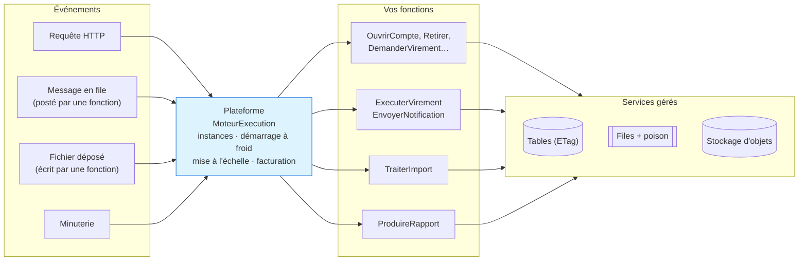
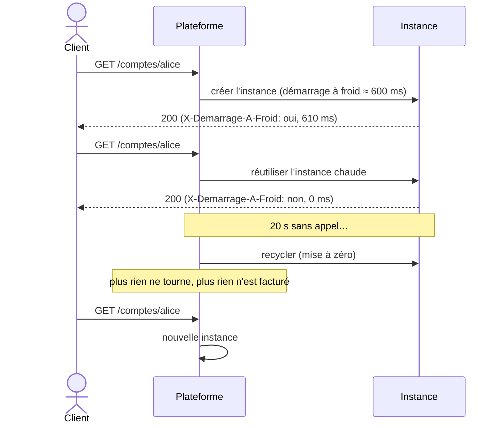
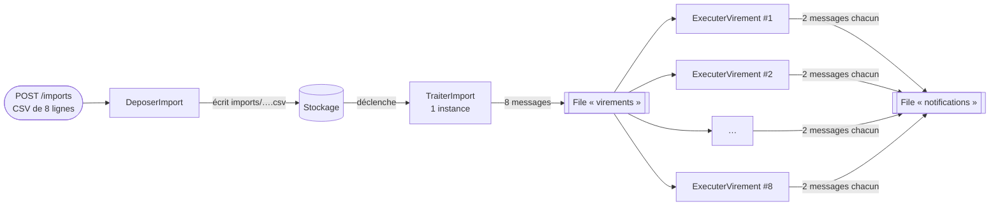
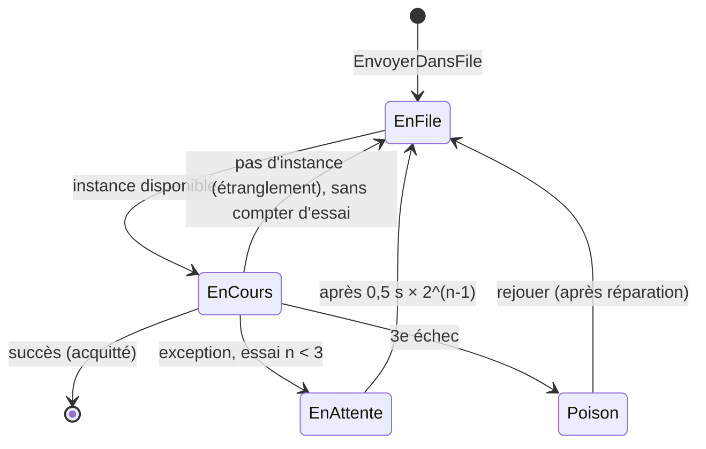

# 12. Serverless (Function as a Service)

> **En une phrase** : on n'écrit plus d'application qui tourne en continu, mais des **fonctions sans état** que le
> fournisseur cloud exécute à la demande, quand un **événement** survient, et qu'il facture à l'usage.

📁 Code : [`12-Serverless`](../12-Serverless) · ⬅️ [DDD](11-ddd.md) · ➡️ [Microkernel](13-microkernel.md) · 🌐 [English](en/12-serverless.md)

---

## L'idée

Popularisé par **AWS Lambda** (2014), puis Azure Functions et Google Cloud Functions. « Serverless » ne veut pas dire
« sans serveur », mais **sans serveur à gérer** : le fournisseur démarre, multiplie et arrête des instances selon le trafic.

> **Dans cette démo, la plateforme est simulée** (aucun téléchargement) mais reproduit les comportements qui changent la
> façon de coder. `Sls.Plateforme` joue le rôle du fournisseur — **on ne l'écrit jamais en vrai** — ;
> `Sls.Fonctions` contient le seul code qu'on écrirait réellement.



La boucle est **événementielle** : une fonction écrit dans une file ou dans le stockage, ce qui déclenche une autre fonction.

| Le fournisseur gère | Vous écrivez |
|---|---|
| serveurs, OS, runtime, mise à l'échelle, haute disponibilité | des fonctions courtes et **sans état** |
| déclencheurs (HTTP, files, stockage, horloge) | un **manifeste** : quelles fonctions, déclenchées par quoi |
| services gérés (bases clé-valeur, files, stockage) | le code métier, **idempotent** |
| facturation à la milliseconde | rien, quand personne n'appelle |

---

## Organisation de la solution

| Projet | Rôle | En vrai |
|---|---|---|
| `Sls.Plateforme` | Le fournisseur simulé + sa « console » `/plateforme/…` | AWS Lambda, Azure Functions |
| `Sls.Fonctions` | Le manifeste et les fonctions | votre code |
| `Sls.Hote` | Fait tourner la plateforme en local | `func start`, `sam local` |
| `Sls.Tests` | Plateforme, fonctions, système complet | |

---

## Le code, pas à pas

### 1. Le manifeste : pas de serveur, pas de contrôleur

L'équivalent de `serverless.yml` ou des attributs `[Function]` d'Azure.
([Deploiement.cs](../12-Serverless/Sls.Fonctions/Deploiement.cs))

```csharp
public static void Declarer(Manifeste manifeste) => manifeste
    // Déclencheurs HTTP (derrière une passerelle API gérée)
    .Http("OuvrirCompte", "POST", "/comptes", ComptesFonctions.Ouvrir)
    .Http("Retirer", "POST", "/comptes/{id}/retrait", ComptesFonctions.Retirer)
    .Http("DemanderVirement", "POST", "/virements", VirementsFonctions.Demander)
    // …
    // Déclencheurs de file : traitement asynchrone, avec nouveaux essais automatiques
    .File("ExecuterVirement", Files.Virements, VirementsFonctions.Executer, memoireMo: 256)
    .File("EnvoyerNotification", Files.Notifications, NotificationsFonctions.Envoyer)
    // Déclencheur de stockage : un fichier déposé lance son traitement
    .Stockage("TraiterImport", "imports/", ImportsFonctions.Traiter, memoireMo: 512)
    // Déclencheur planifié
    .Minuterie("ProduireRapport", TimeSpan.FromSeconds(30), RapportsFonctions.Produire);
```

### 2. Une fonction : une méthode statique

Entrée = le déclencheur + le contexte ; sortie = une réponse. Tout ce qui doit durer va dans un service géré.
([Fonctions.cs](../12-Serverless/Sls.Fonctions/Fonctions.cs))

```csharp
/// <summary>HTTP : on ne fait PAS le virement ici. On l'accepte (202) et on le confie à une file : réponse immédiate.</summary>
public static async Task<ReponseHttp> Demander(RequeteHttp requete, ContexteFonction contexte)
{
    var demande = requete.Lire<VirementDemande>();
    if (await Valider(demande, contexte) is { } erreur)
        return ReponseHttp.Invalide(erreur);

    var virement = await Planifier(demande, contexte, Guid.NewGuid());
    return ReponseHttp.Accepte($"/virements/{virement.Id}", new { virementId = virement.Id, statut = virement.Statut });
}
```

### 3. Démarrage à froid, instances chaudes, mise à zéro

([MoteurExecution.cs](../12-Serverless/Sls.Plateforme/MoteurExecution.cs))

```csharp
lock (etat)
{
    instance = etat.Instances.FirstOrDefault(i => !i.Occupee);
    aFroid = instance is null;
    if (instance is null)
    {
        if (etat.Instances.Count >= _options.InstancesMaxParFonction)
            throw new EtranglementException(nom);
        instance = new Instance($"{++etat.NumeroInstance}");
        etat.Instances.Add(instance);
    }
    instance.Occupee = true;
}
// …
if (aFroid)
{
    // Téléchargement du code, démarrage du runtime .NET, initialisation : c'est le « cold start ».
    await Task.Delay(_options.DemarrageAFroidMs);
}
```



### 4. Mise à l'échelle automatique : le *fan-out*

Une instance ne traite **qu'un appel à la fois** : 8 messages simultanés = 8 instances.



Mesuré sur la démo : `picInstances = 8` pour `ExecuterVirement`.

### 5. Sans état : la mémoire d'instance est trompeuse

([Fonctions.cs](../12-Serverless/Sls.Fonctions/Fonctions.cs))

```csharp
// ✗ Mémoire de l'instance : propre à CETTE instance, remise à zéro à chaque démarrage à froid.
var compteurDeLInstance = (contexte.MemoireInstance.TryGetValue("visites", out var v) ? (long)v : 0) + 1;
contexte.MemoireInstance["visites"] = compteurDeLInstance;

// ✓ Service géré : partagé par toutes les instances, durable.
var global = await Concurrence.ModifierOuCreer(contexte.Table(Tables.Compteurs), "visites",
    new Compteur(0), c => c with { Valeur = c.Valeur + 1 });
```

### 6. Concurrence : écritures conditionnelles (ETag)

Des dizaines d'instances peuvent modifier le même compte en même temps.
([Modele.cs](../12-Serverless/Sls.Fonctions/Modele.cs))

```csharp
/// Lire → modifier → écrire « seulement si personne n'a écrit entre-temps », et recommencer sinon.
public static async Task<T> Modifier<T>(TableGeree table, string cle, Func<T, T> modification) where T : class
{
    for (var essai = 1; ; essai++)
    {
        var (valeur, etag) = await table.Lire<T>(cle);
        if (valeur is null)
            throw new KeyNotFoundException($"{table.Nom}/{cle}");
        try
        {
            var nouvelle = modification(valeur);
            await table.Ecrire(cle, nouvelle, etag);
            return nouvelle;
        }
        catch (ConflitEcritureException) when (essai < 20)
        {
            // Une autre instance a écrit avant nous : on relit et on recommence.
        }
    }
}
```

### 7. Nouveaux essais, messages empoisonnés et idempotence

Une exception fait relivrer le message (attente croissante) ; après 3 échecs, il part dans la file `-poison`.
([ServicesGeres.cs](../12-Serverless/Sls.Plateforme/ServicesGeres.cs))

```csharp
internal void Echec(string file, MessageEnFile message, string erreur)
{
    var tentative = message.Tentative + 1;
    if (tentative >= options.TentativesMax)
        Ajouter($"{file}-poison", message with { Tentative = tentative, DerniereErreur = erreur });
    else
        Ajouter(file, message with
        {
            Tentative = tentative,
            DerniereErreur = erreur,
            VisibleApres = DateTime.UtcNow.AddMilliseconds(options.AttenteEntreTentativesMs * Math.Pow(2, tentative - 1))
        });
}
```



Un message pouvant être livré plusieurs fois, **tout traitement doit être idempotent** : `Compte.Appliquer` ignore une
opération déjà connue, les notifications ont une clé déterministe, et un fichier d'import retraité ne crée aucun doublon
(identifiant tiré du fichier et du numéro de ligne).

```csharp
public Compte Appliquer(Guid operation, decimal variation)
{
    if (Operations.Contains(operation))
        return this;
    if (Solde + variation < 0)
        throw new RegleMetierException("Solde insuffisant.");
    return this with { Solde = Solde + variation, Operations = [.. Operations.TakeLast(49), operation] };
}
```

### 8. La facture

`GET /plateforme/facture` : invocations × 0,20 $ / million + durée × mémoire (Go-s) × 0,0000166667 $ (tarifs AWS Lambda).
La démo complète (49 invocations, 2,6 Go-s) coûte **0,000054 $**. Mais un trafic constant et élevé peut coûter plus
cher qu'un serveur dédié : le serverless brille sur les charges **irrégulières**.

---

## Les tests

Trois niveaux :

| Niveau | Fichier | Exemple |
|---|---|---|
| Plateforme seule | [PlateformeTests.cs](../12-Serverless/Sls.Tests/PlateformeTests.cs) | froid puis chaud, mise à l'échelle, étranglement, recyclage, délai dépassé, Go-s |
| Fonctions, appelées comme des méthodes | [FonctionsTests.cs](../12-Serverless/Sls.Tests/FonctionsTests.cs) | 30 retraits simultanés → exactement 10 réussissent ; double livraison → un seul débit |
| Système complet | [SystemeTests.cs](../12-Serverless/Sls.Tests/SystemeTests.cs) | virement HTTP → files ; import → plusieurs instances ; poison puis rejeu |

```csharp
[Fact]
public async Task Des_retraits_simultanes_ne_mettent_jamais_le_compte_a_decouvert()
{
    // 30 « instances » retirent 100 € en même temps sur un compte de 1 000 € : grâce aux ETag, exactement 10 réussissent.
    var reponses = await Task.WhenAll(Enumerable.Range(0, 30).Select(_ =>
        ComptesFonctions.Retirer(Requete(new { montant = 100m }, DonneesDeDemo.Alice.ToString()), Contexte)));

    Assert.Equal(10, reponses.Count(r => r.Statut == 200));
    Assert.Equal(0m, await Solde(DonneesDeDemo.Alice));
}
```

---

## Bilan

| 👍 Points forts | 👎 Limites |
|---|---|
| Aucun serveur à gérer, haute disponibilité incluse | **Démarrages à froid** (latence imprévisible) |
| Mise à l'échelle automatique, **jusqu'à zéro** | **Sans état** imposé : tout passe par des services gérés |
| Facturation à l'usage : idéal pour un trafic irrégulier | **Idempotence** obligatoire (livraisons multiples) |
| Fonctions simples à tester (des méthodes) | **Dépendance au fournisseur**, limites (durée, mémoire) |
| Naturellement événementiel | Débogage et observabilité distribués ; coût élevé à forte charge constante |

**Quand l'utiliser** : traitements événementiels (fichiers, messages, webhooks), tâches planifiées, API à trafic
irrégulier, « colle » entre services cloud. Souvent **en complément** d'une autre architecture, pas à sa place.
Pour passer au réel : Azure Functions (isolated worker) ou AWS Lambda, Azurite / LocalStack en local, et Durable
Functions / Step Functions pour orchestrer des traitements longs.
