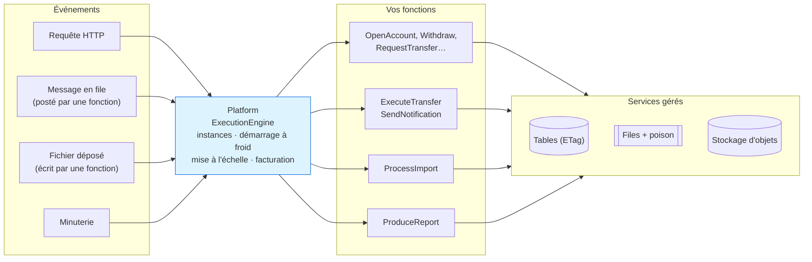
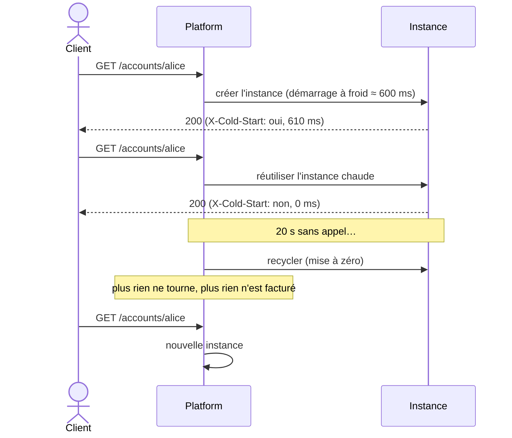
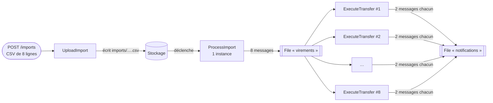

# 12. Serverless (Function as a Service)

> **En une phrase** : on n'écrit plus d'application qui tourne en continu, mais des **fonctions sans état** que le
> fournisseur cloud exécute à la demande, quand un **événement** survient, et qu'il facture à l'usage.

📁 Code : [`12-Serverless`](../12-Serverless) · ⬅️ [DDD](11-ddd.md) · ➡️ [Microkernel](13-microkernel.md) · 🌐 [English](en/12-serverless.md)

---

## L'idée

Popularisé par **AWS Lambda** (2014), puis Azure Functions et Google Cloud Functions. « Serverless » ne veut pas dire
« sans serveur », mais **sans serveur à gérer** : le fournisseur démarre, multiplie et arrête des instances selon le trafic.

> **Dans cette démo, la plateforme est simulée** (aucun téléchargement) mais reproduit les comportements qui changent la
> façon de coder. `Sls.Platform` joue le rôle du fournisseur — **on ne l'écrit jamais en vrai** — ;
> `Sls.Functions` contient le seul code qu'on écrirait réellement.



La boucle est **événementielle** : une fonction écrit dans une file ou dans le stockage, ce qui déclenche une autre fonction.

| Le fournisseur gère | Vous écrivez |
|---|---|
| serveurs, OS, runtime, mise à l'échelle, haute disponibilité | des fonctions courtes et **sans état** |
| déclencheurs (HTTP, files, stockage, horloge) | un **manifeste** : quelles fonctions, déclenchées par quoi |
| services gérés (bases clé-valeur, files, stockage) | le code métier, **idempotent** |
| facturation à la milliseconde | rien, quand personne n'appelle |

---

## Organisation de la solution

| Projet | Rôle | En vrai |
|---|---|---|
| `Sls.Platform` | Le fournisseur simulé + sa « console » `/platform/…` | AWS Lambda, Azure Functions |
| `Sls.Functions` | Le manifeste et les fonctions | votre code |
| `Sls.Host` | Fait tourner la plateforme en local | `func start`, `sam local` |
| `Sls.Tests` | Plateforme, fonctions, système complet | |

---

## Le code, pas à pas

### 1. Le manifeste : pas de serveur, pas de contrôleur

L'équivalent de `serverless.yml` ou des attributs `[Function]` d'Azure.
([Deployment.cs](../12-Serverless/Sls.Functions/Deployment.cs))

```csharp
public static void Declare(Manifest manifest) => manifest
    // HTTP triggers (behind a managed API gateway)
    .Http("OpenAccount", "POST", "/accounts", AccountsFunctions.Open)
    .Http("Withdraw", "POST", "/accounts/{id}/withdrawal", AccountsFunctions.Withdraw)
    .Http("RequestTransfer", "POST", "/transfers", TransfersFunctions.Request)
    // …
    // Queue triggers: asynchronous processing, with automatic retries
    .Queue("ExecuteTransfer", Queues.Transfers, TransfersFunctions.Execute, memoryMb: 256)
    .Queue("SendNotification", Queues.Notifications, NotificationsFunctions.Send)
    // Storage trigger: an uploaded file starts its processing
    .Storage("ProcessImport", "imports/", ImportsFunctions.Process, memoryMb: 512)
    // Scheduled trigger
    .Timer("ProduceReport", TimeSpan.FromSeconds(30), ReportsFunctions.Produce);
```

### 2. Une fonction : une méthode statique

Entrée = le déclencheur + le contexte ; sortie = une réponse. Tout ce qui doit durer va dans un service géré.
([Functions.cs](../12-Serverless/Sls.Functions/Functions.cs))

```csharp
/// <summary>HTTP: the transfer is NOT made here. It is accepted (202) and handed to a queue: immediate response.</summary>
public static async Task<HttpResponseData> Request(HttpRequestData request, FunctionContext context)
{
    var demand = request.Read<TransferRequest>();
    if (await Validate(demand, context) is { } error)
        return HttpResponseData.Invalid(error);

    var transfer = await Schedule(demand, context, Guid.NewGuid());
    return HttpResponseData.Accepted($"/transfers/{transfer.Id}", new { transferId = transfer.Id, status = transfer.Status });
}
```

### 3. Démarrage à froid, instances chaudes, mise à zéro

([ExecutionEngine.cs](../12-Serverless/Sls.Platform/ExecutionEngine.cs))

```csharp
lock (state)
{
    instance = state.Instances.FirstOrDefault(i => !i.Busy);
    cold = instance is null;
    if (instance is null)
    {
        if (state.Instances.Count >= _options.MaxInstancesPerFunction)
            throw new ThrottlingException(name);
        instance = new Instance($"{++state.InstanceNumber}");
        state.Instances.Add(instance);
    }
    instance.Busy = true;
}
// …
if (cold)
{
    // Downloading the code, starting the .NET runtime, initializing: that is the "cold start".
    await Task.Delay(_options.ColdStartMs);
}
```



### 4. Mise à l'échelle automatique : le *fan-out*

Une instance ne traite **qu'un appel à la fois** : 8 messages simultanés = 8 instances.



Mesuré sur la démo : `peakInstances = 8` pour `ExecuteTransfer`.

### 5. Sans état : la mémoire d'instance est trompeuse

([Functions.cs](../12-Serverless/Sls.Functions/Functions.cs))

```csharp
// ✗ Instance memory: specific to THIS instance, reset at each cold start.
var instanceCounter = (context.InstanceMemory.TryGetValue("visits", out var v) ? (long)v : 0) + 1;
context.InstanceMemory["visits"] = instanceCounter;

// ✓ Managed service: shared by all the instances, durable.
var global = await Concurrency.ModifyOrCreate(context.Table(Tables.Counters), "visits",
    new Counter(0), c => c with { Value = c.Value + 1 });
```

### 6. Concurrence : écritures conditionnelles (ETag)

Des dizaines d'instances peuvent modifier le même compte en même temps.
([Model.cs](../12-Serverless/Sls.Functions/Model.cs))

```csharp
/// Read → modify → write "only if nobody wrote in the meantime", and start over otherwise.
public static async Task<T> Modify<T>(ManagedTable table, string key, Func<T, T> modification) where T : class
{
    for (var attempt = 1; ; attempt++)
    {
        var (value, etag) = await table.Read<T>(key);
        if (value is null)
            throw new KeyNotFoundException($"{table.Name}/{key}");
        try
        {
            var updated = modification(value);
            await table.Write(key, updated, etag);
            return updated;
        }
        catch (WriteConflictException) when (attempt < 20)
        {
            // Another instance wrote before us: read again and start over.
        }
    }
}
```

### 7. Nouveaux essais, messages empoisonnés et idempotence

Une exception fait relivrer le message (attente croissante) ; après 3 échecs, il part dans la file `-poison`.
([ManagedServices.cs](../12-Serverless/Sls.Platform/ManagedServices.cs))

```csharp
internal void Failed(string queue, QueuedMessage message, string error)
{
    var attempt = message.Attempt + 1;
    if (attempt >= options.MaxAttempts)
        Add($"{queue}-poison", message with { Attempt = attempt, LastError = error });
    else
        Add(queue, message with
        {
            Attempt = attempt,
            LastError = error,
            VisibleAfter = DateTime.UtcNow.AddMilliseconds(options.DelayBetweenAttemptsMs * Math.Pow(2, attempt - 1))
        });
}
```


Un message pouvant être livré plusieurs fois, **tout traitement doit être idempotent** : `Account.Apply` ignore une
opération déjà connue, les notifications ont une clé déterministe, et un fichier d'import retraité ne crée aucun doublon
(identifiant tiré du fichier et du numéro de ligne).

```csharp
public Account Apply(Guid operation, decimal change)
{
    if (Operations.Contains(operation))
        return this;
    if (Balance + change < 0)
        throw new BusinessRuleException("Insufficient balance.");
    return this with { Balance = Balance + change, Operations = [.. Operations.TakeLast(49), operation] };
}
```

### 8. La facture

`GET /platform/bill` : invocations × 0,20 $ / million + durée × mémoire (Go-s) × 0,0000166667 $ (tarifs AWS Lambda).
La démo complète (49 invocations, 2,6 Go-s) coûte **0,000054 $**. Mais un trafic constant et élevé peut coûter plus
cher qu'un serveur dédié : le serverless brille sur les charges **irrégulières**.

---

## Les tests

Trois niveaux :

| Niveau | Fichier | Exemple |
|---|---|---|
| Plateforme seule | [PlatformTests.cs](../12-Serverless/Sls.Tests/PlatformTests.cs) | froid puis chaud, mise à l'échelle, étranglement, recyclage, délai dépassé, Go-s |
| Fonctions, appelées comme des méthodes | [FunctionsTests.cs](../12-Serverless/Sls.Tests/FunctionsTests.cs) | 30 retraits simultanés → exactement 10 réussissent ; double livraison → un seul débit |
| Système complet | [SystemTests.cs](../12-Serverless/Sls.Tests/SystemTests.cs) | virement HTTP → files ; import → plusieurs instances ; poison puis rejeu |

```csharp
[Fact]
public async Task Simultaneous_withdrawals_never_overdraw_the_account()
{
    // 30 "instances" withdraw 100 € at the same time from an account of 1,000 €: thanks to the ETags, exactly 10 succeed.
    var responses = await Task.WhenAll(Enumerable.Range(0, 30).Select(_ =>
        AccountsFunctions.Withdraw(Request(new { amount = 100m }, DemoData.Alice.ToString()), Context)));

    Assert.Equal(10, responses.Count(r => r.Status == 200));
    Assert.Equal(0m, await Balance(DemoData.Alice));
}
```

---

## Bilan

| 👍 Points forts | 👎 Limites |
|---|---|
| Aucun serveur à gérer, haute disponibilité incluse | **Démarrages à froid** (latence imprévisible) |
| Mise à l'échelle automatique, **jusqu'à zéro** | **Sans état** imposé : tout passe par des services gérés |
| Facturation à l'usage : idéal pour un trafic irrégulier | **Idempotence** obligatoire (livraisons multiples) |
| Fonctions simples à tester (des méthodes) | **Dépendance au fournisseur**, limites (durée, mémoire) |
| Naturellement événementiel | Débogage et observabilité distribués ; coût élevé à forte charge constante |

**Quand l'utiliser** : traitements événementiels (fichiers, messages, webhooks), tâches planifiées, API à trafic
irrégulier, « colle » entre services cloud. Souvent **en complément** d'une autre architecture, pas à sa place.
Pour passer au réel : Azure Functions (isolated worker) ou AWS Lambda, Azurite / LocalStack en local, et Durable
Functions / Step Functions pour orchestrer des traitements longs.
