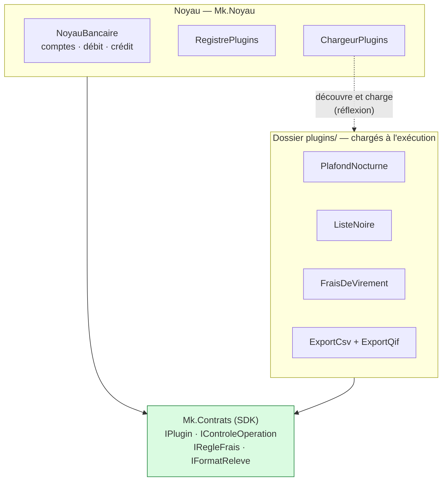
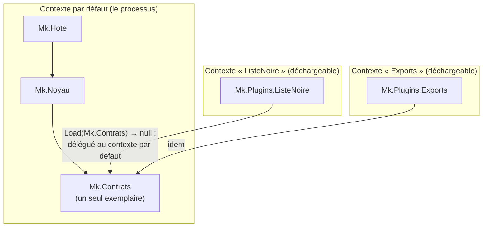
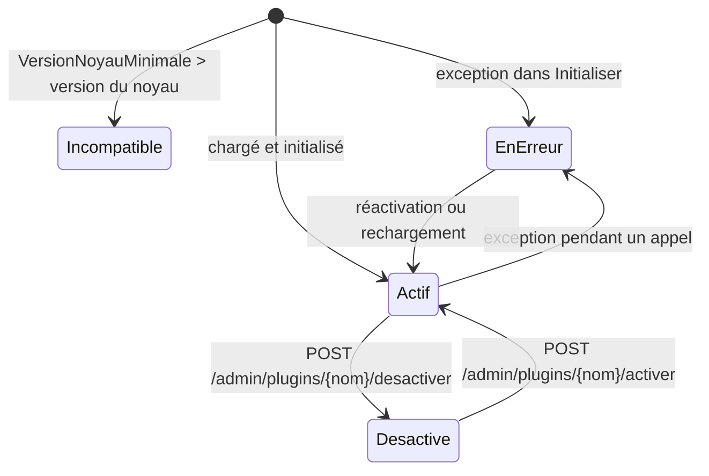
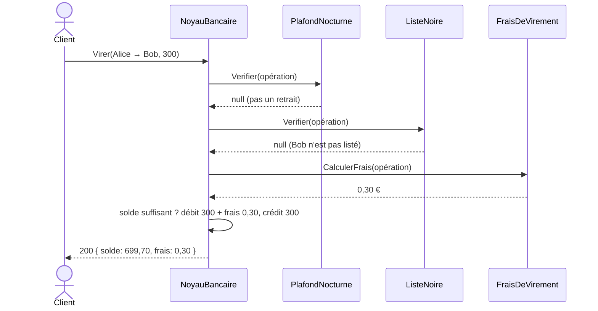
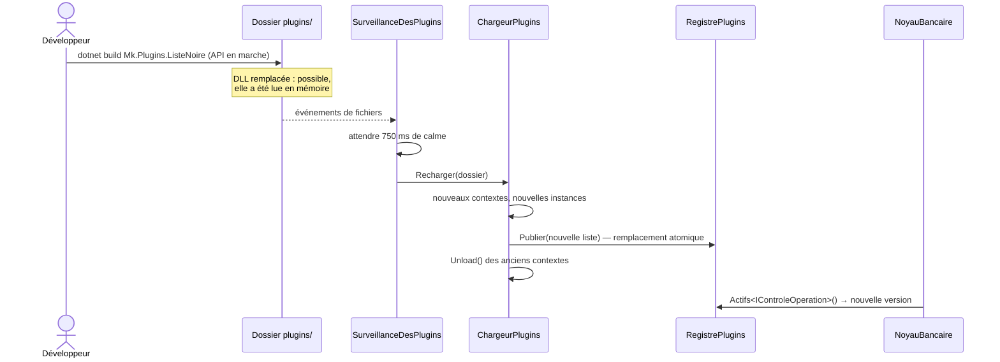

# 13. Microkernel (architecture à plugins)

> **En une phrase** : un **noyau minimal** qui définit des **points d'extension** ; les fonctionnalités variables sont
> des **plugins** chargés à l'exécution, que l'on ajoute, retire ou met à jour sans recompiler ni redémarrer le noyau.

📁 Code : [`13-Microkernel`](../13-Microkernel) · ⬅️ [Serverless](12-serverless.md) · ➡️ [Saga orchestrée](14-saga-orchestree.md)

---

## L'idée

Le modèle de VS Code, Eclipse, des navigateurs, des moteurs de règles ou des logiciels de paie : le cœur fait peu de
choses mais les fait bien, et tout ce qui **varie** (selon le client, le pays, l'offre commerciale) est branché autour.
Aucune des démos précédentes ne traitait cet axe : l'**extensibilité**.



**Le noyau ne référence aucun plugin**, et les plugins ne voient du noyau que le SDK (`Mk.Contrats`). Les deux côtés
ne se rencontrent qu'à l'exécution.

### Les trois points d'extension

| Point d'extension | Rôle | Plugins de la démo |
|---|---|---|
| `IControleOperation` | Peut **refuser** une opération avant qu'elle ait lieu | `PlafondNocturne` (retraits limités la nuit), `ListeNoire` (virements vers des comptes interdits) |
| `IRegleFrais` | Ajoute des **frais** | `FraisDeVirement` (0,1 %, entre 0,20 € et 5 €) |
| `IFormatReleve` | Produit un **relevé** dans un format | `ExportCsv`, `ExportQif` — **deux extensions dans une seule DLL** |

---

## Organisation de la solution

```
13-Microkernel/
├── Mk.Contrats/               le SDK : interfaces et données échangées
├── Mk.Noyau/                  NoyauBancaire, RegistrePlugins, ChargeurPlugins
├── Mk.Hote/                   API HTTP + surveillance du dossier des plugins
├── Mk.Plugins.FraisVirement/  ┐
├── Mk.Plugins.PlafondNocturne/│  projets de plugins : compilés dans plugins/{Nom}/,
├── Mk.Plugins.ListeNoire/     │  chacun avec son plugin.json de réglages
├── Mk.Plugins.Exports/        ┘
├── Plugins.props              réglages communs aux plugins
└── plugins/                   ← sortie de compilation (non versionnée), lue par le noyau
```

---

## Le code, pas à pas

### 1. Le SDK : ce que noyau et plugins partagent

([Contrats.cs](../13-Microkernel/Mk.Contrats/Contrats.cs))

```csharp
public interface IPlugin
{
    string Nom { get; }
    string Description { get; }

    /// <summary>Version minimale du noyau dont le plugin a besoin. Un plugin trop récent est refusé au chargement.</summary>
    Version VersionNoyauMinimale => new(1, 0);

    /// <summary>Appelé une fois au chargement, avec les réglages lus dans le plugin.json du plugin.</summary>
    void Initialiser(ContextePlugin contexte) { }
}

/// <summary>Peut refuser une opération avant qu'elle ait lieu.</summary>
public interface IControleOperation : IPlugin
{
    /// <returns>null si l'opération est permise, sinon la raison du refus.</returns>
    string? Verifier(OperationProposee operation);
}
```

Les plugins reçoivent des **valeurs** (`OperationProposee`, `ReleveCompte`), jamais les objets internes du noyau.

### 2. Un plugin : une classe qui implémente un point d'extension

([PlafondNocturne.cs](../13-Microkernel/Mk.Plugins.PlafondNocturne/PlafondNocturne.cs))

```csharp
public sealed class PlafondNocturne : IControleOperation
{
    private decimal _plafond = 200m;
    private TimeOnly _debut = new(22, 0), _fin = new(6, 0);

    public string Nom => "PlafondNocturne";

    public string? Verifier(OperationProposee operation)
    {
        if (operation.Type != TypeOperation.Retrait || operation.Montant <= _plafond)
            return null;

        var heure = TimeOnly.FromDateTime(operation.Date);
        var laNuit = _debut <= _fin
            ? heure >= _debut && heure < _fin
            : heure >= _debut || heure < _fin;  // plage à cheval sur minuit
        return laNuit ? $"Retrait limité à {_plafond} € entre {_debut:HH\\:mm} et {_fin:HH\\:mm}." : null;
    }
}
```

Ses réglages viennent de son propre `plugin.json`, à côté de sa DLL :

```json
{ "plafond": "200", "debut": "22:00", "fin": "06:00" }
```

### 3. Compiler un plugin… sans embarquer le SDK

([Plugins.props](../13-Microkernel/Plugins.props))

```xml
<PropertyGroup>
  <EnableDynamicLoading>true</EnableDynamicLoading>
  <OutputPath>$(MSBuildThisFileDirectory)plugins\$(MSBuildProjectName)\</OutputPath>
</PropertyGroup>
<ItemGroup>
  <ProjectReference Include="$(MSBuildThisFileDirectory)Mk.Contrats\Mk.Contrats.csproj" Private="false" ExcludeAssets="runtime" />
</ItemGroup>
```

`Private="false"` évite de copier `Mk.Contrats.dll` dans le dossier du plugin. Pourquoi c'est vital : voir l'étape suivante.

### 4. Charger chaque plugin dans son propre contexte

([ChargeurPlugins.cs](../13-Microkernel/Mk.Noyau/ChargeurPlugins.cs))

```csharp
internal sealed class ContexteChargement(string cheminDll)
    : AssemblyLoadContext(Path.GetFileNameWithoutExtension(cheminDll), isCollectible: true)
{
    private readonly AssemblyDependencyResolver _resolveur = new(cheminDll);

    /// Chargé depuis la MÉMOIRE et non depuis le fichier : la DLL n'est pas verrouillée,
    /// on peut la recompiler, la remplacer ou la supprimer pendant que l'application tourne.
    public Assembly Charger() => LoadFromStream(new MemoryStream(File.ReadAllBytes(cheminDll)));

    protected override Assembly? Load(AssemblyName nom)
    {
        // Point crucial : les contrats doivent venir du NOYAU (contexte par défaut).
        // Si le plugin chargeait sa propre copie de Mk.Contrats, son IPlugin serait un AUTRE type
        // que l'IPlugin du noyau (même nom, assemblies différentes), et rien ne fonctionnerait.
        if (nom.Name == typeof(IPlugin).Assembly.GetName().Name)
            return null;

        var chemin = _resolveur.ResolveAssemblyToPath(nom);
        return chemin is null ? null : LoadFromStream(new MemoryStream(File.ReadAllBytes(chemin)));
    }
}
```



Un test le vérifie : après chargement, `Mk.Contrats` n'est présent **qu'une fois** dans le processus.

### 5. Découvrir les extensions par réflexion

```csharp
return assembly.GetExportedTypes()
    .Where(t => t is { IsClass: true, IsAbstract: false } && typeof(IPlugin).IsAssignableFrom(t))
    .Select(t => RegistrePlugins.Preparer((IPlugin)Activator.CreateInstance(t)!, nom, reglages, journal))
    .ToList();
```

`Preparer` vérifie la version du noyau exigée, puis appelle `Initialiser` avec les réglages du `plugin.json`.



### 6. Le noyau appelle les extensions aux endroits prévus

([NoyauBancaire.cs](../13-Microkernel/Mk.Noyau/NoyauBancaire.cs))

```csharp
// 1. Point d'extension « contrôle » : un seul refus suffit.
foreach (var controle in plugins.Actifs<IControleOperation>())
{
    string? refus = null;
    if (!Proteger(controle, () => refus = controle.Verifier(operation)))
        return Resultat.Refus($"Le plugin {controle.Nom} est en erreur : opération refusée par sécurité.");
    if (refus is not null)
        return Resultat.Refus($"[{controle.Nom}] {refus}");
}

// 2. Point d'extension « frais » : chaque règle peut ajouter les siens.
// …

// 3. Le cœur du métier, qui n'appartient qu'au noyau.
var totalFrais = frais.Sum(f => f.Montant);
if (montant + totalFrais > compte.Solde)
    return Resultat.Refus($"Solde insuffisant (frais compris : {totalFrais:0.00} €).");
```



### 7. Un plugin défaillant ne fait pas tomber le noyau

```csharp
/// Un plugin ne doit jamais faire tomber le noyau : son exception est capturée, et le plugin est mis « en erreur »
/// (donc désactivé) jusqu'à ce qu'on le réactive ou qu'on le recharge.
private bool Proteger(IPlugin plugin, Action appel)
{
    try
    {
        appel();
        return true;
    }
    catch (Exception e)
    {
        plugins.SignalerErreur(plugin, e);
        journal($"[{plugin.Nom}] exception, plugin désactivé : {e.Message}");
        return false;
    }
}
```

Choix de sécurité (*fail-closed*) : l'opération en cours est **refusée**, plutôt que d'être exécutée sans un contrôle.

### 8. Le rechargement à chaud

Le registre est **remplacé d'un bloc** ; les anciens contextes sont ensuite déchargés.
`SurveillanceDesPlugins` ([Endpoints.cs](../13-Microkernel/Mk.Hote/Endpoints.cs)) observe le dossier et recharge
750 ms après le dernier changement (une compilation écrit plusieurs fichiers d'affilée).



---

## Les tests

| Fichier | Ce qui est vérifié |
|---|---|
| [NoyauTests.cs](../13-Microkernel/Mk.Tests/NoyauTests.cs) | Le noyau seul, avec des plugins **écrits dans le test** (sans DLL) : frais, plugin défaillant isolé, plugin incompatible refusé, pas d'export sans plugin de format |
| [ChargementTests.cs](../13-Microkernel/Mk.Tests/ChargementTests.cs) | Les vraies DLL : découverte, réglages, **un seul** `Mk.Contrats`, plugin supprimé puis **contexte réellement déchargé** |
| [ApiTests.cs](../13-Microkernel/Mk.Tests/ApiTests.cs) | De bout en bout : frais, liste noire, plafond nocturne selon l'heure (horloge réglable), formats, désactivation à chaud |

```csharp
[Fact]
public void Un_plugin_supprime_du_dossier_disparait_et_son_contexte_est_decharge()
{
    // …
    // Possible pendant que le plugin est chargé : la DLL a été lue en mémoire, le fichier n'est pas verrouillé.
    Directory.Delete(Path.Combine(dossier, "Mk.Plugins.ListeNoire"), recursive: true);
    var decharges = chargeur.Recharger(dossier);

    Assert.DoesNotContain("ListeNoire", Noms(registre));
    Assert.True(AttendreDechargement(decharges), "Les anciens contextes de chargement n'ont pas été libérés.");
}
```

Le projet de tests référence les plugins avec `ReferenceOutputAssembly="false"` : ils sont **compilés** avant les tests,
mais jamais liés comme bibliothèques.

---

## Bilan

| 👍 Points forts | 👎 Limites |
|---|---|
| Fonctionnalités ajoutées **sans toucher au noyau** ni le redéployer | Concevoir de bons points d'extension est difficile ; les changer casse tous les plugins |
| Activation / désactivation **à chaud**, par client ou par offre | Le SDK devient un contrat public à **versionner** avec soin |
| Isolation : un plugin défaillant est écarté | Les plugins tournent **dans le processus** : pas d'isolation de sécurité (un plugin malveillant peut tout faire) |
| Tiers et équipes externes peuvent étendre le produit | Débogage et tests d'intégration plus délicats ; déchargement fragile si une référence traîne |

**Quand l'utiliser** : produits configurables par client, moteurs de règles, outils extensibles par des tiers, logiciels
dont le cœur est stable mais les variantes nombreuses. **Pièges** : copier le SDK dans le dossier du plugin (types
incompatibles), garder une référence vers un plugin (déchargement impossible), charger des plugins non fiables
(il faut alors un processus séparé). En .NET, des bibliothèques comme *McMaster.NETCore.Plugins* encapsulent ce mécanisme.
