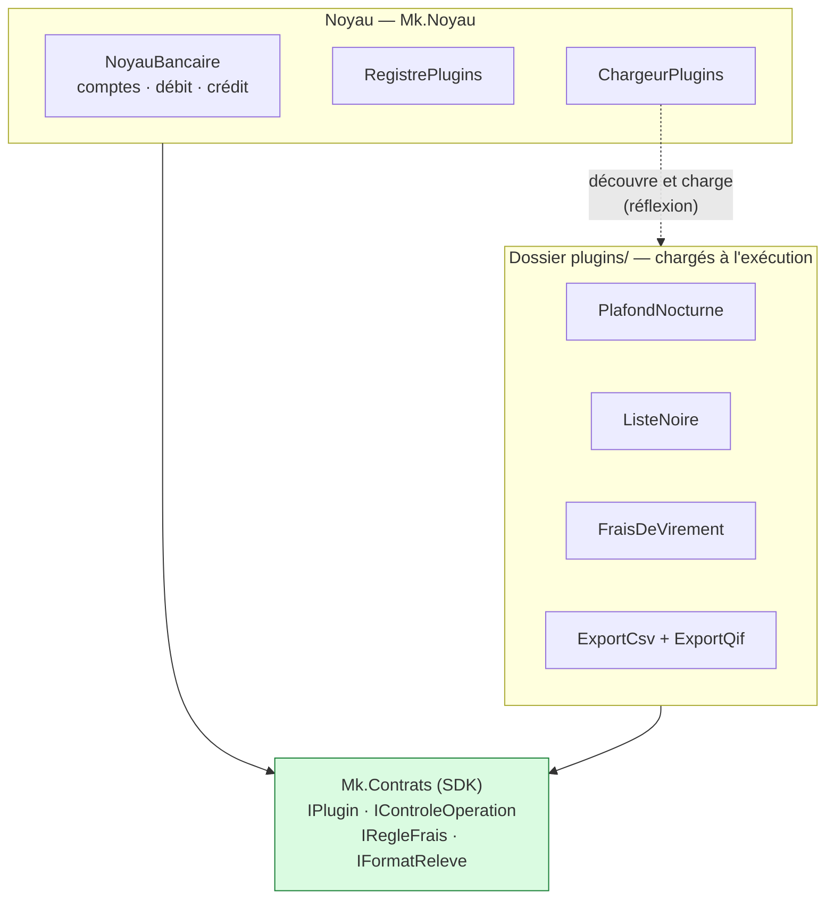
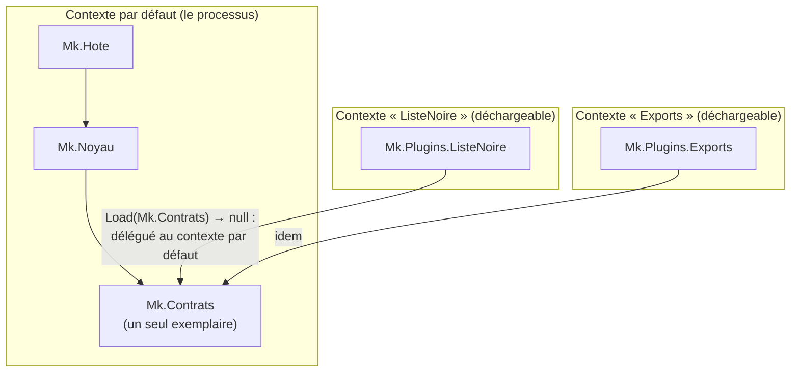
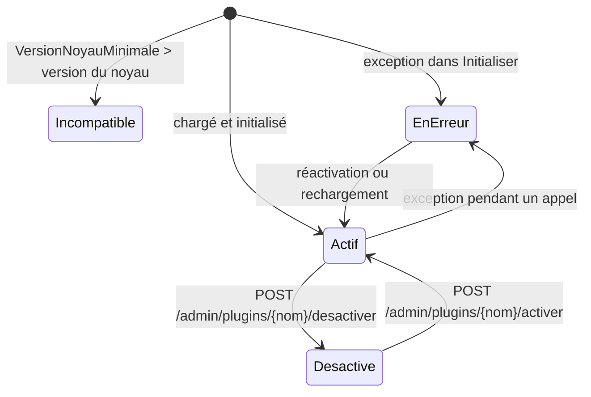
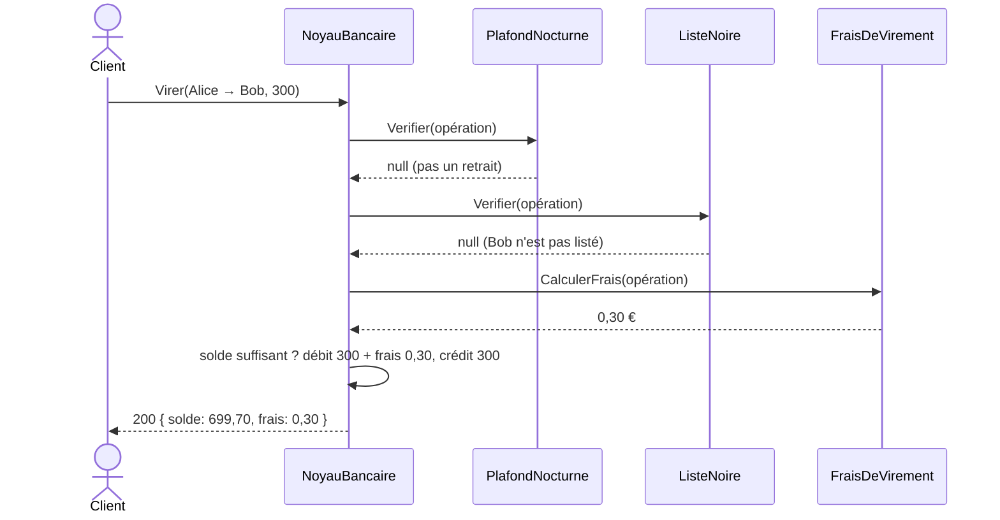
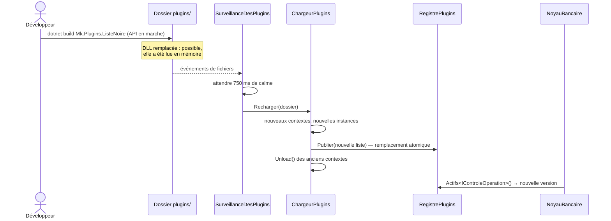

# 13. Microkernel (architecture à plugins)

> **En une phrase** : un **noyau minimal** qui définit des **points d'extension** ; les fonctionnalités variables sont
> des **plugins** chargés à l'exécution, que l'on ajoute, retire ou met à jour sans recompiler ni redémarrer le noyau.

📁 Code : [`13-Microkernel`](../13-Microkernel) · ⬅️ [Serverless](12-serverless.md) · ➡️ [Saga orchestrée](14-saga-orchestree.md) · 🌐 [English](en/13-microkernel.md)

---

## L'idée

Le modèle de VS Code, Eclipse, des navigateurs, des moteurs de règles ou des logiciels de paie : le cœur fait peu de
choses mais les fait bien, et tout ce qui **varie** (selon le client, le pays, l'offre commerciale) est branché autour.
Aucune des démos précédentes ne traitait cet axe : l'**extensibilité**.



**Le noyau ne référence aucun plugin**, et les plugins ne voient du noyau que le SDK (`Mk.Contrats`). Les deux côtés
ne se rencontrent qu'à l'exécution.

### Les trois points d'extension

| Point d'extension | Rôle | Plugins de la démo |
|---|---|---|
| `IControleOperation` | Peut **refuser** une opération avant qu'elle ait lieu | `PlafondNocturne` (retraits limités la nuit), `ListeNoire` (virements vers des comptes interdits) |
| `IRegleFrais` | Ajoute des **frais** | `FraisDeVirement` (0,1 %, entre 0,20 € et 5 €) |
| `IFormatReleve` | Produit un **relevé** dans un format | `ExportCsv`, `ExportQif` — **deux extensions dans une seule DLL** |

---

## Organisation de la solution

```
13-Microkernel/
├── Mk.Contrats/               le SDK : interfaces et données échangées
├── Mk.Noyau/                  NoyauBancaire, RegistrePlugins, ChargeurPlugins
├── Mk.Hote/                   API HTTP + surveillance du dossier des plugins
├── Mk.Plugins.FraisVirement/  ┐
├── Mk.Plugins.PlafondNocturne/│  projets de plugins : compilés dans plugins/{Nom}/,
├── Mk.Plugins.ListeNoire/     │  chacun avec son plugin.json de réglages
├── Mk.Plugins.Exports/        ┘
├── Plugins.props              réglages communs aux plugins
└── plugins/                   ← sortie de compilation (non versionnée), lue par le noyau
```

---

## Le code, pas à pas

### 1. Le SDK : ce que noyau et plugins partagent

([Contrats.cs](../13-Microkernel/Mk.Contrats/Contrats.cs))

```csharp
public interface IPlugin
{
    string Name { get; }
    string Description { get; }

    /// <summary>Minimum version of the kernel the plugin needs. A plugin that is too recent is refused at load time.</summary>
    Version MinimumKernelVersion => new(1, 0);

    /// <summary>Called once at load time, with the settings read from the plugin's plugin.json.</summary>
    void Initialize(PluginContext context) { }
}

/// <summary>Can refuse an operation before it takes place.</summary>
public interface IOperationCheck : IPlugin
{
    /// <returns>null if the operation is allowed, otherwise the reason for the refusal.</returns>
    string? Check(ProposedOperation operation);
}
```

Les plugins reçoivent des **valeurs** (`OperationProposee`, `ReleveCompte`), jamais les objets internes du noyau.

### 2. Un plugin : une classe qui implémente un point d'extension

([PlafondNocturne.cs](../13-Microkernel/Mk.Plugins.PlafondNocturne/PlafondNocturne.cs))

```csharp
public sealed class NightLimit : IOperationCheck
{
    private decimal _limit = 200m;
    private TimeOnly _start = new(22, 0), _end = new(6, 0);

    public string Name => "NightLimit";

    public string? Check(ProposedOperation operation)
    {
        if (operation.Type != OperationType.Withdrawal || operation.Amount <= _limit)
            return null;

        var time = TimeOnly.FromDateTime(operation.Date);
        var atNight = _start <= _end
            ? time >= _start && time < _end
            : time >= _start || time < _end;  // range spanning midnight
        return atNight ? $"Withdrawal limited to {_limit} € between {_start:HH\\:mm} and {_end:HH\\:mm}." : null;
    }
}
```

Ses réglages viennent de son propre `plugin.json`, à côté de sa DLL :

```json
{ "limit": "200", "start": "22:00", "end": "06:00" }
```

### 3. Compiler un plugin… sans embarquer le SDK

([Plugins.props](../13-Microkernel/Plugins.props))

```xml
<PropertyGroup>
  <EnableDynamicLoading>true</EnableDynamicLoading>
  <OutputPath>$(MSBuildThisFileDirectory)plugins\$(MSBuildProjectName)\</OutputPath>
</PropertyGroup>
<ItemGroup>
  <ProjectReference Include="$(MSBuildThisFileDirectory)Mk.Contracts\Mk.Contracts.csproj" Private="false" ExcludeAssets="runtime" />
</ItemGroup>
```

`Private="false"` évite de copier `Mk.Contrats.dll` dans le dossier du plugin. Pourquoi c'est vital : voir l'étape suivante.

### 4. Charger chaque plugin dans son propre contexte

([ChargeurPlugins.cs](../13-Microkernel/Mk.Noyau/ChargeurPlugins.cs))

```csharp
internal sealed class PluginLoadContext(string dllPath)
    : AssemblyLoadContext(Path.GetFileNameWithoutExtension(dllPath), isCollectible: true)
{
    private readonly AssemblyDependencyResolver _resolver = new(dllPath);

    /// Loaded from MEMORY and not from the file: the DLL is not locked,
    /// it can be rebuilt, replaced or deleted while the application is running.
    public Assembly LoadPlugin() => LoadFromStream(new MemoryStream(File.ReadAllBytes(dllPath)));

    protected override Assembly? Load(AssemblyName name)
    {
        // Crucial point: the contracts must come from the KERNEL (default context).
        // If the plugin loaded its own copy of Mk.Contracts, its IPlugin would be ANOTHER type
        // than the kernel's IPlugin (same name, different assemblies), and nothing would work.
        if (name.Name == typeof(IPlugin).Assembly.GetName().Name)
            return null;

        var path = _resolver.ResolveAssemblyToPath(name);
        return path is null ? null : LoadFromStream(new MemoryStream(File.ReadAllBytes(path)));
    }
}
```



Un test le vérifie : après chargement, `Mk.Contrats` n'est présent **qu'une fois** dans le processus.

### 5. Découvrir les extensions par réflexion

```csharp
return assembly.GetExportedTypes()
    .Where(t => t is { IsClass: true, IsAbstract: false } && typeof(IPlugin).IsAssignableFrom(t))
    .Select(t => PluginRegistry.Prepare((IPlugin)Activator.CreateInstance(t)!, name, settings, log))
    .ToList();
```

`Preparer` vérifie la version du noyau exigée, puis appelle `Initialiser` avec les réglages du `plugin.json`.



### 6. Le noyau appelle les extensions aux endroits prévus

([NoyauBancaire.cs](../13-Microkernel/Mk.Noyau/NoyauBancaire.cs))

```csharp
// 1. "Check" extension point: a single refusal is enough.
foreach (var check in plugins.Active<IOperationCheck>())
{
    string? refusal = null;
    if (!Protect(check, () => refusal = check.Check(operation)))
        return Result.Refused($"The plugin {check.Name} is faulted: operation refused for safety.");
    if (refusal is not null)
        return Result.Refused($"[{check.Name}] {refusal}");
}

// 2. "Fees" extension point: each rule can add its own.
// …

// 3. The heart of the business, which belongs to the kernel alone.
var totalFees = fees.Sum(f => f.Amount);
if (amount + totalFees > account.Balance)
    return Result.Refused($"Insufficient balance (fees included: {totalFees:0.00} €).");
```



### 7. Un plugin défaillant ne fait pas tomber le noyau

```csharp
/// A plugin must never bring the kernel down: its exception is caught, and the plugin is marked "faulted"
/// (hence disabled) until it is enabled again or reloaded.
private bool Protect(IPlugin plugin, Action call)
{
    try
    {
        call();
        return true;
    }
    catch (Exception e)
    {
        plugins.ReportError(plugin, e);
        log($"[{plugin.Name}] exception, plugin disabled: {e.Message}");
        return false;
    }
}
```

Choix de sécurité (*fail-closed*) : l'opération en cours est **refusée**, plutôt que d'être exécutée sans un contrôle.

### 8. Le rechargement à chaud

Le registre est **remplacé d'un bloc** ; les anciens contextes sont ensuite déchargés.
`SurveillanceDesPlugins` ([Endpoints.cs](../13-Microkernel/Mk.Hote/Endpoints.cs)) observe le dossier et recharge
750 ms après le dernier changement (une compilation écrit plusieurs fichiers d'affilée).



---

## Les tests

| Fichier | Ce qui est vérifié |
|---|---|
| [NoyauTests.cs](../13-Microkernel/Mk.Tests/NoyauTests.cs) | Le noyau seul, avec des plugins **écrits dans le test** (sans DLL) : frais, plugin défaillant isolé, plugin incompatible refusé, pas d'export sans plugin de format |
| [ChargementTests.cs](../13-Microkernel/Mk.Tests/ChargementTests.cs) | Les vraies DLL : découverte, réglages, **un seul** `Mk.Contrats`, plugin supprimé puis **contexte réellement déchargé** |
| [ApiTests.cs](../13-Microkernel/Mk.Tests/ApiTests.cs) | De bout en bout : frais, liste noire, plafond nocturne selon l'heure (horloge réglable), formats, désactivation à chaud |

```csharp
[Fact]
public void A_plugin_deleted_from_the_folder_disappears_and_its_context_is_unloaded()
{
    // …
    // Possible while the plugin is loaded: the DLL was read into memory, the file is not locked.
    Directory.Delete(Path.Combine(folder, "Mk.Plugins.Blocklist"), recursive: true);
    var unloaded = loader.Reload(folder);

    Assert.DoesNotContain("Blocklist", Names(registry));
    Assert.True(WaitForUnloading(unloaded), "The old load contexts were not released.");
}
```

Le projet de tests référence les plugins avec `ReferenceOutputAssembly="false"` : ils sont **compilés** avant les tests,
mais jamais liés comme bibliothèques.

---

## Bilan

| 👍 Points forts | 👎 Limites |
|---|---|
| Fonctionnalités ajoutées **sans toucher au noyau** ni le redéployer | Concevoir de bons points d'extension est difficile ; les changer casse tous les plugins |
| Activation / désactivation **à chaud**, par client ou par offre | Le SDK devient un contrat public à **versionner** avec soin |
| Isolation : un plugin défaillant est écarté | Les plugins tournent **dans le processus** : pas d'isolation de sécurité (un plugin malveillant peut tout faire) |
| Tiers et équipes externes peuvent étendre le produit | Débogage et tests d'intégration plus délicats ; déchargement fragile si une référence traîne |

**Quand l'utiliser** : produits configurables par client, moteurs de règles, outils extensibles par des tiers, logiciels
dont le cœur est stable mais les variantes nombreuses. **Pièges** : copier le SDK dans le dossier du plugin (types
incompatibles), garder une référence vers un plugin (déchargement impossible), charger des plugins non fiables
(il faut alors un processus séparé). En .NET, des bibliothèques comme *McMaster.NETCore.Plugins* encapsulent ce mécanisme.
