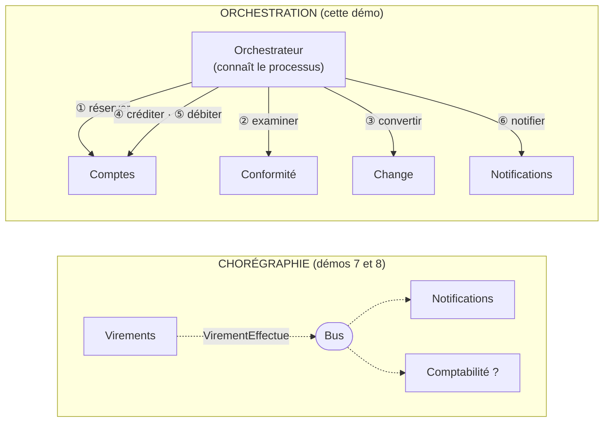
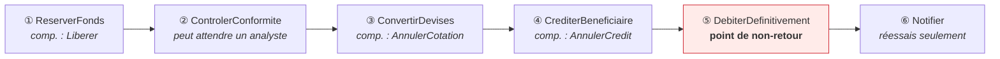
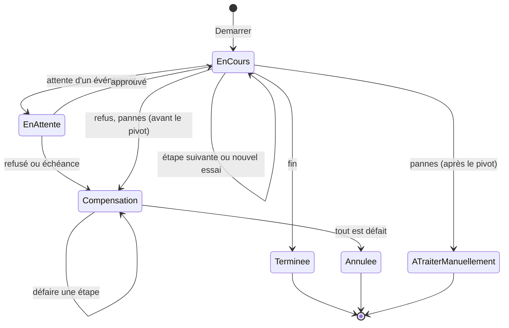
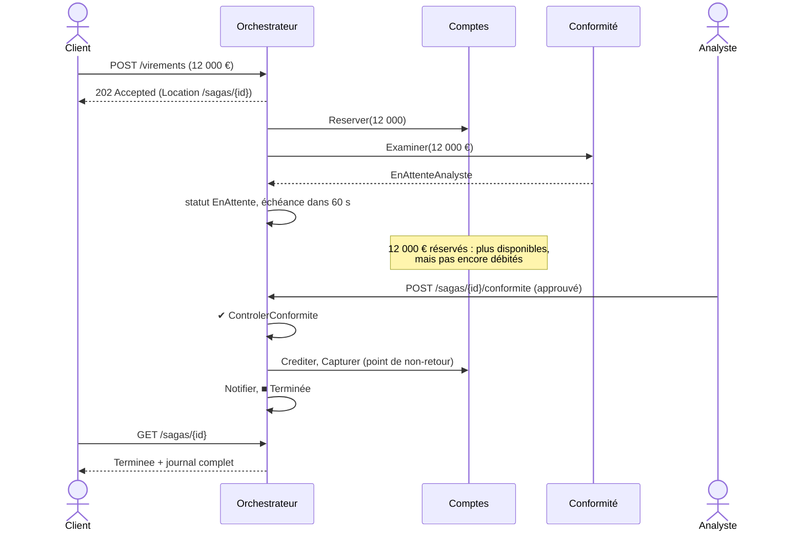

# 14. Saga orchestrée

> **En une phrase** : un **orchestrateur** explicite pilote un processus réparti sur plusieurs services, étape par étape ;
> il mémorise où il en est, réessaie, attend des événements extérieurs, et **compense** en ordre inverse si besoin.

📁 Code : [`14-SagaOrchestree`](../14-SagaOrchestree) · ⬅️ [Microkernel](13-microkernel.md) · ➡️ [Multi-tenant](15-multi-tenant.md)

---

## L'idée : chorégraphie ou orchestration ?

Dès qu'un processus touche plusieurs services (ou plusieurs bases), il n'y a plus de transaction unique : on enchaîne
des étapes locales, avec des compensations en cas d'échec. C'est une **saga** (Garcia-Molina et Salem, 1987).
Il y a deux façons de la coordonner :



| | Chorégraphie | Orchestration |
|---|---|---|
| Qui connaît le processus ? | **personne** : il émerge des réactions de chacun | **l'orchestrateur**, en un seul endroit |
| Couplage | faible : l'émetteur ignore les abonnés | l'orchestrateur connaît tous les participants |
| Lisibilité | difficile de savoir « où en est le virement 42 » | état et historique de chaque saga consultables |
| Ajouter un réactif | facile (s'abonner) | modifier la définition |
| Attente, délais, compensation | à coder dans chaque service | gérés par le moteur |
| Outils | courtier de messages | Durable Functions, Temporal, Step Functions, MassTransit, NServiceBus |

**Règle pratique** : chorégraphie pour **notifier** (« il s'est passé ceci »), orchestration pour **conduire** un
processus métier à plusieurs étapes avec des règles d'échec.

---

## Le processus : un virement en six étapes



- Les fonds sont d'abord **réservés** (plus disponibles, mais pas encore partis), et seulement **capturés** à l'étape ⑤ :
  une réservation se libère facilement, ce qui rend la compensation simple.
- **⑤ est le point de non-retour** (*pivot transaction*) : avant, tout échec est compensé ; après, on ne peut plus
  défaire, on ne fait que **réessayer** les étapes restantes.

La définition tient en un seul fichier, lisible d'un coup d'œil : c'est le principal atout de l'orchestration.
([DefinitionVirement.cs](../14-SagaOrchestree/Saga.Orchestrateur/DefinitionVirement.cs))

```csharp
new("ReserverFonds",
    async s => { await comptes.Reserver(s.Id, s.Source, s.Montant); return Issue.Succes; },
    Compenser: s => comptes.Liberer(s.Id, s.Source)),

new("ControlerConformite", async s =>
    await conformite.Examiner(s.Id, ServiceChange.EnEuros(s.Montant, comptes.Devise(s.Source))) switch
    {
        AvisConformite.Approuve => Issue.Succes,
        AvisConformite.EnAttenteAnalyste => new Issue.EnAttente(
            TimeSpan.FromSeconds(options.DelaiDecisionConformiteSecondes), "en attente de la décision d'un analyste"),
        _ => new Issue.Refusee("Refusé par la conformité.")
    }),
// …
new("DebiterDefinitivement",
    async s => { await comptes.Capturer(s.Id, s.Source); return Issue.Succes; },
    PointDeNonRetour: true),
```

Chaque étape renvoie une **issue** : réussie, en attente (avec un délai), ou refusée. Une exception, elle, signifie
une **panne passagère**.

---

## Le moteur

### 1. L'état est enregistré après chaque pas

L'orchestrateur **ne garde rien en mémoire** : tout ce qu'il faut pour reprendre est dans `EtatSaga`, enregistré
(sérialisé) après chaque transition. ([MoteurSaga.cs](../14-SagaOrchestree/Saga.Orchestrateur/MoteurSaga.cs))

```csharp
/// Fait avancer d'un pas toutes les sagas prêtes. Renvoie le nombre de sagas traitées.
public async Task<int> Traiter()
{
    // …
    var pretes = magasin.Toutes().Where(EstPrete).ToList();
    foreach (var saga in pretes)
    {
        await Avancer(saga);
        magasin.Enregistrer(saga);  // l'état est enregistré après CHAQUE pas
    }
    return pretes.Count;
}
```

### 2. Les états d'une saga



### 3. Réessayer, puis abandonner proprement

```csharp
private void EchecPassager(EtatSaga saga, Etape etape, string message)
{
    saga.Tentatives++;
    if (saga.Tentatives < options.TentativesMax)
    {
        var attente = Attente(saga.Tentatives);
        saga.ProchainEssai = Maintenant + attente;
        // … journal « tentative n/4, nouvel essai dans … ms »
    }
    else if (PointDeNonRetourPasse(saga))
    {
        // On ne peut plus défaire : l'argent a déjà été débité définitivement.
        ATraiterManuellement(saga, $"{etape.Nom} impossible après {options.TentativesMax} tentatives : {message}");
    }
    else
    {
        DemarrerCompensation(saga, $"{etape.Nom} impossible après {options.TentativesMax} tentatives : {message}");
    }
}
```

### 4. Compenser en ordre inverse

Une compensation **doit finir par réussir** : en cas d'échec, on la réessaie indéfiniment.

```csharp
/// Défait la plus récente des étapes réussies. Une compensation doit finir par réussir : on réessaie sans fin.
private async Task CompenserUnPas(EtatSaga saga)
{
    if (saga.EtapesFaites.Count == 0)
    {
        saga.Statut = StatutSaga.Annulee;
        Noter(saga, "■ Virement annulé : toutes les étapes ont été défaites");
        return;
    }

    var etape = Etapes.Single(e => e.Nom == saga.EtapesFaites[^1]);
    if (etape.Compenser is not null)
    {
        // … await etape.Compenser(saga), avec nouvel essai en cas d'échec
    }
    saga.EtapesFaites.RemoveAt(saga.EtapesFaites.Count - 1);
}
```

### 5. Attendre un événement extérieur, avec une échéance

Au-delà de 10 000 €, un **analyste humain** doit décider. La saga passe « en attente », les fonds restent réservés,
et l'API reçoit la décision (`POST /sagas/{id}/conformite`) :

```csharp
/// Événement extérieur : la décision de l'analyste de conformité.
public async Task<bool> Signaler(Guid id, bool approuve, string? commentaire)
{
    // …
    if (approuve)
    {
        Noter(saga, $"✉ Décision reçue : approuvé{Commentaire(commentaire)}");
        TerminerEtape(saga, Etapes[saga.EtapeCourante]);
    }
    else
    {
        DemarrerCompensation(saga, $"Refusé par l'analyste de conformité{Commentaire(commentaire)}");
    }
    // …
}
```

Sans décision avant l'échéance, le moteur déclenche lui-même la compensation.

---

## Trois déroulements réels

Journaux relevés sur l'API en fonctionnement (`GET /sagas/{id}`).

**Panne passagère du service de change** (2 échecs, puis succès) :

```
▶ Virement de 100,00 demandé
✔ ReserverFonds
✔ ControlerConformite
✖ ConvertirDevises : Service de change momentanément indisponible. — tentative 1/4, nouvel essai dans 200 ms
✖ ConvertirDevises : Service de change momentanément indisponible. — tentative 2/4, nouvel essai dans 400 ms
✔ ConvertirDevises
✔ CrediterBeneficiaire
✔ DebiterDefinitivement (point de non-retour franchi)
✔ Notifier
■ Virement terminé
```

**Service de change hors service** (compensation) :

```
✔ ReserverFonds
✔ ControlerConformite
✖ ConvertirDevises : Service de change hors service. — tentative 1/4, nouvel essai dans 200 ms
✖ ConvertirDevises : Service de change hors service. — tentative 2/4, nouvel essai dans 400 ms
✖ ConvertirDevises : Service de change hors service. — tentative 3/4, nouvel essai dans 800 ms
↩ Compensation : ConvertirDevises impossible après 4 tentatives : Service de change hors service.
↩ ReserverFonds défaite
■ Virement annulé : toutes les étapes ont été défaites
```

**Gros virement, décision d'un analyste** :



---

## Les tests

Une **horloge manuelle** permet d'avancer le temps à volonté : les nouveaux essais et les échéances se testent
instantanément, sans attente réelle. ([MoteurSagaTests.cs](../14-SagaOrchestree/Saga.Tests/MoteurSagaTests.cs))

```csharp
[Fact]
public async Task Un_nouveau_moteur_reprend_les_sagas_la_ou_l_ancien_les_avait_laissees()
{
    var premier = NouveauMoteur();
    var id = premier.Demarrer(Alice, Carla, 100m).Id;
    await premier.Traiter();
    await premier.Traiter();  // ReserverFonds et ControlerConformite faites… puis « plantage »

    var second = NouveauMoteur();  // aucun état partagé avec le premier, sauf le magasin
    Assert.Equal(["ReserverFonds", "ControlerConformite"], _magasin.Charger(id)!.EtapesFaites);
    var saga = await Executer(second, id);

    Assert.Equal(StatutSaga.Terminee, saga.Statut);
    Assert.Equal(1_108.32m, Solde(Carla));
}
```

| Test | Ce qui est vérifié |
|---|---|
| `Un_virement_passe_par_les_six_etapes_dans_l_ordre` | déroulement nominal, soldes |
| `Une_panne_passagere_est_absorbee_par_de_nouveaux_essais` | 2 pannes, puis succès |
| `Une_panne_durable_declenche_la_compensation_dans_l_ordre_inverse` | abandon au 4e échec, réservation libérée |
| `Un_gros_virement_attend_la_decision_d_un_analyste` | attente, puis approbation ou refus |
| `Sans_decision_avant_l_echeance_la_saga_est_compensee` | échéance dépassée |
| `Apres_le_point_de_non_retour_on_ne_compense_plus` | notifications en panne : `ATraiterManuellement`, l'argent reste transféré |
| `Un_nouveau_moteur_reprend_les_sagas…` | reprise après « plantage » |
| `Rejouer_une_etape_deja_faite_chez_un_participant_est_sans_effet` | idempotence des participants |
| [ApiTests.cs](../14-SagaOrchestree/Saga.Tests/ApiTests.cs) | la boucle réelle : de bout en bout, décision par HTTP, orchestrateur arrêté puis relancé |

---

## Bilan

| 👍 Points forts | 👎 Limites |
|---|---|
| Le processus est **écrit en un seul endroit**, lisible | L'orchestrateur connaît tous les participants (couplage) |
| État et historique de **chaque** saga consultables | Un composant de plus à exploiter, et à rendre hautement disponible |
| Réessais, attentes, échéances et compensation **gérés par le moteur** | Les participants doivent être **idempotents** (une étape peut être rejouée) |
| Reprise après plantage : l'état est persistant | Risque de « chef d'orchestre obèse » qui absorbe la logique métier des participants |

**Quand l'utiliser** : processus métier longs et à plusieurs étapes (commande, virement international, souscription,
onboarding), avec des attentes humaines, des délais et des règles d'échec précises. En production, ne pas écrire son
propre moteur : **Temporal**, **Azure Durable Functions**, **AWS Step Functions**, ou les sagas de **MassTransit** /
**NServiceBus** font la même chose, avec persistance, supervision et versionnement des processus. Voir aussi
[compensation et saga](concepts-transverses.md#compensation-et-saga).
