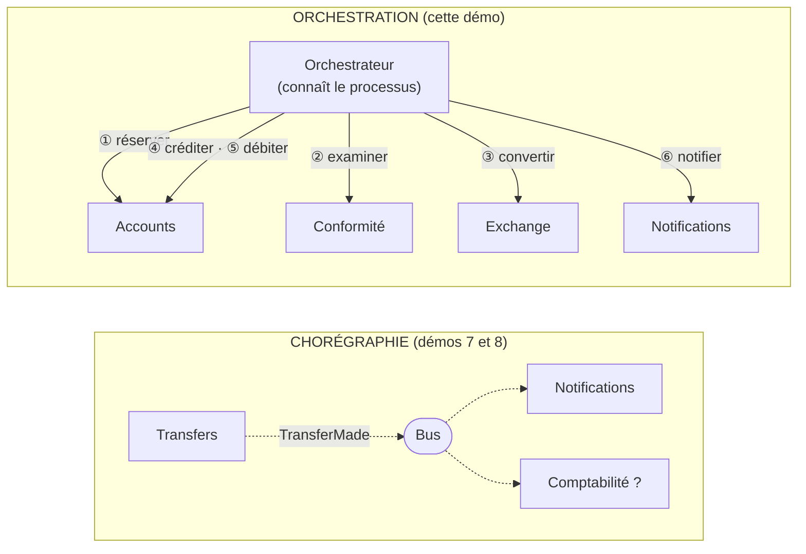
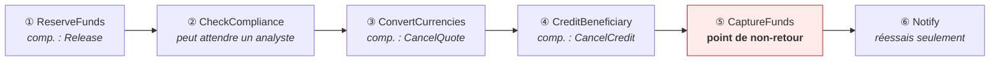
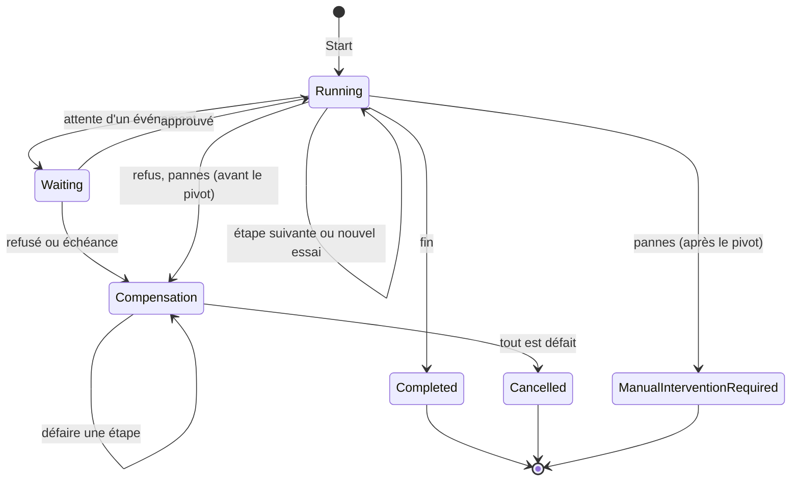
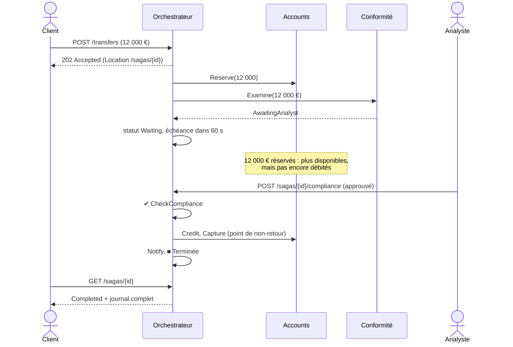

# 14. Saga orchestrée

**Nom anglais** : *Orchestrated Saga*

> **En une phrase** : un **orchestrateur** explicite pilote un processus réparti sur plusieurs services, étape par étape ;
> il mémorise où il en est, réessaie, attend des événements extérieurs, et **compense** en ordre inverse si besoin.

📁 Code : [`14-OrchestratedSaga`](../14-OrchestratedSaga) · ⬅️ [Microkernel](13-microkernel.md) · ➡️ [Multi-tenant](15-multi-tenant.md) · 🌐 [English](en/14-saga-orchestree.md)

---

## L'idée : chorégraphie ou orchestration ?

Dès qu'un processus touche plusieurs services (ou plusieurs bases), il n'y a plus de transaction unique : on enchaîne
des étapes locales, avec des compensations en cas d'échec. C'est une **saga** (Garcia-Molina et Salem, 1987).
Il y a deux façons de la coordonner :



| | Chorégraphie | Orchestration |
|---|---|---|
| Qui connaît le processus ? | **personne** : il émerge des réactions de chacun | **l'orchestrateur**, en un seul endroit |
| Couplage | faible : l'émetteur ignore les abonnés | l'orchestrateur connaît tous les participants |
| Lisibilité | difficile de savoir « où en est le virement 42 » | état et historique de chaque saga consultables |
| Ajouter un réactif | facile (s'abonner) | modifier la définition |
| Attente, délais, compensation | à coder dans chaque service | gérés par le moteur |
| Outils | courtier de messages | Durable Functions, Temporal, Step Functions, MassTransit, NServiceBus |

**Règle pratique** : chorégraphie pour **notifier** (« il s'est passé ceci »), orchestration pour **conduire** un
processus métier à plusieurs étapes avec des règles d'échec. La [démo 21](21-choregraphie.md) fait le **même virement**
par chorégraphie, pour comparer sur pièces.

---

## Le processus : un virement en six étapes



- Les fonds sont d'abord **réservés** (plus disponibles, mais pas encore partis), et seulement **capturés** à l'étape ⑤ :
  une réservation se libère facilement, ce qui rend la compensation simple.
- **⑤ est le point de non-retour** (*pivot transaction*) : avant, tout échec est compensé ; après, on ne peut plus
  défaire, on ne fait que **réessayer** les étapes restantes.

La définition tient en un seul fichier, lisible d'un coup d'œil : c'est le principal atout de l'orchestration.
([TransferDefinition.cs](../14-OrchestratedSaga/Saga.Orchestrator/TransferDefinition.cs))

```csharp
new("ReserveFunds",
    async s => { await accounts.Reserve(s.Id, s.Source, s.Amount); return Outcome.Success; },
    Compensate: s => accounts.Release(s.Id, s.Source)),

new("CheckCompliance", async s =>
    await compliance.Examine(s.Id, ExchangeService.InEuros(s.Amount, accounts.Currency(s.Source))) switch
    {
        ComplianceOpinion.Approved => Outcome.Success,
        ComplianceOpinion.AwaitingAnalyst => new Outcome.Waiting(
            TimeSpan.FromSeconds(options.ComplianceDecisionTimeoutSeconds), "awaiting an analyst's decision"),
        _ => new Outcome.Refused("Refused by compliance.")
    }),
// …
new("CaptureFunds",
    async s => { await accounts.Capture(s.Id, s.Source); return Outcome.Success; },
    PointOfNoReturn: true),
```

Chaque étape renvoie une **issue** : réussie, en attente (avec un délai), ou refusée. Une exception, elle, signifie
une **panne passagère**.

---

## Le moteur

### 1. L'état est enregistré après chaque pas

L'orchestrateur **ne garde rien en mémoire** : tout ce qu'il faut pour reprendre est dans `SagaState`, enregistré
(sérialisé) après chaque transition. ([SagaEngine.cs](../14-OrchestratedSaga/Saga.Orchestrator/SagaEngine.cs))

```csharp
/// <summary>Moves all the ready sagas forward by one step. Returns the number of sagas processed.</summary>
public async Task<int> Process()
{
    // …
    var ready = store.All().Where(IsReady).ToList();
    foreach (var saga in ready)
    {
        await Advance(saga);
        store.Save(saga);  // the state is saved after EACH step
    }
    return ready.Count;
}
```

### 2. Les états d'une saga



### 3. Réessayer, puis abandonner proprement

```csharp
private void TransientFailure(SagaState saga, Step step, string message)
{
    saga.Attempts++;
    if (saga.Attempts < options.MaxAttempts)
    {
        var delay = Delay(saga.Attempts);
        saga.NextAttempt = Now + delay;
        // … log "attempt n/4, new attempt in … ms"
    }
    else if (PointOfNoReturnPassed(saga))
    {
        // Nothing can be undone any more: the money has already been debited for good.
        RequireManualIntervention(saga, $"{step.Name} impossible after {options.MaxAttempts} attempts: {message}");
    }
    else
    {
        StartCompensation(saga, $"{step.Name} impossible after {options.MaxAttempts} attempts: {message}");
    }
}
```

### 4. Compenser en ordre inverse

Une compensation **doit finir par réussir** : en cas d'échec, on la réessaie indéfiniment.

```csharp
/// <summary>Undoes the most recent of the successful steps. A compensation must eventually succeed: it is retried forever.</summary>
private async Task CompensateOneStep(SagaState saga)
{
    if (saga.CompletedSteps.Count == 0)
    {
        saga.Status = SagaStatus.Cancelled;
        Note(saga, "■ Transfer cancelled: all the steps were undone");
        return;
    }

    var step = Steps.Single(e => e.Name == saga.CompletedSteps[^1]);
    if (step.Compensate is not null)
    {
        // … await step.Compensate(saga), with a new attempt on failure
    }
    saga.CompletedSteps.RemoveAt(saga.CompletedSteps.Count - 1);
}
```

### 5. Attendre un événement extérieur, avec une échéance

Au-delà de 10 000 €, un **analyste humain** doit décider. La saga passe « en attente », les fonds restent réservés,
et l'API reçoit la décision (`POST /sagas/{id}/compliance`) :

```csharp
/// <summary>External event: the compliance analyst's decision.</summary>
public async Task<bool> Signal(Guid id, bool approved, string? comment)
{
    // …
    if (approved)
    {
        Note(saga, $"✉ Decision received: approved{Comment(comment)}");
        CompleteStep(saga, Steps[saga.CurrentStep]);
    }
    else
    {
        StartCompensation(saga, $"Refused by the compliance analyst{Comment(comment)}");
    }
    // …
}
```

Sans décision avant l'échéance, le moteur déclenche lui-même la compensation.

---

## Trois déroulements réels

Journaux relevés sur l'API en fonctionnement (`GET /sagas/{id}`).

**Panne passagère du service de change** (2 échecs, puis succès) :

```
▶ Transfer of 100.00 requested
✔ ReserveFunds
✔ CheckCompliance
✖ ConvertCurrencies: Exchange service temporarily unavailable. — attempt 1/4, retrying in 200 ms
✖ ConvertCurrencies: Exchange service temporarily unavailable. — attempt 2/4, retrying in 400 ms
✔ ConvertCurrencies
✔ CreditBeneficiary
✔ CaptureFunds (point of no return crossed)
✔ Notify
■ Transfer completed
```

**Service de change hors service** (compensation) :

```
✔ ReserveFunds
✔ CheckCompliance
✖ ConvertCurrencies: Exchange service down. — attempt 1/4, retrying in 200 ms
✖ ConvertCurrencies: Exchange service down. — attempt 2/4, retrying in 400 ms
✖ ConvertCurrencies: Exchange service down. — attempt 3/4, retrying in 800 ms
↩ Compensation: ConvertCurrencies impossible after 4 attempts: Exchange service down.
↩ ReserveFunds undone
■ Transfer cancelled: all the steps were undone
```

**Gros virement, décision d'un analyste** :



---

## Les tests

Une **horloge manuelle** permet d'avancer le temps à volonté : les nouveaux essais et les échéances se testent
instantanément, sans attente réelle. ([SagaEngineTests.cs](../14-OrchestratedSaga/Saga.Tests/SagaEngineTests.cs))

```csharp
[Fact]
public async Task A_new_engine_resumes_the_sagas_where_the_old_one_left_them()
{
    var first = NewEngine();
    var id = first.Start(Alice, Carla, 100m).Id;
    await first.Process();
    await first.Process();  // ReserveFunds and CheckCompliance done… then "crash"

    var second = NewEngine();  // no state shared with the first one, except the store
    Assert.Equal(["ReserveFunds", "CheckCompliance"], _store.Load(id)!.CompletedSteps);
    var saga = await Run(second, id);

    Assert.Equal(SagaStatus.Completed, saga.Status);
    Assert.Equal(1_108.32m, Balance(Carla));
}
```

| Test | Ce qui est vérifié |
|---|---|
| `A_transfer_goes_through_the_six_steps_in_order` | déroulement nominal, soldes |
| `A_transient_failure_is_absorbed_by_retries` | 2 pannes, puis succès |
| `A_lasting_failure_triggers_the_compensation_in_reverse_order` | abandon au 4e échec, réservation libérée |
| `A_large_transfer_waits_for_an_analyst_decision` | attente, puis approbation ou refus |
| `Without_a_decision_before_the_deadline_the_saga_is_compensated` | échéance dépassée |
| `After_the_point_of_no_return_there_is_no_more_compensation` | notifications en panne : `ManualInterventionRequired`, l'argent reste transféré |
| `Un_nouveau_moteur_reprend_les_sagas…` | reprise après « plantage » |
| `Replaying_a_step_already_done_at_a_participant_has_no_effect` | idempotence des participants |
| [ApiTests.cs](../14-OrchestratedSaga/Saga.Tests/ApiTests.cs) | la boucle réelle : de bout en bout, décision par HTTP, orchestrateur arrêté puis relancé |

---

## Bilan

| 👍 Points forts | 👎 Limites |
|---|---|
| Le processus est **écrit en un seul endroit**, lisible | L'orchestrateur connaît tous les participants (couplage) |
| État et historique de **chaque** saga consultables | Un composant de plus à exploiter, et à rendre hautement disponible |
| Réessais, attentes, échéances et compensation **gérés par le moteur** | Les participants doivent être **idempotents** (une étape peut être rejouée) |
| Reprise après plantage : l'état est persistant | Risque de « chef d'orchestre obèse » qui absorbe la logique métier des participants |

**Quand l'utiliser** : processus métier longs et à plusieurs étapes (commande, virement international, souscription,
onboarding), avec des attentes humaines, des délais et des règles d'échec précises. En production, ne pas écrire son
propre moteur : **Temporal**, **Azure Durable Functions**, **AWS Step Functions**, ou les sagas de **MassTransit** /
**NServiceBus** font la même chose, avec persistance, supervision et versionnement des processus. Voir aussi
[compensation et saga](concepts-transverses.md#compensation-et-saga).
