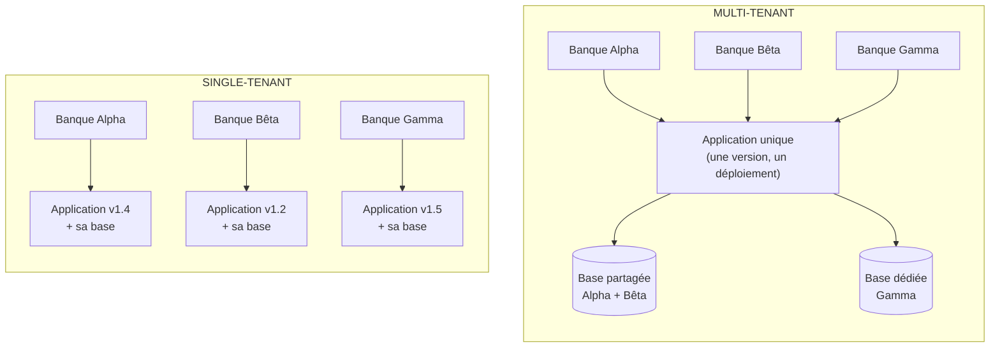
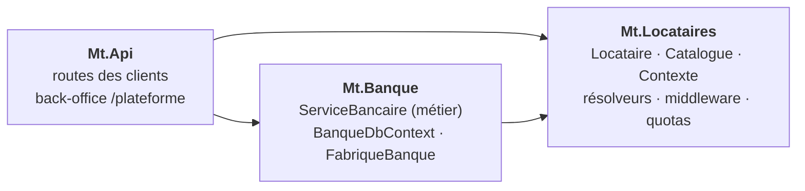
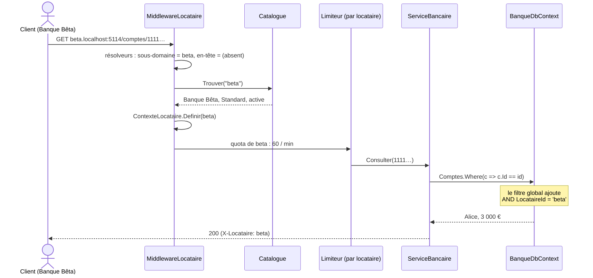
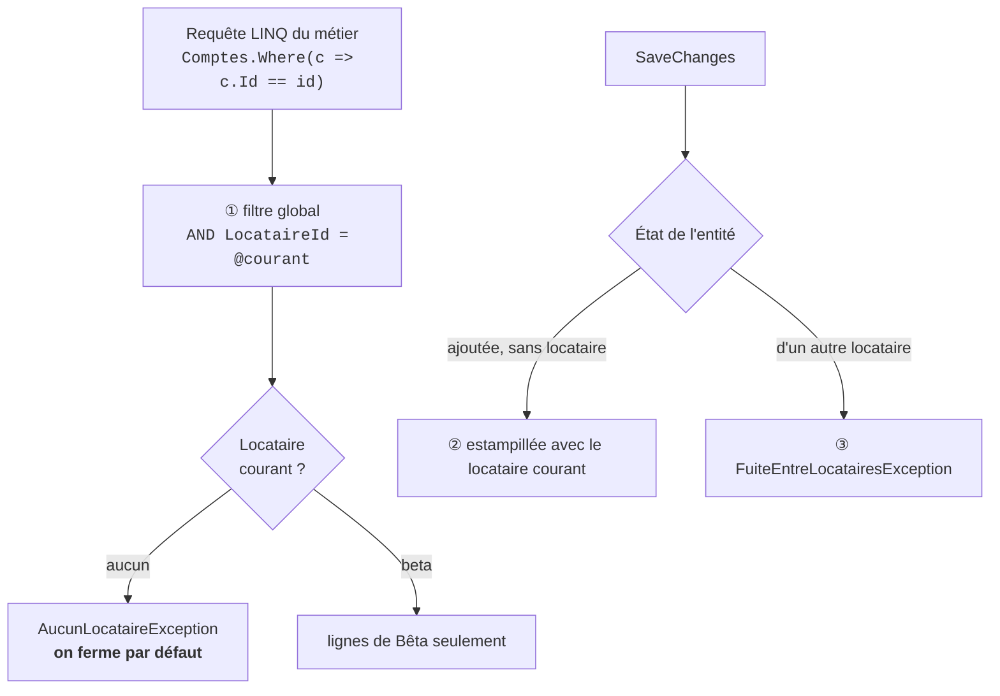
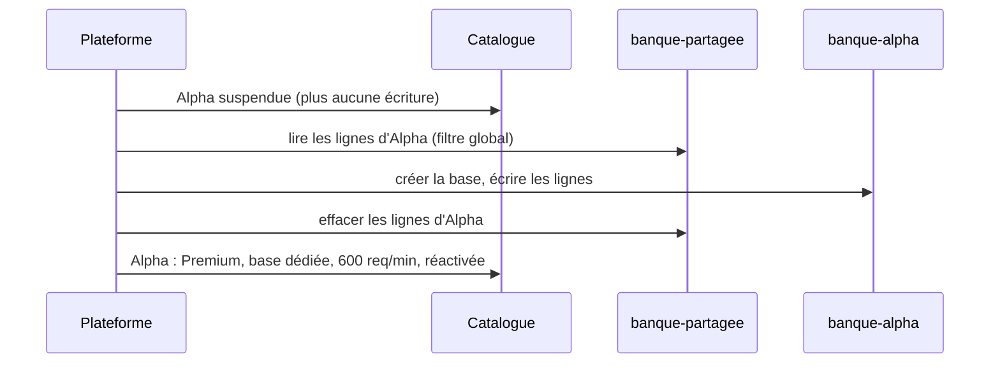

# 15. Multi-tenant (SaaS)

> **En une phrase** : une **seule application**, un seul déploiement, sert **plusieurs clients** (les *locataires*) ;
> chacun a ses données, ses règles et ses quotas, et aucun ne doit jamais voir ceux des autres.

📁 Code : [`15-MultiTenant`](../15-MultiTenant) · ⬅️ [Saga orchestrée](14-saga-orchestree.md) · ➡️ [Concepts transverses](concepts-transverses.md)

---

## L'idée

Jusqu'ici, chaque démo servait **une** banque. Un éditeur qui vend son logiciel à plusieurs banques a deux options :
installer une copie par client (*single-tenant*), ou faire tourner une seule application pour tous (*multi-tenant*).



| | Single-tenant (une installation par client) | Multi-tenant |
|---|---|---|
| Mise à jour | N déploiements, des versions qui divergent | **un** déploiement, tout le monde à jour |
| Nouveau client | une installation à monter | une ligne dans le catalogue, **quelques secondes** |
| Coût d'infrastructure | N fois tout | ressources mutualisées |
| Isolation | physique, naturelle | **à construire** : c'est tout le sujet de cette démo |
| Client exigeant (performances, données à part) | naturel | formule « base dédiée », quotas |

Le gain est économique et opérationnel ; le prix est un **risque permanent** : une seule requête mal filtrée, et une
banque voit les comptes d'une autre. Tout le code de la démo sert à rendre cette erreur **impossible ou bruyante**.

---

## Où ranger les données de chaque client ?

| Modèle | Principe | Isolation | Coût par client | Dans la démo |
|---|---|---|---|---|
| **Base partagée** (« pool ») | une colonne `LocataireId` dans chaque table, un filtre sur chaque requête | logique (le code) | quasi nul | formule **Standard** (Alpha, Bêta) |
| **Schéma par locataire** | une base, un schéma SQL par client | intermédiaire | faible | — (non simulable en mémoire) |
| **Base dédiée** (« silo ») | une base (une chaîne de connexion) par client | physique | élevé | formule **Premium** (Gamma) |

La plupart des SaaS sont **hybrides**, comme ici : la base partagée pour le grand nombre, une base dédiée pour les clients
qui la paient (volumétrie, exigence réglementaire, sauvegarde et restauration séparées). Le même code sert les deux,
car une seule classe connaît la différence. ([FabriqueBanque.cs](../15-MultiTenant/Mt.Banque/FabriqueBanque.cs))

```csharp
public static string NomBase(Locataire locataire) =>
    locataire.Isolation == Isolation.BaseDediee ? $"banque-{locataire.Id}" : BasePartagee;
```

---

## Les projets



`Mt.Locataires` ne contient **aucun** métier bancaire : identifier le client, connaître sa formule, limiter sa
consommation, c'est le même code pour n'importe quel SaaS. `Mt.Banque` contient le métier, écrit comme pour une seule banque.

---

## Le trajet d'une requête



### 1. Identifier le locataire, une fois, avant tout le reste

Le locataire se reconnaît au **sous-domaine** (`beta.localhost:5114`, le choix habituel d'un SaaS) ou à l'en-tête
`X-Locataire` (pratique entre services). Le middleware n'invente rien : absent → 400, inconnu → 404, suspendu → 403,
et **contradictoire → 400**. ([MiddlewareLocataire.cs](../15-MultiTenant/Mt.Locataires/MiddlewareLocataire.cs))

```csharp
if (identifiants.Count > 1)
{
    // Sous-domaine « alpha » et en-tête « beta » : on ne choisit pas, on refuse.
    await Refuser(http, StatusCodes.Status400BadRequest,
        "Locataire ambigu : " + string.Join(", ", trouves.Select(r => $"{r.Nom} = {r.Id}")));
    return;
}
// …
contexte.Definir(locataire);
```

> ⚠️ **En production**, un en-tête est déclaratif : n'importe qui peut écrire `X-Locataire: gamma`. Le locataire doit venir
> du **jeton** de l'utilisateur authentifié, ou être vérifié contre lui (« cet utilisateur appartient-il à Gamma ? »).
> La démo n'a pas d'authentification, pour rester centrée sur l'isolation.

### 2. Le métier ne parle jamais du locataire

Pas un seul `where LocataireId = …` dans le service. Le locataire n'y sert qu'à lire **ses règles** : même code, paramètres
différents. ([ServiceBancaire.cs](../15-MultiTenant/Mt.Banque/ServiceBancaire.cs))

```csharp
// Même code pour toutes les banques, avec les paramètres de chacune.
if (montant > Regles.PlafondVirement)
    throw new RegleMetierException($"Plafond de virement de {Locataire.Nom} : {Regles.PlafondVirement:0.00} €.");

// La cible est cherchée chez le locataire courant seulement : un virement vers un client d'une autre banque
// de la plateforme est impossible par construction (ce serait un virement interbancaire, un autre processus).
var source = await Charger(sourceId);
var cible = await Charger(cibleId);
var frais = Regles.FraisVirement;
```

| Banque | Formule | Base | Plafond de virement | Frais de virement | Frais mensuels | Comptes max |
|---|---|---|---|---|---|---|
| Alpha | Standard | `banque-partagee` | 1 000 € | — | 2 € | 5 |
| Bêta | Standard | `banque-partagee` | 5 000 € | 0,50 € | — | 5 |
| Gamma | Premium | `banque-gamma` | 50 000 € | — | 10 € | 1 000 |

Les règles relèvent du **contrat** de chaque banque ; la formule (Standard / Premium) fixe seulement l'isolation et les
quotas techniques. Quand les clients veulent des **comportements** différents, et plus seulement des paramètres, on
passe aux points d'extension du [Microkernel](13-microkernel.md).

### 3. Le garde-fou : le DbContext

C'est ici que l'isolation se joue. Trois protections, appliquées automatiquement à toute entité qui implémente
`IAppartientAUnLocataire`. ([BanqueDbContext.cs](../15-MultiTenant/Mt.Banque/BanqueDbContext.cs))

```csharp
private void Isoler<T>(ModelBuilder modele) where T : class, IAppartientAUnLocataire
{
    // Clé composite : deux locataires peuvent avoir un compte de même identifiant (ici, Alice et Bob existent partout)
    // sans conflit dans la base partagée.
    modele.Entity<T>().HasKey(nameof(IAppartientAUnLocataire.LocataireId), "Id");
    modele.Entity<T>().HasQueryFilter(e => e.LocataireId == LocataireCourant);
}
```



- **① Filtre global** : `LocataireCourant` est une propriété du DbContext. Le modèle EF (et son filtre) n'est construit
  qu'une fois pour toute l'application, mais EF relit cette propriété à **chaque** requête : chaque DbContext filtre sur
  son propre locataire.
- **Fermé par défaut** : sans locataire, la requête **échoue** au lieu de renvoyer toutes les banques. La plateforme, qui a
  légitimement besoin de tout voir, doit l'écrire explicitement :

  ```csharp
  // Sans IgnoreQueryFilters(), ces requêtes lèveraient AucunLocataireException.
  var comptes = await db.Comptes.IgnoreQueryFilters().Select(c => c.LocataireId).ToListAsync();
  ```
- **② Estampillage** : le métier crée `new Compte(...)` sans jamais renseigner `LocataireId`.
- **③ Écriture croisée** : une entité d'Alpha arrivée par erreur dans le DbContext de Bêta (cache partagé, variable
  statique…) fait échouer `SaveChanges`. C'est un bogue, jamais un cas métier.
- **Clé composite** : `(LocataireId, Id)`. Alice a le même `Guid` dans les trois banques sans conflit ; et une ligne
  d'un locataire ne peut pas « écraser » celle d'un autre.

### 4. Le voisin bruyant

Toutes les banques partagent les mêmes serveurs. Si Alpha inonde l'API, les autres ne doivent pas ralentir : la
limitation de débit se fait **par locataire**, avec le quota de sa formule (60 requêtes/min en Standard, 600 en Premium).
([Installation.cs](../15-MultiTenant/Mt.Locataires/Installation.cs))

```csharp
// Le quota fait partie de la clé : après un changement de formule, une nouvelle partition
// est créée avec le nouveau quota (sinon l'ancienne, mise en cache, resterait en vigueur).
return RateLimitPartition.GetFixedWindowLimiter($"{locataire.Id}:{locataire.Quotas.RequetesParMinute}", _ =>
```

D'où l'ordre des middlewares dans `Program.cs` : **d'abord** savoir qui appelle, **ensuite** appliquer son quota.

```csharp
// L'ordre compte : d'abord savoir QUI appelle, ensuite appliquer SON quota.
app.UseLocataires("/plateforme");
app.UseRateLimiter();
```

---

## Le back-office de la plateforme

Les routes `/plateforme/…` travaillent **sur** les locataires, pas **pour** l'un d'eux : elles s'exécutent sans
locataire, et c'est le seul code qui en manipule plusieurs. ([Plateforme.cs](../15-MultiTenant/Mt.Api/Plateforme.cs))

| Opération | Route | Base partagée (Standard) | Base dédiée (Premium) |
|---|---|---|---|
| Arrivée d'un client | `POST /plateforme/locataires` | rien à créer | créer la base |
| Suspension (impayé…) | `POST …/{id}/suspendre` | 403 sur toutes ses requêtes, données conservées | idem |
| Changement de formule | `POST …/{id}/formule` | copier ses lignes vers la base dédiée, puis les effacer | l'inverse |
| Départ (RGPD, fin de contrat) | `DELETE …/{id}` | supprimer **ses** lignes, table par table | supprimer **la base** |
| Inventaire | `GET /plateforme/stockage` | lignes par locataire, base par base | |

Le départ d'un client montre l'intérêt de la base dédiée : un simple `DROP DATABASE`, facile à prouver. En base partagée,
il faut n'oublier aucune table.

### Changer de formule : un déménagement de données



On n'efface l'ancien emplacement **qu'après** avoir enregistré la copie, et le locataire est suspendu pendant
l'opération : aucune écriture ne peut se perdre entre les deux bases.

### Une tâche de fond n'a pas de locataire

Hors requête HTTP, aucun middleware ne fixe le locataire. La tâche de frais mensuels doit le faire elle-même, banque par
banque, chacune dans son propre scope d'injection (son DbContext, ses règles) :

```csharp
await using var scope = scopes.CreateAsyncScope();
scope.ServiceProvider.GetRequiredService<ContexteLocataire>().Definir(locataire);
var preleves = await scope.ServiceProvider.GetRequiredService<ServiceBancaire>().PreleverFraisMensuels(mois);
```

Si elle l'oubliait, le DbContext lèverait `AucunLocataireException` : mieux vaut une tâche qui plante qu'une tâche qui
prélève les frais d'Alpha sur les clients de Gamma.

---

## Les pièges du multi-tenant

| Piège | Conséquence | Parade dans la démo |
|---|---|---|
| Oublier le filtre dans une requête | une banque voit les comptes des autres | filtre **global**, sur toutes les entités, vérifié par un test d'architecture |
| Requête sans locataire (tâche, script) | tout est renvoyé | **fermé par défaut** : `AucunLocataireException` |
| Identifiants uniques par client seulement | collision dans la base partagée | clé composite `(LocataireId, Id)` |
| Faire confiance à l'en-tête | usurpation d'un autre client | en production : locataire tiré du jeton ; ici, refus des valeurs contradictoires |
| Révéler l'existence d'une donnée | « ce compte existe chez quelqu'un » | 404, comme un compte inexistant |
| Cache partagé (`IMemoryCache`, Redis) | la réponse d'Alpha servie à Bêta | (non montré) préfixer toutes les clés par le locataire |
| Un client consomme tout | les autres ralentissent | limiteur **par locataire**, quotas par formule |
| Évolution du schéma | à appliquer sur **chaque** base dédiée | (non montré) migrations jouées locataire par locataire |

---

## Les tests

| Test | Ce qui est vérifié |
|---|---|
| [IsolationTests.cs](../15-MultiTenant/Mt.Tests/IsolationTests.cs) | |
| `Le_meme_identifiant_designe_un_compte_different_chez_chaque_locataire` | clé composite, base partagée |
| `Un_locataire_ne_voit_ni_ne_touche_les_comptes_d_un_autre` | lecture, liste et retrait croisés impossibles |
| `Sans_locataire_une_requete_echoue_au_lieu_de_tout_renvoyer` | fermé par défaut ; `IgnoreQueryFilters` explicite |
| `Enregistrer_une_donnee_d_un_autre_locataire_est_refuse` | `FuiteEntreLocatairesException` |
| `Toute_donnee_d_un_locataire_est_filtree_et_porte_le_locataire_dans_sa_cle` | **test d'architecture** : toute entité `IAppartientAUnLocataire` |
| `Les_regles_metier_sont_celles_du_locataire`, `Le_quota_de_comptes…`, `Les_frais_mensuels…` | règles par client, idempotence |
| [ApiTests.cs](../15-MultiTenant/Mt.Tests/ApiTests.cs) | |
| `Une_requete_sans_locataire_clair_n_atteint_pas_le_metier` | absent, inconnu, contradictoire, concordant |
| `Un_voisin_bruyant_epuise_son_quota_sans_gener_les_autres` | 61e requête d'Alpha : 429 ; Bêta : 200 |
| `Passer_en_premium_demenage_les_donnees_dans_une_base_dediee` | migration de base, quotas Premium |
| `Le_depart_d_un_client_efface_ses_donnees_et_seulement_les_siennes` | offboarding en base partagée |
| `La_tache_de_frais_mensuels_travaille_locataire_par_locataire` | tarif de chaque banque, suspendue ignorée, rejeu sans effet |

Pour s'assurer que ces tests protègent vraiment, on peut retirer la ligne `HasQueryFilter` du DbContext : 11 tests échouent.

---

## Bilan

| 👍 Points forts | 👎 Limites |
|---|---|
| **Un** déploiement, **une** version pour tous les clients | Une erreur d'isolation expose **tous** les clients à la fois |
| Nouveau client en quelques secondes, sans installation | Le « voisin bruyant » : ressources partagées à brider |
| Coûts mutualisés ; base dédiée réservée à qui la paie | Migrations de schéma et sauvegardes à faire sur N bases dédiées |
| Le métier reste écrit pour un seul client | Chaque requête, tâche, cache, journal doit porter le locataire |

**Quand l'utiliser** : dès qu'on vend le **même logiciel à plusieurs organisations** (SaaS B2B). Commencer par la base
partagée avec un filtre global, et proposer la base dédiée aux clients qui en ont besoin. En production : le locataire
vient de l'authentification, le catalogue est une base à part ; **Finbuckle.MultiTenant** fournit résolveurs, contexte et
intégration EF Core ; côté base, la *Row-Level Security* de SQL Server ou PostgreSQL ajoute une seconde barrière, en dessous
de l'application.
