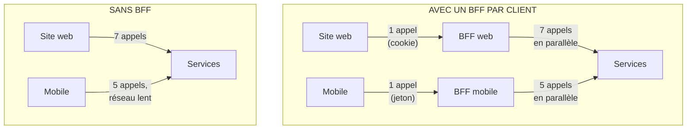
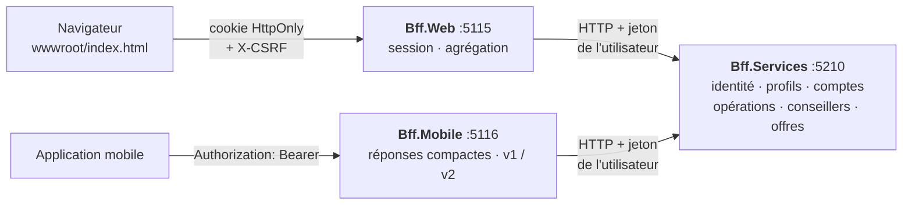
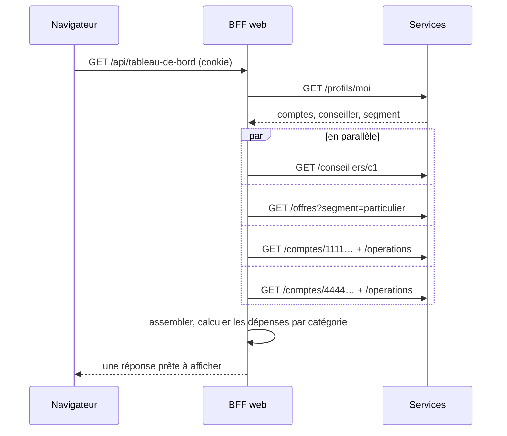
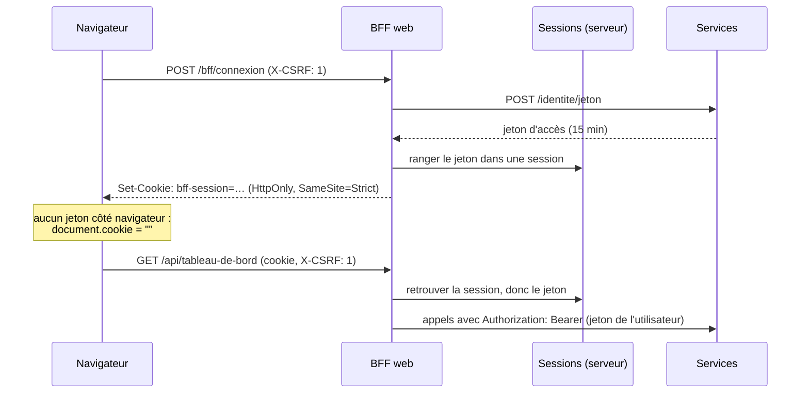

# 16. Backend for Frontend (BFF)

> **En une phrase** : chaque application cliente (site web, application mobile…) a **son propre backend**, écrit par son
> équipe, qui assemble les services génériques en réponses taillées pour ses écrans, et qui gère la sécurité à sa façon.

📁 Code : [`16-BFF`](../16-BFF) · ⬅️ [Multi-tenant](15-multi-tenant.md) · ➡️ [Architecture cellulaire](17-cell-based.md)

---

## L'idée

Les services métier sont **génériques** : un profil, un compte, une liste d'opérations, chacun à son adresse, avec tous ses
champs. C'est ce qu'il faut pour être réutilisable, mais aucun écran ne s'en sert tel quel.



Sans BFF, deux mauvaises options :
- chaque application **enchaîne les appels** et assemble elle-même : lent sur mobile (chaque aller-retour coûte), du code
  d'assemblage dupliqué dans chaque client, et un jeton d'accès à manipuler dans le navigateur ;
- les services ajoutent des routes **pour chaque écran** (`/comptes/resume-pour-mobile`…) : ils deviennent l'otage de toutes
  les interfaces, et chaque changement d'écran impose de modifier, tester et déployer un service partagé.

Le BFF (né chez SoundCloud, popularisé par Sam Newman) déplace cette adaptation dans un composant **qui appartient à l'équipe de l'écran** :
elle le fait évoluer à son rythme, sans négocier avec les équipes des services.

---

## Les projets



Les deux BFF ne se référencent pas, et ne référencent pas les services : ils ne les connaissent que par HTTP. Les contrats
sont **recopiés** dans chaque BFF, avec seulement les champs utiles à ses écrans (lecteur tolérant). Un test le vérifie.
([ClientServices.cs](../16-BFF/Bff.Mobile/ClientServices.cs))

```csharp
// Copie volontaire, et non projet partagé avec le BFF web : chaque BFF appartient à l'équipe de SON application
// et évolue à son rythme. Seuls les champs utiles à l'application mobile sont lus.
```

---

## 1. Agréger : un écran, une requête

Le tableau de bord du site affiche le client, son conseiller, ses comptes avec leurs dernières opérations, ses dépenses par
catégorie et des offres. Il faut sept appels aux services ; le navigateur n'en fait qu'un.
([TableauDeBord.cs](../16-BFF/Bff.Web/TableauDeBord.cs))

```csharp
// ① Le profil d'abord : il dit quels comptes afficher, quel conseiller, quel segment d'offres.
var profil = await services.Profil(jeton);

// ② Puis tout le reste EN PARALLÈLE : la durée totale est celle de l'appel le plus lent, pas la somme.
var conseiller = services.Conseiller(profil.ConseillerId, jeton);
var offres = Facultatif(annulation => services.Offres(profil.Segment, jeton, annulation), BudgetOffres);
var comptes = profil.Comptes.Select(id => CompteAvecOperations(id, jeton)).ToList();
Task[] appels = [conseiller, offres, .. comptes];
await Task.WhenAll(appels);
```



Mesuré sur la démo en fonctionnement (120 ms de latence simulée par appel) :

| En-tête de la réponse | Valeur | Sens |
|---|---|---|
| `X-Appels-Aval` | 7 | appels aux services pour une requête du navigateur |
| `X-Duree-Aval-Cumulee-Ms` | ≈ 900 | ce qu'auraient coûté ces appels **enchaînés** |
| `X-Duree-Totale-Ms` | ≈ 300 | la réponse réelle : deux « vagues » d'appels |

Les appels du BFF vers les services passent par le réseau du centre de données, rapide et fiable ; ceux du téléphone
passent par le réseau mobile. Remplacer cinq allers-retours mobiles par un seul est souvent le premier gain visible.

---

## 2. Une réponse par écran

Le même besoin (« l'accueil ») donne deux réponses très différentes.

| | BFF web : `/api/tableau-de-bord` | BFF mobile : `/mobile/v1/accueil` |
|---|---|---|
| Contenu | client, conseiller, comptes avec IBAN, 10 opérations par compte, dépenses par catégorie, offres | prénom, solde total, soldes, 3 dernières opérations |
| Libellés | bruts (« CB CARREFOUR 0910 PARIS 15 ») | raccourcis (« Carrefour ») |
| Taille (démo) | ≈ 2,8 Ko | ≈ 0,4 Ko |
| Champs nuls | présents | omis |
| Liste longue | 10 dernières opérations | pages de 10, **curseur opaque** |

La pagination montre bien le rôle d'adaptateur : les services paginent par `page` et `taille`, l'application ne connaît
qu'un curseur. Le BFF pourra changer de stratégie sans mettre à jour l'application.
([Ecrans.cs](../16-BFF/Bff.Mobile/Ecrans.cs))

```csharp
var page = LirePage(curseur);
var resultat = await services.Operations(compte, page, TaillePage, jeton);
var suivant = page * TaillePage < resultat.Total ? Curseur(page + 1) : null;
return new PageMobile(resultat.Operations.Select(Vue).ToList(), suivant);
```

### Les versions de l'application

Une application web se met à jour à chaque déploiement ; une application mobile, quand l'utilisateur le veut bien. Plusieurs
versions vivent donc en même temps. La v2 de l'application affiche un bandeau d'offre : le BFF expose `/mobile/v2/accueil`,
et continue de servir `/mobile/v1/accueil` aux téléphones pas encore à jour. **Les services n'ont pas changé.**

```csharp
var offre = version >= 2 ? Facultatif(a => services.Offres(profil.Segment, jeton, a), BudgetOffre) : Task.FromResult<OffreAval[]?>(null);
```

---

## 3. Sécurité : le jeton reste sur le serveur

C'est aujourd'hui la raison la plus citée d'avoir un BFF devant une application web monopage. Les recommandations de
l'IETF (*OAuth 2.0 for Browser-Based Apps*) le décrivent comme l'option la plus sûre : un jeton d'accès stocké dans le navigateur
(`localStorage`, mémoire JavaScript) peut être volé par n'importe quel script injecté (XSS).



([Session.cs](../16-BFF/Bff.Web/Session.cs))

```csharp
o.Cookie.HttpOnly = true;                                 // illisible depuis JavaScript : une faille XSS ne peut pas le voler
o.Cookie.SameSite = SameSiteMode.Strict;                  // jamais envoyé depuis un autre site
o.Cookie.SecurePolicy = CookieSecurePolicy.SameAsRequest; // en production : Always, et le préfixe « __Host- »
```

- **Session côté serveur** (`SessionsEnMemoire`, un `ITicketStore`) : le cookie ne contient qu'une clé chiffrée. Se
  déconnecter supprime la session : un cookie copié auparavant ne donne plus accès à rien (test
  `Apres_deconnexion_un_cookie_vole_ne_vaut_plus_rien`). Sans ce magasin, ASP.NET Core mettrait tout le ticket (jeton
  compris) dans le cookie chiffré, valable jusqu'à son expiration même après déconnexion.
- **CSRF** : puisque le navigateur envoie le cookie automatiquement, un autre site pourrait déclencher une requête. Deux
  barrières : `SameSite=Strict`, et l'en-tête obligatoire `X-CSRF: 1`, qu'un formulaire ne sait pas ajouter et qu'un
  script d'une autre origine ne peut envoyer qu'après une requête préliminaire CORS, que le BFF refuse.
- **Même origine** : le BFF sert lui-même l'application (`wwwroot`). Pas de CORS à configurer, et le cookie reste
  « premier partie ».
- **Aucun passe-droit** : le BFF appelle les services avec le jeton de l'utilisateur, jamais avec une identité technique
  toute-puissante. Les services vérifient eux-mêmes que le compte appartient à l'utilisateur ; passer par le BFF ne permet
  pas à Alice de débiter Bob.

Le mobile, lui, n'a pas ce problème de la même façon : une application native garde son jeton dans le stockage sécurisé du
système (Keychain, Keystore), hors de portée des pages web. Son BFF se contente de le transmettre. C'est une autre raison
d'avoir **un BFF par type de client** : la sécurité n'y est pas la même.

---

## 4. Dégrader plutôt qu'échouer

Un écran qui agrège sept appels a sept occasions d'échouer. Le BFF distingue l'**essentiel** (profil, comptes) de
l'**accessoire** (offres) : un appel accessoire a un budget de temps, et son échec est absorbé.

```csharp
private static async Task<T?> Facultatif<T>(Func<CancellationToken, Task<T>> appel, TimeSpan budget) where T : class
{
    using var delai = new CancellationTokenSource(budget);
    try
    {
        return await appel(delai.Token);
    }
    catch (Exception e) when (e is ServiceAvalException or HttpRequestException or OperationCanceledException)
    {
        return null;
    }
}
```

Avec `PUT /chaos {"offresEnPanne": true}` sur les services, le tableau de bord répond toujours 200, avec `"offres": null`
et `"degrade": ["offres"]` ; la page affiche un bandeau « affichage partiel ». Le budget de temps évite qu'un service
**lent** (plutôt qu'en panne) ralentisse toute la page.

---

## BFF, passerelle d'API, GraphQL

| | Passerelle d'API (démo 8) | BFF | GraphQL |
|---|---|---|---|
| Combien ? | une, pour tous les clients | **une par type de client** | un schéma pour tous |
| Rôle | routage, sécurité, quotas, transversal | adapter les services à **un** client | le client décrit ce qu'il veut |
| Qui l'écrit ? | l'équipe plateforme | l'équipe de l'application cliente | l'équipe API (schéma), le client (requêtes) |
| Contient… | aucune logique propre à un écran | agrégation, formatage, session, versions | des résolveurs par champ |

Ils se combinent : passerelle en entrée, BFF derrière elle, et un BFF peut tout à fait exposer du GraphQL à son application.

---

## Les tests

Les trois processus tournent en mémoire ; les BFF appellent les **vrais** services de test, avec une latence réglable.
([Systeme.cs](../16-BFF/Bff.Tests/Systeme.cs))

| Test | Ce qui est vérifié |
|---|---|
| `La_connexion_pose_un_cookie_HttpOnly_et_ne_renvoie_aucun_jeton` | `HttpOnly`, `SameSite=Strict`, aucun jeton dans la réponse |
| `Apres_deconnexion_un_cookie_vole_ne_vaut_plus_rien` | session supprimée côté serveur |
| `Sans_en_tete_anti_CSRF_une_requete_est_refusee_meme_avec_une_session` | protection CSRF |
| `Le_tableau_de_bord_agrege_sept_appels_faits_en_parallele` | 7 appels, durée < 4 latences (enchaînés : 7) |
| `Une_panne_des_offres_degrade…`, `Un_service_trop_lent_est_abandonne…` | dégradation, budget de temps |
| `Un_virement_passe_par_la_session_et_les_droits_de_l_utilisateur` | jeton de l'utilisateur, 403 sur le compte de Bob |
| `L_accueil_mobile_tient_en_une_requete_et_une_reponse_compacte` | 5 appels, pas d'IBAN, libellés courts, 5 fois plus léger |
| `La_v2_ajoute_un_bandeau_d_offre_sans_changer_la_v1`, `Le_curseur_parcourt…` | versions, pagination |
| `Chaque_BFF_ne_connait_les_services_et_l_autre_BFF_que_par_HTTP` | **test d'architecture** : aucune référence de code |

Les tests de sécurité et de parallélisme ont été vérifiés par mutation : appels enchaînés, cookie sans `HttpOnly` ou
sessions gardées dans le cookie font chacun échouer le test correspondant.

---

## Bilan

| 👍 Points forts | 👎 Limites |
|---|---|
| Chaque application reçoit **exactement** ce qu'elle affiche, en une requête | Un composant de plus à déployer et exploiter **par application** |
| L'équipe de l'écran évolue sans attendre celle des services | Duplication entre BFF (contrats, appels) : c'est voulu, mais il faut l'accepter |
| Le jeton ne va jamais dans le navigateur ; sessions révocables | Sessions à partager entre instances (cache distribué) |
| Versions et dégradations gérées à un seul endroit | Tentation d'y mettre des **règles métier** : elles doivent rester dans les services |

**Quand l'utiliser** : plusieurs applications clientes aux besoins différents sur les mêmes services, une application web
monopage qui ne doit pas manipuler de jetons, ou des écrans qui demandent beaucoup d'appels. Pour une seule application
servie par un seul backend, ce backend **est** déjà son BFF. En production : **Duende BFF** (sessions, CSRF, relais vers
les API), **YARP** pour relayer les routes sans agrégation, et OpenID Connect pour la connexion.
