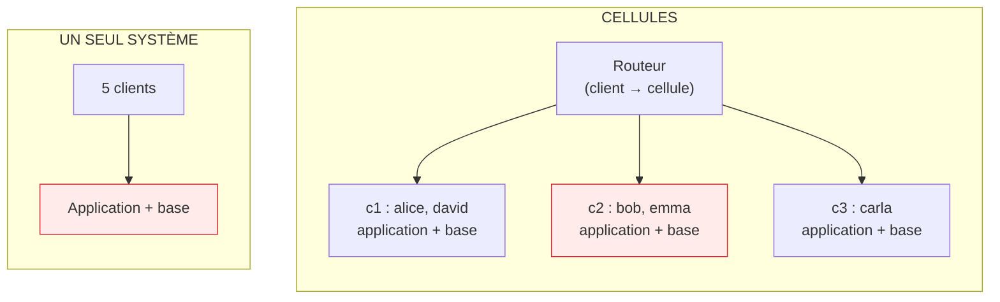
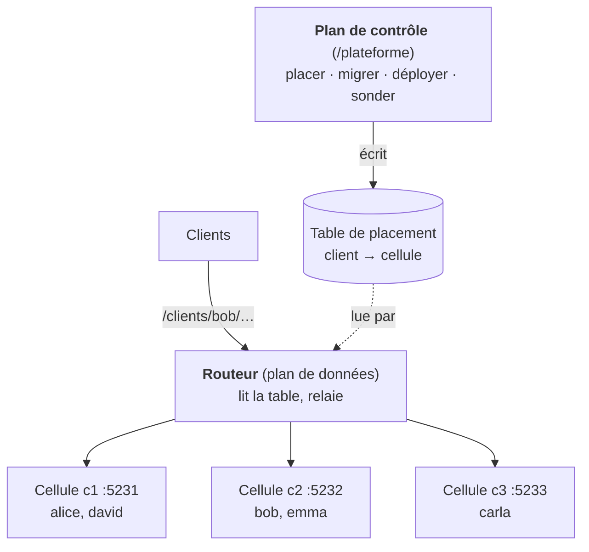
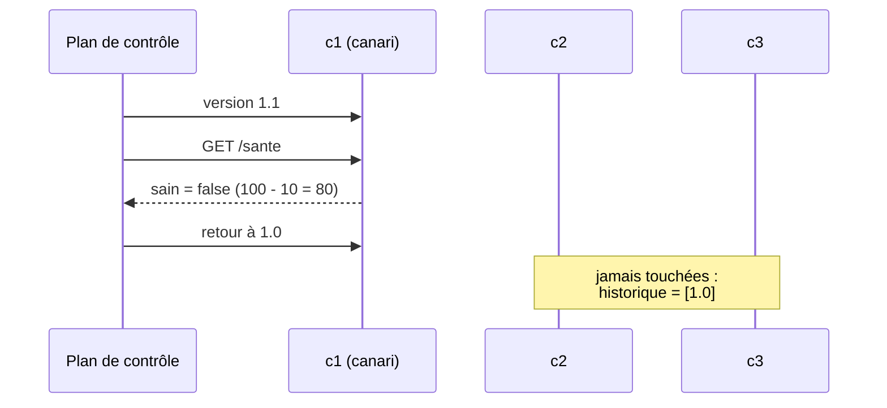
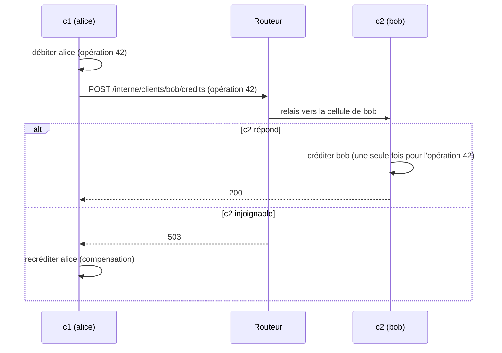

# 17. Architecture cellulaire (cell-based)

**Nom anglais** : *Cell-Based Architecture*

> **En une phrase** : au lieu d'un seul système qui grossit, on fait tourner **plusieurs copies complètes et indépendantes**
> de l'application, les *cellules*, chacune pour une partie des clients ; une panne, un mauvais déploiement ou un client
> trop gourmand reste **enfermé dans sa cellule**.

📁 Code : [`17-CellBased`](../17-CellBased) · ⬅️ [BFF](16-bff.md) · ➡️ [Modèle d'acteurs](18-modele-acteurs.md) · 🌐 [English](en/17-cell-based.md)

---

## L'idée : borner le rayon d'impact

Toutes les démos précédentes, même les microservices, ont un point commun : **un seul exemplaire** de chaque composant sert
tous les clients. Une base saturée, une configuration erronée ou un bogue déployé touche donc tout le monde. On peut
répliquer pour résister aux pannes de machines, mais pas aux pannes « logiques » : toutes les répliques font la même erreur.



À gauche, une panne touche **5 clients sur 5**. À droite, une panne de c2 en touche **2 sur 5** (bob et emma), et les
cellules sont souvent bien plus nombreuses : avec 50 cellules, un incident n'atteint que 2 % des clients.

Chaque cellule contient **tout** : l'API, les règles, les données. Elle ne dépend pas des autres cellules pour servir ses
clients. C'est ce qui la distingue des autres découpages :

| | Découpe… | Une panne touche… |
|---|---|---|
| [Microservices](08-microservices.md) | par **fonction** (comptes, virements…) | une fonction, pour **tous** les clients |
| [Multi-tenant](15-multi-tenant.md) | rien : une instance **partagée** entre clients | potentiellement tous les clients |
| **Cellules** | par **groupe de clients**, chaque groupe ayant toutes les fonctions | toutes les fonctions, pour **un groupe** de clients |

Ils se combinent : une cellule peut contenir des microservices, et elle est en général multi-tenant à l'intérieur.

---

## Les composants



- **Les cellules** ([Cell.Cellule](../17-CellBased/Cell.Cellule)) : un seul programme, lancé plusieurs fois avec un
  identifiant différent. Chacune n'a que les données de ses clients.
- **Le routeur** (plan de données, [Relais.cs](../17-CellBased/Cell.Routeur/Relais.cs)) : lire la **clé de partition**
  (ici le client, dans l'URL), trouver sa cellule, relayer. C'est le **seul composant partagé** : il doit être le plus
  simple possible, sans métier ni base, pour ne jamais devenir lui-même la panne générale.
- **Le plan de contrôle** ([PlanDeControle.cs](../17-CellBased/Cell.Routeur/PlanDeControle.cs)) : il décide (placer,
  ajouter une cellule, migrer, déployer) et écrit la table de placement ; pour migrer, déployer ou sonder, il s'adresse aussi directement aux cellules
  (API `/interne` et `/admin`). Il est **hors du chemin des requêtes** : s'il
  tombe, on ne peut plus placer ni déployer, mais le trafic continue. Dans la démo, il vit dans le même processus que le
  routeur par simplicité ; en production, c'est un service à part.

```csharp
if (placement.CellOf(customer) is not { } id || registry.Find(id) is not { } cell)
    return Results.NotFound(new { error = $"Unknown customer \"{customer}\"." });
```

---

## 1. Rayon d'impact

Relevé sur la démo en fonctionnement, après avoir **arrêté le processus** de la cellule c2 :

| Client | Cellule | Réponse |
|---|---|---|
| alice | c1 | 200 |
| bob | c2 | **503** « Cellule c2 injoignable : seuls ses clients sont touchés. » |
| carla | c3 | 200 |
| david | c1 | 200 |
| emma | c2 | **503** |

```csharp
catch (HttpRequestException)
{
    // Blast radius: only the customers of THIS cell get this error.
```

---

## 2. Grandir en ajoutant des cellules

Une cellule a une **capacité maximale** (ici 3 clients ; en réalité, ce que les tests de charge ont validé). Quand toutes
sont pleines, on n'agrandit pas une cellule : on en **ajoute** une. Toutes les cellules ont donc une taille connue et
testée, et le système grandit sans atteindre de limite inconnue (« on ne sait pas comment se comporte une base 3 fois
plus grosse que tout ce qu'on a testé »).

```csharp
/// <summary>The least loaded open cell that still has room.</summary>
public CellInfo? ChooseCell() => registry.All()
    .Where(c => c.Open && placement.Count(c.Id) < c.Capacity)
    .OrderBy(c => placement.Count(c.Id)).ThenBy(c => c.Id)
    .FirstOrDefault();
```

Parcours dans la démo : 9 places pour 5 clients ; 4 nouveaux clients remplissent les trois cellules ; le suivant reçoit
503 « Toutes les cellules sont pleines : provisionner une nouvelle cellule » ; on lance c4
(`dotnet run --project Cell.Lanceur -- c4`), on l'enregistre (`POST /plateforme/cellules`), et le client suivant y est placé.
Une cellule peut aussi être **fermée** aux nouveaux clients (`POST /plateforme/cellules/c1/fermer`) tout en continuant à
servir les siens.

---

## 3. Déployer par vagues

Toutes les cellules font tourner le même code, mais pas forcément **la même version au même moment**. Un déploiement
avance cellule par cellule : d'abord **une** cellule (le *canari*), puis les suivantes, en vérifiant la santé après chaque
vague. Au premier signal, on revient en arrière et on s'arrête.



La version 1.1 contient un bogue (un retrait débité deux fois) qui ne se voit qu'à l'exécution. La **sonde de santé** de
chaque cellule rejoue un retrait de contrôle ([Version.cs](../17-CellBased/Cell.Cellule/Version.cs)) :

```csharp
public (bool Healthy, string Detail) Probe()
{
    var result = Withdraw(100m, 10m);
    return result == 90m
        ? (true, "check withdrawal correct")
        : (false, $"check withdrawal incorrect: 100 - 10 = {result}");
}
```

Résultat réel de `POST /plateforme/deploiements {"version":"1.1"}` :

```json
{"version":"1.1","status":"Cancelled","waves":[{"wave":1,"cells":["c1"],
 "result":"rollback: c1: check withdrawal incorrect: 100 - 10 = 80"}]}
```

Pendant les quelques instants où c1 tournait en 1.1, ses clients (alice, david) ont pu subir le bogue : c'est le prix,
**borné**, du canari. Avec un déploiement d'un seul coup, tous les clients l'auraient subi. Une cellule injoignable ou
malade dans une vague arrête aussi le déploiement ; les vagues précédentes, saines, sont conservées.

---

## 4. Déplacer un client

Un client grossit, une cellule doit être vidée, la charge est mal répartie : le plan de contrôle **migre** le client.

```csharp
placement.StartMigration(customerId);   // ① no more writes during the copy
try
{
    var export = await Client(source).GetFromJsonAsync<CustomerExport>(Url(source, $"/internal/customers/{customerId}/export"));
    await Check(await Client(target).PostAsJsonAsync(Url(target, "/internal/customers"), export), target);   // ② copy
    placement.Place(customerId, target.Id);                                                                 // ③ switch the routing
    await Client(source).DeleteAsync(Url(source, $"/internal/customers/{customerId}"));                       // ④ clean up
```

Pendant la copie, le routeur répond `503` avec `Retry-After: 2` pour **ce** client seulement. Les identifiants
d'opérations déjà traitées voyagent avec ses données : un crédit rejoué après la migration n'est pas appliqué deux fois
(test `Les_operations_deja_traitees_suivent_le_client_dans_sa_nouvelle_cellule`).

---

## 5. Le prix : ce qui traverse les cellules

Tant que les deux clients d'un virement sont dans la même cellule, c'est une transaction locale. Sinon, il n'y a plus de
transaction commune : la cellule source débite, puis demande le crédit à la cellule cible **via le routeur** (elle ne
connaît pas les autres cellules), avec un identifiant d'opération pour l'idempotence, et **compense** si la cible ne répond pas.



D'où la décision la plus importante de cette architecture : **la clé de partition**. Elle doit faire tenir l'immense
majorité des opérations dans une seule cellule (un client et ses comptes, une entreprise et ses salariés, une boutique et
ses commandes). Si les échanges entre cellules deviennent fréquents, on a reconstruit un système distribué fragile,
avec les inconvénients des cellules et des microservices à la fois.

---

## Les tests

Les quatre cellules et le routeur tournent en mémoire, reliés par leurs serveurs de test
([Systeme.cs](../17-CellBased/Cell.Tests/Systeme.cs)).

| Test | Ce qui est vérifié |
|---|---|
| `Les_clients_de_demo_sont_repartis_entre_les_cellules` | placement initial |
| `Le_routeur_envoie_chaque_client_vers_sa_cellule`, `Une_cellule_ne_contient_que_ses_clients` | routage, cloisonnement |
| `Une_panne_de_cellule_ne_touche_que_ses_clients` | rayon d'impact : 2 clients sur 5 |
| `Un_virement_dans_une_meme_cellule_reste_local` | transaction locale |
| `Un_virement_entre_cellules_passe_par_le_routeur_et_ne_credite_qu_une_fois` | crédit idempotent |
| `Si_la_cellule_du_beneficiaire_est_en_panne_le_virement_est_compense` | compensation |
| `Quand_les_cellules_sont_pleines_on_en_ajoute_une_au_lieu_de_les_agrandir` | capacité, enregistrement de c4 |
| `Migrer_un_client…`, `Les_operations_deja_traitees_suivent…` | migration, idempotence conservée |
| `Un_deploiement_defectueux_s_arrete_a_la_cellule_canari` | canari, retour arrière, historique des versions |
| `Un_deploiement_sain_passe_vague_par_vague`, `Une_cellule_malade_arrete_le_deploiement_a_sa_vague` | vagues |
| `Le_routeur_et_les_cellules_ne_partagent_aucun_code` | **test d'architecture** |

Vérifiés par mutation : un déploiement en une seule vague, la suppression de l'idempotence, de la compensation, ou des
opérations traitées dans l'export, font chacun échouer les tests correspondants.

---

## Bilan

| 👍 Points forts | 👎 Limites |
|---|---|
| **Rayon d'impact borné** : panne, bogue, client gourmand restent dans une cellule | N copies de l'infrastructure : coût, et outillage pour les exploiter |
| Grandir en ajoutant des cellules de taille connue, sans limite inconnue | Les opérations entre cellules sont lentes, rares, à compenser |
| Déploiements progressifs naturels (canari = une cellule) | Choisir la clé de partition engage pour longtemps |
| Une cellule se teste en charge une fois pour toutes | Migrations de clients, rééquilibrage, routeur à rendre très disponible |

**Quand l'utiliser** : à grande échelle, quand une panne générale coûte plus cher que la duplication (grands SaaS,
plateformes de paiement, messageries), et quand une clé de partition naturelle existe. Pour la plupart des systèmes,
plusieurs zones de disponibilité et des déploiements progressifs suffisent. Pour aller plus loin : le guide d'AWS
*Reducing the Scope of Impact with Cell-Based Architecture*, et les retours de Slack sur sa migration vers les cellules.
