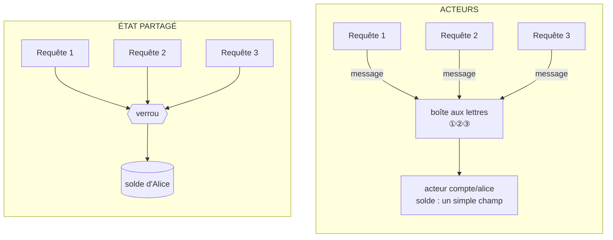
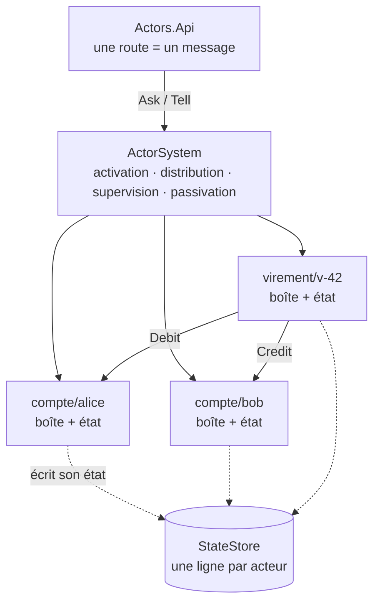
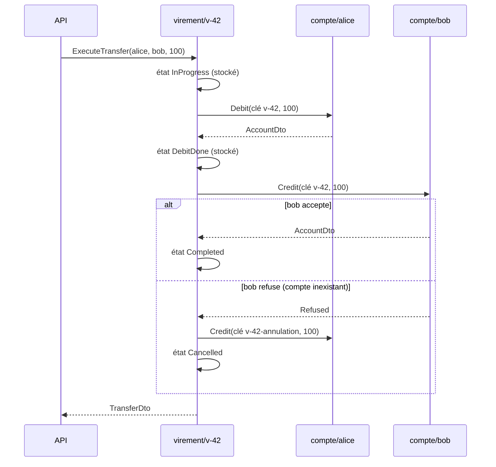
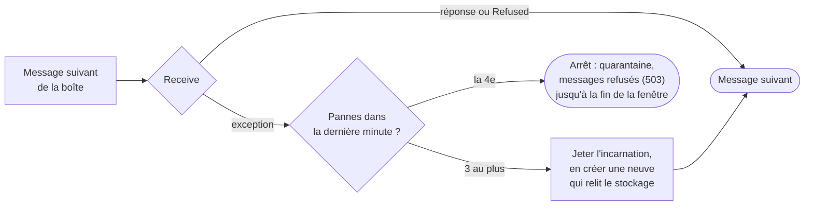

# 18. Modèle d'acteurs

**Nom anglais** : *Actor Model*

> **En une phrase** : le système est fait de milliers de petits objets, les *acteurs*, qui ont chacun **leur propre état**,
> **ne partagent rien** et ne communiquent que **par messages**, traités **un par un** ; la concurrence ne demande plus
> aucun verrou, et une panne se répare en **remplaçant** l'acteur fautif.

📁 Code : [`18-ActorModel`](../18-ActorModel) · ⬅️ [Architecture cellulaire](17-cell-based.md) · ➡️ [Architecture spatiale](19-space-based.md) · 🌐 [English](en/18-modele-acteurs.md)

---

## L'idée : ne plus partager l'état

Dans toutes les démos précédentes, l'état est **partagé** : plusieurs requêtes simultanées lisent et modifient les mêmes
comptes, et c'est la base de données (transactions, verrous, contrôle de concurrence) qui évite qu'elles se marchent
dessus. Le modèle d'acteurs (Carl Hewitt, 1973 ; popularisé par Erlang) prend le problème à l'envers : **chaque donnée a
un seul propriétaire**, et on ne lui parle qu'en déposant un message dans sa boîte aux lettres.



À gauche, la sûreté dépend de **chaque** morceau de code qui touche le solde : un oubli de verrou, et des mises à jour se
perdent. À droite, elle est **structurelle** : seul l'acteur touche son champ, et il ne traite qu'un message à la fois.
Ses messages s'accumulent dans sa boîte, mais des acteurs **différents** travaillent en parallèle, sur tous les cœurs.

Trois règles définissent un acteur. En réponse à un message, il peut :

1. **modifier son propre état** (et seulement le sien) ;
2. **envoyer des messages** à d'autres acteurs dont il connaît l'adresse ;
3. **créer** d'autres acteurs (ici, ils sont *virtuels* : on les adresse, le runtime les crée).

| | Partage de l'état | Une panne… |
|---|---|---|
| Démos 00 à 17 | données partagées, protégées par la base (transactions) | annule la transaction ; le processus continue |
| **Acteurs** | **rien** : chaque état a un seul propriétaire | **remplace l'acteur** fautif, qui recharge son état durable |

---

## Les composants



- **Le runtime** ([Actors.Runtime](../18-ActorModel/Actors.Runtime), ≈ 300 lignes écrites pour la démo, sans package) :
  - [`Actor`](../18-ActorModel/Actors.Runtime/Actor.cs) : la classe de base, avec `Start` (recharger l'état),
    `Receive` (traiter un message) et `StopActivation` ;
  - [`ActorRef`](../18-ActorModel/Actors.Runtime/ActorRef.cs) : l'**adresse** d'un acteur (`account/1111…`),
    jamais l'objet lui-même ; on y `Tell` un message (*tell*, sans réponse) ou on lui `Ask` (*ask*, avec réponse et délai) ;
  - [`ActorSystem`](../18-ActorModel/Actors.Runtime/ActorSystem.cs) : une boîte aux lettres
    (`System.Threading.Channels`) et une boucle par acteur actif, la supervision, la passivation.
- **Le métier** ([Actors.Bank](../18-ActorModel/Actors.Bank)) : [`AccountActor`](../18-ActorModel/Actors.Bank/AccountActor.cs)
  (un par compte), [`TransferActor`](../18-ActorModel/Actors.Bank/TransferActor.cs) (un par virement), des
  [messages](../18-ActorModel/Actors.Bank/Messages.cs) immuables (`record`), un stockage durable et un injecteur de pannes.
- **L'API** ([Endpoints.cs](../18-ActorModel/Actors.Api/Endpoints.cs)) ne lit ni n'écrit aucun état : chaque route
  envoie **un** message à **un** acteur et traduit sa réponse en code HTTP.

```csharp
app.MapPost("/accounts/{id:guid}/withdrawal", async (Guid id, AmountRequest r, ActorSystem system) =>
    Http(await system.Account(id).Ask(new Withdraw(r.Amount))));
```

En production, on n'écrit pas ce runtime : **Orleans** (Microsoft, acteurs *virtuels*, le modèle suivi ici),
**Akka.NET** (portage d'Akka, hiérarchies de supervision à la Erlang) ou **Proto.Actor** font la même chose, **répartis sur
plusieurs machines** : l'adresse `account/alice` reste la même, que l'acteur vive sur le serveur 1 ou le 7.

---

## 1. Un message à la fois : la concurrence sans verrou

Tout le modèle tient dans cette boucle : un seul lecteur par boîte aux lettres, qui **attend la fin** de chaque message
avant de prendre le suivant ([ActorSystem.cs](../18-ActorModel/Actors.Runtime/ActorSystem.cs)).

```csharp
await foreach (var envelope in activation.Mailbox.Reader.ReadAllAsync())
{
    activation.Processing = true;
    object? response = null;
    Exception? failure = null;
    try
    {
        // THE key point of the model: only one message at a time, each handled to the end before the next one.
        response = await activation.Instance!.Receive(envelope.Message);
    }
    // …
}
```

Le compte peut alors écrire le code le plus naïf qui soit : lire le solde, vérifier, modifier. Pas de `lock`, pas de
transaction, pas de version optimiste ([AccountActor.cs](../18-ActorModel/Actors.Bank/AccountActor.cs)) :

```csharp
if (debit && amount > state.Balance)
    return new Refusal($"Insufficient balance ({state.Balance:0.00} €).");

var signed = debit ? -amount : amount;
state.Balance += signed;
```

**Essai réel** : 1 000 retraits de 3 € lancés **en même temps** sur le compte d'Alice (1 000 €) :

```json
POST /demo/simultaneous-withdrawals  { "account": "1111…", "count": 1000, "amount": 3 }
{ "balanceBefore": 1000, "requests": 1000, "accepted": 333, "refused": 667, "finalBalance": 1, "minimumObservedBalance": 1, "durationMs": 231 }
```

Exactement 333 retraits acceptés (333 × 3 = 999 €), aucun en double, jamais de solde négatif. Le même code sans acteur,
appelé par 1 000 threads, perdrait des mises à jour.

Un refus métier (solde insuffisant) est une **réponse** comme une autre (`Refusal`), pas une exception : l'acteur continue.
Les exceptions sont réservées aux **pannes** (voir § 3).

---

## 2. Converser plutôt que verrouiller : le virement

Un virement touche deux comptes, donc deux acteurs aux états séparés : il n'y a **pas de transaction commune**. Un
troisième acteur, `transfer/{id}`, mène la conversation et note où il en est, comme l'orchestrateur de la
[saga](14-saga-orchestree.md), mais à l'échelle d'un seul virement.



Trois propriétés découlent du modèle, sans code dédié :

- **Pas d'interblocage.** Les comptes ne demandent jamais rien à personne ; seul le virement attend leurs réponses.
  Avec des verrous, A→B et B→A simultanés s'interbloquent si l'on ne verrouille pas toujours dans le même ordre.
  Essai réel : 500 virements dans chaque sens, en même temps.

  ```json
  POST /demo/crossed-transfers  { "count": 500, "amount": 1 }
  { "transfers": 1000, "completed": 572, "refused": 428, "totalBefore": 501, "totalAfter": 501, "durationMs": 518 }
  ```

  (Alice n'avait plus qu'1 € après l'essai précédent, d'où les refus ; le total, lui, est conservé.)
- **L'identité fait l'idempotence.** Rejouer `transfer/invoice-42` réveille le **même** acteur, qui connaît déjà la
  réponse ; un virement fini (terminé, refusé ou annulé) ne recommence jamais :

  ```csharp
  if (_state is { Status: TransferStatus.Completed or TransferStatus.Refused or TransferStatus.Cancelled })
      return View();  // already finished: same response, no effect
  ```

- **Une reprise sans double débit.** Si le virement plante après le débit, son état stocké dit `DebitDone` : rejoué,
  il saute le débit et reprend au crédit. Et même refait, le débit porte la clé `transfer-v-42`, que le compte reconnaît :

  ```csharp
  if (key is not null && state.Operations.Any(o => o.Key == key))
      return View();
  ```

⚠ Le piège du modèle : un acteur qui **attend** une réponse ne traite rien d'autre pendant ce temps. Si
le compte A demandait quelque chose au compte B pendant que B demande quelque chose à A, ils s'attendraient
mutuellement (jusqu'au délai de la demande). D'où la règle suivie ici : **les demandes vont dans un seul sens**
(virement → comptes), jamais en cycle ; quand un acteur n'a pas besoin de la réponse, il `Tell` sans attendre.

---

## 3. « Let it crash » : la supervision

Plutôt que de prévoir chaque erreur dans le code métier, on laisse planter l'acteur et son **superviseur** le
**remplace** : l'incarnation fautive, avec un état en mémoire peut-être incohérent, est jetée ; une neuve recharge le
dernier état **écrit** et reprend les messages suivants, qui attendaient dans la boîte.



```csharp
if (activation.Failures.Count > strategy.MaxRestarts)
{
    await StopActivation(activation, $"{activation.Failures.Count} failures in {strategy.Window.TotalSeconds:0} s ({failure.Message})");
    return false;
}

await Deincarnate(activation);
if (!await Incarnate(activation))
```

Le cas le plus parlant : une panne **au pire moment**, après la modification du solde en mémoire mais avant son
écriture (`Step.BeforeSave`, armée par `POST /system/failures`). Essai réel :

```text
POST /accounts/1111…/withdrawal { "amount": 1 }  → 500 « account/1111… crashed while handling this message: simulated failure (BeforeSave) »
GET  /accounts/1111…                            → 200, solde inchangé : le retrait n'a pas eu lieu
GET  /accounts/2222… (piégé 4 fois)             → 500 500 500 500 503
```

Pas de solde à moitié modifié, pas de code de nettoyage : la nouvelle incarnation repart de l'état durable. Au-delà de
3 redémarrages par minute, redémarrer ne sert plus à rien : l'acteur est **arrêté** et ses messages refusés (`503`)
jusqu'à la fin de la fenêtre. Les autres acteurs ne voient rien (Alice répond pendant que Bob est en quarantaine).

Une panne se **propage le long des demandes** : si le compte de Bob plante pendant un virement, la demande du virement
échoue, et le virement plante à son tour. Les deux sont redémarrés, et rejouer le virement le termine (test
`An_account_failure_propagates_to_the_transfer_which_can_be_replayed`).

Le runtime de la démo applique une **stratégie par type** d'acteur (le modèle d'Orleans, où le runtime supervise tout
le monde). Akka et Erlang vont plus loin : les acteurs forment un **arbre**, chaque parent supervise ses enfants et peut
**escalader** la panne à son propre parent.

Enfin, un acteur lent ne bloque que ses propres appelants : `Ask` a un délai (5 s), au-delà duquel l'API répond
`504`. Le message, lui, reste dans la boîte et sera traité.

---

## 4. Acteurs virtuels : activation et passivation

Dans Orleans, un acteur (un *grain*) **existe toujours** en principe : on n'a ni à le créer ni à le détruire. Le premier
message l'**active** (une *incarnation* en mémoire), l'inactivité le **passive** (sa mémoire est libérée, son état
stocké reste), le message suivant le réactive. On peut donc avoir des millions de comptes et n'en garder en mémoire que
ceux qui servent.

```text
POST /system/passivation           → { "passivated": 1004 }      Alice, 9999… (touché par la compensation), 1 002 virements
GET  /system                       → { "active": 0, ... }
GET  /system/storage?type=account  → ["account/1111…", "account/2222…"]   9999… n'a jamais été ouvert : rien de stocké
GET  /accounts/1111…               → 200, solde retrouvé
GET  /system                       → { "active": 1, ... }      seule Alice a été réveillée
```

La passivation automatique tourne toutes les 5 s et endort les acteurs inactifs depuis 30 s
([AutomaticPassivation.cs](../18-ActorModel/Actors.Api/AutomaticPassivation.cs)). Un acteur qui a des messages
en attente ou en cours n'est jamais passivé.

La garantie centrale d'un runtime d'acteurs virtuels : **au plus une incarnation par acteur à la fois**. Le cas délicat
est un message qui arrive pendant qu'une passivation est en train d'arrêter l'ancienne incarnation : la nouvelle
l'attend avant de démarrer.

```csharp
// If a previous incarnation is still finishing stopping (passivation), the new one waits for it before starting:
// never two incarnations of the same actor at the same time, not even for a fraction of a second.
_finishingIncarnations.Remove(path, out var previous);
activation.Loop = Task.Run(() => Run(activation, previous));
```

(Sur plusieurs machines, garantir cette unicité est le vrai travail d'Orleans : un annuaire réparti dit quel serveur
héberge quel acteur.)

---

## 5. Le prix : ce que les acteurs rendent difficile

- **Les lectures transversales.** « Lister tous les comptes », « total des dépôts » : il faudrait réveiller et
  interroger chaque acteur. L'API n'a d'ailleurs pas de `GET /accounts`. On construit à côté une **vue de lecture**
  alimentée par les événements des acteurs : c'est le [CQRS](09-cqrs.md), souvent associé aux acteurs.
- **Pas de transaction entre acteurs** : un processus à plusieurs acteurs s'écrit étape par étape, avec états stockés,
  idempotence et compensation (§ 2).
- **Les cycles de demandes** s'interbloquent (§ 2) ; les boîtes aux lettres peuvent **déborder** si un acteur reçoit plus
  qu'il ne traite (un compte très sollicité est un goulot : un message à la fois, c'est aussi une limite de débit).
- **La livraison** : un `Tell` vers un acteur en quarantaine est perdu (« lettre morte », comptée dans `/system`) ;
  entre machines, un message peut être perdu ou dupliqué. D'où les clés d'idempotence.
- **Le débogage** : le déroulement d'une requête est éclaté en messages asynchrones entre acteurs ; il faut un journal
  (ici `/system/log`) et, en production, une traçabilité distribuée.

---

## Les tests

Deux niveaux : le runtime seul, avec un acteur-jouet instrumenté
([RuntimeTests.cs](../18-ActorModel/Actors.Tests/RuntimeTests.cs)), puis le métier
([BankTests.cs](../18-ActorModel/Actors.Tests/BankTests.cs)) et l'API
([ApiTests.cs](../18-ActorModel/Actors.Tests/ApiTests.cs)). Une horloge manuelle fait avancer le temps pour la
passivation et la quarantaine. L'acteur-jouet incrémente son compteur de la façon la plus dangereuse qui soit :

```csharp
case Increment:
    var read = _counter;
    await Task.Yield();
    _counter = read + 1;
    return _counter;
```

| Test | Ce qui est vérifié |
|---|---|
| `An_actor_handles_only_one_message_at_a_time` | 1 000 incréments simultanés : aucun perdu, jamais deux messages en cours |
| `Different_actors_work_in_parallel` | deux acteurs, deux messages en même temps |
| `The_messages_of_a_sender_are_handled_in_sending_order` | ordre de la boîte aux lettres |
| `The_first_message_activates_the_actor_and_inactivity_passivates_it`, `A_busy_actor_is_never_passivated` | acteurs virtuels |
| `Never_two_incarnations_of_the_same_actor_at_the_same_time` | messages et passivations entrechoqués, arrêts lents |
| `A_failure_replaces_the_incarnation_without_losing_the_next_messages`, `A_failure_does_not_affect_the_other_actors` | supervision |
| `Too_many_failures_stop_the_actor_until_the_end_of_the_window` | quarantaine, lettres mortes |
| `A_request_that_takes_too_long_expires_without_the_message_being_lost` | délai d'une demande |
| `A_thousand_simultaneous_withdrawals_never_make_the_balance_negative` | 333 acceptés sur 1 000, solde 1 € |
| `Simultaneous_crossed_transfers_do_not_deadlock` | 200 + 200 virements, total conservé |
| `A_failure_before_saving_cancels_the_withdrawal_in_progress` | l'état relu dans le stockage |
| `A_transfer_interrupted_after_the_debit_completes_when_replayed`, `La_panne_d_un_compte_remonte_au_virement…` | reprise sans double débit |
| `A_transfer_to_an_account_that_does_not_exist_is_compensated`, `Replaying_a_refused_transfer_never_credits_the_target` | compensation, refus définitif |
| `Replaying_a_completed_transfer_returns_the_same_result_without_effect`, `A_debit_replayed_with_the_same_key_is_applied_only_once` | idempotence : identité de l'acteur, clé de l'opération |
| `Business_refusals_are_responses_not_failures` | un refus ne redémarre rien |
| `A_passivated_account_finds_its_balance_again_in_the_storage` | passivation, réveil d'un seul acteur |
| `Repeated_failures_put_the_actor_in_quarantine`, `A_slowness_answers_504_without_blocking_the_other_accounts` | `500`, `503`, `504` par HTTP |

Vérifiés par mutation : créer une incarnation par message, ne pas attendre l'incarnation précédente, garder
l'incarnation fautive après une panne, passiver un acteur occupé, supprimer la quarantaine, l'idempotence des débits,
la compensation ou le « virement déjà fini » font chacun échouer au moins un test.

---

## Bilan

| 👍 Points forts | 👎 Limites |
|---|---|
| **Concurrence sans verrou** : chaque état a un seul propriétaire | Pas de transaction entre acteurs : étapes, idempotence, compensation |
| Du code métier simple et séquentiel, à l'intérieur de chaque acteur | Lectures transversales difficiles (il faut une vue à part) |
| **Pannes locales** : on remplace l'acteur, l'état durable fait foi | Cycles de demandes = interblocages ; un acteur très sollicité = goulot |
| Passe à l'échelle : millions d'acteurs, répartis sur des machines | Débogage et traçabilité plus difficiles (tout est asynchrone) |

**Quand l'utiliser** : beaucoup d'entités indépendantes, chacune avec un état qui change souvent et des accès
concurrents : joueurs et parties d'un jeu en ligne (Halo utilise Orleans), objets connectés, sessions, paniers,
comptes, messageries (WhatsApp sur Erlang), systèmes télécoms. Moins adapté quand l'essentiel est fait de requêtes
transversales sur des données relationnelles. En .NET : **Orleans** pour des acteurs virtuels sans gestion du cycle de
vie, **Akka.NET** ou **Proto.Actor** pour un contrôle fin (hiérarchies de supervision, flux).
