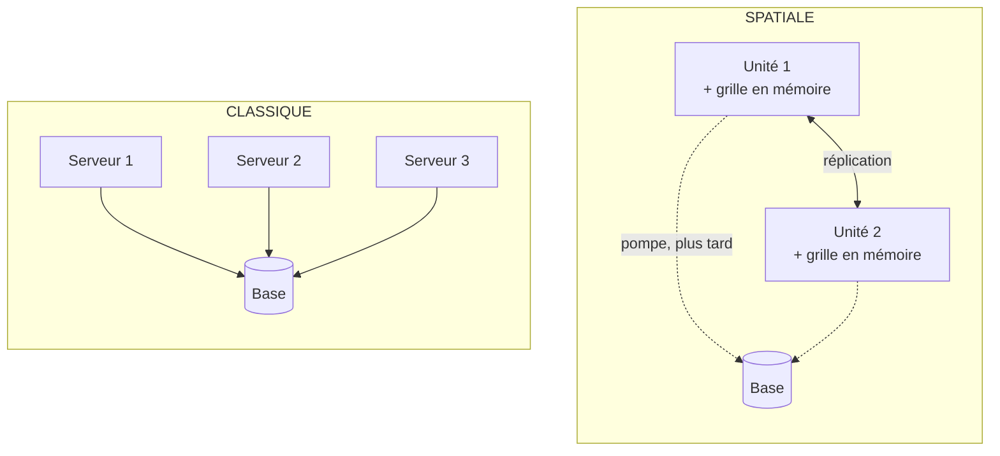
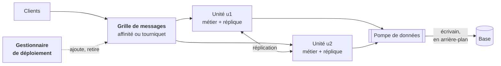
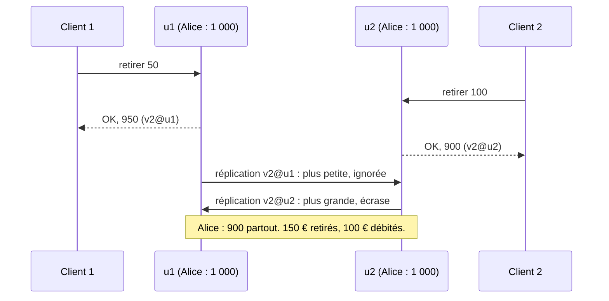

# 19. Architecture spatiale (space-based)

**Nom anglais** : *Space-Based Architecture*

> **En une phrase** : on retire la base de données du chemin des requêtes ; chaque **unité de traitement** garde
> **toutes les données en mémoire**, dans une grille répliquée entre les unités, et la base n'est mise à jour qu'en
> arrière-plan. On peut alors ajouter et retirer des unités à volonté pour absorber la charge.

📁 Code : [`19-SpaceBased`](../19-SpaceBased) · ⬅️ [Modèle d'acteurs](18-modele-acteurs.md) · ➡️ [Pipeline](20-pipeline.md) · 🌐 [English](en/19-space-based.md)

---

## L'idée : la base est le goulot

Toutes les démos précédentes finissent par la même chose : chaque requête lit ou écrit dans une base. On peut multiplier
les serveurs d'application, la base reste **unique** et finit par limiter le débit (verrous, connexions, disque). Le nom
vient de l'idée de *tuple space* : un espace de données partagé en mémoire. L'architecture spatiale (décrite notamment
par Mark Richards) enlève la base du chemin des requêtes :



Une requête n'attend plus que de la mémoire : lire un compte est un accès à un dictionnaire, l'écrire aussi. La base
devient une **sauvegarde** mise à jour en différé, et ne sert plus qu'à recharger la grille quand toutes les unités
sont tombées.

| | Les données de référence sont… | Pour tenir plus de charge… |
|---|---|---|
| Démos 00 à 18 | dans la base | on ajoute des serveurs, la base reste unique |
| [Cellules](17-cell-based.md) | dans la base de chaque cellule | on ajoute des cellules, chacune avec sa base |
| **Spatiale** | **en mémoire**, dans chaque unité | on ajoute des unités ; la base suit à son rythme |

---

## Les composants



Au démarrage à froid (plus aucune unité), le **lecteur de données** recharge la grille depuis la base.
Ce qu'on appelle l'**intergiciel virtualisé** ([Espace.Grille](../19-SpaceBased/Espace.Grille), simulé dans le
processus pour la démo, sans package) :

- la **grille de données** ([GrilleDeDonnees.cs](../19-SpaceBased/Espace.Grille/GrilleDeDonnees.cs),
  [Replique.cs](../19-SpaceBased/Espace.Grille/Replique.cs)) : une réplique complète par unité, et la réplication
  asynchrone de chaque écriture vers les autres (100 ms de latence, réglable) ;
- la **grille de messages** ([GrilleDeMessages.cs](../19-SpaceBased/Espace.Grille/GrilleDeMessages.cs)) : le point
  d'entrée, qui choisit l'unité de chaque requête ;
- la **pompe de données** et son **écrivain**, le **lecteur de données** ([Base.cs](../19-SpaceBased/Espace.Grille/Base.cs)) ;
- le **gestionnaire de déploiement** ([GestionnaireDeDeploiement.cs](../19-SpaceBased/Espace.Grille/GestionnaireDeDeploiement.cs)).

Les **unités de traitement** ([UniteDeTraitement.cs](../19-SpaceBased/Espace.Grille/UniteDeTraitement.cs)) contiennent
le métier ([Banque.cs](../19-SpaceBased/Espace.Banque/Banque.cs)), qui ne voit que la réplique de son unité :

```csharp
private static object Movement(UnitContext unit, Guid id, decimal amount, bool debit, string label) =>
    unit.Modify<Account>(id.ToString(), account =>
        account is null ? (null, NotFound(id))
        : amount <= 0 ? (null, new Refusal("The amount must be positive."))
        : debit && amount > account.Balance ? (null, new Refusal($"Insufficient balance ({account.Balance:0.00} €)."))
```

En production : **Hazelcast**, **Apache Ignite**, **GigaSpaces** (qui a popularisé le modèle), **Oracle Coherence** ou
**Infinispan** fournissent la grille et sa réplication, sur plusieurs machines ; la pompe est une file durable (Kafka,
RabbitMQ). On rencontre ce modèle dans la billetterie, les enchères en ligne, le trading.

---

## 1. Lire et écrire sans la base

Chaque écriture est appliquée dans la réplique de l'unité, puis **publiée** : vers les autres répliques, et vers la
pompe. La requête n'attend ni l'une ni l'autre.

```csharp
private void Publish(string origin, Modification modification)
{
    Interlocked.Increment(ref _inFlight);
    _queue.Writer.TryWrite((origin, modification, DateTimeOffset.UtcNow + ReplicationLatency));
    // The database is not on the request path: the write goes into the pump, we do not wait.
    _toThePump(modification);
}
```

La conséquence est spectaculaire : **la base peut tomber, les requêtes continuent**. Les écritures s'accumulent dans la
pompe et sont écrites quand la base revient (test `Les_requetes_n_attendent_jamais_la_base`). Pendant ce temps, la base
est en retard : un rapport qui la lirait verrait des données périmées.

`GET /grille/comparaison/{id}`, juste après un retrait, montre la **fenêtre de réplication** (essai réel) :

```text
{ "repliques": [ { "ou": "u8", "version": "v2@u8", "solde": 495 },
                 { "ou": "u9", "version": "v1@base", "solde": 500 } ],     ← u9 n'a pas encore reçu l'écriture
  "base": { "version": "v2@u8", "solde": 495 } }
300 ms plus tard : v2@u8 et 495 partout.
```

Chaque entrée porte une **version** (un compteur et l'unité qui l'a écrite). Répliques et base appliquent la même règle :
la plus grande version gagne. Elles finissent donc toutes identiques, quel que soit l'ordre d'arrivée des écritures.

---

## 2. Le prix : les collisions

Deux unités peuvent modifier **la même donnée en même temps**, chacune dans sa réplique, avant d'avoir reçu l'écriture
de l'autre. À la réplication, la plus grande version gagne et **l'autre écriture est perdue**, alors que son client a
reçu « OK ».



La réplique détecte la collision quand une modification ne part pas de la version qu'elle a :

```csharp
var concurrent = local != m.Previous && local.Unit != "" && local.Unit != m.Version.Unit;
if (m.Version > local)
{
    _entries[m.Key] = new Entry(m.Key, m.Value, m.Version);
    return new MergeResult(true, concurrent ? local : null);
}
```

La parade est dans la **grille de messages** : le **routage par affinité** envoie toujours la même clé à la même unité,
qui est alors la seule à l'écrire. Le hachage « de rendez-vous » limite les déplacements quand le nombre d'unités change :

```csharp
: _units.MaxBy(u => Hash($"{key}/{u.Id}"))!;
```

**Essai réel** : 200 retraits de 1 € lancés en même temps sur le compte d'Alice, selon le routage.

```json
POST /demo/concurrent-withdrawals  (affinity)
{ "unitsUsed": ["u2"], "accepted": 200, "expectedBalance": 800, "balanceInGrid": [800], "balanceInDatabase": 800, "lostUpdates": 0 }

POST /demo/concurrent-withdrawals  (round robin)
{ "unitsUsed": ["u5","u6"], "accepted": 200, "expectedBalance": 600, "balanceInGrid": [700], "balanceInDatabase": 700, "lostUpdates": 199 }
```

Au tourniquet, 200 retraits acceptés mais seulement 100 € débités : la banque a perdu 100 €. Grille et base sont
pourtant cohérentes entre elles : rien ne signale l'erreur, sauf le compteur de collisions.

⚠ **L'affinité ne suffit pas toujours.** Quand une unité arrive ou part, certaines clés changent de propriétaire ;
pendant la fenêtre de réplication, l'ancienne et la nouvelle unité peuvent écrire la même clé. L'essai réel l'a montré :
juste après un pic de charge, pendant que le gestionnaire retirait des unités, un retrait de Bob a été perdu (test
`En_affinite_un_changement_d_unites_ouvre_une_fenetre_de_collision`). Les vrais produits réduisent ce risque en
migrant les partitions une à une, ou en n'en gardant qu'une copie maîtresse par donnée (cache **distribué** plutôt que
**répliqué**, au prix d'un appel réseau quand la donnée est ailleurs).

Mark Richards donne une estimation du taux de collisions : il croît avec le **nombre d'unités**, le **carré** du taux
de mises à jour, et la **latence de réplication**, et décroît avec la taille du cache. Ce modèle convient donc aux
données **lues souvent, écrites rarement**, ou bien partitionnées.

---

## 3. L'élasticité

Le gestionnaire de déploiement évalue la charge toutes les 250 ms (requêtes en cours ou en attente, rapportées à la
capacité de 4 par unité) : au-dessus de 75 %, il ajoute une unité ; au-dessous de 25 %, il en retire une (2 au minimum,
6 au maximum).

```csharp
if (load >= options.HighThreshold && units.Count < options.MaxUnits)
{
    var unit = await Start();
    return $"load {load * 100:0}%: {unit.Id} added";
}
```

Une nouvelle unité reçoit une **copie de la grille depuis une unité existante**, sans toucher la base. **Essai réel** :
600 ouvertures de comptes simultanées.

```json
POST /demo/load  { "count": 600 }
{ "durationMs": 2373, "unitsBefore": 2, "maxUnits": 6, ... }
```

```text
08:23:43.612 u10 démarrée : grille copiée depuis u8 (46 entrées)
08:23:43.858 u11 démarrée : grille copiée depuis u8 (106 entrées)
...
08:23:46.099 u9 arrêtée (292 requêtes traitées)
```

Démarrer une unité ne coûte qu'une copie mémoire : c'est ce qui rend l'élasticité rapide. Les requêtes en file restent
sur leur unité ; seules les nouvelles profitent des unités ajoutées.

---

## 4. Pannes : une unité, toutes les unités

- **Une unité tombe** : ses données sont aussi dans les autres répliques. La grille de messages lui retire ses requêtes,
  y compris celles qui attendaient dans sa file, et les confie à une autre (test
  `Les_requetes_d_une_unite_tombee_sont_confiees_a_une_autre`). D'où le minimum de **2 unités** : une seule panne ne
  doit jamais vider la grille.
- **Toutes les unités tombent** : la grille en mémoire a disparu. La requête suivante provoque un **démarrage à froid** :
  le lecteur de données recharge la grille depuis la base. Mais seulement **après que la pompe a tout écrit** :

  ```csharp
  // DATA READER. First wait for the pump to have written everything: otherwise we would load stale values,
  // and the late writes would then overwrite in the database those of the new unit.
  ```

  Si la base est elle aussi en panne, impossible de repartir : `503`. Essai réel : base en panne, 3 retraits acceptés
  (`200`), panne totale → `503` ; base rétablie → la requête suivante attend 6,8 s que la pompe ait écrit ses 444
  écritures de retard, puis répond avec le bon solde.

---

## Les tests

Des tests de la plateforme avec le vrai métier ([PlateformeTests.cs](../19-SpaceBased/Espace.Tests/PlateformeTests.cs)),
où la réplication peut être **retenue à la main** pour rendre une collision certaine, et des tests de l'API
([ApiTests.cs](../19-SpaceBased/Espace.Tests/ApiTests.cs)).

```csharp
_p.Messages.Mode = RoutingMode.RoundRobin;
_p.Data.Suspend();  // each unit writes before having seen the other's write

var first = await Send(new Withdraw(Alice, 100m));  // u2
var second = await Send(new Withdraw(Alice, 50m));    // u1
```

| Test | Ce qui est vérifié |
|---|---|
| `Une_ecriture_est_repliquee_dans_toutes_les_unites_puis_dans_la_base` | réplication, pompe |
| `Les_requetes_n_attendent_jamais_la_base` | base en panne : les requêtes passent, la pompe rattrape |
| `En_affinite_une_meme_cle_va_toujours_a_la_meme_unite`, `En_affinite_des_retraits_simultanes_ne_perdent_rien` | affinité |
| `Au_tourniquet_deux_unites_qui_ecrivent_la_meme_donnee_entrent_en_collision` | collision, écriture perdue, base identique à la grille |
| `En_affinite_un_changement_d_unites_ouvre_une_fenetre_de_collision` | la limite de l'affinité |
| `La_charge_ajoute_des_unites_et_le_calme_les_retire` | élasticité, plafond, plancher |
| `Une_nouvelle_unite_recoit_une_copie_de_la_grille_sans_lire_la_base` | copie entre unités |
| `La_panne_d_une_unite_ne_perd_aucune_donnee`, `Les_requetes_d_une_unite_tombee_sont_confiees_a_une_autre` | panne d'une unité |
| `Apres_une_panne_totale_le_demarrage_a_froid_recharge_la_grille_depuis_la_base`, `Le_demarrage_a_froid_attend_que_la_pompe_ait_tout_ecrit` | démarrage à froid |
| `Un_virement_debite_dans_l_unite_de_la_source_et_credite_dans_celle_de_la_cible`, `Un_credit_refuse_par_l_unite_de_la_cible_est_compense` | virement entre unités, compensation |
| `Des_virements_croises_entre_deux_unites_pleines_ne_se_bloquent_pas` | les requêtes internes ne prennent pas de place en file |
| `Base_en_panne_les_requetes_passent_mais_un_demarrage_a_froid_est_impossible` | `200`, puis `503`, puis reprise, par HTTP |
| `Chaque_reponse_dit_quelle_unite_l_a_traitee`, `On_peut_ajouter_arreter_et_faire_tomber_des_unites`, `La_comparaison_montre_la_meme_version_partout_au_repos` | l'API : en-tête `X-Unite`, gestion des unités, convergence |

Vérifiés par mutation : routage toujours au tourniquet, pas de détection de collision, base ou répliques qui ignorent
les versions, démarrage à froid sans attendre la pompe, nouvelle unité chargée depuis la base, pompe sans nouvel essai,
requêtes internes mises en file, pas de renvoi après une panne d'unité, pas de compensation, pas d'ajout d'unité sous la
charge : chacun fait échouer au moins un test.

---

## Bilan

| 👍 Points forts | 👎 Limites |
|---|---|
| **La base n'est plus le goulot** : lectures et écritures en mémoire | **Collisions** : des écritures acceptées peuvent être perdues |
| **Élasticité** rapide : une unité démarre par une copie mémoire | Toutes les données doivent tenir en mémoire, dans chaque unité |
| La base peut tomber sans interrompre le service | La base est en retard : rapports et autres systèmes voient des données périmées |
| Pics de charge absorbés (billetterie, enchères, soldes) | Complexe à tester et à exploiter ; produits de grille coûteux |

**Quand l'utiliser** : charge très variable et très forte, avec des pics imprévisibles (billetterie à l'ouverture des
ventes, enchères, réservations, jeux), quand la base ne peut pas suivre, et pour des données qui tiennent en mémoire et
s'écrivent surtout par clé. À éviter pour des données volumineuses, des écritures concurrentes fréquentes sur les mêmes
données, ou quand la base doit être à jour à chaque instant (comptabilité, rapports en temps réel). Pour une vraie
banque, ce serait un mauvais choix pour les soldes ; la démo s'en sert justement parce que les collisions s'y voient.
