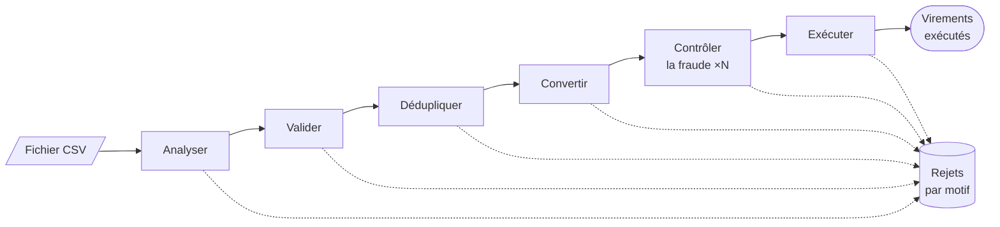

# 20. Pipeline (pipes & filters)

> **En une phrase** : un traitement est découpé en **filtres** indépendants, chacun faisant une seule chose, reliés par
> des **tuyaux** ; les données coulent de l'un à l'autre, chaque filtre travaillant **en même temps** que les autres sur
> un élément différent, comme une chaîne de montage.

📁 Code : [`20-Pipeline`](../20-Pipeline) · ⬅️ [Architecture spatiale](19-space-based.md) · ➡️ [Chorégraphie](21-choregraphie.md) · 🌐 [English](en/20-pipeline.md)

---

## L'idée : une chaîne de montage

C'est la plus ancienne des architectures de ce dépôt : celle du shell Unix (`cat virements.csv | grep EUR | sort | uniq`),
des compilateurs (analyse lexicale → syntaxique → sémantique → génération), des ETL et des traitements de flux. Elle ne
s'applique pas à une application entière, mais à un **traitement de données** : ici, l'import d'un fichier de virements
envoyé par une entreprise (des milliers de lignes à contrôler puis exécuter).



Trois règles font l'architecture :

- un **filtre** ne connaît ni sa source, ni sa destination, ni les autres filtres : il reçoit un élément, en produit un
  autre, ou le **rejette** ;
- un **tuyau** relie deux filtres, et il est **borné** : quand il est plein, le filtre d'avant attend ;
- tous les filtres travaillent **en même temps** : pendant qu'*Exécuter* traite la ligne 1, *Contrôler la fraude* traite
  la 2, *Convertir* la 3…

| | Un traitement, c'est… | Pour l'accélérer… |
|---|---|---|
| Un service classique | une méthode qui fait tout, ligne après ligne | optimiser la méthode |
| **Pipeline** | une suite de filtres qui travaillent en parallèle | trouver le **goulot** et paralléliser **cet** étage |

---

## Les composants

- **Le moteur** ([Pipeline.Noyau](../20-Pipeline/Pipeline.Noyau), générique, sans package, sur `System.Threading.Channels`) :
  [`IFiltre`](../20-Pipeline/Pipeline.Noyau/Filtre.cs), les étages et leurs tuyaux bornés
  ([Etage.cs](../20-Pipeline/Pipeline.Noyau/Etage.cs)), l'assemblage et l'exécution ([Pipeline.cs](../20-Pipeline/Pipeline.Noyau/Pipeline.cs)).
- **Les filtres bancaires** ([Filtres.cs](../20-Pipeline/Pipeline.Banque/Filtres.cs)) et leur assemblage
  ([Imports.cs](../20-Pipeline/Pipeline.Banque/Imports.cs)).
- **L'API** ([Endpoints.cs](../20-Pipeline/Pipeline.Api/Endpoints.cs)) : le corps de `POST /imports` *est* le fichier,
  lu ligne à ligne pendant qu'il arrive.

Un filtre se résume à une méthode :

```csharp
public interface IFiltre<in TEntree, TSortie>
{
    string Nom { get; }

    /// <summary>Un rejet est un résultat normal (la ligne est écartée, le flux continue) ; une exception arrête tout le pipeline.</summary>
    ValueTask<Issue<TSortie>> Traiter(TEntree entree, CancellationToken annulation);
}
```

L'assemblage se lit comme le schéma, et le compilateur vérifie que la sortie de chaque filtre est l'entrée du suivant :

```csharp
Noyau.Pipeline.Depuis<string>()
    .Puis(new Analyser())
    .Puis(new Valider())
    .Puis(new Dedupliquer(registre))
    .Puis(new Convertir())
    .Puis(new ControlerFraude(options.CoutScoring), options.ParallelismeFraude, options.Ordonne);
```

En production : **TPL Dataflow** ou les **Channels** directement dans un processus, **Akka Streams** ; à l'échelle d'un
système, les filtres deviennent des services et les tuyaux des files ou des flux (**Kafka Streams**, **Apache Beam**,
**Azure Data Factory**, les pipelines d'ETL et de CI).

---

## 1. Les rejets : écarter une ligne sans arrêter le fichier

Une ligne fautive n'interrompt pas l'import : le filtre qui la détecte la **rejette** avec un motif, et le flux continue.
Le bilan compte les rejets par motif et garde les premiers, avec leur ligne et le filtre qui les a écartés. **Essai
réel** avec [Virements-exemple.csv](../20-Pipeline/Pipeline.Api/Virements-exemple.csv) (11 lignes) :

```text
ligne 3   Analyser              ligne mal formée              montant « douze » illisible
ligne 4   Valider               IBAN invalide                 FR7630006000011234567890188
ligne 5   Valider               comptes identiques
ligne 6   Dédupliquer           doublon                       dans le fichier
ligne 7   Convertir             devise inconnue               JPY
ligne 8   Contrôler la fraude   bénéficiaire sur liste noire
ligne 9   Contrôler la fraude   plafond dépassé               10530,00 €
ligne 10  Exécuter              solde insuffisant             VIR-009
→ 3 virements exécutés : Alice 842,80 €, Bob 657,20 €
```

Une **exception**, elle, signale une panne : tout le pipeline s'arrête (le premier étage en échec annule les autres).

```csharp
// Le premier étage qui échoue arrête tous les autres.
foreach (var tache in taches)
    _ = tache.ContinueWith(_ => arret.Cancel(), TaskContinuationOptions.OnlyOnFaulted);
```

---

## 2. Recomposer : les mêmes filtres, un autre pipeline

Les filtres ne se connaissant pas, on les réassemble à volonté. L'**import à blanc** (`POST /imports?aBlanc=true`)
est le même pipeline **sans le dernier filtre** : il dit ce qui serait rejeté, sans toucher à un seul compte.

```csharp
public static Pipeline<string, Virement> ABlanc(Registre registre, OptionsImport options) => Controles(registre, options).Construire();
```

De même, la panne simulée de la démo est un filtre inséré avant *Exécuter*, et les tests assemblent leurs propres
pipelines avec des filtres de test. Deux conseils d'assemblage :

- **les filtres bon marché d'abord** : ce qu'*Analyser* ou *Dédupliquer* rejettent n'atteint pas le coûteux contrôle de fraude ;
- les filtres sont indépendants, mais le pipeline a un **ordre logique** : *Exécuter* suppose que *Convertir* est passé
  (montant en euros). Il vérifie donc sa précondition plutôt que de faire confiance à l'assemblage (test
  `Executer_refuse_un_virement_qui_n_est_pas_passe_par_la_conversion`, écrit après que ce piège s'est présenté).

---

## 3. La contre-pression : un fichier de taille quelconque, une mémoire bornée

Les tuyaux contiennent au plus 64 éléments. Quand un étage est plus lent que le précédent, son tuyau d'entrée se
remplit, et l'étage d'avant **attend** pour écrire ; l'attente remonte jusqu'à la lecture du fichier.

```csharp
/// <summary>Écrire dans un tuyau plein BLOQUE : l'étage attend que le suivant ait de la place. C'est la contre-pression.</summary>
private async Task Ecrire(ChannelWriter<Element<TSortie>> sortie, Element<TSortie> element, ContexteExecution contexte)
{
    var debut = Stopwatch.GetTimestamp();
    await sortie.WriteAsync(element, contexte.Annulation);
```

Résultat : le fichier n'est jamais chargé en entier. **Essai réel**, 100 000 lignes générées à la volée : au plus
**330 à 375 lignes en mémoire** à la fois selon le parallélisme (`maxEnTransit`), et ce serait pareil pour 10 millions.

---

## 4. Le goulot, et le parallélisme d'un étage

Le débit d'un pipeline est celui de son **étage le plus lent**. Le bilan mesure, pour chaque étage, son temps de
traitement et son temps d'attente du tuyau suivant. **Essai réel**, 100 000 lignes :

```text
1 copie du contrôle de fraude : 4 117 ms (24 000 lignes/s)
   Analyser               occupation 0,02   attente du suivant 3 976 ms
   Valider                occupation 0,05   attente du suivant 3 847 ms
   Contrôler la fraude    occupation 0,94   ← le goulot
   Exécuter               occupation 0,01
8 copies : 763 ms (131 000 lignes/s), même résultat
```

Les étages rapides passent leur temps à attendre : seul le goulot compte. Un filtre **sans état** (comme le contrôle de
fraude) peut tourner en **plusieurs copies** ; un filtre à état (*Dédupliquer*, *Exécuter*) reste unique. Et une fois le
goulot élargi, un autre prend sa place : avec un score de fraude léger, le goulot devient *Valider* (le calcul des IBAN),
et ajouter des copies de fraude ne sert plus à rien.

Le piège : plusieurs copies finissent dans le désordre. Or **l'ordre du fichier compte** : si Alice vire 600 € à Bob
ligne 1, et Bob 1 000 € ligne 2, la ligne 2 n'est possible qu'après la 1. L'étage parallèle numérote donc les éléments
et les fait ressortir dans l'ordre d'arrivée :

```csharp
while (enAvance.Remove(attendu, out var suivant))
{
    if (suivant is not null)
        await Ecrire(sortie, suivant, contexte);
    attendu++;
    fenetre.Release();
}
```

Sans cela, la ligne 2 arrive la première à *Exécuter* et est rejetée (test
`L_ordre_du_fichier_compte_et_l_etage_parallele_ordonne_le_respecte`). Paralléliser ne change donc pas le résultat
(test `Paralleliser_le_controle_de_fraude_ne_change_pas_le_resultat`).

---

## 5. La reprise après une panne

Un import peut s'arrêter au milieu (panne, déploiement, base indisponible). Une partie des lignes est exécutée, pas les
autres. Le remède est l'**idempotence** : *Dédupliquer* écarte toute référence déjà exécutée, et le registre refuse en
dernier recours d'exécuter deux fois la même. On **rejoue simplement le fichier**. Essai réel :

```text
POST /imports?panneALaReference=VIR-010   → 500, « Panne simulée en traitant VIR-010. », bilan : 0 exécuté
GET  /comptes/<Alice>                      → 880 € : VIR-001 avait pourtant été exécuté
POST /imports                              → 2 exécutés, doublons : 2 ; Alice 842,80 €, Bob 657,20 € (comme sans panne)
```

⚠ Le bilan d'un import **échoué** dit ce qui est *sorti* du pipeline, pas ce qui a été *fait* : VIR-001 était exécuté,
mais sa sortie attendait encore dans le dernier tuyau quand l'arrêt a tout coupé. Seul le registre fait foi : c'est
pourquoi la reprise s'appuie sur les références exécutées, et non sur le bilan.

---

## Les tests

Le moteur avec des filtres de test ([NoyauTests.cs](../20-Pipeline/Pipeline.Tests/NoyauTests.cs)), les filtres
bancaires assemblés comme dans l'API ([ImportTests.cs](../20-Pipeline/Pipeline.Tests/ImportTests.cs)), et l'API
([ApiTests.cs](../20-Pipeline/Pipeline.Tests/ApiTests.cs)).

| Test | Ce qui est vérifié |
|---|---|
| `Les_elements_traversent_les_filtres_dans_l_ordre`, `Un_rejet_ecarte_l_element_sans_arreter_le_flux` | le flux, les rejets par motif |
| `Les_etages_travaillent_en_meme_temps_chacun_sur_un_element` | 3 étages occupés en même temps |
| `La_contre_pression_borne_ce_qui_est_en_memoire` | 20 000 éléments, au plus 37 en transit |
| `Un_etage_parallele_ordonne_rend_les_elements_dans_leur_ordre_d_arrivee` | ordonné ou non, avec un élément très lent |
| `Une_exception_dans_un_filtre_arrete_tout_le_pipeline`, `L_annulation_arrete_un_flux_sans_fin` | panne, annulation |
| `Le_goulot_est_l_etage_le_plus_occupe_et_chaque_execution_a_ses_compteurs` | mesures |
| `Le_fichier_d_exemple_donne_trois_virements_et_un_rejet_par_motif` | chaque rejet par le bon filtre, soldes |
| `Rejouer_un_fichier_n_execute_rien_deux_fois`, `Le_registre_n_execute_jamais_deux_fois_la_meme_reference` | idempotence, à deux niveaux |
| `Apres_une_panne_en_plein_import_le_rejeu_termine_sans_rien_executer_deux_fois` | reprise |
| `Un_import_a_blanc_dit_ce_qui_passerait_sans_rien_modifier` | recomposition |
| `L_ordre_du_fichier_compte_et_l_etage_parallele_ordonne_le_respecte`, `Paralleliser_le_controle_de_fraude_ne_change_pas_le_resultat` | ordre et déterminisme |
| `Executer_refuse_un_virement_qui_n_est_pas_passe_par_la_conversion` | précondition d'un filtre |
| `Un_gros_fichier_passe_en_flux_avec_une_memoire_bornee` | 20 000 lignes, rejets attendus, argent conservé |
| `La_cle_d_un_iban_est_verifiee` | modulo 97 |
| `Un_import_execute_le_fichier_et_garde_son_compte_rendu`, `Un_import_a_blanc_ne_touche_a_aucun_compte`, `Une_panne_repond_500_avec_le_compte_rendu`, `La_demo_de_l_import_massif_designe_le_goulot` | l'API |

Vérifiés par mutation : tuyaux non bornés, étage parallèle jamais ordonné, panne sans arrêt des autres étages, chacune
des deux protections contre les doublons, précondition de conversion, rejet qui ne libère pas sa place, compteurs
partagés entre exécutions, en-tête du fichier non sauté, liste noire, comptage des rejets : chacun fait échouer au moins
un test.

---

## Bilan

| 👍 Points forts | 👎 Limites |
|---|---|
| Filtres **simples**, testables un par un, **réutilisables** et réassemblables | Pour des traitements en flux seulement, pas pour une application interactive |
| **Débit** : tous les étages en même temps ; on parallélise le goulot, et lui seul | Le débit est celui du plus lent ; chaque tuyau a un coût (copie, synchronisation) |
| **Mémoire bornée** par la contre-pression, quelle que soit la taille des données | Filtres à état (dédoublonnage, exécution) : uniques, et ordre à préserver |
| Rejets par motif, mesures par étage : on voit où ça coince | Une panne au milieu laisse un travail partiel : idempotence obligatoire pour rejouer |

**Quand l'utiliser** : imports et exports de fichiers, ETL, traitements par lots (relevés, paie, facturation),
traitement de flux d'événements, de médias ou de journaux, compilateurs. Partout où des données passent par une suite
d'étapes indépendantes. Ce n'est pas une architecture d'application à part entière : on loge un pipeline dans un
service ou un module, organisé lui-même selon une autre démo.
