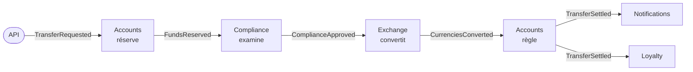

# 21. Chorégraphie (événementiel pur)

**Nom anglais** : *Event-Driven Choreography*

> **En une phrase** : aucun service ne conduit le processus ; chacun **réagit aux événements** des autres et publie les
> siens, et le virement avance de réaction en réaction, comme des danseurs qui suivent la musique sans chef d'orchestre.

📁 Code : [`21-Choreography`](../21-Choreography) · ⬅️ [Pipeline](20-pipeline.md) · ➡️ [Strangler Fig](22-strangler-fig.md) · 🌐 [English](en/21-choregraphie.md)

---

## L'idée : le même virement que la démo 14, sans orchestrateur

La [saga orchestrée](14-saga-orchestree.md) confie le processus à un orchestrateur qui appelle chaque service à son tour.
Ici, le **même processus**, avec les mêmes données (Alice 50 000 €, Bob 500 €, Carla 1 000 $) et les mêmes règles
(analyste au-delà de 10 000 €, mêmes taux de change), est écrit… **nulle part**. Il émerge des abonnements :



Chaque flèche est un événement publié **sans savoir qui l'écoute**. Les démos 7 et 8 utilisaient déjà la chorégraphie,
mais seulement pour **notifier** (« un virement a eu lieu ») ; ici, elle **conduit** tout un processus métier, avec
attente humaine, compensations et pannes. C'est là qu'on voit ses forces et ses limites.

| | [Orchestration (démo 14)](14-saga-orchestree.md) | **Chorégraphie (cette démo)** |
|---|---|---|
| Le processus est écrit… | en un seul endroit (la définition de la saga) | **nulle part** : il émerge des abonnements |
| Un service connaît… | l'orchestrateur connaît tous les participants | **personne** ; seulement les contrats d'événements |
| Ajouter une réaction | modifier la définition | **s'abonner**, sans toucher aux autres |
| « Où en est le virement 42 ? » | l'état de la saga, stocké | une **projection** à construire (le Suivi) |
| Compensation | écrite à côté de chaque étape, déclenchée par le moteur | **dispersée** : chaque service sait quels événements défont son travail |
| Un participant en panne | le moteur réessaie, puis compense | **silence** : le processus reste en plan jusqu'à un délai d'expiration |
| Point unique de défaillance | l'orchestrateur | le courtier de messages |

---

## Les composants

- **Le courtier** ([Bus.cs](../21-Choreography/Choreo.Bus/Bus.cs), simulé dans le processus, sans package) : une file
  **par abonné** (un abonné lent ne retarde pas les autres), livraison « au moins une fois », nouveaux essais, lettres
  mortes, et le journal de tous les événements.
- **Les contrats** ([Contracts.cs](../21-Choreography/Choreo.Services/Contracts.cs)) : la forme des événements, seul
  code partagé. Chaque événement transporte **toutes les données du virement**, complétées au fil de l'eau (devises,
  montant en euros, puis montant converti) : chaque service y trouve ce qu'il lui faut sans rappeler personne.
- **Les services** ([Accounts.cs](../21-Choreography/Choreo.Services/Accounts.cs),
  [Others.cs](../21-Choreography/Choreo.Services/Others.cs)) : Comptes, Conformité, Change, Notifications, Fidélité,
  chacun dans son espace de noms, avec ses données. Un test d'architecture vérifie qu'aucun ne connaît les autres.
- **Le Suivi** ([Tracking.cs](../21-Choreography/Choreo.Services/Tracking.cs)) : il écoute tout et reconstitue l'état de
  chaque virement. Il observe, il ne décide rien.

Un service, c'est une liste d'abonnements. Voici tout ce que Comptes écoute :

```csharp
Bus.Subscribe<TransferRequested>(Name, Reserve);
Bus.Subscribe<ComplianceRefused>(Name, e => Release(e, e.Reason));  // compensation
Bus.Subscribe<ExchangeFailed>(Name, e => Release(e, e.Reason));       // compensation
Bus.Subscribe<CurrenciesConverted>(Name, Settle);
```

En production : **RabbitMQ**, **Azure Service Bus** ou **Kafka**, avec **MassTransit**, **NServiceBus**, **Wolverine**
ou **Dapr** pour les abonnements, les nouveaux essais et les boîtes de réception.

---

## 1. Le processus n'existe que dans les réactions

Chaque événement porte la **corrélation** (le virement) et sa **cause** (l'événement auquel il répond) :

```csharp
/// <summary>A new event, in reaction to this one: same correlation, and this one as cause.</summary>
public T Next<T>(T next, string emitter) where T : Event =>
    next with { Correlation = Correlation, Cause = Id, Emitter = emitter };
```

C'est le seul fil qui permet de raconter ce qui s'est passé. **Essai réel**, `GET /transfers/{id}` :

```text
TransferRequested                      ← API
  FundsReserved                        ← Accounts, en réaction à TransferRequested
    ComplianceApproved                 ← Compliance
      CurrenciesConverted              ← Exchange
        TransferSettled                ← Accounts
          CustomerNotified             ← Notifications : « Transfer of 100,00 EUR done (108,32 USD received). »
```

Pour savoir **où en est** un virement, il faut un service de plus, le **Suivi**, qui écoute tous les événements (une
projection, comme en [CQRS](09-cqrs.md)). Son revers : il doit connaître chaque type d'événement. Ajouter une étape au
processus, c'est aussi penser à lui.

La seule « carte » du système est la liste des abonnements, et elle n'existe qu'à l'exécution (`GET /bus`) :

```text
Accounts       écoute ComplianceRefused, CurrenciesConverted, ExchangeFailed, TransferRequested
Compliance     écoute FundsReserved, ReservationExpired
Exchange       écoute ComplianceApproved
Loyalty        écoute TransferSettled
Notifications  écoute TransferSettled
Tracking       écoute les 13 types d'événements
```

---

## 2. Des compensations dispersées

Pas de moteur qui défait les étapes en ordre inverse : chaque service doit savoir **quels événements des autres
signifient « défais ce que tu as fait »**. Comptes libère la réservation sur `ComplianceRefused` **et** sur
`ExchangeFailed` ; si demain un nouveau service peut échouer, il faudra penser à l'abonner aussi. Essai réel :

```text
Alice → Mallory (liste noire)    TransferRequested → FundsReserved → ComplianceRefused → FundsReleased    Cancelled
Alice → Yuki (yens, non cotés)   … → ComplianceApproved → ExchangeFailed → FundsReleased                 Cancelled
Bob → Alice, 900 € (solde 500)   TransferRequested → FundsRefused                                        Refused
```

Comme dans la démo 14, les fonds sont d'abord **réservés** (indisponibles pour un autre virement, test
`Reserved_money_is_no_longer_available_for_another_transfer`), et seulement débités au règlement : le point de
non-retour. Après lui (notification), on réessaie, on ne défait rien.

---

## 3. Quand un service se tait

Avec un orchestrateur, un participant en panne est réessayé puis compensé : quelqu'un attend sa réponse. Ici,
**personne n'attend personne**. Le change tombe en panne : le courtier réessaie 4 fois, met l'événement aux lettres
mortes… et c'est tout. Essai réel :

```text
POST /chaos { "exchangeDown": true } ; POST /transfers (200 €)   → statut InProgress, 200 € réservés sur le compte d'Alice
GET /bus/dead-letters          → Exchange, 4 tentatives, « Exchange service unavailable. »
GET /transfers/stuck           → le virement, sans activité récente
… 30 s plus tard               → ReservationExpired (émise par Accounts, sans cause) : Abandoned, 0 € réservé
```

Le filet de sécurité est **local** : Comptes se protège lui-même en donnant une durée de vie à ses réservations.

```csharp
expired = _reservations.Where(r => r.Value.ExpiresAt <= now).ToList()
```

Et les autres services doivent en tenir compte : la Conformité écoute `ReservationExpired` pour ne plus faire décider
un analyste sur un virement abandonné ; Comptes refuse un règlement arrivé trop tard (`TransferAbandoned`) ; le Suivi
ne rouvre pas un virement terminé. Chacun de ces cas est un **test**, et chacun a demandé une ligne de code à un
service différent : c'est le coût caché de la chorégraphie.

---

## 4. Livré deux fois, traité une fois

Les vrais courtiers livrent « au moins une fois » : après une coupure, un message peut arriver deux fois. Chaque service
garde donc les identifiants des événements déjà traités (sa « boîte de réception »), et change son état **et** publie
la suite d'un seul tenant :

```csharp
lock (Lock)
{
    if (_handled.Contains(received.Id))
        return;
    if (react() is { } next)
        Bus.Publish(next);
    _handled.Add(received.Id);
}
```

Test `Events_delivered_twice_produce_their_effect_only_once` : avec un courtier qui livre **chaque**
événement deux fois, 20 virements de 10 € donnent exactement 200 € débités, 20 notifications, 20 points de fidélité.
(Dans un vrai service avec une base, « d'un seul tenant » demande l'outbox de la [démo 8](08-microservices.md).)

---

## 5. Ajouter un participant sans toucher aux autres

Le service Fidélité (des points sur chaque virement réglé) a été ajouté **après coup**. Il s'abonne, c'est tout :

```csharp
public void Register() => Bus.Subscribe<TransferSettled>(Name, e => Once(e, () =>
```

Aucun autre service n'a changé, aucun ne sait qu'il existe : le test `Adding_a_subscriber_changes_nothing_for_the_others`
fait tourner le système avec et sans lui, et obtient exactement les mêmes événements. C'est l'atout majeur de la
chorégraphie, et la raison pour laquelle elle convient si bien aux **réactions** (notifier, compter, archiver,
alimenter un tableau de bord) plutôt qu'aux processus.

---

## Les tests

Les services et le bus sans HTTP, avec une horloge manuelle pour l'expiration
([ChoreographyTests.cs](../21-Choreography/Choreo.Tests/ChoreographyTests.cs)), et l'API
([ApiTests.cs](../21-Choreography/Choreo.Tests/ApiTests.cs)).

| Test | Ce qui est vérifié |
|---|---|
| `A_transfer_moves_forward_through_chain_reactions_without_anyone_driving_it` | les 6 événements, leurs émetteurs, la chaîne des causes |
| `A_compliance_refusal_is_compensated_by_the_accounts_service`, `An_exchange_failure_is_compensated_too` | compensations |
| `An_insufficient_balance_stops_everything_from_the_first_reaction`, `Reserved_money_is_no_longer_available_for_another_transfer` | réservation |
| `A_big_transfer_waits_for_an_analyst_decision` | attente humaine, approbation et refus |
| `A_failed_service_blocks_the_process_until_the_reservation_expires` | lettres mortes, virement bloqué, expiration |
| `After_the_expiry_neither_the_analyst_nor_a_late_message_settles_the_transfer` | les cas tardifs, dans trois services |
| `Events_delivered_twice_produce_their_effect_only_once` | boîte de réception |
| `After_the_point_of_no_return_a_failed_notification_is_retried_never_compensated` | nouveaux essais, lettres mortes |
| `Adding_a_subscriber_changes_nothing_for_the_others` | extensibilité |
| `No_service_knows_the_others` | **test d'architecture** (réflexion) |
| `Requesting_a_transfer_answers_202_and_the_rest_happens_without_the_caller`, `The_analyst_decides_through_the_API`, `A_failed_service_shows_in_the_dead_letters_and_the_stuck_transfers`, `The_bus_shows_who_listens_to_what` | l'API |

Vérifiés par mutation : pas de boîte de réception, chacune des deux compensations, expiration qui ne rend pas l'argent
ou n'a pas lieu, conformité sourde à l'expiration, règlement tardif silencieux, Suivi qui rouvre un virement terminé,
courtier sans nouvel essai, un service qui en référence un autre, réservation qui ignore l'argent déjà réservé : chacun
fait échouer au moins un test.

---

## Bilan

| 👍 Points forts | 👎 Limites |
|---|---|
| **Couplage minimal** : les services ne se connaissent pas | Le processus n'est écrit nulle part : difficile à comprendre, à modifier |
| **Ajouter une réaction** = s'abonner, sans toucher à rien | Compensations et délais **dispersés** dans les services |
| Pas de chef d'orchestre à exploiter ni à rendre disponible | Une panne se traduit par du **silence** : il faut surveiller (lettres mortes, virements bloqués) |
| Chaque service avance à son rythme, indépendamment | Suivre un processus demande une projection, et la traçabilité des causes |

**Quand l'utiliser** : pour les **réactions** à un fait (notifier, facturer, archiver, alimenter un entrepôt de données,
synchroniser un autre système), et les processus courts, stables, à peu de participants. Dès qu'un processus a de
nombreuses étapes, des attentes, des délais et des règles d'échec, l'[orchestration](14-saga-orchestree.md) est plus
sûre. Les deux se combinent souvent : un orchestrateur conduit le processus, et publie des événements que d'autres
services, eux, chorégraphient.
