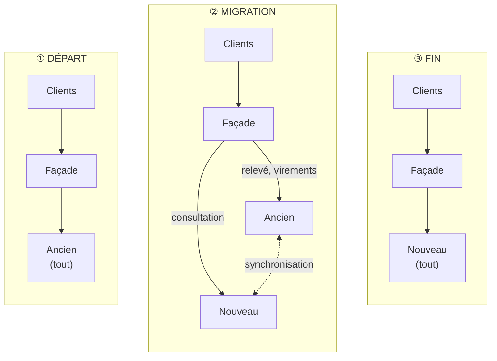
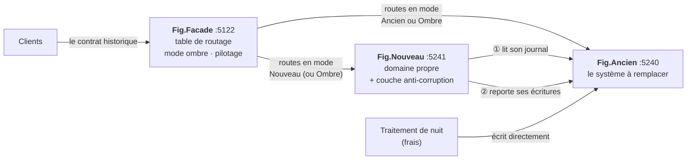
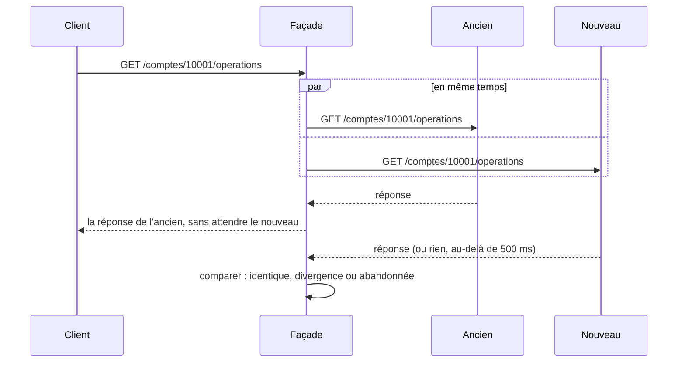
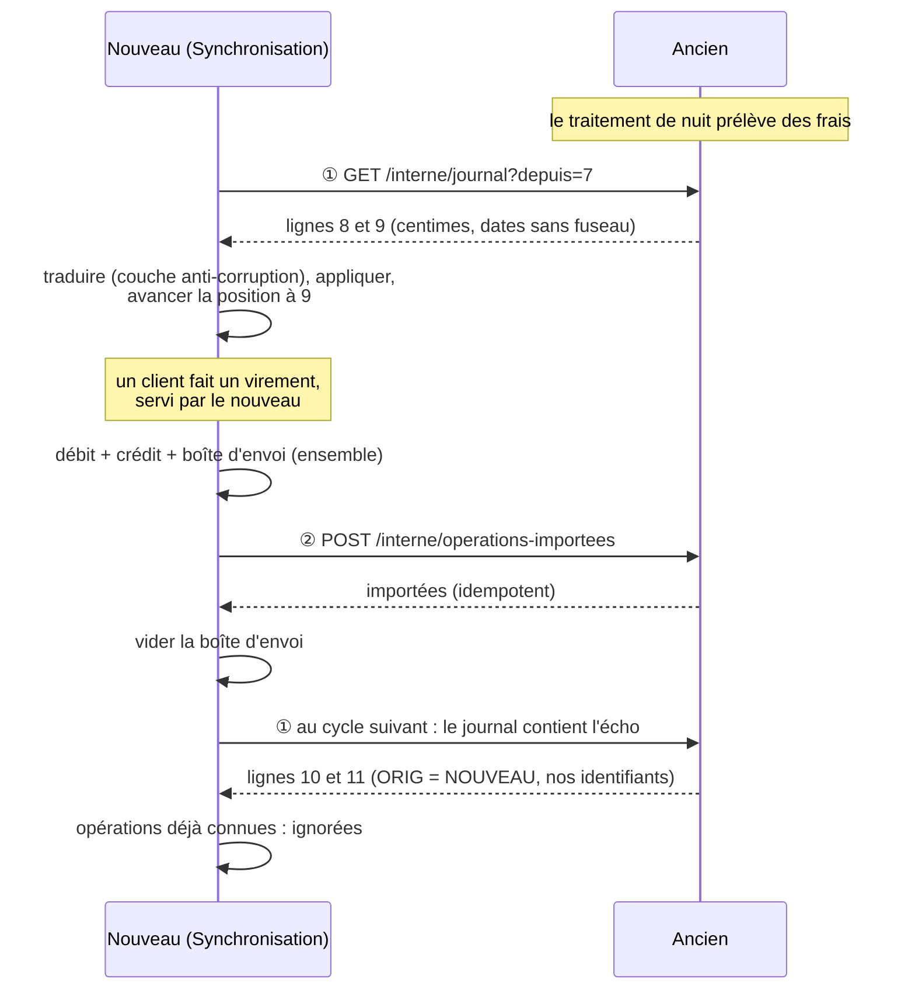

# 22. Strangler Fig (migration progressive)

> **En une phrase** : pour remplacer un vieux système sans tout réécrire d'un coup, on place une **façade** devant lui,
> puis on lui retire ses fonctions **une route à la fois** au profit d'un nouveau service, jusqu'au jour où il ne sert
> plus à rien et qu'on peut l'éteindre.

📁 Code : [`22-StranglerFig`](../22-StranglerFig) · ⬅️ [Chorégraphie](21-choregraphie.md) · ➡️ [REST, gRPC, GraphQL](23-rest-grpc-graphql.md) · 🌐 [English](en/22-strangler-fig.md)

---

## L'idée

Le figuier étrangleur germe dans les branches d'un arbre, descend ses racines jusqu'au sol, enveloppe peu à peu son hôte
et finit par tenir debout tout seul quand l'arbre a disparu. Martin Fowler en a tiré le nom de ce schéma de migration (2004).

Toutes les autres démos construisent un système **neuf**. Celle-ci répond à la question qu'on rencontre bien plus
souvent : **comment passer d'un système existant à l'une de ces architectures ?** La tentation est la réécriture complète,
livrée en une fois (« big bang ») : des mois sans rien livrer, un ancien système qui continue d'évoluer pendant ce temps,
et une bascule finale où tout se joue en une nuit, sans retour possible.



Le Strangler Fig remplace ce saut par une suite de petits pas : chaque fonction migrée est **en production** tout de
suite, sur du vrai trafic, et chaque pas peut être **annulé** en une requête. Les clients ne voient jamais la différence :
ils ne parlent qu'à la façade, dont l'adresse ne change pas.

---

## Les projets



| Projet | Rôle |
|---|---|
| [Fig.Ancien](../22-StranglerFig/Fig.Ancien) | Le système à remplacer, écrit « à l'ancienne » : une classe qui fait tout, montants en centimes, dates sans fuseau, libellés en majuscules tronqués à 30 caractères. Il n'a reçu que deux routes internes pour la migration (son journal des modifications, l'import des opérations du nouveau) |
| [Fig.Nouveau](../22-StranglerFig/Fig.Nouveau) | Le remplaçant : son propre modèle (euros en `decimal`, dates avec fuseau), sa propre base, et le contrat historique reproduit à l'identique |
| [Fig.Facade](../22-StranglerFig/Fig.Facade) | Le seul point d'entrée des clients : relais HTTP, table de routage modifiable à chaud, comparaisons du mode ombre, suivi de la migration. Aucune logique métier |

Aucun des trois ne référence les autres : la façade et le nouveau service ne connaissent l'ancien que par HTTP (test
d'architecture). Le jour où l'ancien s'éteint, on supprime son projet et la couche anti-corruption ; rien d'autre ne
compile contre lui.

---

## 1. La façade : une table de routage

Chaque route a un **mode** : qui répond. On le change à chaud (`PUT /facade/routes/{nom}`), sans redéployer ni redémarrer.

| Mode | Qui répond | Le nouveau service… |
|---|---|---|
| `Ancien` | l'ancien | n'est pas appelé |
| `Ombre` | l'ancien | est appelé **en même temps**, sa réponse est comparée puis jetée |
| `Nouveau` | le nouveau | répond ; l'ancien n'est plus appelé pour cette route |

Et surtout : **ce qui n'est pas déclaré va à l'ancien**. C'est le point de départ du schéma (une façade vide, qui relaie
tout), et la protection contre ce qu'on n'a pas recensé. ([Relais.cs](../22-StranglerFig/Fig.Facade/Relais.cs))

```csharp
var route = table.Find(http.Request.Method, path);
var mode = route?.Mode ?? Mode.Legacy;   // what nobody took over stays with the legacy system: that is the starting point
```

Chaque réponse porte l'en-tête `X-Servi-Par: ancien` ou `nouveau`, et la façade compte, route par route, combien
d'appels chaque système a servis (`GET /facade/routes`). Les routes `/interne/*` des deux systèmes ne sont jamais
relayées : un client ne peut pas lire le journal de l'ancien ni déclencher ses frais à travers la façade.

La table de départ, dans `appsettings.json`, montre une migration en cours :

| Route | Méthode et chemin | Mode |
|---|---|---|
| `consultation` | `GET /comptes/{numero}` | Nouveau |
| `operations` | `GET /comptes/{numero}/operations` | Ombre |
| `releve` | `GET /comptes/{numero}/releve` | Ancien |
| `virements` | `POST /virements` | Ancien |
| *(non déclarée)* | `GET /agences`, et tout le reste | Ancien |

---

## 2. Le mode ombre : prouver avant de basculer

Les tests de contrat (section 4) vérifient les cas qu'on a pensé à écrire. Le mode ombre vérifie **tous ceux que le
trafic réel produit** : la façade appelle les deux systèmes, renvoie la réponse de l'ancien, et compare.



```csharp
// Both calls leave at the same time; the client only waits for the legacy system.
var budget = new CancellationTokenSource(options.ShadowBudgetMs);
var shadow = Send("modern", Message(http.Request, body), budget.Token);
```

```csharp
// Compared AFTERWARDS, without being awaited: a slow or failed modern service slows nobody down.
_ = comparer.Compare(route!.Name, $"{http.Request.Method} {path}{http.Request.QueryString}", response, shadow, budget);
```

`GET /facade/comparaisons` donne le bilan : réponses identiques, **divergences** (avec les deux corps, pour enquêter) et
appels **abandonnés** (le nouveau a dépassé son budget ou n'a pas répondu ; ce n'est pas une divergence, mais c'est à
surveiller avant de lui confier la charge). Le JSON est comparé en structure : l'ordre des propriétés et les espaces ne
comptent pas, les valeurs si.

**Seule une lecture a un mode ombre.** Exécuter un virement des deux côtés débiterait deux fois : la façade refuse
(`400`) de passer une écriture en mode ombre. ([TableDeRoutage.cs](../22-StranglerFig/Fig.Facade/TableDeRoutage.cs))

```csharp
// A write has no "shadow" mode: executing it on both sides would make two transfers.
private static void Check(Route route, Mode mode)
{
    if (mode == Mode.Shadow && route.Method != "GET")
```

Pour les écritures, la confiance vient des tests de contrat, puis d'une bascule prudente, réversible à tout instant.

---

## 3. Deux bases, une seule vérité : synchroniser dans les deux sens

Pendant la migration, les deux systèmes ont chacun leurs données, et chacun écrit : l'ancien pour ses routes pas encore
migrées **et pour ses traitements internes** (ici, les frais prélevés la nuit, qui ne passent jamais par la façade) ; le
nouveau pour ses routes migrées. Il faut donc synchroniser **dans les deux sens**.



([Synchronisation.cs](../22-StranglerFig/Fig.Nouveau/Synchronisation.cs))

```csharp
// ② Forward our writes. If the legacy system does not answer, they stay in the outbox for the next
//    cycle; the import being idempotent, a batch sent again is not counted twice.
var toForward = store.ToForward();
if (toForward.Count > 0)
{
    await legacy.Import(toForward.Select(LegacyTranslator.ToLegacy).ToList(), cancellation);
    store.MarkForwarded(toForward);
}
```

Les pièges de ce double sens sont ceux de tout système distribué, et chacun a son test :

| Piège | Parade | Test |
|---|---|---|
| Une écriture du nouveau revient par le journal de l'ancien (**boucle**) | l'écho porte l'identifiant du nouveau, déjà connu : ignoré | `L_echo_d_un_virement_du_nouveau_ne_revient_pas_en_double` |
| L'ancien est injoignable au moment du report | **boîte d'envoi** : remplie avec le virement, vidée seulement après confirmation | `Si_l_ancien_est_injoignable_les_operations_attendent_le_cycle_suivant` |
| L'ancien a importé, mais la réponse s'est perdue | **import idempotent** : le lot renvoyé n'est compté qu'une fois | `Un_lot_renvoye_apres_une_reponse_perdue_n_est_importe_qu_une_fois` |
| Une ligne de journal inconnue | la synchronisation **s'arrête** plutôt que d'ignorer la ligne : un retard visible vaut mieux qu'un écart silencieux | `Un_type_inconnu_arrete_la_traduction_au_lieu_d_etre_ignore` |

Ce journal des modifications est la version simplifiée d'une **capture des changements** (*Change Data Capture*,
Debezium sur le journal de transactions de la base, par exemple). Le premier cycle relit tout depuis le début : c'est
la reprise initiale des données.

### La couche anti-corruption

Le journal de l'ancien parle sa langue : colonnes à six lettres (`NUMCPT`, `MNTCTS`, `DATOPE`), centimes, heure de Paris
sans fuseau. Une seule classe la traduit, dans les deux sens, et le modèle du nouveau n'en voit rien (la même idée que
dans la [démo DDD](11-ddd.md)). ([CoucheAntiCorruption.cs](../22-StranglerFig/Fig.Nouveau/CoucheAntiCorruption.cs))

```csharp
/// <summary>The legacy system notes Paris time without time zone: this is where we decide which instant it is.</summary>
public static DateTimeOffset DateFromLegacy(string text)
{
    var local = DateTime.ParseExact(text, DateFormat, CultureInfo.InvariantCulture);
    return new DateTimeOffset(local, Paris.GetUtcOffset(local));
}
```

---

## 4. Reproduire le contrat hérité, habitudes comprises

Les clients dépendent de l'API de l'ancien **telle qu'elle est**, y compris ses bizarreries. Le nouveau service a son
propre modèle, mais il expose le contrat historique à l'identique : c'est ce qui permet de basculer une route sans
prévenir personne. ([Contrat.cs](../22-StranglerFig/Fig.Nouveau/Contrat.cs))

| Habitude de l'ancien | Ce que le nouveau doit faire |
|---|---|
| Calcule en centimes, puis divise par 100 : `947.1` dans le JSON | ne jamais écrire `947.10`, même si le client a envoyé `70.10` |
| Dates à l'heure de Paris, sans fuseau : `2026-10-12T10:05:00` | convertir depuis son `DateTimeOffset` ; une opération du 31 octobre à 23 h 30 UTC est sur le relevé de **novembre** |
| Libellés en majuscules, tronqués à 30 caractères | garder les libellés tels qu'ils viennent de l'ancien, écrire les siens au même format |
| Opérations triées par date, la plus récente d'abord | trier par date, et non par ordre d'arrivée (une opération de l'ancien peut arriver après un virement plus récent) |
| Erreurs en majuscules : `{"erreur":"SOLDE INSUFFISANT"}` | mêmes statuts, mêmes messages |
| Relevé en texte, colonnes alignées, fins de ligne `\r\n`, montants à virgule (« 1000,00 ») | le même texte, au caractère près |

```csharp
// The legacy system computes in cents then divides by 100: 950 and not 950.00 in the JSON. We reproduce its representation.
private static decimal Euros(decimal amount) => LegacyTranslator.Cents(amount) / 100m;
```

Les **tests de contrat** ([EquivalenceTests.cs](../22-StranglerFig/Fig.Tests/EquivalenceTests.cs)) construisent un
historique varié (frais de l'ancien, virements des deux côtés, une opération au changement de mois), puis envoient les
mêmes requêtes aux deux systèmes et exigent des réponses **identiques au caractère près** : 13 lectures, 7 virements
refusés. Trois des écarts du tableau ci-dessus (montants, fuseau, tri) ont été introduits exprès dans le nouveau service
pour vérifier que ces tests les voient : ils les voient tous.

Seule différence admise : la **référence** d'un virement (`VIR-000001` pour l'ancien, `VIR-N00001` pour le nouveau). Elle
est opaque pour les clients, et deux numérotations distinctes évitent toute collision quand une route va et vient.

---

## 5. Revenir en arrière

Un problème en production sur une route migrée ? On la rend à l'ancien, par la même requête que pour la migrer :

```http
PUT {{facade}}/facade/routes/transfers
X-Admin-Key: demo

{ "mode": "Legacy" }
```

C'est la synchronisation **retour** qui rend ce geste sûr : l'ancien connaît les virements faits par le nouveau. Le test
`Revenir_en_arriere_sur_une_route_ne_perd_aucun_virement` le prouve : après un virement de 100 € servi par le nouveau,
puis un retour à l'ancien, celui-ci refuse un virement de 950 € (il sait qu'il ne reste que 900 €). Sans le report,
il l'aurait accepté.

---

## 6. Éteindre l'ancien

Toutes les routes déclarées en mode `Nouveau` ne suffisent pas : il reste peut-être des appels que personne n'a recensés.
`GET /facade/progression` mesure les deux :

```json
{ "declaredRoutes": 4, "migratedRoutes": 4, "percentage": 100,
  "undeclaredCalls": 0, "legacyCallsSinceLastSwitch": 0, "legacyRemovable": true }
```

`ancienRetirable` exige toutes les routes migrées **et** aucun appel à l'ancien depuis la dernière bascule. Dans la démo,
`GET /agences` est la fonction oubliée : un seul appel suffit à repasser l'indicateur à `false`. Si l'on éteint
l'ancien quand même, les quatre routes migrées continuent de fonctionner, et `/agences` répond `502` : il fallait la
migrer aussi (test `Une_fois_tout_migre_l_ancien_peut_etre_eteint`).

---

## Les limites, montrées plutôt que masquées

- **Lire chez l'un ce qu'on a écrit chez l'autre.** Avec la table de départ, la consultation est servie par le nouveau
  et les virements par l'ancien. Juste après un virement, la consultation montre l'**ancien solde**, jusqu'au cycle de
  synchronisation suivant (500 ms). Constaté sur la démo en fonctionnement, et figé dans le test
  `Ecrire_chez_l_un_et_lire_chez_l_autre_montre_un_solde_en_retard_jusqu_a_la_synchronisation`. Parade : basculer
  **ensemble** les lectures et les écritures d'une même donnée, ou n'ouvrir au nouveau que des données qu'il est seul à écrire.
- **Deux écrivains, une règle.** Pendant la fenêtre de synchronisation, l'ancien (ses frais de nuit) et le nouveau (ses
  virements) peuvent débiter le même compte sans se voir : un découvert est possible. Chaque règle qui porte sur un
  solde doit avoir **un seul** système qui la vérifie, ou tolérer ce retard.
- **Le nouveau doit être à jour avant de servir.** Au démarrage, tant que le premier cycle n'a pas tourné, il ne connaît
  aucun compte. En production : ne lui envoyer du trafic qu'une fois la reprise initiale terminée (sonde de disponibilité).
- **Le coût de la cohabitation** : deux systèmes à exploiter, une synchronisation à surveiller, une couche de traduction
  à maintenir, tant que la migration dure. Une migration qui s'éternise coûte plus cher que les deux systèmes seuls.

---

## Strangler Fig et les autres démos

| | Rôle de la façade | Durée de vie |
|---|---|---|
| **Strangler Fig** | aiguiller chaque route vers l'ancien ou le nouveau, le temps de migrer | temporaire : la table finit avec tout en `Nouveau`, et la façade devient une simple passerelle |
| [Passerelle d'API](08-microservices.md) | point d'entrée unique, routage, sécurité, quotas | permanente |
| [BFF](16-bff.md) | adapter les services à **une** application cliente | permanente |
| [Couche anti-corruption](11-ddd.md) | protéger un modèle du modèle d'un autre système | aussi longtemps que l'autre système existe |

Le schéma ne dit rien de la forme du nouveau système : le nouveau service peut être organisé selon n'importe quelle démo
(hexagonale, tranches verticales…), et la cible peut être un [monolithe modulaire](07-monolithe-modulaire.md) aussi bien
que des [microservices](08-microservices.md). On peut aussi étrangler **par l'intérieur** (« branch by abstraction ») :
une interface devant une partie du code, deux implémentations, un interrupteur ; c'est le même principe sans façade réseau.

---

## Les tests

Les trois processus tournent en mémoire, chacun avec son vrai programme ; chaque liaison entre eux peut être coupée,
ralentie, ou perdre ses réponses, et une horloge réglable date les opérations des deux côtés.
([Systeme.cs](../22-StranglerFig/Fig.Tests/Systeme.cs))

| Test | Ce qui est vérifié |
|---|---|
| `Une_lecture_donne_la_meme_reponse_des_deux_cotes` (13 cas), `Un_virement_refuse_l_est_avec_la_meme_erreur_des_deux_cotes` (7 cas) | **tests de contrat** : réponses identiques au caractère près |
| `Le_contrat_herite_garde_les_habitudes_de_l_ancien` | libellé tronqué, heure de Paris sans fuseau, `-2.5` et non `-2.50` |
| `Une_route_que_personne_n_a_reprise_va_a_l_ancien`, `Les_routes_internes_ne_sont_pas_exposees_aux_clients` | le routage par défaut, les routes internes |
| `Basculer_une_route_change_qui_repond_sans_redemarrer_ni_rien_changer_pour_le_client` | bascule à chaud, `X-Servi-Par`, compteurs |
| `En_mode_ombre_le_client_recoit_la_reponse_de_l_ancien_et_les_deux_sont_comparees`, `Une_divergence_est_signalee_sans_que_le_client_la_voie` | mode ombre |
| `En_mode_ombre_un_nouveau_service_lent_ou_en_panne_ne_gene_pas_le_client` | réponse en moins de 1,5 s quand le nouveau en met 5 ; appels abandonnés |
| `Le_mode_ombre_est_refuse_pour_une_ecriture`, `Le_pilotage_de_la_migration_exige_la_cle_d_administration` | garde-fous du pilotage |
| `Revenir_en_arriere_sur_une_route_ne_perd_aucun_virement` | retour arrière sûr |
| `L_ancien_n_est_retirable_que_lorsque_plus_rien_ne_l_appelle`, `Une_fois_tout_migre_l_ancien_peut_etre_eteint` | la fin de la migration |
| `Le_premier_cycle_recharge_tout_l_ancien`, `Ce_qu_ecrit_un_traitement_interne_de_l_ancien_arrive_dans_le_nouveau`, `Un_virement_fait_dans_le_nouveau_est_reporte_dans_l_ancien` + les trois pièges du tableau de la section 3 | synchronisation dans les deux sens |
| `Une_ligne_du_journal_devient_une_operation_en_euros_avec_son_fuseau`, `L_heure_de_Paris_n_a_pas_le_meme_decalage_en_hiver`… | couche anti-corruption (sans serveur) |
| `La_facade_et_le_nouveau_service_ne_connaissent_l_ancien_que_par_HTTP` | **test d'architecture** |

Vérifiés par mutation (17 essais, tous détectés) : écho compté deux fois, import non idempotent, report oublié, boîte
d'envoi vidée avant la confirmation, route non déclarée envoyée au nouveau, routes internes relayées, ombre attendue par
le client, ombre permise pour une écriture, comparaison qui ne compare rien, montants, fuseau ou tri du contrat faussés,
libellé non tronqué, type de journal inconnu ignoré, règle de solde oubliée par le nouveau, indicateur de retrait qui
ne mesure plus les appels.

---

## Bilan

| 👍 Points forts | 👎 Limites |
|---|---|
| **Livrer tout de suite** : chaque route migrée sert du vrai trafic | Deux systèmes à faire vivre ensemble tant que dure la migration |
| **Réversible** à chaque étape, en une requête | Synchronisation dans les deux sens : boucles, pannes, idempotence, retard |
| Le mode ombre prouve l'équivalence sur le trafic réel, sans risque | Le contrat hérité, bizarreries comprises, est à reproduire exactement |
| Les clients ne changent rien : ils ne voient que la façade | Lire chez l'un ce qu'on a écrit chez l'autre : basculer les données par blocs cohérents |
| On sait quand on a fini : plus aucun appel à l'ancien | Une migration qui s'arrête à 80 % laisse le pire des deux mondes |

**Quand l'utiliser** : pour remplacer un système **en production** dont on ne peut pas arrêter le service ni geler les
évolutions le temps d'une réécriture, et dont les fonctions se découpent en routes (ou en écrans, en messages). Moins
utile pour un petit système qu'on réécrit en quelques semaines, ou quand l'ancien n'a pas de point d'entrée qu'on puisse
intercepter. En production : **YARP** ou la passerelle d'API existante pour la façade, **Debezium** (ou les déclencheurs
de la base) pour capturer les changements, **Scientist** (GitHub) ou **Diffy** (Twitter) pour le mode ombre, et des
indicateurs de fonctionnalités pour basculer par pourcentage de clients plutôt que d'un coup.
