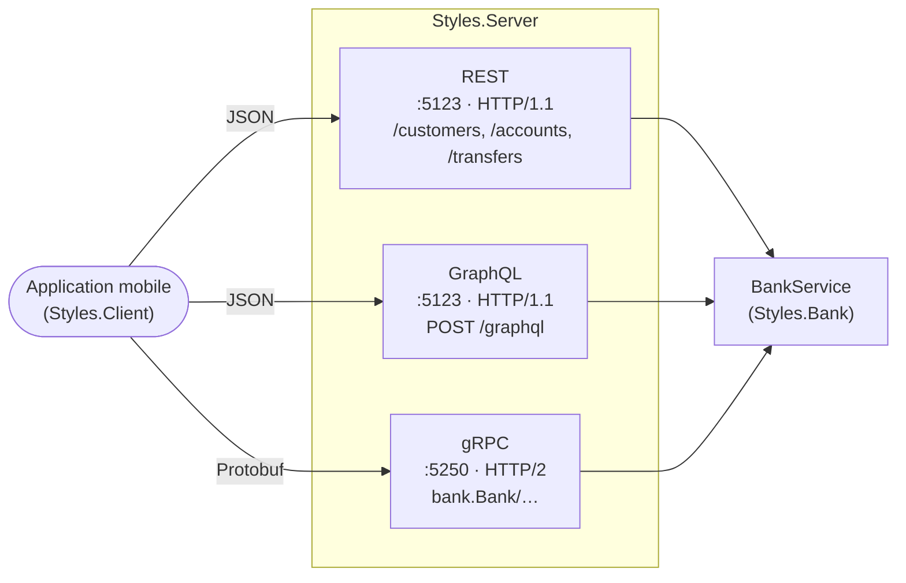
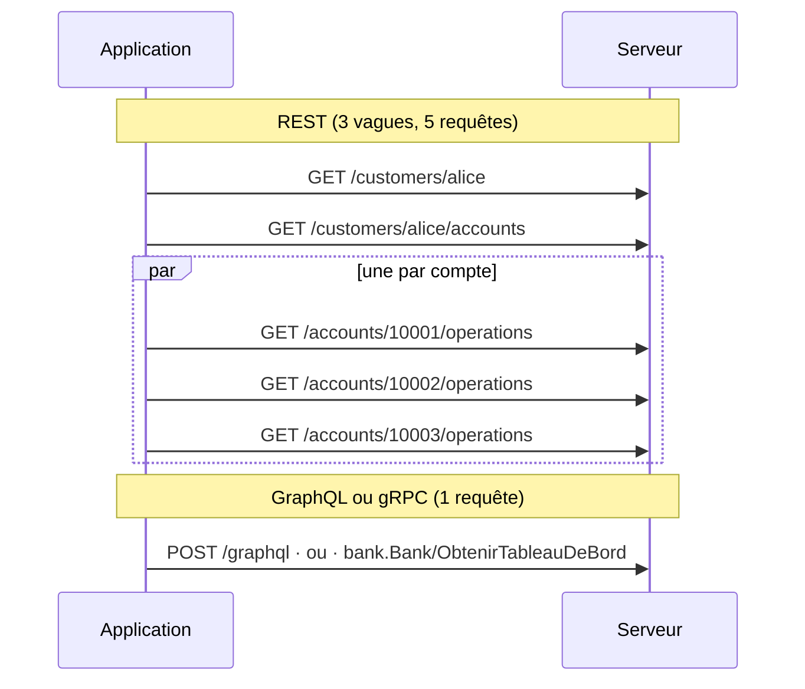

# 23. REST, gRPC, GraphQL (styles d'API)

> **En une phrase** : la même banque exposée de trois façons, des **ressources** (REST), des **procédures** (gRPC) et un
> **graphe que le client interroge** (GraphQL) ; le métier ne bouge pas, ce qui change, c'est qui décide de la forme
> des réponses, ce qui circule sur le réseau, et ce que HTTP fait encore pour vous.

📁 Code : [`23-RestGrpcGraphQL`](../23-RestGrpcGraphQL) · ⬅️ [Strangler Fig](22-strangler-fig.md) · ➡️ [MVC et MVVM](24-mvc-mvvm.md) · 🌐 [English](en/23-rest-grpc-graphql.md)

---

## L'idée : trois présentations du même métier

Les autres démos changent l'**intérieur** du système. Celle-ci garde un intérieur simple et unique, le
[BankService](../23-RestGrpcGraphQL/Styles.Bank/BankService.cs), et change sa **surface** : trois API dans le
même processus, chacune une fine couche de traduction. Un test d'architecture vérifie que le métier ignore tout des
trois (`The_business_code_knows_nothing_about_API_styles`).



| | **REST** | **gRPC** | **GraphQL** |
|---|---|---|---|
| On manipule… | des **ressources** (noms), avec les verbes HTTP | des **procédures** (verbes) d'un service | un **graphe** de types, qu'on parcourt |
| Le contrat | implicite, ou décrit à part (OpenAPI) | **banque.proto**, dont on génère client et serveur | le **schéma** (SDL), vérifié à chaque requête |
| Qui choisit la forme de la réponse | le serveur, une représentation par ressource | le serveur, un message par méthode | **le client**, champ par champ |
| Format | JSON (texte, noms de champs) | Protobuf (binaire, numéros de champs) | JSON, exactement la forme demandée |
| Transport | HTTP, n'importe quelle version | **HTTP/2 obligatoire** (trailers) | HTTP, presque toujours `POST /graphql` |
| Erreurs | statut HTTP + `problem+json` | 17 statuts gRPC, dans les trailers | `200` + `errors`, à côté des données obtenues |
| Cache HTTP | **oui** (GET, ETag, 304) | non | non (en pratique) |
| Le serveur pousse | non (on interroge, ou SSE) | **flux** natifs | abonnements (WebSocket ; non fait ici) |
| Depuis un navigateur | oui | non (il faut gRPC-Web et un relais) | oui |
| Faire évoluer | ajouter des champs, sinon `/v2` | numéros de champs, champs inconnus ignorés | `@deprecated`, et on sait qui lit quoi |

---

## Les composants

- **Le métier** ([Styles.Bank](../23-RestGrpcGraphQL/Styles.Bank)) : clients, comptes, opérations, virements, et
  ce dont les trois API ont besoin sans être propre à l'une d'elles : des lectures **unitaires et groupées**, un
  abonnement aux nouvelles opérations, un compteur de lectures « en base ».
- **L'outillage** ([Styles.Tooling](../23-RestGrpcGraphQL/Styles.Tooling)) : faute de packages dans le cache NuGet
  local, ce que fourniraient Google.Protobuf, Grpc.AspNetCore et HotChocolate, écrit à la main et réduit à l'essentiel,
  mais fidèle aux formats filaires : [Protobuf.cs](../23-RestGrpcGraphQL/Styles.Tooling/Protobuf/Protobuf.cs)
  (encodage), [Grpc.cs](../23-RestGrpcGraphQL/Styles.Tooling/Grpc/Grpc.cs) (trames, statuts, échéances),
  [GrpcHost.cs](../23-RestGrpcGraphQL/Styles.Tooling/Grpc/GrpcHost.cs) et
  [GrpcClient.cs](../23-RestGrpcGraphQL/Styles.Tooling/Grpc/GrpcClient.cs), et un mini-moteur GraphQL
  ([Parser.cs](../23-RestGrpcGraphQL/Styles.Tooling/GraphQL/Parser.cs),
  [Schema.cs](../23-RestGrpcGraphQL/Styles.Tooling/GraphQL/Schema.cs),
  [Engine.cs](../23-RestGrpcGraphQL/Styles.Tooling/GraphQL/Engine.cs)). Écrire ces pièces montre ce que sont
  vraiment ces protocoles : quelques centaines de lignes chacun.
- **Les contrats gRPC** ([banque.proto](../23-RestGrpcGraphQL/Styles.Contracts/bank.proto) et
  [Messages.cs](../23-RestGrpcGraphQL/Styles.Contracts/Messages.cs)) : sans `protoc`, les classes sont écrites à la main
  et un test vérifie qu'elles correspondent au `.proto` champ par champ.
- **Le serveur** ([RestApi.cs](../23-RestGrpcGraphQL/Styles.Server/RestApi.cs),
  [GrpcApi.cs](../23-RestGrpcGraphQL/Styles.Server/GrpcApi.cs),
  [GraphQLApi.cs](../23-RestGrpcGraphQL/Styles.Server/GraphQLApi.cs)) et la table de
  [Translations.cs](../23-RestGrpcGraphQL/Styles.Server/Translations.cs) des erreurs.
- **Le client de comparaison** ([BankClients.cs](../23-RestGrpcGraphQL/Styles.Client/BankClients.cs)) : la même
  application écrite trois fois, derrière une interface `IBankClient`, avec un compteur de requêtes et d'octets
  ([Measure.cs](../23-RestGrpcGraphQL/Styles.Client/Measure.cs)). Les tests l'utilisent aussi.

Données : **Alice** (`alice`) a trois comptes, courant `10001`, Livret A `10002` et compte joint `10003` ; **Bob**
(`bob`) un compte courant `20001`.

---

## 1. L'écran d'accueil : cinq requêtes, une, une

L'application mobile affiche, pour chaque compte, son libellé, son solde et ses trois dernières opérations. **Essai réel**
(`dotnet run --project Styles.Client`, avec 50 ms de latence simulée par requête, comme un réseau mobile) :

```text
  REST     5 request(s), 0 B sent, 2014 B received, 178 ms
  GraphQL  1 request(s), 207 B sent, 876 B received, 60 ms
  gRPC     1 request(s), 14 B sent, 393 B received, 63 ms
```

**REST** suit les ressources : le client, ses comptes, puis les opérations de **chaque** compte (« 1 + N »). Les N
dernières partent en parallèle, mais ce sont trois vagues d'allers-retours, et une requête par compte :

```csharp
var customer = await http.GetFromJsonAsync<JsonObject>($"/customers/{customerId}");
var accounts = await http.GetFromJsonAsync<JsonArray>($"/customers/{customerId}/accounts");
// 1 + 1 + N: one request per account for its operations (in parallel, but one request each).
```

**GraphQL** envoie la description de l'écran ; la réponse a exactement sa forme :

```graphql
query HomeScreen($id: ID!, $n: Int) {
  customer(id: $id) {
    name
    accounts { number label balance operations(latest: $n) { date label amount } }
  }
}
```

**gRPC** a une procédure taillée pour cet écran, déclarée dans le contrat :

```protobuf
rpc GetDashboard (DashboardRequest) returns (Dashboard);
```



Les trois écrans obtenus sont **identiques** (test `The_three_APIs_give_exactly_the_same_screen`). REST aurait pu
faire mieux, avec une ressource dédiée (`/customers/alice/dashboard`) ou un paramètre `?expand=operations` : c'est
exactement ce que fait un [BFF](16-bff.md). Mais il faut alors une ressource par écran, ce que GraphQL évite.

---

## 2. Ce qui circule

Pour le même écran, REST reçoit **2,3 fois** plus que GraphQL et **5 fois** plus que gRPC (corps seulement ; test
`gRPC_transfers_the_fewest_bytes_and_REST_the_most`).

**REST** renvoie la représentation complète de chaque compte, la même pour tous les clients. L'écran voulait deux
champs ; il en reçoit dix (sur-récupération, test `The_representation_of_an_account_is_complete_and_the_same_for_all_clients`) :

```json
{"number":"10001","label":"Current account","type":"current","iban":"FR76 3000 4000 0110 0010 0010 001","balance":1626.05,
 "currency":"EUR","openingDate":"2015-03-02","overdraftLimit":500,"owner":{"id":"alice","name":"Alice Martin"},
 "_links":{"self":"/accounts/10001","operations":"/accounts/10001/operations","owner":"/customers/alice"}}
```

**GraphQL** ne renvoie que les champs demandés, mais en JSON : chaque nom de champ est répété dans chaque objet. Et
c'est lui qui **envoie** le plus (210 octets) : le texte de la requête part à chaque appel. (En production, les
« requêtes persistées » remplacent ce texte par un identifiant.)

**gRPC** ne transmet ni noms ni texte : des numéros de champs et des entiers binaires. L'exemple de la documentation
Protobuf (test `An_integer_is_encoded_as_a_varint_as_in_the_Protobuf_documentation`) :

```text
champ 1 = 150   →   08 96 01
                    08    = numéro de champ 1, type filaire 0 (varint)
                    96 01 = 150, sur 7 bits par octet, poids faibles d'abord
```

Deux conséquences visibles dans le contrat : une valeur par défaut (0, chaîne vide) **ne circule pas du tout** ; et il
n'y a **pas de type décimal**, d'où des montants en centimes :

```protobuf
// No decimal type in Protobuf: amounts travel in cents, on integers.
message Account {
  string number = 1;
  string label = 2;
  AccountType type = 3;
  int64 balance_cents = 4;
  repeated Operation latest_operations = 5;
}
```

GraphQL non plus n'a pas de décimal : `Float` est un double (`"Float" => JsonValue.Create(Convert.ToDouble(value))`). Pour
de l'argent, on définit d'ordinaire un scalaire personnalisé. Et chaque format a sa précision pour les dates : l'essai
réel a montré un écran GraphQL différent des deux autres, parce que le schéma datait à la seconde quand REST gardait les
fractions. Le métier date donc désormais ses opérations à la seconde :

```csharp
now = now.AddTicks(-(now.Ticks % TimeSpan.TicksPerSecond));
```

---

## 3. Le N+1 : déplacé, pas supprimé

Une seule requête GraphQL peut cacher **N** lectures en base : si le champ `operations` est résolu compte par compte,
`client { accounts { operations } }` lit la base une fois par compte, et `client { comptes { titulaire { comptes {
operations } } } }` neuf fois. Le client ne voit qu'un aller-retour ; la base, elle, voit tout.

Le moteur exécute donc la requête **par niveaux** : un champ est résolu pour tous les objets d'un même niveau à la fois.
Un résolveur **groupé** (le « DataLoader » des moteurs GraphQL) reçoit tous les comptes et fait une seule lecture :

```csharp
.BatchedField("operations", "[Operation!]!", (accounts, a) =>
{
    var byAccount = bank.LatestOperations(accounts.Select(c => c.Number).ToList(), a.GetOrDefault<int?>("latest") ?? 10);
    return accounts.Select(c => (object?)byAccount[c.Number]).ToList();
}, new Arg("latest", "Int", 10))
```

| Pour l'écran d'Alice | REST | GraphQL | gRPC |
|---|---|---|---|
| Requêtes HTTP | 5 | 1 | 1 |
| Lectures des opérations en base | **3** | **1** | **1** |

REST fait autant de lectures que de requêtes : le N+1 est **visible** (dans les journaux d'accès, dans la latence). En
GraphQL il est **invisible** et dépend de chaque résolveur. gRPC, avec sa méthode faite pour l'écran, le règle une fois
pour toutes côté serveur. Tests `Behind_the_single_GraphQL_request_the_database_is_read_only_once` et
`The_operations_of_all_the_accounts_of_a_level_are_read_at_once` (9 comptes, une lecture).

---

## 4. Une erreur, trois langues

Un virement refusé pour solde insuffisant, **essai réel** :

```text
  REST     422 INSUFFICIENT_BALANCE "Insufficient balance: 1160,01 € available (authorized overdraft: 300,00 €)."
  GraphQL  INSUFFICIENT_BALANCE   "Insufficient balance: 1160,01 € available (authorized overdraft: 300,00 €)."
  gRPC     FailedPrecondition     "Insufficient balance: 1160,01 € available (authorized overdraft: 300,00 €)."
```

La traduction est écrite une fois, dans [Translations.cs](../23-RestGrpcGraphQL/Styles.Server/Translations.cs) :

| Erreur métier | REST | gRPC | GraphQL (`extensions.code`) |
|---|---|---|---|
| Client, compte ou virement inconnu | `404 Not Found` | `NotFound` (5) | `UNKNOWN_ACCOUNT`… |
| Montant invalide, même compte, paramètre invalide | `400 Bad Request` | `InvalidArgument` (3) | `INVALID_AMOUNT`… |
| Solde insuffisant | `422 Unprocessable Entity` | `FailedPrecondition` (9) | `INSUFFICIENT_BALANCE` |

- **REST** : le statut dit la catégorie, que comprennent tous les outils (caches, journaux, alertes sur les 5xx) ; le
  corps `application/problem+json` (RFC 9457) porte le détail.
- **gRPC** : la réponse HTTP est **toujours 200**. Le vrai statut arrive à la fin, dans les **trailers** HTTP/2
  (`grpc-status`, `grpc-message`), après le dernier message : c'est la raison pour laquelle gRPC exige HTTP/2. Le
  serveur refuse un appel sans trailers (`426`). Les 17 statuts sont des catégories, pas des codes métier : pour
  distinguer deux `FailedPrecondition`, il faut les détails riches (`google.rpc.Status`, non faits ici).
- **GraphQL** : `200` aussi, et l'erreur dans `errors`, avec le **chemin** du champ fautif. Les autres champs sont
  servis (test `An_error_on_a_field_does_not_prevent_getting_the_others`) :

```json
{"data":{"a":{"label":"Current account"},"b":null},
 "errors":[{"message":"Unknown account \"99999\".","locations":[{"line":1,"column":41}],"path":["b"],"extensions":{"code":"UNKNOWN_ACCOUNT"}}]}
```

Quand le champ en erreur est **non nul** (`!`), il ne peut pas valoir `null` : c'est son parent qui devient `null`, et
ainsi de suite jusqu'au premier champ qui l'accepte. Avec `operations(latest: 51)` (refusé), le compte, la liste des
comptes et finalement `client` valent `null`, avec une erreur par compte (test
`A_non_null_field_in_error_nulls_the_first_nullable_parent`). Concevoir un schéma, c'est aussi choisir où ces
erreurs s'arrêtent. Enfin, une exception imprévue ne doit rien divulguer : `"Error inner."`, sans détail
(test `An_unexpected_error_discloses_nothing_to_the_client`).

---

## 5. Pousser plutôt qu'interroger

**gRPC** sait faire répondre le serveur plusieurs fois : `FollowOperations` garde la réponse HTTP/2 ouverte et y écrit
chaque nouvelle opération, une trame à la fois.

```csharp
await foreach (var operation in operations.ReadAllAsync(cancellation))
    await write(Message(operation));
```

Le client fixe une **échéance** (en-tête `grpc-timeout`) ; le serveur l'applique aussi, et arrête le travail : le flux se
termine en `DeadlineExceeded` et l'abonnement est libéré (test `The_client_deadline_also_stops_the_work_on_the_server_side`).
Un client qui part libère aussi le serveur (test `A_client_that_gives_up_frees_the_server`). **Essai réel** :

```text
  gRPC (server stream, 1 request open for 2 s):
      Savings via REST from 10002 (10,00 €)
      Savings via GraphQL from 10002 (10,00 €)
      Savings via gRPC from 10002 (10,00 €)
      end of stream: DeadlineExceeded
```

**REST** n'a pas de flux : on interroge. Mais HTTP rend l'interrogation peu coûteuse : chaque compte a un **ETag** qui
change à chaque opération ; le client renvoie celui qu'il a (`If-None-Match`) et reçoit `304 Not Modified`, sans corps,
tant que rien n'a bougé (test `The_ETag_avoids_transferring_again_an_account_that_has_not_changed`) :

```text
  REST (polling with ETag, 5 times): 1 × 200, 4 × 304 Not Modified — 5 request(s), 0 B sent, 337 B received, 310 ms
```

C'est le grand atout de REST, absent des deux autres : GET est **sûr et idempotent**, donc tout ce qui se trouve entre
le client et le serveur (navigateur, proxy, CDN) peut mettre en cache. GraphQL passe tout par `POST /graphql` et perd ce
cache ; gRPC aussi. (Pour pousser, REST a les *Server-Sent Events* ou les WebSockets ; GraphQL, les abonnements, sur
WebSocket : ni l'un ni l'autre n'est fait ici.)

---

## 6. Faire évoluer le contrat

Les trois styles laissent ajouter un champ sans casser les clients, chacun à sa façon.

- **gRPC** : seul le **numéro** de champ circule. On peut renommer un champ ; jamais changer ni réutiliser son numéro.
  Un client ancien **saute** les champs qu'il ne connaît pas, un client récent lit des valeurs par défaut dans un message
  ancien (tests `An_old_client_ignores_the_fields_added_since`,
  `A_new_client_reads_an_old_message_with_the_default_values`). D'où la valeur 0 de chaque enum, réservée à
  « inconnu » (`UNKNOWN_ACCOUNT_TYPE = 0`).
- **GraphQL** : le client ne reçoit que ce qu'il demande, donc ajouter est toujours sûr. Retirer se prépare : le champ
  `balanceText` (le solde déjà formaté, de la première version) est **déprécié** dans le schéma publié, et le serveur
  **compte qui le demande encore** (`GET /graphql/usage`) ; on le retire le jour où le compteur ne bouge plus.
  Aucun autre style ne sait aussi précisément ce que lisent ses clients.

```graphql
balanceText: String! @deprecated(reason: "Use 'balance' (a number) and format it for display.")
```

- **REST** : ajouter un champ JSON est sûr si les clients ignorent ceux qu'ils ne connaissent pas (c'est le
  comportement par défaut de System.Text.Json) ; pour un changement incompatible, on publie une nouvelle version
  (`/v2/accounts`, ou un en-tête), et on fait vivre les deux.

Sans `protoc`, un piège guette : des classes qui divergent du `.proto`. Le test
`Each_message_of_the_proto_matches_its_class_field_by_field` compare nom, numéro et type de chaque champ, et
`The_server_serves_each_method_of_the_service_and_nothing_else` les méthodes.

---

## 7. Se protéger d'un client trop curieux

En REST et en gRPC, le serveur sait ce que coûte chaque appel : il les a écrits. En GraphQL, **le client écrit la
requête** : `client { accounts { owner { accounts { owner { … } } } } }` peut faire travailler le serveur sans
fin. Le moteur **valide** donc toute la requête contre le schéma **avant** d'exécuter quoi que ce soit (champs et
arguments inconnus, arguments obligatoires, types des variables, avec leur ligne et leur colonne), et refuse au-delà de
6 niveaux (tests `A_query_that_is_too_deep_is_refused_before_being_executed`,
`An_unknown_field_or_argument_is_refused_by_the_validation_with_its_position`). En production on ajoute un **coût
maximal** par requête, des limites sur la taille des listes (ici `latest` ≤ 50), et souvent une liste blanche de
requêtes connues.

---

## Les tests

49 tests ([Styles.Tests](../23-RestGrpcGraphQL/Styles.Tests)) : les trois clients et le serveur en mémoire (le serveur
de test gère HTTP/2 et les trailers : gRPC passe aussi), le moteur GraphQL appelé directement, l'encodeur Protobuf seul.

| Test | Ce qui est vérifié |
|---|---|
| `The_three_APIs_give_exactly_the_same_screen`, `A_transfer_succeeds_the_same_way_through_the_three_APIs` | même métier, mêmes résultats |
| `REST_makes_one_request_per_account_GraphQL_and_gRPC_a_single_one_in_all`, `gRPC_transfers_the_fewest_bytes_and_REST_the_most` | coûts réseau |
| `Behind_the_single_GraphQL_request_the_database_is_read_only_once` | N+1 en base |
| `The_same_business_error_in_the_language_of_each_API` (3 cas) | traductions des erreurs |
| `An_integer_is_encoded_as_a_varint_as_in_the_Protobuf_documentation`, `A_string_is_preceded_by_its_length`, `Default_values_do_not_travel`, `Zigzag_keeps_small_negatives_short`… | encodage Protobuf, octet par octet |
| `An_old_client_ignores_the_fields_added_since`, `A_new_client_reads_an_old_message_with_the_default_values` | évolution du contrat gRPC |
| `Each_message_of_the_proto_matches_its_class_field_by_field`, `The_enumeration_of_the_proto_matches_the_one_of_the_code`, `The_server_serves_each_method_of_the_service_and_nothing_else` | le `.proto` reste la source de vérité |
| `A_unary_call_is_a_POST_whose_body_is_a_framed_message_and_the_status_in_the_trailers`, `A_business_error_still_answers_200_with_the_gRPC_status_in_the_trailers` | le format filaire gRPC, vu « à la main » |
| `The_stream_pushes_each_operation_as_soon_as_it_happens`, `The_client_deadline_also_stops_the_work_on_the_server_side`, `A_client_that_gives_up_frees_the_server` | flux, échéances, annulation |
| `The_client_gets_exactly_the_requested_fields_and_nothing_else`, `Aliases_allow_asking_for_the_same_field_twice`, `The_variables_are_checked_according_to_their_type`, `A_mutation_is_executed_and_returns_what_the_client_asks_for` | GraphQL |
| `An_error_on_a_field_does_not_prevent_getting_the_others`, `A_non_null_field_in_error_nulls_the_first_nullable_parent`, `An_unexpected_error_discloses_nothing_to_the_client` | réponses partielles, propagation des `null` |
| `The_published_schema_flags_the_deprecated_fields_and_the_server_knows_who_uses_them` | dépréciation et statistique d'utilisation |
| `Errors_are_HTTP_statuses_with_a_problem_json_body` (4 cas), `A_transfer_creates_a_201_resource_whose_address_is_in_Location`, `The_ETag_avoids_transferring_again_an_account_that_has_not_changed` | REST |
| `The_business_code_knows_nothing_about_API_styles`, `The_tooling_ignores_the_bank_and_the_contracts_ignore_the_business_code` | **tests d'architecture** |

Vérifiés par mutation (25 essais, tous détectés) : valeurs par défaut transmises, champ inconnu refusé, zigzag absent,
saut de champ qui lit l'ancienne position ; erreur gRPC rendue comme un succès, échéance ignorée, type de contenu non
contrôlé, trailers ignorés par le client, méthode gRPC qui lit compte par compte ; abonnement jamais libéré, dates non
arrondies ; résolveur GraphQL non groupé, pas de limite de profondeur, champ inconnu accepté, erreur non absorbée par un
champ nullable, null non propagé, erreur interne divulguée, variable inutilisée ou mal typée acceptée, statistique
d'utilisation absente ; ETag ignoré, 200 au lieu de 201 ; traductions d'erreurs faussées ; numéro de champ changé dans
une classe sans toucher au `.proto`.

Deux de ces garanties viennent d'échecs réels pendant l'écriture de la démo : le saut des champs inconnus
(`position += ReadVarint(bytes, ref position)` lit l'ancienne valeur de `position` **avant** l'appel, et saute au
mauvais endroit : trouvé par `An_old_client_ignores_the_fields_added_since`) et l'arrondi des dates (trouvé à
l'essai réel, section 2).

---

## Bilan

| | 👍 Points forts | 👎 Limites |
|---|---|---|
| **REST** | Simple, universel, lisible avec `curl` ; **le cache HTTP** ; les statuts compris par tous les outils | Une forme par ressource : trop de données, ou trop d'allers-retours ; pas de flux ; contrat souvent implicite |
| **gRPC** | **Compact et rapide** ; contrat strict et généré ; flux dans les deux sens ; échéances propagées | HTTP/2 obligatoire, pas de navigateur sans relais ; binaire illisible sans outil ; pas de cache HTTP |
| **GraphQL** | **Le client choisit** : un aller-retour par écran, rien de superflu ; schéma typé et introspectable ; on sait qui lit quoi | N+1 caché, requêtes coûteuses à borner, cache HTTP perdu, `200` pour tout ; un moteur à exploiter |

**Quand choisir quoi** : **REST** pour une API publique ou partenaire, des ressources simples, quand le cache compte ;
**gRPC** entre services internes (microservices, [démo 8](08-microservices.md)), pour le débit, la latence, les flux et
les contrats stricts entre équipes ; **GraphQL** devant des clients nombreux et variés aux écrans riches (mobile, web),
souvent comme couche d'agrégation au-dessus de services REST ou gRPC, là où l'on écrirait sinon un
[BFF](16-bff.md) par application. Les trois cohabitent souvent : gRPC entre les services, GraphQL ou REST vers
l'extérieur. En production : **ASP.NET Core** (Minimal API) et **OpenAPI** pour REST ; **Grpc.AspNetCore**,
**Grpc.Net.Client** et **Grpc.Tools** (`protoc`) pour gRPC, avec **gRPC-Web** ou le transcodage JSON pour les
navigateurs ; **HotChocolate** ou **GraphQL.NET** pour GraphQL, avec leurs DataLoaders, l'analyse de coût et les
requêtes persistées.
