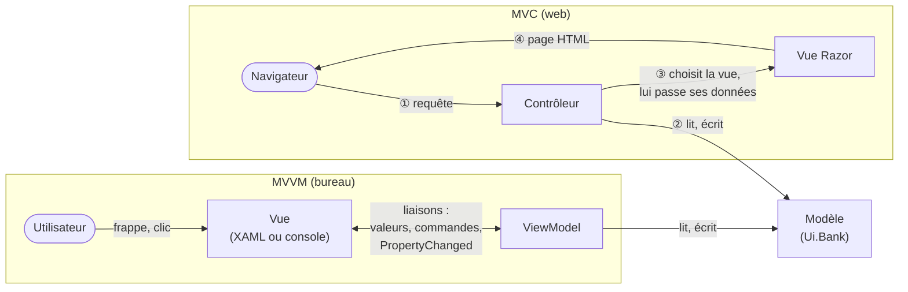
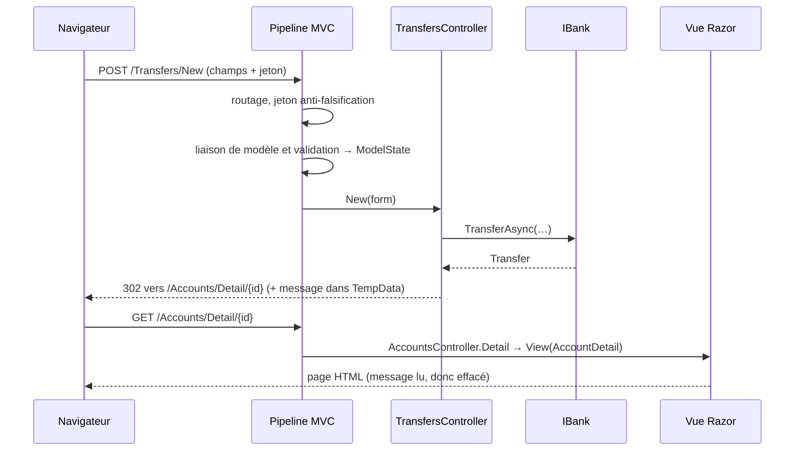
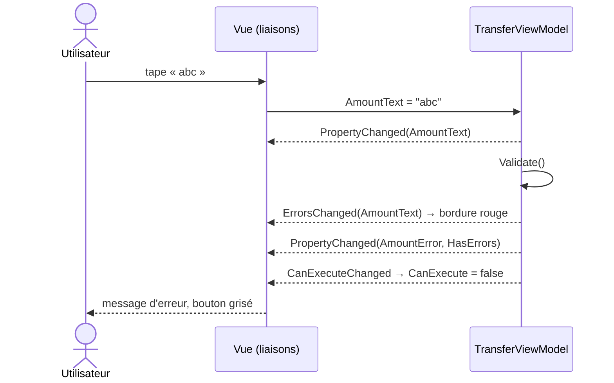

# 24. MVC et MVVM (patterns de présentation)

> **En une phrase** : le même écran de banque construit deux fois, en **MVC** sur le web (un contrôleur reçoit chaque
> requête, choisit une vue, qui produit une page puis disparaît) et en **MVVM** sur le bureau (un ViewModel garde l'état
> de l'écran et ses commandes, la vue s'y lie et suit chacun de ses changements) ; le modèle ne bouge pas, ce qui
> change, c'est **qui reçoit l'action de l'utilisateur, et combien de temps l'écran vit**.

📁 Code : [`24-MvcMvvm`](../24-MvcMvvm) · ⬅️ [REST, gRPC, GraphQL](23-rest-grpc-graphql.md) · ➡️ [Concepts transverses](concepts-transverses.md) · 🌐 [English](en/24-mvc-mvvm.md)

---

## L'idée : organiser ce qu'il y a entre le modèle et l'utilisateur

Les autres démos organisent le système, ou son API. Celle-ci regarde le dernier mètre : **l'interface**. MVC et MVVM
ne disent rien de l'intérieur du modèle (qui peut être hexagonal, en couches, en microservices…). Ils répondent à une
autre question : comment séparer ce qu'on **affiche** de ce qu'on **décide**, pour pouvoir tester l'un sans l'autre.

Le modèle est commun ([Ui.Bank](../24-MvcMvvm/Ui.Bank)) : comptes, opérations, virements et leurs règles, derrière
une interface asynchrone `IBank`, comme un vrai service distant. Un test vérifie qu'il ignore tout des écrans
(`The_model_knows_nothing_about_the_screens`).



| | **MVC** (ici : ASP.NET Core MVC) | **MVVM** (ici : WPF, et une console) |
|---|---|---|
| Qui reçoit l'action de l'utilisateur | le **contrôleur** (une route, une action) | la **vue**, qui la transmet par liaison ou commande |
| Qui connaît qui | le contrôleur choisit la vue (par son nom) | la vue connaît le ViewModel ; le ViewModel **ignore** la vue |
| Durée de vie de l'écran | **une requête** : construit, rendu, jeté | **tant que la fenêtre est ouverte** : l'état reste en mémoire |
| Comment la vue est mise à jour | on refait une requête, on reçoit une nouvelle page | **automatiquement**, à chaque PropertyChanged |
| Validation | après l'envoi du formulaire (ModelState) | **pendant la saisie**, à chaque frappe |
| Ce qu'on teste sans écran | la décision du contrôleur (quelle vue, quelles données) | **tout le comportement** de l'écran |
| Mécanisme indispensable | routage, liaison de modèle, moteur de vues | moteur de liaisons de données (bindings) |

---

## Les projets

```
Ui.Bank          le MODÈLE, commun : IBank (asynchrone), InMemoryBank (latence réglable), règles du virement
Ui.Mvc           :5124  MVC web : Controllers/ (une action par page), Views/ (Razor), Models/ (données des vues)
Ui.Presentation  MVVM : les ViewModels, en .NET pur (sans WPF, vérifié par un test) + ObservableObject, commandes
Ui.Wpf           la vue WPF : MainWindow.xaml, que des liaisons ; code-behind réduit à InitializeComponent
Ui.Console       une deuxième vue sur les mêmes ViewModels, et Binding.cs : un {Binding} démonté en 20 lignes
Ui.Tests         51 tests : modèle, contrôleurs, site complet, ViewModels, vue console, liaisons du XAML
```

```powershell
dotnet run --project 24-MvcMvvm\Ui.Mvc        # then http://localhost:5124
dotnet run --project 24-MvcMvvm\Ui.Wpf        # the window (Windows); 400 ms per call to the bank
dotnet run --project 24-MvcMvvm\Ui.Console    # the same thing at the keyboard ("help")
```

Données : **Alice** a un compte courant `11111111-…` (1 000 €) et un Livret A `44444444-…` (8 000 €), **Bob** un compte
courant `22222222-…` (500 €). Au-delà de 1 000 €, les deux interfaces demandent une confirmation.

Le vocabulaire piège : ASP.NET Core appelle souvent « view models » les classes que le contrôleur passe à la vue
([Models/Modeles.cs](../24-MvcMvvm/Ui.Mvc/Models/PageModels.cs)). Ce ne sont **pas** des ViewModels au sens de MVVM : de
simples sacs de données, préparés pour un rendu puis jetés, sans état ni commande.

---

## 1. MVC : le trajet d'une requête

Chaque clic est une requête HTTP, qui traverse le même chemin :



Le contrôleur ne produit pas de HTML et la vue ne lit pas la banque : il **décide**, elle **met en forme**
([AccountsController.cs](../24-MvcMvvm/Ui.Mvc/Controllers/AccountsController.cs),
[Index.cshtml](../24-MvcMvvm/Ui.Mvc/Views/Accounts/Index.cshtml)). La vue est désignée par convention
(`Views/{contrôleur}/{action}.cshtml`) ou par son nom. C'est ce qu'on teste en appelant le contrôleur comme une simple
méthode (`The_list_chooses_its_view_and_passes_it_data_ready_to_display`) : le résultat est une **décision**
(`ViewResult`, `RedirectToActionResult`, `NotFoundResult`), pas du HTML.

Entre deux requêtes, le serveur ne garde **rien** de l'écran. Tout ce qu'il faut pour la suivante voyage dans la
requête : l'identifiant dans l'URL, les champs du formulaire, le jeton, et un cookie pour TempData.

---

## 2. Le formulaire en MVC : réafficher ou rediriger

[TransfersController.cs](../24-MvcMvvm/Ui.Mvc/Controllers/TransfersController.cs) suit le schéma classique du web.
Quand l'action s'exécute, la liaison de modèle a déjà rempli le formulaire et noté dans `ModelState` tout ce qui ne va
pas : champ manquant (`[Required]`), « abc » au lieu d'un nombre, règles entre champs
(`IValidatableObject`, les mêmes que celles de la banque). S'il y a une erreur, **la même vue est réaffichée** (200),
avec les messages et ce que l'utilisateur avait tapé :

```csharp
        if (!ModelState.IsValid)
            return await Redisplay(form, cancellation);
```

S'il n'y en a pas, le virement est fait, puis le contrôleur **redirige** (« Post/Redirect/Get ») : la page d'arrivée
s'obtient par un GET, qu'on peut actualiser sans refaire le virement. Le message de succès passe la redirection dans
**TempData** (un cookie), qui s'efface dès qu'on l'a lu :

```csharp
            var transfer = await bank.TransferAsync(source, target, amount, cancellation);
            // TempData survives ONE redirection (cookie), then disappears: the message is displayed only once.
            TempData["Message"] = $"Transfer of {Format.Euros(transfer.Amount)} done. New balance: {Format.Euros(transfer.SourceBalance)}.";
            return RedirectToAction(nameof(AccountsController.Detail), "Accounts", new { id = source });
```

Un refus de la banque (solde insuffisant) devient une erreur du formulaire, sans champ, affichée en tête
(`ModelState.AddModelError(string.Empty, …)`). Et tout POST doit porter le **jeton anti-falsification** que le tag
helper `<form>` ajoute de lui-même : sans lui, `400` (filtre global `AutoValidateAntiforgeryTokenAttribute`).

**La confirmation des gros montants** est une **autre vue** pour la même action. Le serveur n'ayant rien gardé, la
page [Confirm.cshtml](../24-MvcMvvm/Ui.Mvc/Views/Transfers/Confirm.cshtml) renvoie tous les champs, cachés, plus
`Confirmed=true` :

```csharp
        if (amount >= TransferRules.ConfirmationThreshold && !form.Confirmed)
        {
            await LoadAccounts(form, cancellation);
            return View("Confirm", form);
        }
```

**Essai réel** : 1 200 € depuis le compte d'Alice (1 000 €). Le site affiche d'abord la page de confirmation, puis,
une fois confirmé, le refus de la banque. Le contrôleur ne connaît pas le solde avant d'appeler la banque ; il faudrait
une lecture de plus pour le vérifier plus tôt. Le ViewModel, lui, a les soldes en mémoire et refuse dès la frappe
(section 4). Ensuite 250,50 € : redirection, message, nouveau solde 749,50 € ; F5 : ni second virement, ni message.

---

## 3. MVVM : la vue observe le ViewModel

En MVVM, l'écran est **un objet qui vit** : le ViewModel
([Ui.Presentation](../24-MvcMvvm/Ui.Presentation)). Il contient l'état (comptes affichés, compte sélectionné, texte
saisi, erreurs, message, « en cours ») et les commandes (Virer, Échanger). Il ne connaît pas la vue : il **prévient**
quand une propriété change, par `INotifyPropertyChanged`
([Tooling.cs](../24-MvcMvvm/Ui.Presentation/Tooling.cs)) :

```csharp
    protected bool Set<T>(ref T storage, T value, [CallerMemberName] string? property = null)
    {
        if (EqualityComparer<T>.Default.Equals(storage, value))
            return false;
        storage = value;
        Notify(property!);
        return true;
    }
```

La vue WPF ([MainWindow.xaml](../24-MvcMvvm/Ui.Wpf/MainWindow.xaml)) ne contient **que des liaisons**. Chacune lit
une propriété et s'abonne à ses changements ; dans l'autre sens, une frappe ou une sélection écrit dans le ViewModel ;
`Command` relie un bouton à une commande, dont `CanExecute` grise ou active le bouton :

```xml
                <TextBox Text="{Binding AmountText, UpdateSourceTrigger=PropertyChanged}" Margin="0,4,0,2" Padding="2" />
                <TextBlock Text="{Binding AmountError}" Foreground="#B42318" TextWrapping="Wrap" />

                <Button Content="Transfer" Command="{Binding TransferCommand}" Padding="16,6" Margin="0,12,0,8" HorizontalAlignment="Left" />
```



Le code-behind de la fenêtre se réduit à `InitializeComponent`, et le XAML ne contient aucun gestionnaire d'événement
(`The_WPF_view_contains_no_code`). L'assemblage (banque, ViewModel, fenêtre) est fait une fois, dans
[App.xaml.cs](../24-MvcMvvm/Ui.Wpf/App.xaml.cs). Les ViewModels n'ont aucune référence à WPF
(`The_ViewModels_know_nothing_about_WPF_and_the_web`) : `INotifyPropertyChanged`, `INotifyDataErrorInfo`, `ICommand` et
`ObservableCollection` font partie de .NET lui-même. `ObservableObject`, `Command` et `AsyncCommand` sont ce
qu'apporteraient CommunityToolkit.Mvvm ou Prism, écrits à la main : une centaine de lignes, sans magie.

---

## 4. Valider pendant la saisie

[TransferViewModel.cs](../24-MvcMvvm/Ui.Presentation/TransferViewModel.cs) revérifie tout à chaque changement : montant
lisible (« 250 », « 250,5 », « 250.50 », « 1 000 € »), positif, au centime, inférieur au solde de la source, comptes
différents. Les règles sont celles de la banque (`TransferRules`, publiques pour cela) ; la banque les applique de
nouveau, et c'est elle qui fait foi. Les erreurs sont exposées deux fois : en texte (`AmountError`, `TargetError`,
qu'une console peut afficher) et par `INotifyDataErrorInfo` (la bordure rouge de WPF).

Quelques détails qui font la différence, chacun couvert par un test :
- ce qui a été tapé reste affiché, même « abc » : la propriété liée est le **texte**, le montant en est déduit ;
- une erreur identique n'est pas renotifiée, et une valeur identique non plus (`Each_keystroke_is_checked_and_the_view_is_told`) :
  WPF réécrit souvent la valeur affichée, chaque notification inutile redessine l'écran ;
- le **solde de la source est suivi** : s'il change ailleurs (autre fenêtre, autre appareil, puis actualisation),
  l'erreur « solde insuffisant » apparaît ou disparaît seule ; quand on change de source, l'ancienne n'est plus suivie,
  sinon fuite et erreurs fantômes (`The_source_balance_is_followed_even_when_it_changes_elsewhere`) ;
- après un virement, les soldes sont mis à jour **sur place** (le même objet `AccountViewModel`) : la sélection dans la
  liste et dans les listes déroulantes ne saute pas.

---

## 5. L'asynchrone : attendre, ignorer le double clic, écarter les réponses périmées

Une page MVC n'existe qu'une fois la réponse prête. Un écran MVVM, lui, est **affiché pendant** les appels : il faut
montrer qu'on attend, empêcher de refaire, et se méfier des réponses qui arrivent dans le désordre. Avec la vraie
fenêtre (400 ms par appel), on voit le bouton se griser et la barre d'activité défiler.

**Le double clic** : `AsyncCommand` se désactive pendant son exécution ; un second clic sur le bouton grisé ne fait
rien (`During_the_transfer_the_screen_waits_and_a_double_click_does_not_transfer_twice`, qui retient l'appel à la banque
le temps de cliquer encore).

**Les réponses périmées** : cliquer sur Bob, puis aussitôt sur le Livret ; si la réponse pour Bob arrive après celle du
Livret, l'écran afficherait les opérations de Bob sous le titre du Livret. Chaque chargement a un numéro, seule la
réponse du dernier est gardée ([AccountsViewModel.cs](../24-MvcMvvm/Ui.Presentation/AccountsViewModel.cs)) :

```csharp
        var request = ++_lastRequest;
```
```csharp
            var operations = await bank.OperationsAsync(account.Id);
            if (request != _lastRequest)
                return;
```

Le test fait arriver les réponses dans le mauvais ordre, sans `Thread.Sleep` : la banque de test « retient » un appel
jusqu'à ce qu'on le relâche (`A_response_that_arrives_too_late_does_not_overwrite_the_next_selection`). Il vérifie aussi
que la réponse périmée n'éteint pas l'indicateur du chargement toujours en cours.

---

## 6. Poser une question sans connaître l'écran

Au-delà de 1 000 €, il faut une confirmation. Un ViewModel qui appellerait `MessageBox.Show` ne serait plus testable
(une fenêtre modale bloquerait le test) ni réutilisable (pas de boîte de dialogue dans une console). Il demande donc à
une interface, `IConfirmation`, que chaque vue implémente à sa façon : boîte de dialogue en WPF, ligne lue au clavier en
console, réponse programmée dans les tests.

```csharp
        if (amount >= TransferRules.ConfirmationThreshold
            && !await _confirmation.AskAsync($"Transfer {Format.Euros(amount)} from {source.Display} to {target.Display}?"))
        {
            Inform("Transfer cancelled.", error: false);
            return;
        }
```

C'est la différence de fond avec MVC : là-bas, la confirmation est **une requête et une vue de plus**, et l'état fait
l'aller-retour dans des champs cachés ; ici, c'est **un appel attendu au milieu d'une méthode**, et l'état n'a pas bougé.

---

## 7. Une deuxième vue sur les mêmes ViewModels

[Ui.Console](../24-MvcMvvm/Ui.Console) branche une console sur les **mêmes** ViewModels, sans en changer une ligne.
Ses liaisons sont faites à la main par [Binding.cs](../24-MvcMvvm/Ui.Console/Binding.cs), ce que fait un `{Binding}`
de WPF sans la machinerie : lire la propriété, s'abonner à `PropertyChanged`, recopier à chaque changement.

```csharp
    private void Changed(object? sender, PropertyChangedEventArgs e)
    {
        // An empty name means "everything may have changed".
        if (string.IsNullOrEmpty(e.PropertyName) || e.PropertyName == _property.Name)
            Push();
    }
```

Les lignes `⚠`, `»` et `[Transfer]` apparaissent d'elles-mêmes, poussées par le ViewModel au moment où il change :

```text
> from 1
> to 1
  ⚠ accounts Choose two different accounts.
> to 3
> amount abc
  ⚠ amount Enter an amount, for example 250.50.
> amount 2000
  ⚠ amount Insufficient balance: 1,000.00 € available.
> transfer
  (the Transfer button is greyed out)
…
> amount 250.5
  [Transfer] enabled
> transfer
  [Transfer] greyed out
  » Transfer in progress…
  » Transfer of 250.50 € done. New balance: 749.50 €.
```

(Essai réel, `dotnet run --project 24-MvcMvvm\Ui.Console`.) Le test
`The_console_drives_the_same_ViewModels_as_the_WPF_window` joue une session au clavier, confirmation refusée comprise.

---

## 8. Les liaisons ne sont pas vérifiées par le compilateur

`{Binding MontantSaisie}` (avec une faute) compile, et la fenêtre s'ouvre : la zone reste vide, et l'erreur part dans
la fenêtre de sortie du débogueur. C'est la faiblesse classique de MVVM en WPF (MAUI, Avalonia et UWP ont des liaisons
**compilées**, `x:DataType` / `x:Bind`, qui la corrigent).

La démo la compense par un test qui lit le XAML : les indications de conception (`d:DataContext`, et `DataType` sur les
modèles d'éléments) disent quel ViewModel est lié où, et le vérificateur
([ArchitectureTests.cs](../24-MvcMvvm/Ui.Tests/ArchitectureTests.cs)) suit chaque chemin de liaison. Il vérifie aussi
que ces indications disent vrai : un `DataContext="{Binding Transfer}"` annoncé comme `AccountsViewModel`, une liste de
comptes affichée avec un modèle prévu pour des opérations, un `DisplayMemberPath` mal orthographié
(`The_checker_finds_the_typos_that_WPF_would_let_through`). Sur la vraie fenêtre, 30 liaisons sont
vérifiées.

---

## MVC, MVP, MVVM… et les autres

Tous séparent le **modèle** de sa **présentation** ; ils diffèrent par l'objet du milieu et le sens des flèches.

- **MVC** (Smalltalk, 1979) : à l'origine, la vue observait le modèle et le contrôleur traitait le clavier et la
  souris. Sur le web (Rails, ASP.NET MVC, Spring MVC), il est devenu le cycle requête → contrôleur → vue de cette démo.
- **MVP** (Model-View-Presenter) : le présentateur pilote une vue **passive** à travers une interface
  (`IVueVirement.AfficherErreur(…)`). Testable aussi, mais le présentateur pousse chaque changement à la main, faute de
  moteur de liaisons. Courant en Windows Forms et sur Android avant ses outils de liaison.
- **MVVM** (WPF, 2005) : le présentateur devient un modèle de la vue, et le moteur de liaisons fait le travail de
  synchronisation. WPF, MAUI, Avalonia, WinUI ; côté web, Knockout, et les composants de Vue ou d'Angular en reprennent
  l'idée.
- **MVU / flux unidirectionnel** (Elm, Redux, et les composants de React ou Blazor) : l'état est immuable, chaque
  action produit un nouvel état, et la vue est recalculée. Une piste à part, qui remplace les liaisons dans les deux
  sens par un seul sens.

---

## Les tests

51 tests, sans écran ni `Thread.Sleep` ([Ui.Tests](../24-MvcMvvm/Ui.Tests)) :
- **le modèle** (6) : les règles du virement, que les deux interfaces affichent mais que seule la banque fait respecter ;
- **les contrôleurs MVC** appelés comme des méthodes (6) : la décision (vue choisie, données, redirection, erreur
  ajoutée à `ModelState`) ; la liaison et la validation n'ont pas lieu ici ;
- **le site complet**, en mémoire (`WebApplicationFactory`, 9) : on joue le navigateur, on lit le HTML, on renvoie le
  formulaire avec son jeton ; Post/Redirect/Get, message lu une seule fois, saisie gardée après une erreur, page de
  confirmation qui renvoie tout ;
- **les ViewModels** (21) : chaque notification attendue, le bouton qui suit la saisie, la validation, le solde suivi,
  l'attente, le double clic, les réponses périmées, la confirmation, avec une banque « télécommandée » qui retient un
  appel jusqu'à ce qu'on le relâche ;
- **la vue console et la liaison** (3), **l'architecture et les liaisons du XAML** (6).

**Essais de mutation** : 25 garanties cassées une à une (réponse périmée affichée, indicateur arrêté par elle,
ancienne source encore suivie, nouvelle source pas suivie, double clic, notifications sans changement, comptes
remplacés au lieu d'être mis à jour, montant pas vidé, pas de confirmation, erreurs renotifiées, solde non vérifié à la
saisie, bouton pas réévalué, refus de la banque non traité, pas d'actualisation après un virement ; côté MVC : jeton,
redirection, page de confirmation, `ModelState` ignoré, règle entre champs, refus non traduit, message non affiché ;
solde non vérifié par la banque ; liaison console qui ne filtre pas ; faute de frappe dans le XAML ; gestionnaire
`Click` dans la vue) : chacune fait échouer au moins un test. Trois ne faisaient d'abord rien échouer et ont renforcé
les tests : l'ancienne source encore suivie ne change aucune propriété, seulement le bouton (le test compte aussi
`CanExecuteChanged`) ; aucun test ne réaffectait la même valeur ; et le test du contrôleur envoyait un formulaire vide,
écarté de toute façon : il envoie maintenant un formulaire complet, avec une erreur notée par le pipeline.

---

## Bilan

| | 👍 Points forts | 👎 Limites |
|---|---|---|
| **MVC** (web) | Simple et sans état côté serveur : chaque requête est indépendante, facile à mettre en cache et à répartir ; marche partout, même sans JavaScript ; le contrôleur se teste en une ligne | L'écran ne réagit qu'à l'envoi : pas de validation pendant la saisie sans JavaScript ; chaque étape (confirmation) est une page de plus, l'état voyage dans les champs cachés ; une vue ne se teste qu'en lisant du HTML |
| **MVVM** | **Tout l'écran se teste sans écran** ; réaction immédiate (validation, bouton, indicateur) ; plusieurs vues sur les mêmes ViewModels ; la vue peut être confiée à un graphiste | Un moteur de liaisons indispensable ; liaisons non vérifiées par le compilateur en WPF ; de la cérémonie (notifications, commandes) ; l'état vit longtemps : fuites d'abonnements, réponses dans le désordre, fil d'exécution de l'interface |

**Quand choisir quoi** : la plateforme décide souvent. **MVC** pour un site rendu côté serveur (ASP.NET Core MVC ou
Razor Pages, qui en est la variante « une page, un modèle »), quand la simplicité, le référencement et la tenue en
charge comptent plus que la réactivité. **MVVM** dès qu'une interface vit longtemps et réagit en continu : applications
de bureau (WPF, WinUI, Avalonia) et mobiles (MAUI), avec CommunityToolkit.Mvvm ou Prism en production. Côté web, les
applications riches ont pris un troisième chemin, les **composants** (Blazor, React, Angular, Vue), qui empruntent à
MVVM l'état lié à la vue, ou au **flux unidirectionnel** son état immuable. Et dans tous les cas, le modèle reste
derrière, organisé selon n'importe laquelle des autres démos : MVC et MVVM ne sont que **la couche de présentation**
de la [démo 0](00-couches.md), enfin découpée à son tour.
