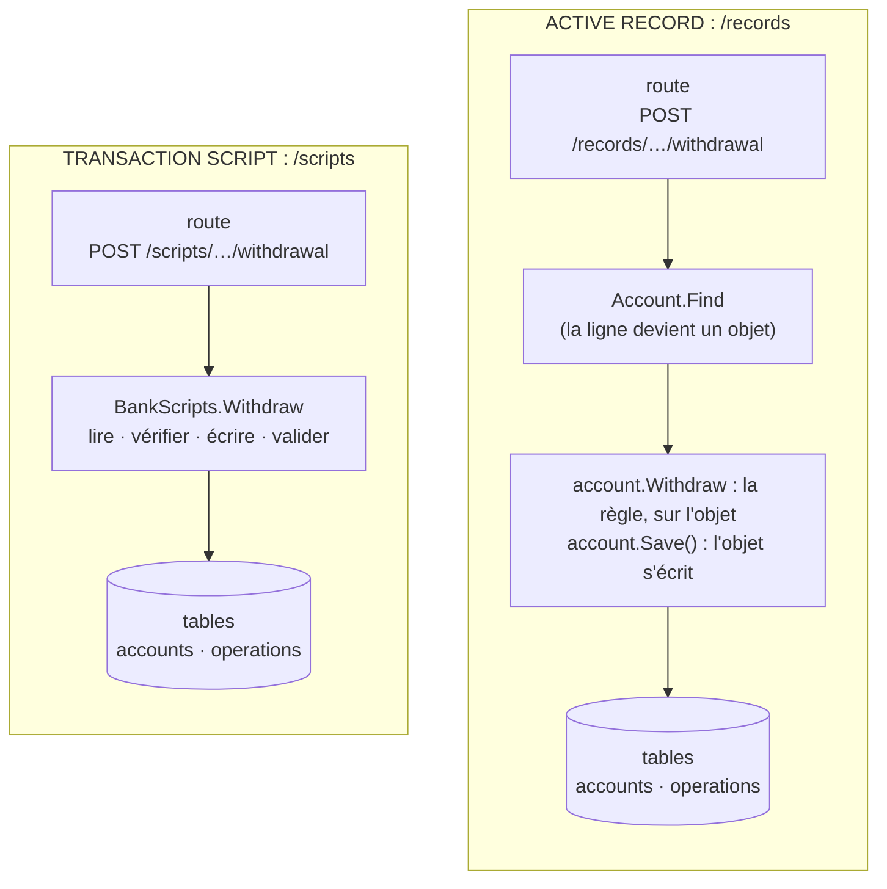
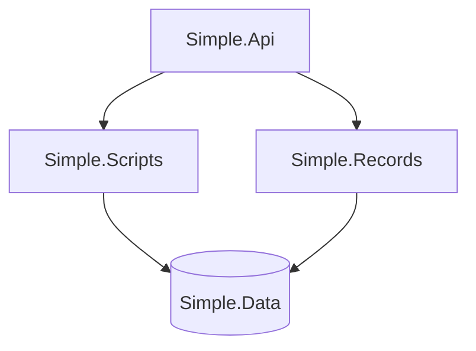

# 25. Transaction Script et Active Record (le point de départ)

> **En une phrase** : les deux façons les plus directes d'écrire le métier, sans architecture : une **procédure par cas
> d'utilisation**, qui lit et écrit elle-même les lignes de la base (**Transaction Script**), ou un **objet par ligne de
> table**, qui porte ses règles et s'enregistre lui-même (**Active Record**). C'est par là que commencent presque toutes
> les applications, et c'est contre leurs limites que les autres démos se sont construites.

📁 Code : [`25-TransactionScriptActiveRecord`](../25-TransactionScriptActiveRecord) · ⬅️ [MVC et MVVM](24-mvc-mvvm.md) · ➡️ [Mediator](26-mediator.md) · 🌐 [English](en/25-transaction-script-active-record.md)

---

## L'idée : écrire le métier sans rien entre lui et la base

Les deux noms viennent du livre de **Martin Fowler**, *Patterns of Enterprise Application Architecture* (2002). Fowler y
range la logique métier en trois formes : le **Transaction Script** (une procédure par requête), le **Domain Model** (des
objets qui portent les règles, ce que fait la [démo 11](11-ddd.md)) et le **Table Module** (une classe par table, l'époque
des `DataSet` de .NET 1). L'**Active Record** est à la frontière : c'est un objet du domaine qui *est* aussi sa ligne de
table. Ruby on Rails l'a rendu célèbre en 2004 ; Laravel (Eloquent) et Django le suivent.



Les deux styles sont dans la **même API**, sur la **même base** : ce que l'un écrit, l'autre le lit. Ce qui change,
c'est **où vivent les règles** (dans chaque script, ou une seule fois sur l'objet) et **qui coordonne** (le script, ou la
route qui appelle les objets).

Aucune des deux n'est une erreur de débutant : pour un métier mince, c'est souvent **le bon choix**. La démo 0 s'en sert
déjà sans le dire (le service de sa couche métier est un transaction script), et la démo 5 aussi (`OpenAccount`). Cette
démo les isole, pour voir à quel moment elles cessent de suffire.

---

## Les projets

```
Simple.Data      la base, écrite à la main : tables de lignes (AccountRow, OperationRow), transactions (Commit, retour arrière)
Simple.Scripts   TRANSACTION SCRIPT : BankScripts, une méthode par cas d'utilisation ; les lignes ne sont que des données
Simple.Records   ACTIVE RECORD : Account et Operation, qui se chargent (Find), vérifient (Withdraw…) et s'enregistrent (Save)
Simple.Api       :5125  /scripts/… et /records/…, les mêmes routes, sur la même base
Simple.Tests     54 tests : base, scripts, objets, API, architecture
```



**Il n'y a pas de couche entre le code et la base** : les scripts comme les objets dépendent directement de
`Simple.Data`, qui ne dépend de rien. C'est l'inverse de l'[Onion](02-onion.md), où la base dépend du métier.

> **Pourquoi une base écrite à la main ?** Le dépôt n'utilise que les paquets du cache local, sans SQLite. `Simple.Data`
> joue le rôle d'une base SQL réduite à quatre instructions (lecture par clé, filtre, insertion, mise à jour) et, surtout,
> à de **vraies transactions** : les changements se font sur une copie des tables, `Commit` la publie, l'abandon la jette.

---

## 1. Transaction Script : un cas d'utilisation, lu de haut en bas

Tout le retrait tient dans une méthode : ouvrir la transaction, lire la ligne, vérifier, écrire, valider.
([BankScripts.cs](../25-TransactionScriptActiveRecord/Simple.Scripts/BankScripts.cs))

```csharp
public WithdrawalResult Withdraw(Guid id, decimal amount)
{
    using var tx = database.Begin();
    var account = tx.Accounts.Find(id) ?? throw new AccountNotFoundException(id);

    // The same two checks are copied in Transfer: each script carries its own copy of the rules.
    if (amount <= 0)
        throw new ScriptRefusedException("The amount must be strictly positive.");
    if (amount > account.Balance)
        throw new ScriptRefusedException("Insufficient balance.");

    var newBalance = account.Balance - amount;
    tx.Accounts.Update(account with { Balance = newBalance });
    tx.Operations.Insert(new OperationRow(Guid.NewGuid(), id, "Withdrawal", -amount, tx.Now));
    tx.Commit();
    return new WithdrawalResult(id, newBalance);
}
```

Aucun objet métier : `AccountRow` est un `record` sans comportement, une copie des colonnes de la table. Pour savoir ce
que fait « retirer », on lit **une** méthode, sans sauter de classe en classe. C'est la grande force du style.

La route n'a plus rien à faire qu'appeler le script et traduire ses exceptions en HTTP.
([ScriptEndpoints.cs](../25-TransactionScriptActiveRecord/Simple.Api/ScriptEndpoints.cs))

```csharp
routes.MapPost("/accounts/{id:guid}/withdrawal", (Guid id, WithdrawalRequest request, BankScripts scripts) =>
    Run(() => Results.Ok(scripts.Withdraw(id, request.Amount))));
```

---

## 2. La transaction fait la sûreté du script

Un script écrit au fil de l'eau : dans le virement, le débit de la source est **déjà écrit** quand on lit le compte
destinataire. S'il n'existe pas, l'exception quitte le script sans `Commit`.
([BankScripts.cs](../25-TransactionScriptActiveRecord/Simple.Scripts/BankScripts.cs))

```csharp
var newSource = source with { Balance = source.Balance - amount };
tx.Accounts.Update(newSource);

// The target is read after the debit. If it does not exist, the exception leaves the script
// without Commit: the transaction throws the debit away.
var target = tx.Accounts.Find(targetId) ?? throw new AccountNotFoundException(targetId);
```

Le `using` fait le reste : `Dispose` sans `Commit` jette la copie des tables, et le débit avec.
([Database.cs](../25-TransactionScriptActiveRecord/Simple.Data/Database.cs))

```csharp
public void Commit()
{
    ObjectDisposedException.ThrowIf(_finished, this);
    _database.Publish(Accounts.Rows, Operations.Rows);
    Finish();
}

public void Dispose()
{
    if (!_finished)
        Finish();
}
```

La transaction donne aussi l'**isolation** : une seule à la fois (un `SemaphoreSlim`), l'équivalent grossier du niveau
`SERIALIZABLE`. Deux retraits ne peuvent pas lire le même solde et l'écrire chacun. Dans une vraie base, c'est le
moteur SQL qui fournit ces deux garanties ; le transaction script repose entièrement sur elles. **Une frontière de
transaction = un script** : c'est tout le modèle.

Essai réel (les requêtes de `Bank.http`, dans l'ordre) : après un retrait par `/scripts` et un virement par `/records`,
Alice a 650 €. Un virement de 50 € vers un compte inexistant répond `404` et elle a toujours 650 €, sans nouvelle
opération.

---

## 3. Le prix : chaque script garde sa copie des règles

Le virement doit vérifier ce que vérifie le retrait. En Transaction Script, il le **recopie**.
([BankScripts.cs](../25-TransactionScriptActiveRecord/Simple.Scripts/BankScripts.cs))

```csharp
using var tx = database.Begin();
var source = tx.Accounts.Find(sourceId) ?? throw new AccountNotFoundException(sourceId);
if (amount <= 0)
    throw new ScriptRefusedException("The amount must be strictly positive.");
if (amount > source.Balance)
    throw new ScriptRefusedException("Insufficient balance.");
```

Avec deux scripts, c'est sans conséquence. Avec quarante (retrait au guichet, prélèvement, virement programmé, frais…),
la règle « solde suffisant » existe en quarante exemplaires, et le jour où elle change (un découvert autorisé), il faut
les retrouver tous. Fowler le dit lui-même : on commence par extraire des sous-routines communes, et de fil en aiguille
on aboutit à un **Domain Model**. Les tests le montrent : il faut tester la règle **dans chaque script**
(`A_refused_withdrawal_writes_nothing` et `A_transfer_breaking_a_rule_is_refused` vérifient les mêmes montants).

---

## 4. Active Record : la ligne devient un objet

`Account` enveloppe une ligne de la table `accounts`. Il se **charge** lui-même (méthode statique `Find`), porte
**ses règles** et s'**écrit** lui-même (`Save`).
([Account.cs](../25-TransactionScriptActiveRecord/Simple.Records/Account.cs))

```csharp
public static Account? Find(Transaction tx, Guid id) =>
    tx.Accounts.Find(id) is { } row ? new Account(tx, row, isNew: false) : null;
```

```csharp
public void Withdraw(decimal amount) => Debit(amount, "Withdrawal");

public void TransferTo(Account target, decimal amount)
{
    if (target.Id == Id)
        throw new RuleViolationException("Cannot transfer to the same account.");
    if (amount > TransferLimit)
        throw new RuleViolationException($"A transfer cannot exceed {TransferLimit:0} €.");

    Debit(amount, $"Transfer to {target.Owner}");
    target.Balance += amount;
    target.Record($"Transfer from {Owner}", amount);
}

private void Debit(decimal amount, string label)
{
    if (amount <= 0)
        throw new RuleViolationException("The amount must be strictly positive.");
    if (amount > Balance)
        throw new RuleViolationException("Insufficient balance.");
    Balance -= amount;
    Record(label, -amount);
}
```

La règle « solde suffisant » est écrite **une fois**, dans `Debit`, et le retrait comme le virement passent par elle.
`Balance` n'a pas de mutateur public, et le constructeur est privé : on ne fabrique un `Account` que par `Find` ou
`Open` (deux tests d'architecture le vérifient).

```csharp
/// <summary>INSERT or UPDATE of the row, then INSERT of the operations recorded since the last Save.</summary>
public void Save()
{
    var row = new AccountRow(Id, Owner, Balance);
    if (_isNew)
        _tx.Accounts.Insert(row);
    else
        _tx.Accounts.Update(row);
    _isNew = false;

    foreach (var operation in _pendingOperations)
        _tx.Operations.Insert(operation);
    _pendingOperations.Clear();
}
```

L'objet sait s'il est nouveau (`INSERT`) ou chargé (`UPDATE`), et garde les opérations enregistrées depuis le dernier
`Save` : c'est ce que font `save()` dans Rails ou Laravel.

---

## 5. Qui coordonne ? La route

Les objets savent se vérifier et s'enregistrer, mais quelqu'un doit ouvrir la transaction, les charger, les enregistrer
**tous les deux** et valider. Sans couche entre la route et les objets, c'est la route.
([RecordEndpoints.cs](../25-TransactionScriptActiveRecord/Simple.Api/RecordEndpoints.cs))

```csharp
routes.MapPost("/transfers", (TransferRequest request, Database database) => Run(() =>
{
    using var tx = database.Begin();
    if (Account.Find(tx, request.Source) is not { } source)
        return NotFound(request.Source);
    if (Account.Find(tx, request.Target) is not { } target)
        return NotFound(request.Target);

    source.TransferTo(target, request.Amount);
    source.Save();
    target.Save();
    tx.Commit();
    return Results.Ok(new { SourceBalance = source.Balance, TargetBalance = target.Balance });
}));
```

C'est le « contrôleur obèse » des applications Rails qui grandissent : la coordination (et bientôt des notifications,
des contrôles d'accès, des appels à d'autres services) s'accumule dans les contrôleurs. La réponse habituelle est
d'ajouter des **services d'application**, ce qui mène aux [couches](00-couches.md), ou des **cas d'utilisation**
explicites, ce qui mène à [Clean](03-clean.md).

---

## 6. Le piège d'Active Record : oublier `Save`

Changer l'objet ne change pas la ligne. Un test le montre : le retrait est fait, la transaction validée, et pourtant
rien n'est écrit.
([AccountRecordTests.cs](../25-TransactionScriptActiveRecord/Simple.Tests/AccountRecordTests.cs))

```csharp
[Fact]
public void A_change_that_is_not_saved_is_lost()
{
    using (var tx = _database.Begin())
    {
        Account.Find(tx, Database.Alice)!.Withdraw(100m);
        tx.Commit();   // Save() was forgotten: the object changed, not the row
    }

    Assert.Equal(1000m, BalanceOf(Database.Alice));
}
```

Dans le virement, il faut enregistrer **les deux** comptes ; en oublier un, c'est créditer Bob en mémoire seulement
(c'est pourquoi le test du virement par l'API relit les deux soldes dans la base : sans cette relecture, l'essai de
mutation qui retire `target.Save()` passait inaperçu, la réponse étant calculée sur les objets en mémoire). Un ORM à suivi des changements
comme EF Core (le style *Data Mapper* de la démo 0) supprime ce piège : `SaveChanges` écrit tout ce qui a changé.

---

## 7. Le modèle dépend de la base

Les règles d'Active Record sont sur l'objet, mais l'objet ne peut pas exister sans transaction : même tester
« solde insuffisant » demande une base.
([AccountRecordTests.cs](../25-TransactionScriptActiveRecord/Simple.Tests/AccountRecordTests.cs))

```csharp
[Theory]
[InlineData(0)]
[InlineData(-5)]
[InlineData(1001)]
public void A_refused_withdrawal_leaves_the_object_unchanged(int amount)
{
    using var tx = _database.Begin();
    var alice = Account.Find(tx, Database.Alice)!;

    Assert.Throws<RuleViolationException>(() => alice.Withdraw(amount));

    alice.Save();
    Assert.Equal(1000m, alice.Balance);
    Assert.Empty(alice.LatestOperations());
}
```

Ici la base est en mémoire et le test prend une milliseconde. Avec un vrai SQL Server, chaque test de règle devient un
test d'intégration. C'est exactement ce que corrigent l'[hexagonale](01-hexagonale.md) et l'[Onion](02-onion.md) :
le métier ne connaît plus la base, il se teste seul.

---

## Quand en sortir

Ces deux styles ne sont pas une étape à franchir au plus vite : on en sort quand un **symptôme** apparaît, et le
symptôme dit vers où aller.

| Symptôme | Ce qu'il manque | Vers |
|---|---|---|
| La même règle recopiée dans plusieurs scripts | un endroit unique pour chaque règle | Active Record, puis un [modèle du domaine](11-ddd.md) |
| Les routes s'épaississent de coordination | une place pour les cas d'utilisation | [couches](00-couches.md), [Clean](03-clean.md) |
| Chaque test de règle demande une base | un métier qui ignore la base | [hexagonale](01-hexagonale.md), [Onion](02-onion.md), [cœur fonctionnel](04-coeur-fonctionnel.md) |
| Les objets ne ressemblent plus aux tables (héritage, valeurs, agrégats) | séparer le modèle et le schéma | *Data Mapper* (EF Core), [DDD](11-ddd.md) |
| Les scripts se multiplient sans se gêner | rien : ranger chaque script avec sa route | [Vertical Slice](05-vertical-slice.md) |

La dernière ligne est importante : un transaction script bien rangé, c'est une **tranche verticale**. La démo 5 n'est
rien d'autre qu'un transaction script par fichier, qui remonte vers le domaine les seules règles partagées.

---

## Les tests

54 tests, rangés par sujet :

- **La base** (`DatabaseTests`) : ce qui est validé est vu par la transaction suivante, l'abandon est un retour arrière,
  une deuxième transaction **attend** la première (le test le vérifie sans `Thread.Sleep`, avec un délai de garde).
- **Les scripts** (`BankScriptsTests`) : on appelle le script, puis on relit la base. Le retour arrière du virement vers
  un compte inconnu est vérifié sur le solde **et** sur les opérations.
- **Les objets** (`AccountRecordTests`) : `Find`, règles, `Save` (insertion, mise à jour, opérations écrites une seule
  fois), oubli de `Save`.
- **L'API** (`ApiTests`) : chaque test tourne deux fois, sur `/scripts` et sur `/records`, et doit donner la même
  réponse ; ce qu'un style écrit, l'autre le lit.
- **L'architecture** (`ArchitectureTests`) : scripts et objets ne connaissent que la base ; un `Account` ne change de
  solde que par ses règles.

Les essais de mutation (36 garanties cassées une par une : verrou, retour arrière, copies des tables, chaque règle des
deux styles, `Save`, codes HTTP, base partagée) font tous échouer au moins un test. Le premier passage en avait laissé
six sans effet, dont le plafond de 5 000 € : le test le vérifiait avec 5 001 € depuis le compte d'Alice, qui n'en a que
1 000, et le refus venait du solde, pas du plafond. Le test passe désormais par un compte qui a de quoi payer.

---

## Bilan

| | 👍 Points forts | 👎 Limites |
|---|---|---|
| **Transaction Script** | Un cas d'utilisation = une méthode, lue de haut en bas ; aucune abstraction ; la transaction se voit | Règles recopiées d'un script à l'autre ; le métier dépend de la base ; difficile à faire grandir |
| **Active Record** | Chaque règle écrite une fois, sur l'objet ; très productif avec un framework (Rails, Laravel) | `Save` à ne pas oublier ; la coordination glisse dans les routes ; objets collés au schéma des tables ; tests qui demandent une base |

**Quand l'utiliser** : un métier mince (CRUD, back-office, outils internes, scripts d'import), un prototype, une
application qui restera petite. Transaction Script quand chaque cas d'utilisation est indépendant ; Active Record
quand les mêmes règles reviennent sur les mêmes données, et que les objets ressemblent aux tables.

**Quand l'éviter** : un métier riche, aux règles qui se croisent ; un schéma de base qui ne ressemble pas au modèle ;
une équipe qui veut tester les règles sans base. Les vingt-cinq autres démos sont autant de façons d'en sortir.
