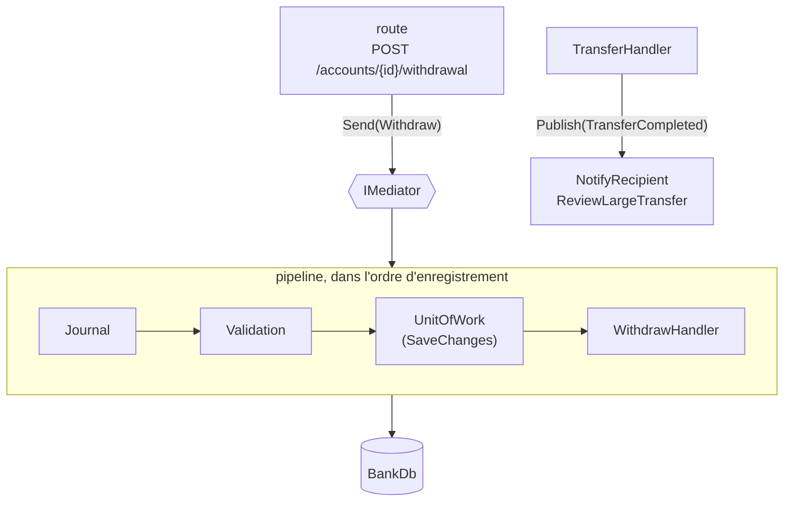
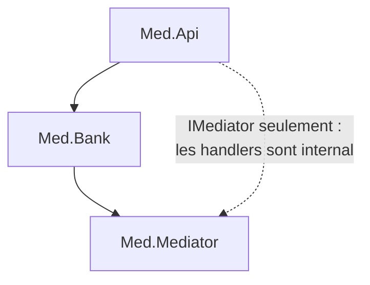

# 26. Mediator (messagerie en processus)

> **En une phrase** : les appelants n'appellent plus le code qui les sert, ils **envoient un message** à un
> **médiateur**. Celui-ci trouve le seul handler de ce message, le fait passer par un **pipeline** de comportements
> communs (journal, validation, unité de travail), et diffuse les **notifications** à tous ceux qu'elles intéressent.
> C'est ce que fait MediatR, écrit ici à la main ; et ce n'est **pas** du CQRS.

📁 Code : [`26-Mediator`](../26-Mediator) · ⬅️ [Transaction Script et Active Record](25-transaction-script-active-record.md) · ➡️ [Concepts transverses](concepts-transverses.md) · 🌐 [English](en/26-mediator.md)

---

## L'idée : un intermédiaire entre ceux qui demandent et ceux qui font

Le **Mediator** est l'un des patrons du *Gang of Four* (1994) : plutôt que des objets qui se connaissent tous, un
médiateur par lequel ils communiquent. En .NET, le mot désigne surtout ce que **MediatR** (Jimmy Bogard, 2014) a
popularisé, la **messagerie en processus** :

- une **requête** (`Withdraw`, `GetAccount`) a **exactement un** handler, et une réponse ;
- une **notification** (`TransferCompleted`) a **zéro, un ou plusieurs** handlers, et pas de réponse ;
- des **comportements** (*pipeline behaviors*) entourent chaque requête : écrits une fois, ils s'appliquent à toutes.

MediatR est devenu payant pour les entreprises en 2025. La démo l'écrit à la main, en une centaine de lignes, pour
montrer qu'il n'y a là aucune magie, et à quel prix vient la commodité.



---

## Les projets

```
Med.Mediator   le médiateur, écrit à la main : IRequest, IRequestHandler, INotification, IPipelineBehavior, Mediator
               (≈ 100 lignes, ne connaît que le conteneur d'injection de dépendances)
Med.Bank       la banque : un fichier par requête (requête + validateur + handler, ces deux-là internal),
               les notifications et leurs handlers, les trois comportements du pipeline, BankDb (EF Core en mémoire)
Med.Api        :5126  des routes qui ne connaissent que IMediator ; GET /journal montre ce que le pipeline a vu
Med.Tests      35 tests : le médiateur seul, la banque par le médiateur, l'API, l'architecture
```



---

## 1. Le médiateur, sans magie

L'appelant ne connaît que le type de la réponse. Le vrai type de la requête n'est connu qu'à l'exécution : le
médiateur fabrique alors, une fois par type de requête, un « répartiteur » typé, puis le réutilise.
([Mediator.cs](../26-Mediator/Med.Mediator/Mediator.cs))

```csharp
public Task<TResponse> Send<TResponse>(IRequest<TResponse> request, CancellationToken ct = default)
{
    ArgumentNullException.ThrowIfNull(request);

    // The caller only knows TResponse; the request's real type is only known now.
    // The dispatcher closes the generic types once: IRequestHandler<Withdraw, decimal>, and so on.
    var dispatcher = (Dispatcher<TResponse>)Dispatchers.GetOrAdd(request.GetType(), type =>
        Activator.CreateInstance(typeof(Dispatcher<,>).MakeGenericType(type, typeof(TResponse)))!);
    return dispatcher.Send(request, services, ct);
}
```

Le répartiteur demande le handler au conteneur, puis l'enveloppe dans les comportements, comme les couches d'un oignon :

```csharp
var typed = (TRequest)request;
var handler = services.GetService<IRequestHandler<TRequest, TResponse>>()
    ?? throw new InvalidOperationException($"No handler is registered for {typeof(TRequest).Name}.");

// The behaviors wrap the handler like the layers of an onion:
// the first one registered is the outermost, the handler is at the center.
RequestHandlerDelegate<TResponse> next = () => handler.Handle(typed, ct);
foreach (var behavior in services.GetServices<IPipelineBehavior<TRequest, TResponse>>().Reverse())
{
    var inner = next;
    next = () => behavior.Handle(typed, inner, ct);
}
return next();
```

C'est tout : MediatR ajoute des optimisations, des flux (`IStreamRequest`), des stratégies de publication, mais le cœur
est là.

---

## 2. Une route = un message

Toutes les routes ont la même forme : fabriquer un message, l'envoyer, traduire le résultat en HTTP. Elles ne
connaissent ni le handler, ni ce qui tourne autour.
([BankEndpoints.cs](../26-Mediator/Med.Api/BankEndpoints.cs))

```csharp
app.MapPost("/accounts/{id:guid}/withdrawal", (Guid id, WithdrawalRequest request, IMediator mediator, CancellationToken ct) =>
    Run(async () => Results.Ok(new { NewBalance = await mediator.Send(new Withdraw(id, request.Amount), ct) })));

app.MapPost("/transfers", (Transfer command, IMediator mediator, CancellationToken ct) =>
    Run(async () => Results.Ok(await mediator.Send(command, ct))));
```

Les handlers sont `internal` : l'API **ne peut pas** les appeler directement, le compilateur l'en empêche. Le seul
chemin est le médiateur.

---

## 3. Un handler qui ne fait que le métier

Pas de validation, pas de journal, pas de `SaveChanges` : le pipeline s'en charge.
([Withdraw.cs](../26-Mediator/Med.Bank/Features/Accounts/Withdraw.cs))

```csharp
public record Withdraw(Guid AccountId, decimal Amount) : ICommand<decimal>;

internal class WithdrawValidator : IValidator<Withdraw>
{
    public IEnumerable<ValidationError> Validate(Withdraw request)
    {
        if (request.Amount <= 0)
            yield return new(nameof(request.Amount), "The amount must be strictly positive.");
    }
}

/// <summary>Only the business: no validation, no logging, no SaveChanges. The behaviors take care of them.</summary>
internal class WithdrawHandler(BankDb db) : IRequestHandler<Withdraw, decimal>
{
    public async Task<decimal> Handle(Withdraw request, CancellationToken ct)
    {
        var account = await db.Accounts.FindAsync([request.AccountId], ct)
            ?? throw new NotFoundException($"Account {request.AccountId} not found.");

        account.Withdraw(request.Amount);
        db.Operations.Add(new Operation { AccountId = account.Id, Label = "Withdrawal", Amount = -request.Amount });
        return account.Balance;
    }
}
```

La requête, son validateur et son handler sont **dans le même fichier** : c'est la disposition habituelle, et c'est
une [tranche verticale](05-vertical-slice.md). Les deux se combinent si souvent qu'on les confond ; la tranche dit
**où ranger**, le médiateur dit **comment appeler**.

---

## 4. Le pipeline : écrit une fois, appliqué à toutes les requêtes

Trois comportements, enregistrés dans l'ordre où ils s'emboîtent.
([BankRegistration.cs](../26-Mediator/Med.Bank/BankRegistration.cs))

```csharp
// Handlers and notification handlers are found by scanning; the behaviors are listed, in pipeline order.
services.AddMediator(typeof(BankRegistration).Assembly)
    .AddBehavior(typeof(JournalBehavior<,>))
    .AddBehavior(typeof(ValidationBehavior<,>))
    .AddBehavior(typeof(UnitOfWorkBehavior<,>));
```

La **validation** arrête la requête avant son handler ; l'**unité de travail** enregistre après une commande, jamais
après une lecture.
([Behaviors.cs](../26-Mediator/Med.Bank/Pipeline/Behaviors.cs))

```csharp
public Task<TResponse> Handle(TRequest request, RequestHandlerDelegate<TResponse> next, CancellationToken ct)
{
    var errors = validators.SelectMany(v => v.Validate(request)).ToList();
    if (errors.Count > 0)
        throw new RequestValidationException(errors);
    return next();
}
```

```csharp
public async Task<TResponse> Handle(TRequest request, RequestHandlerDelegate<TResponse> next, CancellationToken ct)
{
    if (request is not ICommand<TResponse>)
        return await next();

    var response = await next();
    await db.SaveChangesAsync(ct);
    return response;
}
```

**L'ordre compte.** Le journal est à l'extérieur : il voit aussi les requêtes refusées par la validation. Placé après
elle, il ne les verrait plus (les essais de mutation le confirment : inverser les deux lignes fait échouer le test du
journal). Essai réel, `GET /journal` après le scénario de `Bank.http` (le premier appel inclut le démarrage d'EF Core) :

```text
{"request":"Transfer","outcome":"ok","elapsedMs":86.46}
{"request":"GetAccount","outcome":"ok","elapsedMs":36.14}
{"request":"ListComplianceAlerts","outcome":"ok","elapsedMs":2.85}
{"request":"Withdraw","outcome":"ok","elapsedMs":2.12}
{"request":"Withdraw","outcome":"RequestValidationException","elapsedMs":0.32}
{"request":"Withdraw","outcome":"BusinessRuleException","elapsedMs":0.38}
```

Le retrait de 0 € s'arrête dans la validation (0,32 ms, le handler n'est jamais appelé) ; celui de 99 999 € va
jusqu'au handler, où l'entité refuse : deux refus, deux étages différents du pipeline.

---

## 5. Les notifications : l'émetteur ne connaît pas ses abonnés

Le virement déplace l'argent, puis **annonce** qu'il l'a fait. Il ne sait pas que Bob sera prévenu ni qu'un contrôle de
conformité regarde les gros montants.
([Transfer.cs](../26-Mediator/Med.Bank/Features/Transfers/Transfer.cs))

```csharp
source.Withdraw(request.Amount);
target.Deposit(request.Amount);
// …
await mediator.Publish(new TransferCompleted(source.Id, source.Owner, target.Id, request.Amount), ct);
return new TransferResult(source.Balance, target.Balance);
```

([TransferCompleted.cs](../26-Mediator/Med.Bank/Features/Transfers/TransferCompleted.cs))

```csharp
internal class NotifyRecipient(BankDb db) : INotificationHandler<TransferCompleted>
{
    public Task Handle(TransferCompleted notification, CancellationToken ct)
    {
        db.Notifications.Add(new Notification
        {
            AccountId = notification.TargetId,
            Message = $"You received {notification.Amount:0.##} € from {notification.SourceOwner}."
        });
        return Task.CompletedTask;
    }
}
```

Ajouter une réaction (un courriel, des points de fidélité) = ajouter un handler, sans toucher au virement.

**Mais ce n'est pas un bus de messages.** Les handlers tournent **dans le même processus, l'un après l'autre, dans le
fil du virement**, avant son `SaveChanges`. Leurs écritures sont enregistrées avec lui, ou pas du tout, et la première
exception annule tout. Un test le montre : un handler d'audit en panne fait échouer le virement, et ni les soldes ni la
notification de Bob ne bougent (`A_failing_notification_handler_cancels_the_whole_transfer`). C'est l'opposé de la
[chorégraphie](21-choregraphie.md), où les événements traversent un courtier, entre services, après coup : un abonné en
panne n'y empêche pas le virement, mais il faut alors gérer les reprises et l'ordre.

---

## 6. Le prix : le compilateur ne voit plus le chemin

Avec un appel direct, « aller à la définition » mène au code qui s'exécute, et un appel sans destination ne compile pas.
Avec un médiateur :

- `mediator.Send(new Withdraw(...))` **compile toujours**, même s'il n'existe aucun handler ; l'erreur n'arrive qu'à
  l'exécution (`No handler is registered for Withdraw.`, un test le vérifie) ;
- « aller à la définition » mène à `IMediator`, pas au handler ; il faut chercher la classe qui implémente
  `IRequestHandler<Withdraw, decimal>` ;
- un handler peut envoyer d'autres requêtes : les appels en cascade deviennent invisibles ;
- ce qui tourne autour d'un handler (le pipeline) n'est écrit nulle part près de lui.

Les tests d'architecture remettent une partie de ce que le compilateur faisait.
([ArchitectureTests.cs](../26-Mediator/Med.Tests/ArchitectureTests.cs))

```csharp
[Fact]
public void Every_request_of_the_bank_has_exactly_one_handler()
{
    using var bank = new TestBank();
    using var scope = bank.Services.CreateScope();

    var requests = Bank.GetTypes().Where(t => !t.IsAbstract && !t.IsInterface && Implements(t, typeof(IRequest<>)));
    foreach (var request in requests)
    {
        var response = request.GetInterfaces().Single(i => i.IsGenericType && i.GetGenericTypeDefinition() == typeof(IRequest<>))
            .GetGenericArguments()[0];
        var handlers = scope.ServiceProvider.GetServices(typeof(IRequestHandler<,>).MakeGenericType(request, response));
        Assert.True(handlers.Count() == 1, $"{request.Name}: {handlers.Count()} handler(s)");
    }
}
```

Deux autres vérifient que les handlers sont `internal` et qu'aucun ne dépend d'un autre handler.

---

## 7. Un médiateur ne fait pas un CQRS

`ICommand` et `IQuery` sont **nos** étiquettes (le médiateur ne connaît que « requête ») : elles servent à
l'unité de travail pour savoir quand enregistrer. Mais la lecture interroge **les mêmes tables, avec le même
`DbContext`**, que les commandes.
([GetAccount.cs](../26-Mediator/Med.Bank/Features/Accounts/GetAccount.cs))

```csharp
/// <summary>A query reads the same tables as the commands: the mediator does not separate the models.</summary>
internal class GetAccountHandler(BankDb db) : IRequestHandler<GetAccount, AccountView>
```

Le CQRS sépare **les modèles** (un pour écrire, un autre pour lire, souvent deux bases reliées par des événements) ;
le médiateur sépare **l'appelant du code appelé**. On peut faire du CQRS sans médiateur, et un médiateur sans CQRS :
c'est le cas ici. La comparaison détaillée : [Mediator ou CQRS ?](differences/18-mediator-vs-cqrs.md)

---

## Les tests

35 tests :

- **Le médiateur seul** (`MediatorTests`), avec des messages jouets : la requête atteint son handler ; une requête
  sans handler échoue en citant son nom ; les comportements s'emboîtent dans l'ordre d'enregistrement ; un comportement
  peut répondre sans appeler le handler ; la publication appelle tous les handlers, dans l'ordre, et s'arrête au premier
  qui échoue.
- **La banque par le médiateur** (`BankTests`), sans HTTP, une portée par envoi comme une requête web : un retrait est
  enregistré alors que son handler n'appelle jamais `SaveChanges` ; une lecture n'enregistre **jamais** ce qui traîne
  dans l'unité de travail ; une requête invalide s'arrête avant son handler ; un handler de notification en panne annule
  tout le virement ; le journal note chaque requête et son issue.
- **L'API** (`ApiTests`) : erreurs de validation (400, champs en erreur), règle métier (400), compte inconnu (404).
- **L'architecture** (`ArchitectureTests`) : le médiateur ignore la banque ; chaque requête a un handler et un seul ;
  handlers `internal` ; aucun handler ne dépend d'un autre.

Les essais de mutation (27 garanties cassées une par une : ordre du pipeline, publication, recherche des handlers,
validation, unité de travail, chaque règle, codes HTTP) font tous échouer au moins un test.

---

## Bilan

| 👍 Points forts | 👎 Limites |
|---|---|
| Les préoccupations communes (journal, validation, transaction, droits, cache) écrites une fois | Le chemin d'exécution n'est plus visible : « aller à la définition » mène à `IMediator` |
| Routes et contrôleurs minces, tous de la même forme | Une requête sans handler compile ; l'erreur arrive à l'exécution |
| Un émetteur ne connaît pas ses abonnés (notifications) | Notifications synchrones, dans la même transaction : un abonné lent ou en panne ralentit ou annule tout |
| Se combine naturellement avec les tranches verticales | Indirection inutile si chaque requête n'a de toute façon qu'un appelant ; souvent pris à tort pour du CQRS |

**Quand l'utiliser** : beaucoup de cas d'utilisation qui partagent les mêmes préoccupations (validation, transaction,
audit, autorisations), surtout avec des [tranches verticales](05-vertical-slice.md). **Quand s'en passer** : une
petite application, où un appel direct à un service se lit mieux ; et quand le besoin réel est de séparer lectures et
écritures, ce qui est le travail du [CQRS](09-cqrs.md), pas du médiateur. Un décorateur sur une interface de service
donne aussi un pipeline, sans perdre « aller à la définition ».
