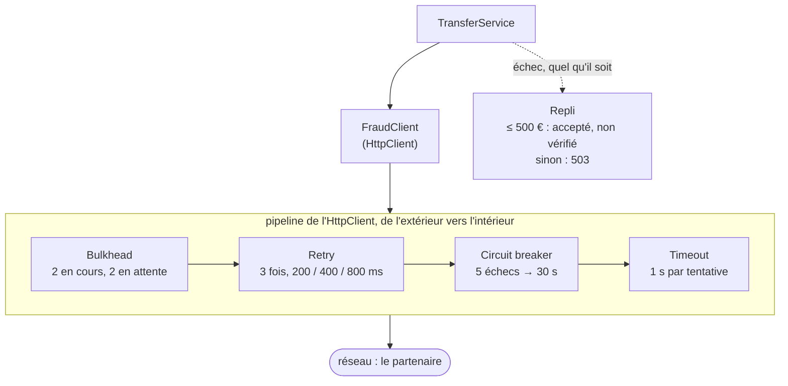
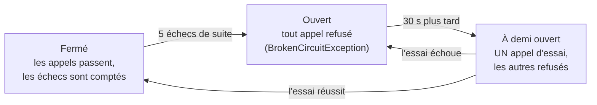

# 27. Résilience (timeout, retry, circuit breaker, bulkhead)

**Nom anglais** : Resilience Patterns

> **En une phrase** : quand une application dépend d'un service qu'elle ne contrôle pas, elle ne peut pas l'empêcher
> d'être lent ou en panne, mais elle peut **ne pas tomber avec lui** : couper les appels trop longs (**timeout**),
> réessayer les pannes passagères (**retry**), arrêter d'appeler un service à terre (**circuit breaker**), borner ce
> qu'il peut immobiliser (**bulkhead**), et décider quoi faire sans lui (**repli**).

📁 Code : [`27-Resilience`](../27-Resilience) · ⬅️ [Mediator](26-mediator.md) · ➡️ [Concepts transverses](concepts-transverses.md) · 🌐 [English](en/27-resilience.md)

---

## L'idée : une panne ne doit pas se propager

Avant chaque virement, la banque demande à un **partenaire** (un service de détection de fraude) si l'opération est
suspecte. Le partenaire est derrière le réseau. Sans précaution, sa panne devient la nôtre :

- un partenaire **lent** garde chaque requête en attente ; les fils d'exécution et les connexions s'épuisent, et c'est
  toute la banque qui ne répond plus, même pour consulter un solde ;
- un partenaire **en panne** reçoit quand même tous nos appels, plus nos réessais : on l'empêche de se relever ;
- et le client attend, pour finir sur une erreur.

Michael Nygard a nommé ces protections dans *Release It!* (2007) ; en .NET, la bibliothèque **Polly** les a
popularisées, et `Microsoft.Extensions.Http.Resilience` les assemble en un appel, `AddStandardResilienceHandler`, que la
[démo 8](08-microservices.md) utilise. Cette démo les écrit **à la main**, sans paquet, pour voir ce que fait chacune,
et pourquoi leur **ordre** compte.



---

## Les projets

```
Res.Resilience      les quatre stratégies, écrites à la main comme des DelegatingHandler (≈ 250 lignes) ;
                    ne connaît pas la banque
Res.FraudSimulator  le partenaire simulé, à la place du réseau : sain, capricieux, lent ou en panne, à la demande
Res.Bank            comptes, virements, FraudClient (un HttpClient sans aucun code de résilience) et le repli
Res.Api             :5127  POST /transfers ; GET /resilience (état du circuit, événements, appels reçus par le
                    partenaire) ; POST /partner/mode (l'interrupteur de pannes)
Res.Tests           35 tests, sur une horloge factice : chaque stratégie seule, puis l'API devant chaque panne
```

---

## 1. L'ordre du pipeline est le design

Les stratégies sont des **gestionnaires** (`DelegatingHandler`) empilés autour de l'`HttpClient` du partenaire. Le
code qui appelle (`FraudClient`) n'en sait rien : il fait un `PostAsJsonAsync`.
([Program.cs](../27-Resilience/Res.Api/Program.cs))

```csharp
// The pipeline of the fraud client, from the outside in: the order IS the design.
builder.Services.AddHttpClient<IFraudCheck, FraudClient>(client => client.BaseAddress = new Uri("http://fraud.partner.example/"))
    .AddHttpMessageHandler(sp => new BulkheadHandler(sp.GetRequiredService<Bulkhead>()))
    .AddHttpMessageHandler(sp => new RetryHandler(sp.GetRequiredService<ResilienceOptions>().Retry,
        sp.GetRequiredService<TimeProvider>(), sp.GetRequiredService<ResilienceEvents>(), sp.GetRequiredService<Random>()))
    .AddHttpMessageHandler(sp => new CircuitBreakerHandler(sp.GetRequiredService<CircuitBreaker>()))
    .AddHttpMessageHandler(sp => new TimeoutHandler(sp.GetRequiredService<ResilienceOptions>().AttemptTimeout,
        sp.GetRequiredService<TimeProvider>(), sp.GetRequiredService<ResilienceEvents>()))
    .ConfigurePrimaryHttpMessageHandler(sp => new SimulatedFraudHandler(sp.GetRequiredService<FraudPartner>()));
```

Pourquoi cet ordre (le même que celui d'`AddStandardResilienceHandler`) :

| Position | Stratégie | Si elle était ailleurs… |
|---|---|---|
| 1, la plus extérieure | **Bulkhead** | à l'intérieur du retry, une requête qui réessaie libérerait puis reprendrait sa place à chaque tentative |
| 2 | **Retry** | à l'intérieur du breaker, il ne verrait pas le circuit ouvert et ses tentatives ne seraient pas comptées |
| 3 | **Circuit breaker** | à l'extérieur du retry, il compterait une requête de 4 tentatives comme **un** échec |
| 4, la plus intérieure | **Timeout** (par tentative) | à l'extérieur du retry, il couperait l'ensemble des tentatives, pas chacune |

---

## 2. Timeout : ne pas attendre indéfiniment

Au-delà d'une seconde, l'appel est annulé et devient une `TimeoutRejectedException`, un échec comme un autre pour le
breaker et le retry autour.
([TimeoutHandler.cs](../27-Resilience/Res.Resilience/TimeoutHandler.cs))

```csharp
using var timeoutSource = new CancellationTokenSource(timeout, clock);
using var linked = CancellationTokenSource.CreateLinkedTokenSource(ct, timeoutSource.Token);
try
{
    return await base.SendAsync(request, linked.Token);
}
catch (OperationCanceledException) when (timeoutSource.IsCancellationRequested && !ct.IsCancellationRequested)
{
    // Our delay ran out, not the caller's patience: the caller's own cancellation goes up unchanged.
    events.Add("timeout", $"no answer within {timeout.TotalMilliseconds:0} ms");
    throw new TimeoutRejectedException(timeout);
}
```

Le filtre distingue **notre** délai de l'abandon de l'appelant (le client HTTP qui se déconnecte) : ce dernier n'est
pas une panne du partenaire, et ne doit ni être réessayé ni ouvrir le circuit.

---

## 3. Retry : réessayer, mais pas n'importe comment

([RetryHandler.cs](../27-Resilience/Res.Resilience/RetryHandler.cs))

```csharp
for (var attempt = 0; ; attempt++)
{
    string failure;
    try
    {
        var response = await base.SendAsync(request, ct);
        if (!Transient.IsFailure(response) || attempt == options.MaxRetries)
            return response;
        failure = $"HTTP {(int)response.StatusCode}";
        response.Dispose();
    }
    catch (Exception e) when (Transient.IsRetryable(e) && attempt < options.MaxRetries)
    {
        failure = e.GetType().Name;
    }

    var delay = DelayBefore(attempt + 1);
    events.Add("retry", $"attempt {attempt + 2} in {delay.TotalMilliseconds:0} ms, after {failure}");
    await Task.Delay(delay, clock, ct);
}
```

Quatre règles, chacune vérifiée par un test :

- **Seulement les pannes passagères** : 5xx, 408, 429, erreur réseau, timeout. Un `400` ne guérira pas en réessayant.
- **Une attente qui double** (*backoff exponentiel*) : 200, 400, 800 ms, pour laisser au service le temps de se remettre.
- **Une part de hasard** (*jitter*, jusqu'à +20 %) : mille clients qui ont échoué ensemble ne doivent pas revenir à la
  même milliseconde.
- **Jamais un circuit ouvert ni une cloison pleine** : réessayer ce que ces deux-là refusent annulerait leur effet.

Et une règle de métier : **on ne réessaie que ce qu'on peut répéter sans dommage**. Demander un avis de fraude, oui ;
débiter un compte, non (sauf avec une clé d'[idempotence](concepts-transverses.md#idempotence), comme la démo 8).

> **Un piège rencontré en écrivant la démo** : le retry renvoie **le même** `HttpRequestMessage`. Son contenu doit
> pouvoir être relu. Le simulateur lisait d'abord le corps avec `ReadFromJsonAsync`, qui ferme le flux mis en mémoire :
> la deuxième tentative échouait en `ObjectDisposedException` (500). Il le lit maintenant en texte.

---

## 4. Circuit breaker : laisser souffler un service à terre

Après **5 échecs de suite**, le circuit s'**ouvre** : pendant 30 s, chaque appel échoue **aussitôt**, sans réseau.
Puis il passe **à demi ouvert** : **un seul** appel d'essai décide de la suite.



([CircuitBreaker.cs](../27-Resilience/Res.Resilience/CircuitBreaker.cs))

```csharp
public void BeforeCall()
{
    lock (_gate)
    {
        if (State == CircuitState.HalfOpen)
            throw new BrokenCircuitException(TimeSpan.Zero);   // the trial call is in progress: no other

        if (State == CircuitState.Open)
        {
            var remaining = _openedAt + options.BreakDuration - clock.GetUtcNow();
            if (remaining > TimeSpan.Zero)
                throw new BrokenCircuitException(remaining);
            State = CircuitState.HalfOpen;
            events.Add("circuit", "half-open: one trial call");
        }
    }
}
```

**L'état est partagé** : un seul breaker par partenaire, pour toutes les requêtes (un singleton), sinon chaque requête
aurait son propre compteur et le circuit ne s'ouvrirait jamais. Il vit **hors** du gestionnaire : `IHttpClientFactory`
recrée ses gestionnaires toutes les deux minutes, et l'état serait perdu avec eux.

---

## 5. Bulkhead : borner ce qu'un service peut immobiliser

Le nom vient des **cloisons étanches** d'un navire. Au plus 2 appels en cours vers le partenaire, 2 en attente, les
suivants refusés **aussitôt**. Un partenaire très lent n'immobilise que ces quatre requêtes.
([Bulkhead.cs](../27-Resilience/Res.Resilience/Bulkhead.cs))

```csharp
public async Task<IDisposable> Enter(CancellationToken ct)
{
    if (!_slots.Wait(0))
    {
        lock (_gate)
        {
            if (_queued >= options.MaxQueue)
            {
                events.Add("bulkhead", $"rejected: {options.MaxConcurrency} in progress, {_queued} waiting");
                throw new BulkheadRejectedException();
            }
            _queued++;
        }
        try
        {
            await _slots.WaitAsync(ct);
        }
        finally
        {
            lock (_gate)
                _queued--;
        }
    }
    return new Slot(_slots);
}
```

---

## 6. Le repli : une décision de métier

Les quatre stratégies limitent les dégâts ; elles ne répondent pas à la question « et maintenant ? ». Quelle que soit
la raison de l'échec (réseau, timeout, circuit ouvert, cloison pleine), c'est la banque qui décide.
([TransferService.cs](../27-Resilience/Res.Bank/TransferService.cs))

```csharp
bool approved;
try
{
    approved = await fraud.IsApproved(source, amount, ct);
}
catch (Exception e) when (e is HttpRequestException or TimeoutRejectedException
                              or BrokenCircuitException or BulkheadRejectedException)
{
    if (amount > UnverifiedLimit)
        throw new FraudCheckUnavailableException(e.GetType().Name,
            e is BrokenCircuitException broken ? broken.RetryAfter : TimeSpan.FromSeconds(5));

    var (from, to) = ledger.Move(source, target, amount, " (unverified)");
    return new TransferOutcome("accepted-unverified", from, to);
}
```

Jusqu'à 500 €, le virement passe, marqué « non vérifié », pour un contrôle après coup ; au-delà, `503` avec un
en-tête `Retry-After` (le temps restant avant que le circuit ne retente, s'il est ouvert). Ce seuil n'est pas un réglage
technique : c'est le **risque** que la banque accepte de prendre.

Et un détail qui compte : les règles qu'on peut vérifier seul (montant, comptes, solde) le sont **avant** d'appeler
le partenaire. Un virement invalide ne lui coûte aucun appel (un test le vérifie).

---

## Essai réel : le scénario de `Bank.http`

L'API lancée pour de vrai (horloge réelle), les requêtes de `Bank.http` dans l'ordre :

| Partenaire | Virement | Réponse | Durée | Appels reçus (cumul) |
|---|---|---|---|---|
| sain | 100 € | `accepted` | 0,15 s | 1 |
| capricieux (2 × 503) | 100 € | `accepted` : 2 réessais, après 203 puis 423 ms | 0,74 s | 4 |
| lent (3 s) | 50 € | `accepted-unverified` : 4 timeouts | 5,5 s | 8 |
| en panne | 600 € | `503`, `Retry-After: 30` : le 5e échec de suite ouvre le circuit | 0,26 s | 9 |
| en panne | 10 € | `accepted-unverified`, circuit ouvert | **0,001 s** | 9 : pas d'appel |
| de retour, 31 s plus tard | 10 € | `accepted` : l'appel d'essai referme le circuit | 0,03 s | 10 |

Deux lectures. Le partenaire lent a coûté 5,5 s au client : c'est le prix de 4 tentatives d'une seconde, et la
raison d'être d'un **timeout total** en production. Et les 4 timeouts ont compté dans le breaker : le premier échec
en panne a suffi à l'ouvrir. Une fois ouvert, le partenaire ne reçoit plus rien et le client a sa réponse en une
milliseconde. Les attentes affichées (203, 423, 238, 435, 814 ms) montrent le jitter au travail.

---

## 7. En production : ne pas réécrire Polly

Cette démo écrit les stratégies pour les comprendre. En production, `AddStandardResilienceHandler` (démo 8) assemble
les mêmes, dans le même ordre, avec ce que la démo laisse de côté :

- un **timeout total**, en plus du timeout par tentative ;
- un breaker **par taux d'échec** sur une fenêtre de temps, plutôt qu'un nombre d'échecs de suite ;
- un **limiteur de débit** (*rate limiter*) à la place de la cloison ;
- le **hedging** (lancer une deuxième requête si la première tarde) ;
- la télémétrie (métriques, traces) de chaque stratégie.

Le paquet est déjà dans le cache, et la configuration tient en dix lignes. L'intérêt de cette démo est ailleurs :
savoir **ce que l'on règle** quand on choisit `MaxRetryAttempts = 3`.

---

## Les tests

35 tests, tous sur une **horloge factice** (`FakeTimeProvider`) : les attentes du retry, les timeouts, la pause du
breaker et la lenteur du partenaire suivent cette horloge, qu'un utilitaire fait avancer par pas de 50 ms tant que
l'appel n'est pas fini. Une pause de 30 s dure quelques millisecondes ; aucun `Thread.Sleep`.

- **Chaque stratégie seule** (`StrategyTests`), devant un service scripté qui compte ses appels : retry (pannes
  passagères, abandon après 3 réessais, pas de réessai sur un 400, attentes qui doublent, jitter), timeout (lenteur,
  annulation par l'appelant), breaker (ouverture à 5 échecs, remise à zéro par un succès, essai réussi ou raté, un seul
  essai à la fois, essai annulé), bulkhead (2 + 2, le 5e refusé), et le retry qui ne réessaie pas un circuit ouvert.
- **L'API devant chaque panne** (`ApiTests`) : partenaire sain (1 appel), capricieux (3 appels, accepté), lent (4
  timeouts, accepté non vérifié), en panne (503 et `Retry-After`), circuit qui protège puis se referme, cloison pleine.
- **L'architecture** : les stratégies ignorent la banque ; la banque ignore le simulateur ; `FraudClient` n'a pas
  d'autre champ que son `HttpClient`.

Les essais de mutation (28 garanties cassées une par une) font tous échouer au moins un test. Le premier passage en
avait laissé cinq sans effet, chacun corrigé par un test plus exigeant ou par le code :

- **supprimer l'attente** entre deux tentatives : les tests vérifiaient le journal, pas le temps écoulé ; un test
  mesure maintenant l'écart entre les appels sur l'horloge ;
- **réessayer un circuit ouvert** : le partenaire ne recevait pas plus d'appels, mais les réessais sont désormais comptés ;
- **prendre l'abandon de l'appelant pour un timeout** quand les deux arrivent ensemble : un test dédié ;
- **ignorer l'échec de l'appel d'essai** : sans effet, car le compteur d'échecs n'était pas remis à zéro à
  l'ouverture ; il l'est maintenant, et c'est bien l'état « à demi ouvert » qui rouvre le circuit ;
- **le plafond de 5 000 €** : 5 001 € dépassent aussi le solde d'Alice, le refus venait du solde ; le test vérifie
  désormais le message.

---

## Bilan

| 👍 Points forts | 👎 Limites |
|---|---|
| Une panne du partenaire reste chez lui : pas d'effet domino | Des réglages à choisir et à tester (seuils, délais, nombre d'essais) |
| Réponse rapide au client, même en cas d'échec | Les réessais multiplient la charge : sans breaker ni jitter, ils aggravent la panne |
| Le partenaire en difficulté n'est plus bombardé | Réessayer n'est sûr que pour une opération idempotente |
| Le code métier ignore tout : la résilience est dans le pipeline | Le repli est une décision de métier, qu'il faut prendre explicitement |

**Quand l'utiliser** : pour **tout** appel réseau vers un service qu'on ne contrôle pas (partenaire, autre service,
base distante). C'est le complément obligé des [microservices](08-microservices.md), du [BFF](16-bff.md) et de toute
architecture distribuée. **En pratique** : `AddStandardResilienceHandler` ou Polly ; écrire les siens seulement pour
apprendre, comme ici.
