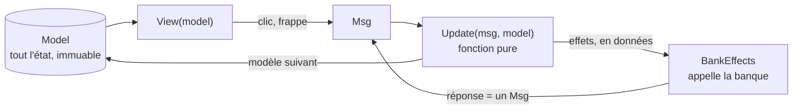

# 28. MVU (Model-View-Update)

> **En une phrase** : tout l'état de l'écran tient dans **un modèle immuable** ; tout ce qui arrive (clic, frappe,
> réponse de la banque) est un **message**, traité **un à la fois** par une fonction **pure**, `Update`, qui rend le
> modèle suivant et les effets à lancer **sous forme de données** ; la **vue** est recalculée à partir du modèle, et
> seules les différences atteignent l'écran. Le même écran que la [démo 24](24-mvc-mvvm.md), en flux à sens unique.

📁 Code : [`28-Mvu`](../28-Mvu) · ⬅️ [Résilience](27-resilience.md) · ➡️ [Concepts transverses](concepts-transverses.md) · 🌐 [English](en/28-mvu.md)

---

## L'idée : un seul sens de circulation

La démo 24 a construit le même écran de banque en MVC et en MVVM. En MVVM, la vue et le ViewModel se parlent **dans
les deux sens** (liaisons) ; l'état est réparti dans des propriétés, et chaque setter doit penser à revalider, à
prévenir la vue, à réévaluer les commandes. MVU, venu du langage **Elm** (2012) et popularisé par **Redux** et React,
fait circuler l'information dans **un seul sens** :



Le même modèle de banque (`Ui.Bank`, celui de la démo 24, référencé tel quel), les mêmes règles, les mêmes
comportements : validation pendant la saisie, bouton grisé, confirmation au-delà de 1 000 €, réponses arrivées dans le
désordre écartées. Seule l'organisation change.

---

## Les projets

```
Mvu.Runtime   le moteur, écrit à la main : les nœuds de la vue (Column, Text, Button, TextBox, Choice), le diff
              entre deux vues, et la boucle (boîte aux lettres, Update, rendu, effets) ; ne connaît pas la banque
Mvu.Bank      l'écran : Model (tout l'état), Msg (tout ce qui arrive), Effect (ce qu'Update demande),
              BankScreen.Update (pure), BankView.View (pure), BankEffects (le seul code qui appelle la banque)
Mvu.Console   un afficheur générique (n'importe quel programme MVU) : la vue d'abord, puis seulement les différences ;
              « click ID », « type ID texte », « pick ID N » envoient le message attaché à l'élément
Ui.Bank       (démo 24) le modèle de la banque, partagé
Mvu.Tests     33 tests
```

```powershell
dotnet run --project 28-Mvu\Mvu.Console     # then: pick from 1, pick to 3, type amount 250, click transfer…
```

---

## 1. Le modèle : tout l'état, en une valeur

Ce qui est sélectionné, tapé, en cours de chargement, en attente de confirmation : tout est dans **un** `record`
immuable. Chaque message produit une copie modifiée (`with`), jamais une modification en place. Et ce qui se **déduit**
de l'état est recalculé à chaque lecture.
([Model.cs](../28-Mvu/Mvu.Bank/Model.cs))

```csharp
public string? AmountError =>
    AmountText.Trim().Length == 0 ? null
    : Amount is not { } amount ? "Enter an amount, for example 250.50."
    : TransferRules.CheckAmount(amount) ?? (SourceAccount is { } source ? TransferRules.CheckBalance(source.Balance, amount) : null);

public string? AccountsError =>
    Source is { } source && Target is { } target ? TransferRules.CheckAccounts(source, target) : null;

public bool CanTransfer =>
    Source is not null && Target is not null && Amount is not null && AmountError is null && AccountsError is null
    && !Busy && PendingConfirmation is null;
```

Comparer avec `TransferViewModel` (démo 24), qui appelle `Validate()` dans chaque setter, s'abonne au solde du compte
source pour revalider s'il change, et prévient la vue erreur par erreur. Ici, rien à appeler, rien à oublier : changer
de compte source change le solde lu, donc l'erreur.

---

## 2. Les messages : la liste de tout ce qui peut arriver

([Messages.cs](../28-Mvu/Mvu.Bank/Messages.cs))

```csharp
// What the user does
public sealed record AccountSelected(int Index) : Msg;
public sealed record SourceChosen(int Index) : Msg;
public sealed record TargetChosen(int Index) : Msg;
public sealed record AmountTyped(string Text) : Msg;
public sealed record SwapClicked : Msg;
public sealed record TransferClicked : Msg;
public sealed record ConfirmationAnswered(bool Yes) : Msg;

// What the bank answers (the results of the effects)
public sealed record AccountsLoaded(IReadOnlyList<Account> Accounts) : Msg;
public sealed record OperationsLoaded(int Request, IReadOnlyList<Operation> Operations) : Msg;
public sealed record OperationsFailed(int Request, string Error) : Msg;
public sealed record TransferDone(Transfer Transfer) : Msg;
public sealed record TransferFailed(string Error) : Msg;
```

Les réponses de la banque sont des messages **comme les clics** : elles font la queue avec eux, et sont traitées par la
même fonction.

---

## 3. `Update` : une fonction pure

Un message et le modèle courant entrent ; le nouveau modèle et les effets à lancer sortent. Pas d'`await`, pas
d'événement, pas d'appel à la banque.
([BankScreen.cs](../28-Mvu/Mvu.Bank/BankScreen.cs))

```csharp
// A response to an older request (A clicked, then B, and A's answer arrives last): ignored.
OperationsLoaded loaded when loaded.Request != model.OperationsRequest => (model, None),
OperationsLoaded loaded => (model with { Operations = [.. loaded.Operations], LoadingOperations = false }, None),
```

```csharp
// The button is greyed out when this is false; a click that arrives anyway (double click) changes nothing.
TransferClicked when !model.CanTransfer => (model, None),
TransferClicked when model.Amount >= TransferRules.ConfirmationThreshold =>
    (model with { PendingConfirmation = Question(model) }, None),
TransferClicked => Send(model),

ConfirmationAnswered { Yes: true } when model.PendingConfirmation is not null =>
    Send(model with { PendingConfirmation = null }),
ConfirmationAnswered when model.PendingConfirmation is not null =>
    (model with { PendingConfirmation = null, Notice = new Notice("Transfer cancelled.", IsError: false) }, None),
```

La **confirmation** montre la différence de fond avec la démo 24. En MVVM, la commande s'interrompait au milieu pour
**attendre** une réponse (`await _confirmation.AskAsync(…)`, une boîte de dialogue en WPF, une question au clavier en
console). En MVU, il n'y a rien à attendre : la question en cours est **un état** (`PendingConfirmation`), la vue
l'affiche avec deux boutons, et la réponse est un message de plus.

---

## 4. Les effets sont des données

`Update` ne charge rien : il **demande** (`new LoadOperations(id, request)`). Un interpréteur, seul à connaître
`IBank`, exécute la demande et transforme la réponse, succès ou refus métier, en message.
([BankEffects.cs](../28-Mvu/Mvu.Bank/BankEffects.cs))

```csharp
case LoadOperations load:
    try
    {
        return new OperationsLoaded(load.Request, await bank.OperationsAsync(load.Account, ct));
    }
    catch (BusinessError error)
    {
        return new OperationsFailed(load.Request, error.Message);
    }
```

C'est ce qui rend `Update` testable par simple comparaison de valeurs : « après ce clic, le modèle est celui-ci, et
l'effet demandé est `SendTransfer(Alice, Bob, 250)` ». Aucune fausse banque.
([UpdateTests.cs](../28-Mvu/Mvu.Tests/UpdateTests.cs))

```csharp
[Fact]
public void A_click_sends_the_transfer_and_a_second_click_sends_nothing()
{
    var (sending, effects) = BankScreen.Update(new TransferClicked(), ReadyToTransfer("250"));
    var (_, secondClick) = BankScreen.Update(new TransferClicked(), sending);

    Assert.Equal([new SendTransfer(InMemoryBank.Alice, InMemoryBank.Bob, 250m)], effects);
    Assert.True(sending.Busy);
    Assert.Empty(secondClick);
}
```

---

## 5. La vue : une fonction du modèle

La vue lit le modèle et **décrit** l'écran ; chaque élément porte le message qu'il enverra. Griser un bouton, c'est ne
lui donner aucun message.
([BankView.cs](../28-Mvu/Mvu.Bank/BankView.cs))

```csharp
H.TextBox("amount", "Amount", model.AmountText, text => new AmountTyped(text)),
model.AmountError is { } amountError ? H.Text(amountError, Tone.Error) : null,
H.Button("swap", "Swap", model.Source is not null || model.Target is not null ? new SwapClicked() : null),
H.Button("transfer", model.Busy ? "Transfer…" : "Transfer", model.CanTransfer ? new TransferClicked() : null),
```

La console ne connaît rien de la banque : « click transfer » cherche dans la vue courante l'élément `transfer` et
envoie son message ; un bouton sans message ne fait rien.

---

## 6. Le moteur : une boîte aux lettres, un message à la fois

La boucle lit les messages un par un, appelle `Update`, recalcule la vue, transmet les différences, lance les effets.
C'est le seul endroit où il y a de l'asynchrone et de la concurrence.
([Runtime.cs](../28-Mvu/Mvu.Runtime/Runtime.cs))

```csharp
await foreach (var message in _mailbox.Reader.ReadAllAsync())
{
    try
    {
        var (model, effects) = _program.Update(message, Model);
        var view = _program.View(model);
        var patches = Diff.Compute(View, view);
        (Model, View) = (model, view);
        if (patches.Count > 0)
            _render(view, patches);
        foreach (var effect in effects)
            Run(effect);
    }
    // …
}
```

Comme les [acteurs](18-modele-acteurs.md) : une boîte aux lettres lue par un seul consommateur. Un test envoie 1 000
messages depuis plusieurs fils : aucun n'est perdu, et `Update` n'est jamais appelée deux fois en même temps.

---

## 7. Le diff, et sa limite

La vue est recalculée en entier ; le diff la compare à la précédente, **position par position**, et seules les
différences sont affichées. L'essai réel (la console, la banque de la démo 24 à 300 ms par appel) le montre, et montre
aussi la limite d'un diff par position :

```text
> type amount abc
  ~ [amount] Amount: abc
  ~ ⚠ Enter an amount, for example 250.50.
  ~ [swap] Swap
  + (transfer) Transfer, greyed out
```

La ligne d'erreur s'insère au milieu : les lignes suivantes changent de position, et le diff les voit « modifiées ».
L'erreur prend la place de `[swap]`, `[swap]` celle de `(transfer)`, et `(transfer)`, qui n'a pas changé, est
« inséré » à la fin. React, Elm et Blazor évitent cela avec des **clés** : chaque élément est identifié, et une
insertion ne décale pas les autres. Le diff de la démo n'en a pas, volontairement.

Le reste de la session, tel qu'affiché : 2 000 € depuis Alice donnent `⚠ Insufficient balance: 1,000.00 € available.`
dès la frappe ; le virement de 250 € passe (« Transfer… » grisé pendant l'appel), le montant se vide, les soldes et
l'historique se rechargent ; un second clic ne fait rien (« greyed out ») ; 1 200 € depuis le livret font apparaître la
question, « no » l'annule, « yes » envoie le virement.

---

## MVVM ou MVU : le même écran

| Comportement | MVVM (démo 24) | MVU (cette démo) |
|---|---|---|
| L'état de l'écran | réparti dans les propriétés de plusieurs ViewModels | **un** modèle immuable |
| Valider pendant la saisie | `Validate()` dans chaque setter, abonnement au solde du compte source | erreurs **dérivées** du modèle, recalculées |
| Prévenir la vue | `PropertyChanged`, `ErrorsChanged`, `CanExecuteChanged` | rien : la vue est recalculée |
| Confirmation au-delà de 1 000 € | un `await` au milieu de la commande (`IConfirmation`) | un **état** : `PendingConfirmation`, deux boutons |
| Réponse périmée (A puis B) | un compteur dans le ViewModel, vérifié après l'`await` | un compteur dans le modèle, vérifié dans `Update` |
| Double clic | bouton grisé par `CanExecute` | `TransferClicked` ignoré quand `!CanTransfer` |
| Tester | ViewModel + fausse banque qui retient les appels | `Update` avec des valeurs, sans banque |
| Écrire un petit formulaire | une liaison et c'est fini | un message, un cas dans `Update`, un élément de vue |

---

## Les tests

33 tests :

- **`Update` seule** (`UpdateTests`, 15) : aucune banque, aucun moteur, aucun `await` : chargement initial, réponse
  périmée ignorée, erreurs à la frappe, erreur de solde qui suit le compte source, comptes identiques, double clic,
  confirmation (question, non, oui), virement fait (montant vidé, rechargement en gardant la sélection), refus de la
  banque.
- **La vue** (`ViewTests`) : bouton grisé ou porteur de `TransferClicked`, erreurs affichées, oui et non pendant une
  question.
- **Le moteur** (`RuntimeTests`), avec un compteur jouet : 1 000 messages concurrents traités un à un, résultat d'un
  effet revenu en message, rendu des seules différences, effet en échec enregistré, diff (insertion, suppression,
  remplacement, ligne devenue groupe).
- **Tout ensemble** (`ScreenTests`) : une session console complète sur la vraie banque ; la course « livret puis Bob »
  avec une banque qui retient la réponse du livret ; les refus de la banque devenus messages.
- **L'architecture** : le moteur ignore la banque ; seuls les effets appellent `IBank`, jamais `Update` ni la vue ; le
  modèle n'a que des propriétés `init` et des listes immuables.

Les essais de mutation (26 garanties cassées une par une) font tous échouer au moins un test. Le premier passage en
avait laissé deux : la **sélection perdue** au rechargement des comptes (le test sélectionnait déjà le premier compte,
celui qu'on retrouve par défaut) et l'**échange** des comptes cassé (le test ne regardait que l'erreur, pas le compte
destinataire).

L'écriture de la démo a aussi fait sortir un vrai défaut du diff : une ligne remplacée par un groupe (« loading… »
remplacé par l'historique) s'affichait « column (1) ». Il retire maintenant l'ancienne ligne et insère celles du groupe.

---

## Bilan

| 👍 Points forts | 👎 Limites |
|---|---|
| Tout le comportement dans une fonction pure, testée avec des valeurs | Un message et un cas d'`Update` pour la moindre saisie : verbeux |
| Un seul état : rien de désynchronisé, rien à revalider à la main | La vue recalculée en entier : il faut un diff (et des clés) |
| Un message à la fois : pas de course entre deux changements | Un modèle unique qui grossit : il faut le découper (composition de programmes) |
| Les effets sont des données : aucune fausse banque pour tester | Moins outillé que MVVM en .NET (Fabulous, Elmish) ; c'est l'approche de React et Redux côté web |

**Quand l'utiliser** : un écran riche, où l'ordre des événements compte et où l'on veut tout tester sans écran ; les
applications web à composants (React + Redux, Elm, et les composants de Blazor en reprennent une partie). **Quand
préférer MVVM** : une application de bureau XAML, où les liaisons font le travail en une ligne et où l'outillage
existe.
