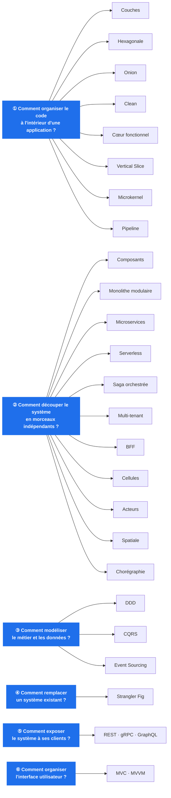
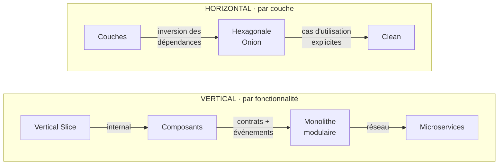
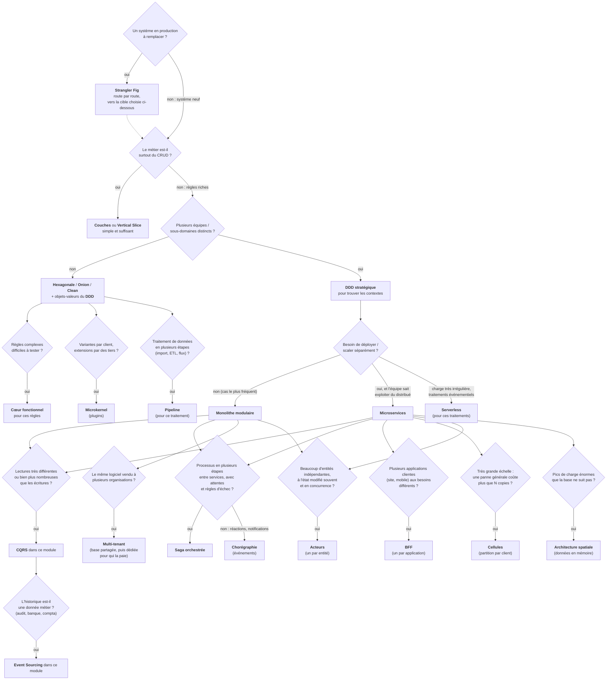
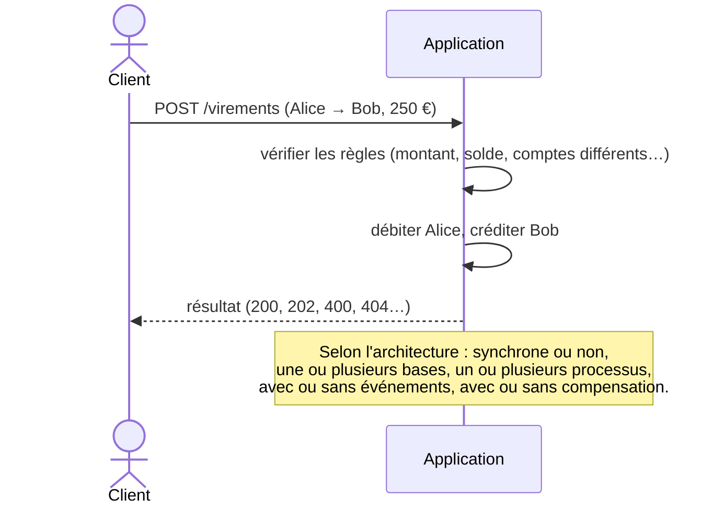

# Architectures logicielles en C# — documentation

🌐 [English](en/README.md) (traduction en cours : [état](en/TRANSLATION.md))

Cette documentation explique **vingt-deux façons d'organiser une application**, **une façon d'y arriver** depuis un
système existant, **trois façons de l'exposer** à ses clients et **deux façons d'organiser son interface**, chacune illustrée par une solution .NET 10 complète, testée et exécutable dans ce dépôt. Toutes implémentent **le même métier** — une petite banque : ouvrir un compte,
consulter, retirer, virer — pour qu'on puisse comparer la *forme* du code à fonctionnalités égales.

> 📗 **Pas développeur ?** Une version sans code, avec des mots simples et des images de la vie courante :
> [les architectures expliquées à tout le monde](pour-tous/README.md).

> 🗂️ **Besoin d'un résumé ?** Une fiche mémo d'une page par architecture (idée, schéma, règles, quand l'utiliser,
> pièges) : [les fiches](fiches/README.md).

> ⚖️ **Hexagonale ou Onion ? CQRS ou Event Sourcing ?** Les architectures qu'on confond, comparées deux à deux sur leurs
> seules différences, code des démos à l'appui : [les différences entre architectures](differences/README.md).

> 🌐 **Noms français et anglais** : une architecture connue sous un nom anglais le garde ; celles nommées en français
> affichent leur nom anglais sous le titre de chaque page. Récapitulatif dans [la table des noms](noms-architectures.md).

> **Lire les schémas.** Les diagrammes sont écrits en [Mermaid](https://mermaid.js.org/). Ils s'affichent directement sur
> GitHub / GitLab / Azure DevOps, dans Rider et Visual Studio 2022 (aperçu Markdown), et dans VS Code avec l'extension
> *Markdown Preview Mermaid Support*.

---

## Sommaire

| # | Architecture | Nom anglais | En une phrase | Doc | Code |
|---|---|---|---|---|---|
| 0 | **Couches (N-tiers)** | Layered Architecture (N-tier) | Présentation → Métier → Données : les dépendances descendent vers la base | [00-couches](00-couches.md) | [`00-Couches`](../00-Couches) |
| 1 | **Hexagonale** (ports & adapters) | Hexagonal Architecture (Ports & Adapters) | Le métier au centre, branché au monde par des ports et des adapters interchangeables | [01-hexagonale](01-hexagonale.md) | [`01-Hexagonale`](../01-Hexagonale) |
| 2 | **Onion** | Onion Architecture | Des couches concentriques, toutes les dépendances pointent vers le domaine | [02-onion](02-onion.md) | [`02-Onion`](../02-Onion) |
| 3 | **Clean Architecture** | Clean Architecture | Un interacteur par cas d'utilisation ; le résultat sort par un *presenter* | [03-clean](03-clean.md) | [`03-Clean`](../03-Clean) |
| 4 | **Functional Core, Imperative Shell** | Functional Core, Imperative Shell | Des règles 100 % pures qui décident ; une coquille qui fait les entrées/sorties | [04-coeur-fonctionnel](04-coeur-fonctionnel.md) | [`04-CoeurFonctionnel`](../04-CoeurFonctionnel) |
| 5 | **Vertical Slice** | Vertical Slice Architecture | Un fichier par fonctionnalité, de la route jusqu'à la base | [05-vertical-slice](05-vertical-slice.md) | [`05-VerticalSlice`](../05-VerticalSlice) |
| 6 | **Package by Component** | Package by Component | Une interface publique par composant, tout le reste `internal` | [06-composants](06-composants.md) | [`06-Composants`](../06-Composants) |
| 7 | **Monolithe modulaire** | Modular Monolith | Des modules autonomes, reliés par des contrats et des événements, dans un seul déploiement | [07-monolithe-modulaire](07-monolithe-modulaire.md) | [`07-MonolitheModulaire`](../07-MonolitheModulaire) |
| 8 | **Microservices** | Microservices | Un processus par service, HTTP + messages, aucun code partagé | [08-microservices](08-microservices.md) | [`08-Microservices`](../08-Microservices) |
| 9 | **CQRS** | CQRS (Command Query Responsibility Segregation) | Un modèle pour écrire, un autre pour lire, reliés par des événements | [09-cqrs](09-cqrs.md) | [`09-CQRS`](../09-CQRS) |
| 10 | **Event Sourcing** | Event Sourcing | On stocke les événements, l'état se recalcule en les rejouant | [10-event-sourcing](10-event-sourcing.md) | [`10-EventSourcing`](../10-EventSourcing) |
| 11 | **Domain-Driven Design** | Domain-Driven Design (DDD) | Modéliser le métier dans sa langue ; découper en contextes délimités | [11-ddd](11-ddd.md) | [`11-DDD`](../11-DDD) |
| 12 | **Serverless** | Serverless (Function as a Service) | Des fonctions sans état déclenchées par des événements, facturées à l'usage | [12-serverless](12-serverless.md) | [`12-Serverless`](../12-Serverless) |
| 13 | **Microkernel** (plugins) | Microkernel (Plug-in Architecture) | Un noyau minimal et des plugins chargés, déchargés et mis à jour à chaud | [13-microkernel](13-microkernel.md) | [`13-Microkernel`](../13-Microkernel) |
| 14 | **Saga orchestrée** | Orchestrated Saga | Un orchestrateur pilote un processus multi-services : état persistant, réessais, attentes, compensation | [14-saga-orchestree](14-saga-orchestree.md) | [`14-SagaOrchestree`](../14-SagaOrchestree) |
| 15 | **Multi-tenant** (SaaS) | Multi-tenant Architecture (SaaS) | Une seule application pour plusieurs clients : données isolées, règles et quotas par client | [15-multi-tenant](15-multi-tenant.md) | [`15-MultiTenant`](../15-MultiTenant) |
| 16 | **Backend for Frontend** (BFF) | Backend for Frontend (BFF) | Un backend par application cliente : agrégation, réponses taillées pour l'écran, jeton gardé côté serveur | [16-bff](16-bff.md) | [`16-BFF`](../16-BFF) |
| 17 | **Architecture cellulaire** (cell-based) | Cell-Based Architecture | Plusieurs copies complètes du système, chacune pour une partie des clients : rayon d'impact borné | [17-cell-based](17-cell-based.md) | [`17-CellBased`](../17-CellBased) |
| 18 | **Modèle d'acteurs** | Actor Model | Des milliers d'acteurs à l'état privé, qui ne se parlent que par messages traités un par un ; on remplace ceux qui plantent | [18-modele-acteurs](18-modele-acteurs.md) | [`18-ModeleActeurs`](../18-ModeleActeurs) |
| 19 | **Architecture spatiale** (space-based) | Space-Based Architecture | Les données en mémoire, répliquées entre des unités qu'on ajoute à volonté ; la base mise à jour en arrière-plan | [19-space-based](19-space-based.md) | [`19-SpaceBased`](../19-SpaceBased) |
| 20 | **Pipeline** (pipes & filters) | Pipes and Filters (Pipeline) | Des filtres indépendants reliés par des tuyaux bornés, qui travaillent tous en même temps sur un flux de données | [20-pipeline](20-pipeline.md) | [`20-Pipeline`](../20-Pipeline) |
| 21 | **Chorégraphie** (événementiel pur) | Event-Driven Choreography | Le même virement que la démo 14, sans orchestrateur : chaque service réagit aux événements des autres | [21-choregraphie](21-choregraphie.md) | [`21-Choregraphie`](../21-Choregraphie) |
| 22 | **Strangler Fig** (migration progressive) | Strangler Fig | Une façade devant l'ancien système, qui lui retire ses fonctions une route à la fois au profit du nouveau | [22-strangler-fig](22-strangler-fig.md) | [`22-StranglerFig`](../22-StranglerFig) |
| 23 | **REST, gRPC, GraphQL** (styles d'API) | REST, gRPC, GraphQL (API Styles) | Le même métier exposé en ressources, en procédures et en graphe interrogé par le client | [23-rest-grpc-graphql](23-rest-grpc-graphql.md) | [`23-RestGrpcGraphQL`](../23-RestGrpcGraphQL) |
| 24 | **MVC et MVVM** (patterns de présentation) | MVC and MVVM (Presentation Patterns) | Le même écran en MVC web (une requête, une vue jetée) et en MVVM (un ViewModel vivant, que la vue observe) | [24-mvc-mvvm](24-mvc-mvvm.md) | [`24-MvcMvvm`](../24-MvcMvvm) |
| ★ | **Concepts transverses** | Idempotence, outbox, concurrence optimiste, compensation, cohérence à terme | [concepts-transverses](concepts-transverses.md) | (démos 6 à 22) |

---

## Trois questions différentes (et trois de plus)

Ces « architectures » ne répondent pas toutes à la même question. Les mélanger dans un même classement est la principale
source de confusion. Elles se rangent en trois familles, **et se combinent** d'une famille à l'autre. Une quatrième
question se pose dès qu'un système existe déjà : comment passer de lui à l'une de ces architectures. Une cinquième
concerne sa surface, quelle que soit son organisation : comment l'exposer à ses clients. La sixième, son dernier
mètre : comment organiser l'interface que voit l'utilisateur.



| Famille | Question | Granularité | Exemples de combinaison |
|---|---|---|---|
| **Organisation du code** | Où mettre quoi, qui dépend de qui, où peut-on étendre ? | une application, un module, un service | Vertical Slice *dans* un module ; Hexagonale *dans* un microservice ; plugins autour d'un noyau |
| **Découpage du système** | Quelles frontières, quel déploiement, quelle coordination ? | le système entier | Monolithe modulaire dont un module devient microservice ; saga orchestrée entre services ; une application partagée entre plusieurs clients ; un BFF par application devant des microservices ; des cellules contenant chacune un monolithe modulaire ; des acteurs à l'intérieur d'un service |
| **Modélisation** | Comment représenter le métier et l'état ? | un contexte, un module | DDD pour trouver les modules ; CQRS + Event Sourcing dans *un* module |
| **Migration** | Comment remplacer un système en production sans tout arrêter ? | le système entier, le temps de la migration | Strangler Fig vers un monolithe modulaire ou des microservices ; sa façade devient ensuite leur passerelle |
| **Exposition** | Sous quelle forme les clients appellent-ils le système ? | chaque frontière (public, partenaires, entre services) | gRPC entre microservices, REST pour l'API publique ; GraphQL devant les applications, à la place d'un BFF par application |
| **Présentation** | Qui reçoit l'action de l'utilisateur, qui décide, qui affiche ? | un écran, une application cliente | MVC pour le site rendu par le serveur, MVVM pour l'application de bureau ou mobile, devant le même modèle ; un BFF par application derrière chacune |

### Les deux grands axes de l'organisation du code



- **Horizontal** : on sépare *la technique* (UI, métier, données). Le progrès de *Couches* vers *Hexagonale / Onion / Clean*
  est l'**inversion des dépendances** : le métier cesse de dépendre de la base de données.
- **Vertical** : on sépare *les fonctionnalités ou les sous-domaines*. Le progrès de *Composants* vers *Microservices* est
  une **isolation de plus en plus forte** : visibilité `internal`, puis contrats, puis frontière réseau.

---

## Guide de choix

Aucun choix n'est « le bon » dans l'absolu. Cet arbre donne un **point de départ raisonnable** ; chaque page détaille
les signaux qui doivent faire évoluer le choix.



Le **style d'API** se choisit à part, frontière par frontière, quelle que soit l'architecture retenue :
**REST** pour une API publique ou partenaire (simple, universelle, le cache HTTP) ; **gRPC** entre services internes
(compact, contrat strict, flux) ; **GraphQL** devant des applications aux écrans riches et variés (le client choisit
ses champs, un aller-retour par écran). Détails et mesures : [démo 23](23-rest-grpc-graphql.md).

L'**organisation de l'interface**, elle, dépend surtout de la plateforme : **MVC** pour un site rendu côté serveur, où
chaque clic est une requête ; **MVVM** pour une application de bureau ou mobile, dont l'écran vit longtemps et réagit à
chaque frappe. Détails : [démo 24](24-mvc-mvvm.md).

---

## Comparatif

| | Dépendance du métier | Ce qu'on stocke | Déploiements | Garde-fou | Coût principal |
|---|---|---|---|---|---|
| [Couches](00-couches.md) | dépend de la couche données | l'état | 1 | références non transitives | métier couplé à la persistance |
| [Hexagonale](01-hexagonale.md) | rien | l'état | 1 | discipline + test d'archi | interfaces à maintenir |
| [Onion](02-onion.md) | rien | l'état | 1 | références de projets | nombre de projets |
| [Clean](03-clean.md) | rien | l'état | 1 | références de projets | cérémonie (boundaries, presenters) |
| [Cœur fonctionnel](04-coeur-fonctionnel.md) | rien (pur) | l'état | 1 | séparation des projets | tout charger *avant* de décider |
| [Vertical Slice](05-vertical-slice.md) | du `DbContext` | l'état | 1 | discipline | duplication si on ne refactore pas |
| [Composants](06-composants.md) | rien hors du composant | l'état | 1 | **compilateur** (`internal`) | interfaces à concevoir |
| [Monolithe modulaire](07-monolithe-modulaire.md) | contrats des autres modules | l'état (1 base / module) | 1 | `internal` + Contrats + test d'archi | pas de transaction entre modules |
| [Microservices](08-microservices.md) | JSON des autres services | l'état (1 base / service) | **N** | **le réseau** | pannes, idempotence, exploitation |
| [CQRS](09-cqrs.md) | rien (côté écriture) | l'état + des vues | 1 | références de projets | cohérence à terme, données dupliquées |
| [Event Sourcing](10-event-sourcing.md) | rien | **les événements** | 1 | magasin en ajout seul | versionnement, RGPD, courbe d'apprentissage |
| [DDD](11-ddd.md) | rien | l'état | 1 | langage + contextes | exige des experts métier disponibles |
| [Serverless](12-serverless.md) | services gérés du fournisseur | l'état (services gérés) | **1 par fonction** | **la plateforme** | démarrages à froid, dépendance au fournisseur |
| [Microkernel](13-microkernel.md) | rien (les plugins dépendent du SDK) | l'état | 1 (+ plugins déposés à chaud) | contexte de chargement par plugin | SDK à versionner, plugins dans le processus |
| [Saga orchestrée](14-saga-orchestree.md) | des participants, via l'orchestrateur | l'état + l'état de chaque saga | 1 orchestrateur + N participants | moteur : réessais, échéances, compensation | participants idempotents, orchestrateur à exploiter |
| [Multi-tenant](15-multi-tenant.md) | rien (le locataire est ambiant) | l'état, étiqueté par locataire | **1 pour tous les clients** | filtre global + estampillage + clé composite | fuite entre clients au moindre oubli, voisin bruyant |
| [BFF](16-bff.md) | des services en aval (HTTP) | rien, sauf les sessions | 1 par application cliente | aucune référence entre BFF ; droits vérifiés par les services | un composant par application, duplication, métier qui s'y glisse |
| [Cellules](17-cell-based.md) | rien (chaque cellule est autonome) | l'état, réparti entre cellules | 1 routeur + **N cellules**, par vagues | **la cellule** : rayon d'impact borné | échanges inter-cellules, N fois l'infrastructure, migrations |
| [Acteurs](18-modele-acteurs.md) | rien (un acteur ne connaît que des adresses) | l'état, une ligne par acteur | 1 (ou une grappe de serveurs : Orleans, Akka) | **la boîte aux lettres** : un message à la fois ; le superviseur | pas de transaction entre acteurs, lectures transversales, cycles de demandes |
| [Spatiale](19-space-based.md) | rien (seulement la réplique de son unité) | l'état, **en mémoire** dans chaque unité ; la base en différé | **N unités**, ajoutées et retirées selon la charge | versions + routage par affinité | collisions (écritures perdues), tout en mémoire, base en retard |
| [Pipeline](20-pipeline.md) | rien (un filtre ne connaît que son entrée et sa sortie) | l'état ; les données ne font que passer | 1 | tuyaux bornés (contre-pression) ; types vérifiés à l'assemblage | traitements en flux seulement ; filtres à état uniques ; reprise idempotente |
| [Chorégraphie](21-choregraphie.md) | des contrats d'événements, jamais des autres services | l'état de chaque service + le journal des événements | 1 par service + le courtier | test d'architecture : aucun service n'en référence un autre | processus écrit nulle part ; compensations et délais dispersés ; pannes silencieuses |
| [Strangler Fig](22-strangler-fig.md) | rien (l'ancien n'est vu qu'à travers la couche anti-corruption) | l'état, **deux fois** (ancien et nouveau), synchronisé dans les deux sens | façade + ancien + nouveau, puis façade + nouveau | la façade : ce qui n'est pas déclaré reste à l'ancien ; retour arrière en une requête | deux systèmes à faire vivre ensemble ; synchronisation ; contrat hérité à reproduire |
| [REST, gRPC, GraphQL](23-rest-grpc-graphql.md) | rien (il ignore HTTP, JSON, Protobuf et GraphQL) | l'état | 1 (REST et GraphQL en HTTP/1.1, gRPC en HTTP/2) | le `.proto` (test de correspondance) ; le schéma GraphQL, validé avant exécution | REST : allers-retours, sur-récupération ; gRPC : pas de navigateur ; GraphQL : N+1 caché, requêtes à borner, cache HTTP perdu |
| [MVC et MVVM](24-mvc-mvvm.md) | rien (il ignore les écrans) | l'état ; MVVM garde aussi celui de l'écran, en mémoire | 1 site (MVC) ; 1 application par poste (MVVM) | MVC : jeton anti-falsification, ModelState ; MVVM : ViewModels sans WPF (test d'archi), liaisons du XAML vérifiées par un test | MVC : validation après envoi, une page par étape ; MVVM : moteur de liaisons, liaisons non compilées, état à longue durée de vie (abonnements, réponses périmées) |

---

## Le fil rouge : un virement

Pour comparer, gardez en tête ce scénario, présent dans toutes les démos : *Alice vire 250 € à Bob*.
Chaque page montre son trajet dans l'architecture concernée.



Données de démo communes : **Alice** `11111111-1111-1111-1111-111111111111` (1 000 €) et
**Bob** `22222222-2222-2222-2222-222222222222` (500 €).

---

## Lancer les démos

```powershell
dotnet test ArchitecturesDemo.slnx                          # les 489 tests
dotnet run --project 01-Hexagonale\Hexa.Adapters.Web        # une API (ports 5100 à 5124)
dotnet run --project 08-Microservices\Micro.Lanceur         # les 5 microservices
```

Chaque API contient un fichier **`Banque.http`** avec les requêtes du scénario, à exécuter depuis Visual Studio, Rider
ou VS Code (extension REST Client). Le [README principal](../README.md) détaille les points à observer pour chaque démo.
