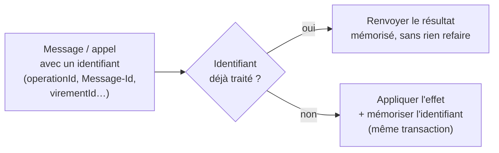
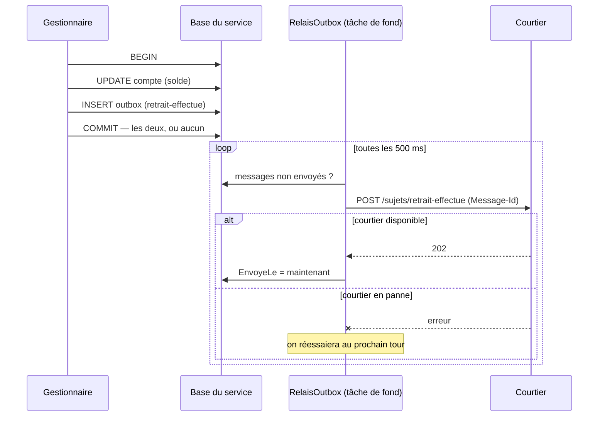
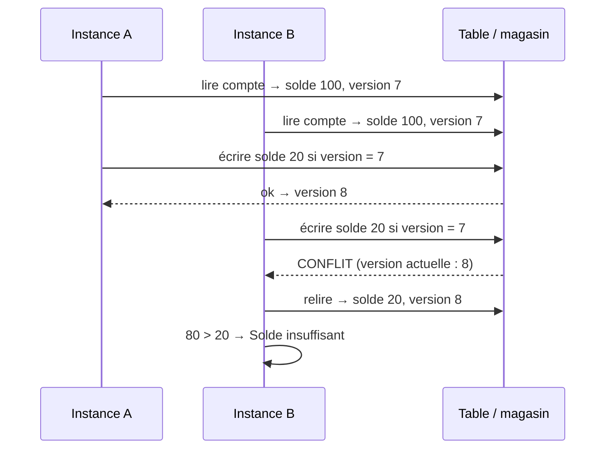
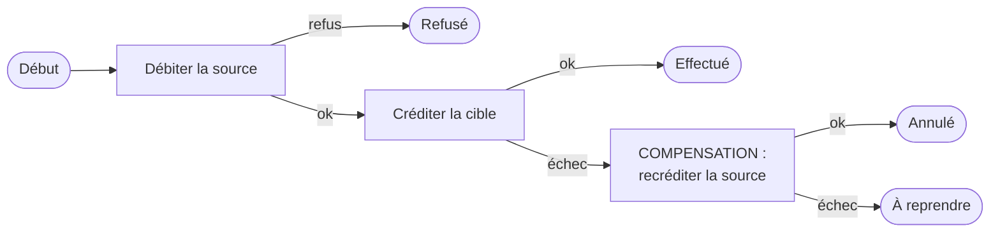
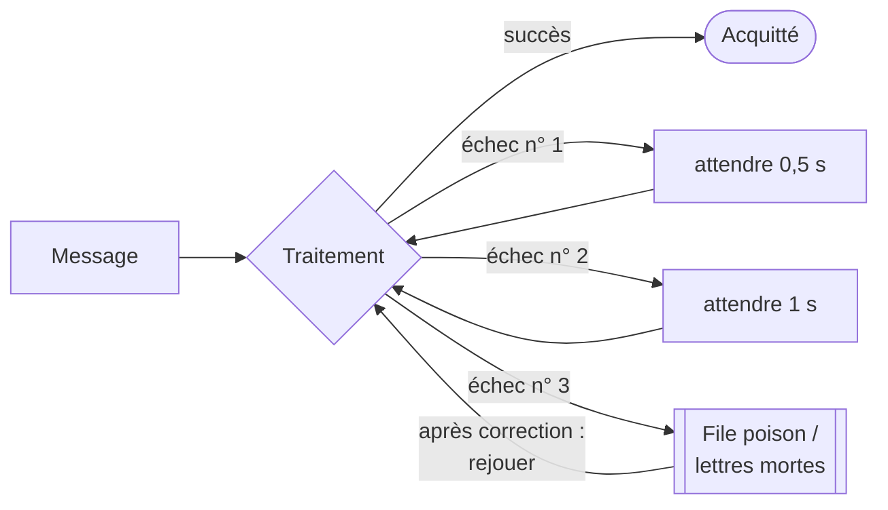
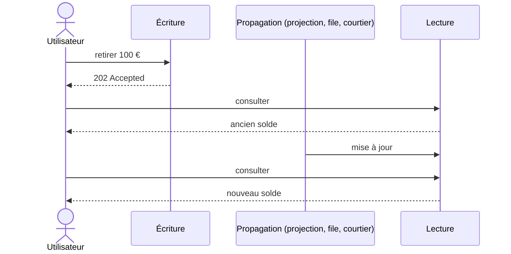
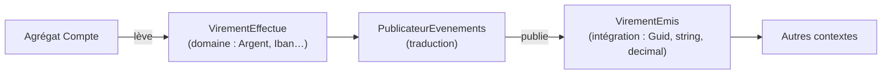

# ★ Concepts transverses

Dès qu'un système a **plusieurs bases** (démos 6 à 12) ou **plusieurs processus** (démos 8 et 12), on perd deux
garanties qu'on croyait acquises : *la transaction unique* et *l'appel qui réussit ou échoue franchement*. Les mêmes
mécanismes reviennent alors dans plusieurs démos. Cette page les rassemble.

⬅️ [Sommaire](README.md)

| Concept | Problème résolu | Démos |
|---|---|---|
| [Idempotence](#idempotence) | Un même appel ou message traité deux fois | 8, 10, 12, 14, 15, 17, 18, 20 |
| [Outbox](#outbox) | Enregistrer une donnée **et** publier un événement, sans perdre l'un des deux | 8 (et 9) |
| [Concurrence optimiste](#concurrence-optimiste) | Deux modifications simultanées de la même donnée | 10, 12 (et l'alternative : 18 ; le contre-exemple : 19) |
| [Compensation / saga](#compensation-et-saga) | Pas de transaction entre plusieurs bases | 6, 7, 8, 14, 17, 18 |
| [Nouveaux essais et lettres mortes](#nouveaux-essais-et-lettres-mortes) | Pannes passagères vs pannes durables | 8, 12, 14, 18 |
| [Cohérence à terme](#cohérence-à-terme) | Les lectures ne voient pas tout de suite les écritures | 8, 9, 10, 12, 19 |
| [Événements de domaine vs d'intégration](#événements-de-domaine-vs-dintégration) | Ce qu'on publie aux autres | 7, 9, 11 |

---

## Idempotence

**Une opération est idempotente si l'exécuter deux fois a le même effet que l'exécuter une fois.**
Sur un réseau, on ne sait jamais si un appel sans réponse a été traité : on le rejoue. Et un courtier de messages livre
« au moins une fois ». Sans idempotence : double débit.

| Technique | Exemple dans les démos |
|---|---|
| Table des opérations traitées | [Micro.Comptes/Endpoints.cs](../08-Microservices/Micro.Comptes/Endpoints.cs) : `OperationsTraitees` par `operationId` |
| Table des messages traités | [Micro.Notifications/Program.cs](../08-Microservices/Micro.Notifications/Program.cs) : `MessagesTraites` par `Message-Id` |
| Opérations récentes dans l'entité | [Sls.Fonctions/Modele.cs](../12-Serverless/Sls.Fonctions/Modele.cs) : `Compte.Operations` |
| Clé déterministe (écrasement sans doublon) | [Sls.Fonctions/Fonctions.cs](../12-Serverless/Sls.Fonctions/Fonctions.cs) : notification `{compte}/{virement}` |
| Identifiant dérivé de l'entrée | `IdentifiantDeterministe($"{fichier}#{ligne}")` : un import retraité ne crée pas de doublons |
| Point de reprise | [Projecteur.cs](../09-CQRS/Cqrs.Lecture/Projections/Projecteur.cs) : `if (sequence <= DerniereSequence) return;` |
| Opérations traitées, migrées avec le client | [Magasin.cs](../17-CellBased/Cell.Cellule/Magasin.cs) : `OperationsTraitees` suit le client d'une cellule à l'autre |
| Clé de période sur l'opération | [ServiceBancaire.cs](../15-MultiTenant/Mt.Banque/ServiceBancaire.cs) : `var cle = $"frais-{mois}";` (frais mensuels prélevés une fois) |
| L'identité de l'acteur | [VirementActeur.cs](../18-ModeleActeurs/Acteurs.Banque/VirementActeur.cs) : rejouer `virement/facture-42` réveille le même acteur, qui connaît déjà la réponse |
| Référence de ligne, à deux niveaux | [Filtres.cs](../20-Pipeline/Pipeline.Banque/Filtres.cs) : `Dedupliquer` écarte tôt les références déjà exécutées ; le registre refuse en dernier recours. Un import interrompu se rejoue tel quel |

---

## Outbox

**Problème** : enregistrer un retrait puis publier `RetraitEffectue`. Si le processus s'arrête entre les deux, ou si le
courtier est en panne, l'événement est perdu — ou pire, publié pour un retrait annulé.

**Solution** : écrire le message dans une table *outbox* **dans la même transaction** que la donnée, puis le publier en
tâche de fond, en réessayant jusqu'au succès.

Le relais peut envoyer un message deux fois (crash entre l'envoi et la mise à jour de `EnvoyeLe`) : d'où l'**idempotence**
chez les abonnés. Code : [RelaisOutbox.cs](../08-Microservices/Micro.Comptes/RelaisOutbox.cs). En CQRS, le journal
d'événements de [EcritureDb](../09-CQRS/Cqrs.Ecriture/Persistance/EcritureDb.cs) joue le même rôle.

---

## Concurrence optimiste

**Problème** : deux processus lisent un compte à 100 €, retirent chacun 80 €, et écrivent : le compte affiche 20 € au
lieu d'un refus. **Solution** : chaque écriture précise la **version** (ou l'ETag) lue ; si elle a changé, l'écriture est refusée.

| | Event Sourcing | Serverless |
|---|---|---|
| Où | [MagasinEvenements.Ajouter](../10-EventSourcing/Es.Stockage/MagasinEvenements.cs) | [TableGeree.Ecrire](../12-Serverless/Sls.Plateforme/ServicesGeres.cs) |
| Version | nombre d'événements du flux | ETag de l'entité |
| En cas de conflit | 409 au client (`If-Match`) | relire et réessayer ([`Concurrence.Modifier`](../12-Serverless/Sls.Fonctions/Modele.cs)) |

« Optimiste » : on ne verrouille rien, on parie qu'il n'y aura pas de conflit, et on le détecte s'il y en a un.

**L'alternative : un seul écrivain.** Plutôt que de détecter les conflits, le [modèle d'acteurs](18-modele-acteurs.md)
les rend impossibles : chaque compte a un seul propriétaire, qui traite ses messages un par un. Les deux retraits de
80 € arrivent dans sa boîte et sont traités l'un après l'autre ; le second voit 20 € et est refusé, sans version ni
nouvel essai.

**Le contre-exemple : la dernière écriture gagne.** Dans l'[architecture spatiale](19-space-based.md), chaque unité écrit
dans sa propre réplique sans rien vérifier ailleurs ; la réplication garde la plus grande version et **jette l'autre**.
Les deux retraits de 80 € sont acceptés, un seul est débité. Seul un routage qui donne chaque compte à une seule unité
(affinité) évite ces collisions.

---

## Compensation et saga

**Problème** : un virement touche deux comptes stockés dans **deux bases** (ou deux services). Pas de transaction commune.
**Solution** : une suite d'étapes locales ; si une étape échoue, on exécute des **actions de compensation** qui annulent
les précédentes. Une **saga** est cette suite d'étapes, avec un état qui dit où on en est.

| Démo | Où | Particularité |
|---|---|---|
| 6 | [VirementsComposant.cs](../06-Composants/Composants.Virements/Interne/VirementsComposant.cs) | compensation simple, dans le même processus |
| 7 | [VirementsEndpoints.cs](../07-MonolitheModulaire/Modulaire.Virements/Interne/VirementsEndpoints.cs) | entre deux modules, via `IComptesApi` |
| 8 | [Micro.Virements/Endpoints.cs](../08-Microservices/Micro.Virements/Endpoints.cs) | saga à statut (`EnCours` → `Effectue` / `Refuse` / `Annule` / `AReprendre`), appels idempotents |
| 14 | [MoteurSaga.cs](../14-SagaOrchestree/Saga.Orchestrateur/MoteurSaga.cs) | saga **orchestrée** : processus décrit en un seul endroit, état persistant, attente d'un événement extérieur, point de non-retour |
| 18 | [VirementActeur.cs](../18-ModeleActeurs/Acteurs.Banque/VirementActeur.cs) | un **acteur par virement**, qui converse avec deux acteurs comptes ; son état stocké (`DebitFait`…) permet de reprendre après une panne |

Deux façons de coordonner une saga : la **chorégraphie** (chaque service réagit aux événements des autres, démos 7 et 8)
et l'**orchestration** (un chef d'orchestre explicite conduit les étapes, [démo 14](14-saga-orchestree.md)). Les étapes
qui suivent le **point de non-retour** (par exemple le débit définitif) ne se compensent plus : on ne peut que les réessayer.

Une compensation n'efface pas le passé : le client voit un débit **puis** un crédit. C'est une écriture inverse, comme en comptabilité.

---

## Nouveaux essais et lettres mortes

Une panne **passagère** (réseau, redémarrage) se règle en réessayant ; une panne **durable** (bug, donnée invalide) non.
On réessaie donc un nombre limité de fois, avec une **attente croissante** (*backoff exponentiel*), puis on met le message
de côté (*dead letter*, *poison queue*) pour qu'un humain s'en occupe, sans bloquer les autres.

| | Microservices | Serverless |
|---|---|---|
| Appels HTTP | [`AddStandardResilienceHandler`](../08-Microservices/Micro.Virements/Program.cs) : 3 retries + timeout + circuit breaker | — |
| Messages | [Courtier](../08-Microservices/Micro.Courtier/Courtier.cs) : 8 tentatives puis lettres mortes | [ServiceFiles](../12-Serverless/Sls.Plateforme/ServicesGeres.cs) : 3 tentatives puis `-poison`, rejouable |

Le [modèle d'acteurs](18-modele-acteurs.md) applique la même idée aux acteurs eux-mêmes : un acteur qui plante est
redémarré (jusqu'à 3 fois par minute), puis arrêté et mis en quarantaine ; les messages qu'on lui envoie pendant ce temps
sont des « lettres mortes », comptées par le runtime.

À distinguer : un **refus métier** (solde insuffisant) n'est **pas** une panne. Il ne doit pas déclencher de nouvel essai
(voir `VirementsFonctions.Executer`, qui marque le virement « Refusé » sans lever d'exception).

---

## Cohérence à terme

Quand l'écriture et la lecture passent par des chemins différents (événements, projections, files), **la lecture voit
l'écriture avec un léger retard**. Le système est cohérent *à terme* : une fois les messages traités.

Rendu visible dans la démo CQRS (`Projections:DelaiMs`, `GET /admin/projections`), dans les microservices (Notifications
arrêté puis redémarré) et en serverless (`202` puis `GET /virements/{id}`). Côté interface : afficher « en cours »,
renvoyer l'état connu juste après une commande, ou interroger jusqu'à la mise à jour.

---

## Événements de domaine vs d'intégration

| | Événement **de domaine** | Événement **d'intégration** |
|---|---|---|
| Portée | à l'intérieur d'un contexte / module | entre contextes, modules ou services |
| Types | riches (`Argent`, `Iban`, `CompteId`) | simples (`Guid`, `string`, `decimal`) |
| Stabilité | évolue librement avec le modèle | contrat public, à faire évoluer avec précaution |
| Exemple | [`VirementEffectue`](../11-DDD/Ddd.TenueDeCompte.Domaine/Fondations.cs) (DDD) | [`VirementEmis`](../11-DDD/Ddd.TenueDeCompte.Contrats/Contrats.cs) (DDD), [`VirementEffectue`](../07-MonolitheModulaire/Modulaire.Virements.Contrats/VirementEffectue.cs) (démo 7) |

Un bon événement d'intégration transporte **ce dont les abonnés ont besoin** (par exemple les noms des titulaires), pour
qu'ils n'aient pas à rappeler l'émetteur : c'est l'*event-carried state transfer*.
