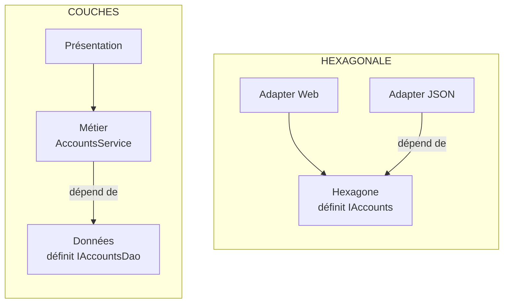

# Couches ou Hexagonale ?

**En anglais** : *Layered Architecture or Hexagonal Architecture?*

> **La différence en une phrase** : dans les couches, le métier **dépend de la base** ; dans l'hexagonale, c'est
> l'inverse, la base **se branche sur le métier**. Tout le reste en découle.

📁 Démos : [`00-Layered`](../../00-Layered) · [`01-Hexagonal`](../../01-Hexagonal) · · 🌐 [English](../en/differences/01-couches-vs-hexagonale.md)
📖 Pages : [Couches](../00-couches.md) · [Hexagonale](../01-hexagonale.md) · 🗂️ Fiches : [0](../fiches/00-couches.md) · [1](../fiches/01-hexagonale.md)

⬅️ [Sommaire](README.md) · ➡️ [Hexagonale ou Onion ?](02-hexagonale-vs-onion.md)

---

## Ce qu'elles partagent

Les deux séparent la technique (HTTP, base) du métier, et toutes deux tiennent dans **un seul déploiement**. Le
métier a les mêmes règles (montant positif, solde suffisant), le scénario est le même.

## Les différences point par point

| | Couches | Hexagonale |
|---|---|---|
| Image | une pile : haut → bas | un centre et un pourtour : intérieur / extérieur |
| Le métier référence… | `Layered.Data` | **aucun projet** |
| L'interface d'accès aux données est définie par… | la couche données (`IAccountsDao`) | le métier (port sortant `IAccounts`) |
| …dans le vocabulaire de… | la persistance (`AccountEntity`, `Save`) | le métier (`Account`, `Load`, `Save`) |
| L'entité | **anémique** (setters publics) ; la règle est dans le service | **riche** : `Account.Withdraw` protège son solde |
| Canaux d'entrée | un : la présentation | plusieurs, à égalité : API, CLI, tests |
| Remplacer le stockage | touche le métier (il manipule les entités de persistance) | écrire un adapter ; les **tests de contrat** prouvent l'équivalence |
| Tester le métier | avec un faux DAO… qui renvoie des `AccountEntity` | avec un adapter de test, sans base |
| Garde-fou | références non transitives | hexagone sans référence + test d'architecture |

## Côte à côte



La flèche entre le métier et les données **change de sens** : c'est l'inversion des dépendances.

## Dans le code des démos

**Qui définit le contrat d'accès aux données.** Dans les couches, c'est la couche données, avec ses propres types
([AccountsDao.cs](../../00-Layered/Layered.Data/AccountsDao.cs)) :

```csharp
// The interface is defined BY the data layer, in ITS vocabulary (AccountEntity).
public interface IAccountsDao
{
    Task<AccountEntity?> ById(Guid id);
    Task Add(AccountEntity account);
    Task<bool> IsEmpty();
    Task Save();
}
```

Dans l'hexagonale, c'est le métier, qui dit ce dont il a besoin
([OutboundPorts.cs](../../01-Hexagonal/Hexa.Hexagon/Ports/Outbound/OutboundPorts.cs)) :

```csharp
public interface IAccounts
{
    Task<Account?> Load(Guid id);
    Task Save(Account account);
}
```

**Où vit la règle.** Couches : dans le service, sur une entité que n'importe qui peut modifier
([AccountsService.cs](../../00-Layered/Layered.Business/AccountsService.cs)) :

```csharp
// Since the entity is anemic, nothing stops another class from doing "account.Balance -= x"
// without going through this check: the rule is protected by discipline alone.
private static void CheckWithdrawalAllowed(AccountEntity account, decimal amount)
```

Hexagonale : dans l'entité elle-même, dont le solde n'a pas de setter public
([Account.cs](../../01-Hexagonal/Hexa.Hexagon/Domain/Account.cs)) :

```csharp
public decimal Balance { get; private set; }

public void Withdraw(decimal amount)
{
    CheckAmount(amount);
    if (amount > Balance)
        throw new BusinessRuleException("Insufficient balance.");
    Balance -= amount;
}
```

## Le même retrait

| Étape | Couches | Hexagonale |
|---|---|---|
| Entrée | `AccountsController` (seule entrée possible) | adapter Web **ou** adapter CLI, même cas d'utilisation |
| Charger | `dao.ById` → `AccountEntity` | `accounts.Load` → `Account` du domaine |
| Décider | `AccountsService.CheckWithdrawalAllowed` | `Account.Withdraw` |
| Modifier | `account.Balance -= amount` dans le service | dans `Account.Withdraw` |
| Enregistrer | `dao.Save()` (le `SaveChanges` d'EF) | `accounts.Save(account)` : mémoire ou fichier JSON selon la configuration |

## Comment choisir

- **Couches** si l'application est surtout du CRUD, que les règles tiennent en quelques `if` et que la base ne
  changera pas : c'est simple et connu de tous.
- **Hexagonale** dès que l'un de ces signaux apparaît : des règles qui se multiplient, l'envie de les tester sans base,
  un deuxième canal d'entrée (CLI, messages), un stockage susceptible de changer.

## Passer des couches à l'hexagonale

1. Rendre l'entité riche : déplacer les règles du service dans des méthodes de l'entité, retirer les setters publics.
2. Déplacer l'interface d'accès aux données **dans le projet métier**, la renommer dans le vocabulaire du métier.
3. Faire implémenter cette interface par l'ancienne couche données (qui référence désormais le métier).
4. Retirer la référence du métier vers les données ; un test d'architecture l'empêche de revenir.

Ces étapes peuvent se faire **une fonctionnalité à la fois** : rien n'oblige à tout migrer d'un coup.

## Idées reçues

- *« L'hexagonale a six côtés pour six ports »* : non, la forme ne sert qu'à laisser de la place pour dessiner. On peut
  avoir deux ports ou vingt.
- *« Les couches, c'est forcément mal »* : pour un CRUD, l'inversion des dépendances ne rapporte rien et coûte des
  interfaces. Les couches restent un très bon point de départ.
