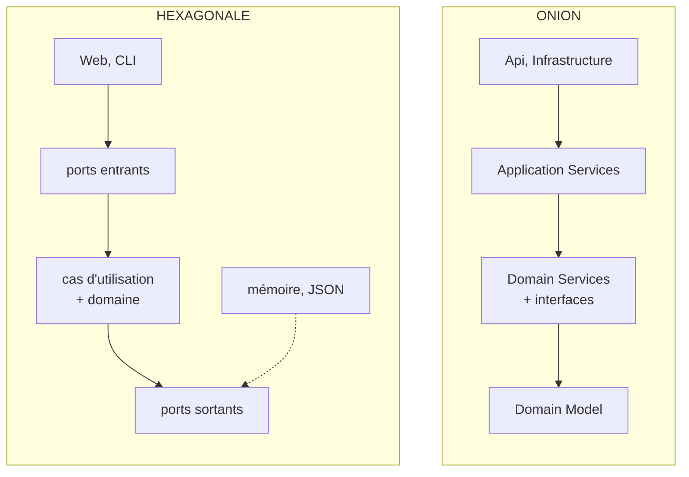

# Hexagonale ou Onion ?

> **La différence en une phrase** : **la même règle de dépendance** (tout pointe vers le métier), mais l'hexagonale
> structure **le pourtour** (ports et adapters) quand l'Onion structure **le centre** (modèle, services de domaine,
> services applicatifs).

📁 Démos : [`01-Hexagonale`](../../01-Hexagonale) · [`02-Onion`](../../02-Onion) ·
📖 Pages : [Hexagonale](../01-hexagonale.md) · [Onion](../02-onion.md) · 🗂️ Fiches : [1](../fiches/01-hexagonale.md) · [2](../fiches/02-onion.md)

⬅️ [Couches ou Hexagonale ?](01-couches-vs-hexagonale.md) · ➡️ [Onion ou Clean ?](03-onion-vs-clean.md)

---

## Ce qu'elles partagent

L'essentiel : le métier ne dépend de rien, l'infrastructure implémente des interfaces déclarées au centre, une
*composition root* assemble le tout. Un projet construit selon l'une est presque toujours lisible avec le vocabulaire de
l'autre. C'est pourquoi on les confond, et pourquoi beaucoup de modèles « Clean » .NET sont en réalité des Onion.

## Les différences point par point

| | Hexagonale (Cockburn, 2005) | Onion (Palermo, 2008) |
|---|---|---|
| Ce qu'elle dessine | l'**extérieur** : qui appelle, qui est appelé | l'**intérieur** : des couches concentriques |
| Le centre | un bloc : domaine + cas d'utilisation + ports | Domain Model → Domain Services → Application Services |
| Projets de la démo | `Hexa.Hexagone` (un seul) + un projet par adapter | `Onion.Domain`, `Onion.Application`, `Onion.Infrastructure`, `Onion.Api` |
| Vocabulaire | port entrant / sortant, adapter, *driving* / *driven* | repository, unit of work, service de domaine, service applicatif |
| Règle qui touche **deux** comptes | dans le cas d'utilisation | dans un **service de domaine** (`ServiceVirement`) |
| Enregistrer un virement | deux appels `Sauvegarder`, un par compte | **une** unité de travail : tout ou rien |
| Entrées | mises en avant : Web **et** CLI sur le même cas | une seule API ; le sujet est ailleurs |
| Ce qu'on vérifie en test | **tests de contrat** : chaque adapter d'un port passe la même suite | chaque couche ne dépend que des couches intérieures |

## Côte à côte



## Dans le code des démos : le même virement

**Hexagonale** : le cas d'utilisation porte la règle « même compte » et enregistre chaque compte séparément
([CasUtilisation.cs](../../01-Hexagonale/Hexa.Hexagone/Application/CasUtilisation.cs)) :

```csharp
public class EffectuerVirement(IComptes comptes, INotifications notifications) : IEffectuerVirement
{
    public async Task Executer(Guid sourceId, Guid cibleId, decimal montant)
    {
        if (sourceId == cibleId)
            throw new RegleMetierException("Impossible de virer vers le même compte.");

        var source = await comptes.Charger(sourceId) ?? throw new CompteIntrouvableException(sourceId);
        var cible = await comptes.Charger(cibleId) ?? throw new CompteIntrouvableException(cibleId);

        source.Retirer(montant);
        cible.Deposer(montant);

        await comptes.Sauvegarder(source);
        await comptes.Sauvegarder(cible);
        await notifications.VirementEffectue(sourceId, cibleId, montant);
    }
}
```

**Onion** : la règle qui concerne deux comptes est un **service de domaine**
([ServiceVirement.cs](../../02-Onion/Onion.Domain/Services/ServiceVirement.cs)) ; le service applicatif ne fait
qu'orchestrer, et valide **une seule fois**
([VirementsAppService.cs](../../02-Onion/Onion.Application/VirementsAppService.cs)) :

```csharp
public async Task<VirementResultat> Virer(Guid sourceId, Guid cibleId, decimal montant)
{
    var source = await comptes.ObtenirOuEchouer(sourceId);
    var cible = await comptes.ObtenirOuEchouer(cibleId);

    // La règle (plafond, même compte, solde…) vit dans le service de domaine.
    serviceVirement.Virer(source, cible, montant);

    // Une seule validation pour les deux comptes : tout ou rien.
    await unitOfWork.Enregistrer();
    return new VirementResultat(CompteDto.Depuis(source), CompteDto.Depuis(cible));
}
```

Ce que cela change :

- **Atomicité** : dans la démo hexagonale, si la seconde sauvegarde échouait, la première serait déjà faite. Le port
  `IComptes` n'offre pas de transaction. L'Onion la rend explicite avec `IUnitOfWork`, que le `DbContext` implémente.
- **Place des règles** : l'hexagonale ne dit pas où ranger une règle à deux entités ; l'Onion lui donne une couche.
- **Points d'entrée** : l'hexagonale montre deux adapters entrants sur le même cas d'utilisation ; c'est son sujet.

> Rien n'empêche d'ajouter une unité de travail à une hexagonale (un port de plus), ni une CLI à un Onion : la démo
> de chacune met en avant ce que son auteur a voulu souligner.

## Comment choisir

Ce n'est pas vraiment un choix exclusif :

- si le défi est **à l'extérieur** (plusieurs canaux, infrastructures à remplacer, adapters à prouver équivalents),
  raisonnez en ports et adapters ;
- si le défi est **à l'intérieur** (beaucoup de règles, certaines sur plusieurs entités, transactions), structurez le
  centre en couches à la façon Onion.

## Les combiner

La combinaison la plus courante en .NET : **un centre en oignon** (`Domain`, `Application`) **entouré d'adapters**
(`Infrastructure.Persistance`, `Infrastructure.Messagerie`, `Api`, `Cli`), avec des tests de contrat sur les
adapters. On ajoute ensuite les objets-valeurs et agrégats du [DDD](06-ddd-vs-hexagonale-onion.md) au centre.

## Idées reçues

- *« L'Onion est une évolution de l'hexagonale »* : c'est surtout un autre angle de vue sur la même règle.
- *« Il faut autant de projets que de couches »* : non. Des dossiers et un test d'architecture suffisent souvent ; les
  projets séparés ajoutent la garantie du compilateur.
