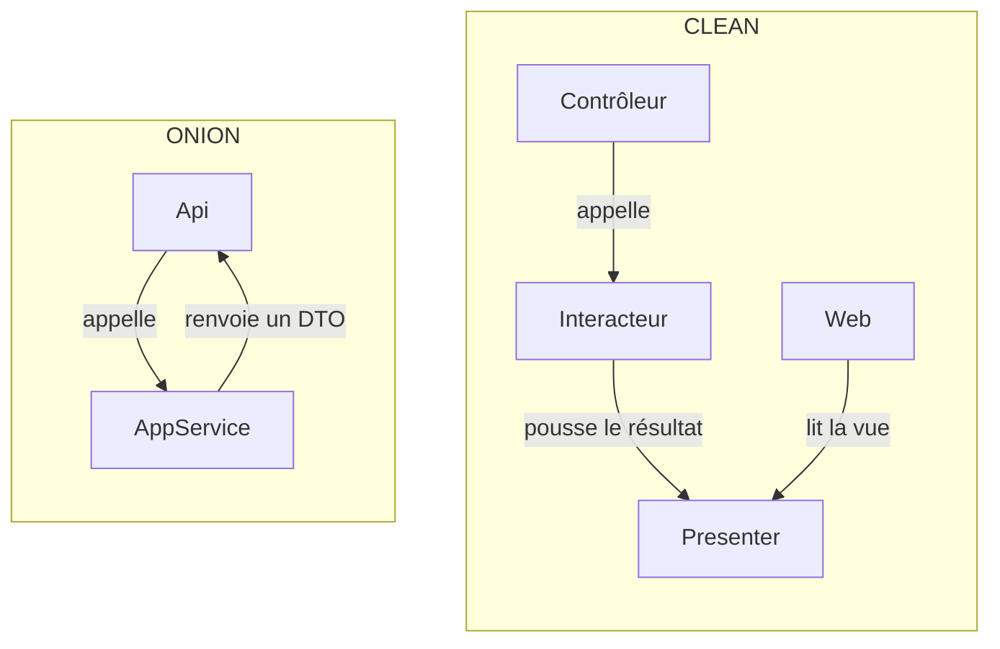

# Onion ou Clean ?

**En anglais** : *Onion Architecture or Clean Architecture?*

> **La différence en une phrase** : Clean garde les cercles de l'Onion mais **formalise chaque cas d'utilisation**
> (une classe, une entrée, une sortie) et **inverse aussi la sortie** : l'interacteur ne renvoie rien, il pousse son
> résultat vers un *presenter*.

📁 Démos : [`02-Onion`](../../02-Onion) · [`03-Clean`](../../03-Clean) · · 🌐 [English](../en/differences/03-onion-vs-clean.md)
📖 Pages : [Onion](../02-onion.md) · [Clean](../03-clean.md) · 🗂️ Fiches : [2](../fiches/02-onion.md) · [3](../fiches/03-clean.md)

⬅️ [Hexagonale ou Onion ?](02-hexagonale-vs-onion.md) · ➡️ [Clean ou Vertical Slice ?](04-clean-vs-vertical-slice.md)

---

## Ce qu'elles partagent

Des cercles concentriques, la **règle de dépendance** (un cercle ne connaît que les cercles intérieurs), des entités au
centre, l'accès aux données derrière une interface déclarée à l'intérieur.

| Cercle Clean | Équivalent Onion |
|---|---|
| ① Entities | Domain Model |
| ② Use Cases | Application Services (+ Domain Services) |
| ③ Interface Adapters | Infrastructure, contrôleurs |
| ④ Frameworks & Drivers | Api (ASP.NET Core) |

## Les différences point par point

| | Onion | Clean |
|---|---|---|
| Un cas d'utilisation, c'est… | une **méthode** d'un service applicatif | une **classe** : `RetraitInteracteur` |
| Entrée | des paramètres | un *request model* (`DemandeRetrait`) via une *input boundary* (`IRetraitEntree`) |
| Sortie | une **valeur renvoyée** (`VirementResultat`) ou une exception | **rien n'est renvoyé** : appel d'une *output boundary* (`IRetraitSortie`) |
| Erreurs métier | exceptions, traduites par un middleware | méthodes de sortie : `Refus`, `CompteIntrouvable` |
| Mise en forme de la réponse | l'API, à partir du DTO | un **presenter** par format (HTTP, texte) |
| Types pour un retrait | 1 ou 2 | ≈ 6 |
| Accès aux données | repository + unit of work | *gateway* (`IComptesPasserelle`) |
| Coût principal | nombre de projets | **cérémonie** |

## Côte à côte : le flux de la réponse



## Dans le code des démos

**Onion** : le service applicatif renvoie son résultat ; les erreurs remontent en exceptions
([VirementsAppService.cs](../../02-Onion/Onion.Application/VirementsAppService.cs)) :

```csharp
serviceVirement.Virer(source, cible, montant);
await unitOfWork.Enregistrer();
return new VirementResultat(CompteDto.Depuis(source), CompteDto.Depuis(cible));
```

**Clean** : l'interacteur ne renvoie rien ; chaque issue est une méthode de l'output boundary
([Retrait.cs](../../03-Clean/Clean.CasUtilisation/Retrait/Retrait.cs)) :

```csharp
public interface IRetraitSortie
{
    void Succes(ReponseRetrait reponse);
    void CompteIntrouvable(Guid compteId);
    void Refus(string raison);
}
```

```csharp
try
{
    compte.Retirer(demande.Montant);
}
catch (RegleMetierException e)
{
    sortie.Refus(e.Message);
    return;
}

await comptes.Sauvegarder(compte);
sortie.Succes(new ReponseRetrait(compte.Id, ancienSolde, compte.Solde));
```

Le cercle extérieur crée le presenter, appelle le contrôleur, puis lit la vue produite
([Program.cs](../../03-Clean/Clean.Web/Program.cs)) :

```csharp
var presenter = new RetraitPresenterHttp();
await controleur.Retirer(id, requete.Montant, presenter);
return EnHttp(presenter.Vue);
```

Ce que cela achète : **plusieurs présentations d'un même cas d'utilisation** sans y toucher (la démo a un presenter
JSON et un relevé texte). Ce que cela coûte : un presenter **à état**, peu naturel avec ASP.NET Core, et six types là
où l'Onion en a deux.

## Comment choisir

- **Onion** (ou un « Clean » simplifié) dans la grande majorité des API : un service ou un handler par cas
  d'utilisation, qui renvoie un résultat.
- **Clean complet** quand un même cas d'utilisation doit réellement alimenter plusieurs présentations très différentes
  (API, écran, relevé, export) et que l'équipe accepte la cérémonie.

## Entre les deux : le « Clean » .NET courant

Les modèles populaires (Jason Taylor, Ardalis) prennent les cercles et le vocabulaire de Clean, mais **remplacent le
presenter par un retour** (`Result<T>`) et l'interacteur par un *handler* (souvent MediatR). Le résultat est très
proche d'un Onion où chaque cas d'utilisation serait une classe. C'est aussi un pas vers le
[Vertical Slice](04-clean-vs-vertical-slice.md).

## Idées reçues

- *« Clean = 4 projets »* : le nombre de projets n'est pas la Clean Architecture ; la règle de dépendance l'est.
- *« Un projet Clean n'a pas d'exceptions »* : la démo traduit les exceptions du domaine en appels de sortie, mais rien
  n'interdit de les laisser remonter ; c'est un choix, pas une règle.
