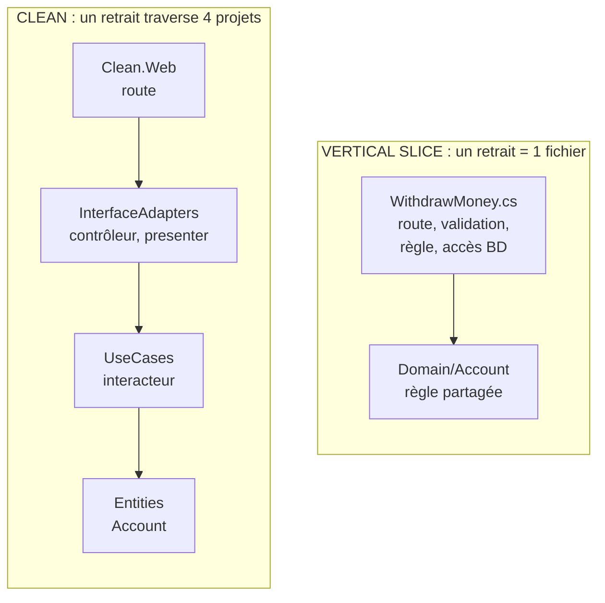

# Clean ou Vertical Slice ?

**En anglais** : *Clean Architecture or Vertical Slice Architecture?*

> **La différence en une phrase** : Clean découpe le code **par couche technique** (un cas d'utilisation traverse
> quatre cercles), Vertical Slice le découpe **par fonctionnalité** (un cas d'utilisation tient dans un fichier).

📁 Démos : [`03-Clean`](../../03-Clean) · [`05-VerticalSlice`](../../05-VerticalSlice) · · 🌐 [English](../en/differences/04-clean-vs-vertical-slice.md)
📖 Pages : [Clean](../03-clean.md) · [Vertical Slice](../05-vertical-slice.md) · 🗂️ Fiches : [3](../fiches/03-clean.md) · [5](../fiches/05-vertical-slice.md)

⬅️ [Onion ou Clean ?](03-onion-vs-clean.md) · ➡️ [Hexagonale ou Cœur fonctionnel ?](05-hexagonale-vs-coeur-fonctionnel.md)

---

## Ce qu'elles partagent

Les deux font du **cas d'utilisation** l'unité de base du code : `WithdrawalInteractor` d'un côté, `WithdrawMoney` de
l'autre. On trouve facilement « ce qui se passe quand on retire de l'argent ». Elles divergent sur tout le reste.

## Les différences point par point

| | Clean | Vertical Slice |
|---|---|---|
| Axe de découpe | **horizontal** : entités, cas d'utilisation, adaptateurs, web | **vertical** : une tranche par requête ou commande |
| Ajouter « retirer de l'argent » | un fichier dans chaque cercle, 4 projets | **un fichier** + une ligne dans `Program.cs` |
| Abstractions | une interface par frontière (entrée, sortie, passerelle) | aucune « au cas où » : le `DbContext` est déjà dépôt + unité de travail |
| Couplage | faible partout | **fort dans** la tranche, **faible entre** les tranches |
| Lecture et écriture | même chemin (interacteur, passerelle) | chaque tranche choisit : entité pour écrire, **projection LINQ** pour lire |
| Règles partagées | dans les entités, d'emblée | **remontées** dans `Domain/` quand une deuxième tranche en a besoin |
| Changer de base | réécrire la passerelle | plus coûteux : le `DbContext` est dans chaque tranche |
| Risque | cérémonie, abstractions vides | duplication, handlers obèses |

## Côte à côte



## Dans le code des démos

**Vertical Slice** : la tranche complète, de la route à la base
([WithdrawMoney.cs](../../05-VerticalSlice/Vertical.Api/Features/Accounts/WithdrawMoney.cs)) :

```csharp
public static void Map(IEndpointRouteBuilder app) => app.MapPost("/accounts/{id:guid}/withdrawal", Execute);

private static async Task<IResult> Execute(Guid id, Request request, BankDbContext db)
{
    // … validation of the amount …
    var account = await db.Accounts.FindAsync(id);
    if (account is null)
        return Results.NotFound();

    if (account.Withdraw(request.Amount) is { } refusal)
        return Results.BadRequest(new { error = refusal });

    db.Operations.Add(new Operation { AccountId = id, Label = "Withdrawal", Amount = -request.Amount });
    await db.SaveChangesAsync();

    return Results.Ok(new Response(id, account.Balance));
}
```

**Clean** : le même retrait réparti entre la route ([Program.cs](../../03-Clean/Clean.Web/Program.cs)), le contrôleur,
l'interacteur ([Withdrawal.cs](../../03-Clean/Clean.UseCases/Withdrawal/Withdrawal.cs)), le presenter
([HttpPresenters.cs](../../03-Clean/Clean.InterfaceAdapters/Presenters/HttpPresenters.cs)) et la passerelle :

```csharp
public class WithdrawalInteractor(IAccountsGateway accounts) : IWithdrawalInput
{
    public async Task Execute(WithdrawalRequest request, IWithdrawalOutput output)
    {
        var account = await accounts.Load(request.AccountId);
        // … Refusal, AccountNotFound or Success, pushed to the presenter …
    }
}
```

**La lecture** montre le mieux l'écart. Vertical Slice projette directement vers la réponse, en lecture seule, sans
passer par le domaine ([GetAccount.cs](../../05-VerticalSlice/Vertical.Api/Features/Accounts/GetAccount.cs)) :

```csharp
var account = await db.Accounts
    .AsNoTracking()
    .Where(c => c.Id == id)
    .Select(c => new { c.Id, c.Owner, c.Balance })
    .FirstOrDefaultAsync();
```

En Clean, une consultation passe par le même chemin qu'une écriture : interacteur, passerelle, entité, presenter.

## Comment choisir

- **Vertical Slice** pour une API de gestion livrée fonctionnalité par fonctionnalité, où les fonctionnalités
  évoluent indépendamment et où la base ne changera pas.
- **Clean** (ou Onion) quand l'infrastructure doit rester remplaçable, que les mêmes règles servent plusieurs canaux,
  ou que le domaine est riche et partagé par toutes les fonctionnalités.

## Les combiner

Courant et efficace : des **tranches verticales dans chaque module** d'un
[monolithe modulaire](09-monolithe-modulaire-vs-microservices.md), un domaine riche pour les règles partagées, et des
ports hexagonaux **seulement autour des services externes** (paiement, courriel), là où le remplacement est probable.

## Idées reçues

- *« Vertical Slice = pas d'architecture »* : c'est une architecture avec des règles (une tranche par requête,
  couplage fort dedans, faible entre), qui demande la discipline de reconnaître et remonter le code partagé.
- *« Vertical Slice impose MediatR »* : non, la démo s'en passe ; une méthode statique par tranche suffit
  (MediatR est d'ailleurs payant pour les entreprises depuis 2025).
