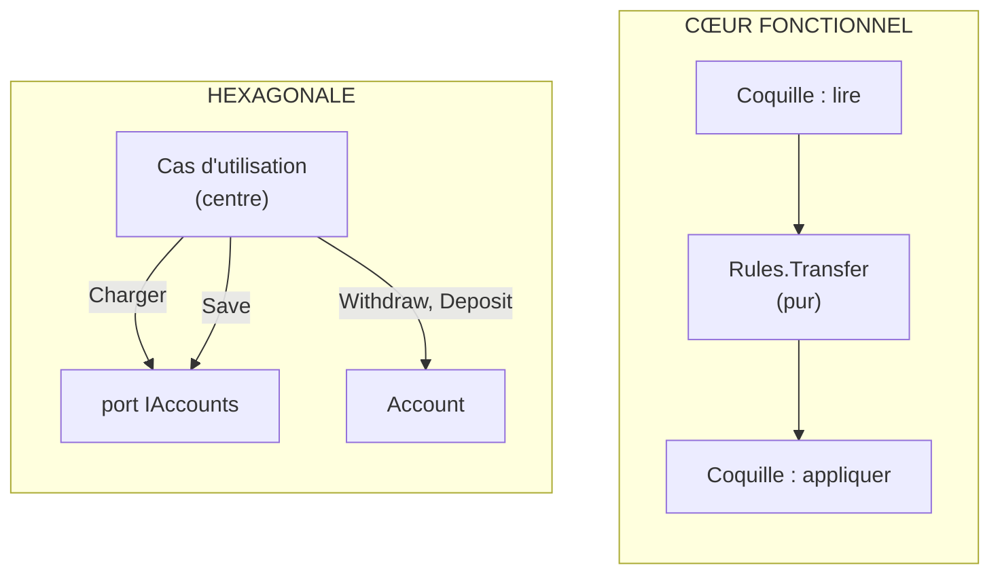

# Hexagonale ou Cœur fonctionnel ?

**En anglais** : *Hexagonal Architecture or Functional Core, Imperative Shell?*

> **La différence en une phrase** : le centre hexagonal fait **encore des entrées/sorties**, à travers des ports ; le
> cœur fonctionnel n'en fait **plus aucune** : il reçoit des valeurs et renvoie une décision, la coquille fait tout le
> reste.

📁 Démos : [`01-Hexagonal`](../../01-Hexagonal) · [`04-FunctionalCore`](../../04-FunctionalCore) · · 🌐 [English](../en/differences/05-hexagonale-vs-coeur-fonctionnel.md)
📖 Pages : [Hexagonale](../01-hexagonale.md) · [Cœur fonctionnel](../04-coeur-fonctionnel.md) · 🗂️ Fiches : [1](../fiches/01-hexagonale.md) · [4](../fiches/04-coeur-fonctionnel.md)

⬅️ [Clean ou Vertical Slice ?](04-clean-vs-vertical-slice.md) · ➡️ [DDD ou Hexagonale / Onion ?](06-ddd-vs-hexagonale-onion.md)

---

## Ce qu'elles partagent

Le métier ignore HTTP, la base et le système de fichiers ; il se teste sans infrastructure. Le cœur fonctionnel est
souvent décrit comme **l'hexagonale poussée à l'extrême**.

## Les différences point par point

| | Hexagonale | Cœur fonctionnel |
|---|---|---|
| Le centre appelle… | des **ports sortants** (`IAccounts.Load`, `INotifications`) | **rien** |
| Style | objets, `async`, entités modifiées sur place | fonctions **pures**, `record` immuables (`account with { Balance = … }`) |
| Qui orchestre lire → décider → écrire | le cas d'utilisation, **au centre** | la **coquille**, à l'extérieur |
| Ce que renvoie la règle | rien (elle modifie l'entité) ou une exception | une **décision** : `Accepted` ou `Refused` |
| Le temps (« aujourd'hui ») | lu au centre via un port (horloge) si besoin | **une donnée d'entrée** calculée par la coquille |
| Tests du centre | avec des adapters de test (mémoire, faux) | valeurs → valeur, **aucun double** |
| Limite | interfaces à maintenir | tout charger **avant** de décider |

## Côte à côte



## Dans le code des démos

**Hexagonale** : le cas d'utilisation, au centre, charge, modifie et sauvegarde à travers ses ports
([UseCases.cs](../../01-Hexagonal/Hexa.Hexagon/Application/UseCases.cs)) :

```csharp
var source = await accounts.Load(sourceId) ?? throw new AccountNotFoundException(sourceId);
var target = await accounts.Load(targetId) ?? throw new AccountNotFoundException(targetId);

source.Withdraw(amount);
target.Deposit(amount);

await accounts.Save(source);
await accounts.Save(target);
```

**Cœur fonctionnel** : la règle reçoit tout ce dont elle a besoin, y compris le cumul du jour, et renvoie une décision
([Rules.cs](../../04-FunctionalCore/Functional.Core/Rules.cs)) :

```csharp
public static TransferDecision Transfer(Account source, Account target, decimal amount, decimal alreadyTransferredToday)
{
    if (source.Id == target.Id)
        return new TransferDecision.Refused("Cannot transfer to the same account.");
    // … daily limit, then reuse of the withdrawal rule …
}
```

La coquille fait les trois temps ([Endpoints.cs](../../04-FunctionalCore/Functional.Shell/Endpoints.cs)) :

```csharp
// 2. DECIDE (pure)
var decision = Rules.Transfer(source.ToCore(), target.ToCore(), request.Amount, alreadyTransferred);

// 3. APPLY (I/O)
switch (decision)
{
    case TransferDecision.Accepted ok:
        source.Balance = ok.Source.Balance;
        target.Balance = ok.Target.Balance;
        // … operations, SaveChangesAsync, 200 …
    case TransferDecision.Refused refusal:
        return Results.BadRequest(new { error = refusal.Reason });
}
```

Ce que cela change :

- **Les tests** : la règle du plafond journalier se teste avec des nombres, sans base ni horloge simulée.
- **Les décisions sont des données** : on peut les journaliser, les comparer, les rejouer.
- **La contrainte** : la coquille doit savoir **à l'avance** tout ce que la règle lira (ici, le cumul des virements du
  jour). Si la décision exige des lectures en cascade (« si X, alors aller chercher Y »), le cœur pur devient difficile.

## Comment choisir

Ce ne sont pas deux architectures concurrentes au même niveau :

- l'**hexagonale** organise l'application entière et ses frontières ;
- le **cœur fonctionnel** convient aux **règles complexes** (tarification, éligibilité, plafonds, calculs) et se loge
  **à l'intérieur** de l'hexagone, d'un Onion, ou même d'une tranche verticale.

## Les combiner

Un cas d'utilisation hexagonal peut devenir une petite coquille : il lit à travers ses ports, appelle une règle pure,
applique la décision à travers ses ports. On garde les adapters interchangeables **et** des règles testables sans
double. Le même principe, *décider* séparé d'*appliquer*, fonde l'[Event Sourcing](../10-event-sourcing.md).

## Idées reçues

- *« Fonctionnel = F# »* : la démo est en C# : `record`, `with`, `switch` sur des types fermés suffisent.
- *« Plus de mocks du tout »* : la coquille reste à tester, par quelques tests d'intégration ; ce sont les règles qui
  n'en ont plus besoin.
